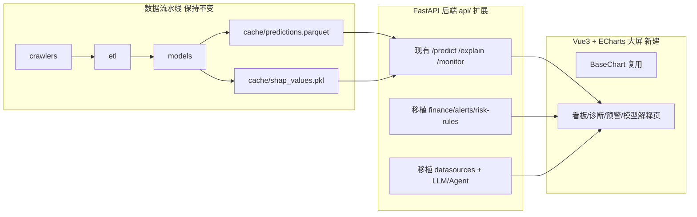

## 产品概述

产出一份完整的 Markdown 开发设计文档（置于新项目 `docs/` 目录下），用于指导将 `financial-risk-warning-platform` 的展示层从 Streamlit 一次性迁移为 Vue3 + ECharts 专业大屏/看板，并系统性复用旧项目 `risk-warning-platform` 的前端组件骨架与后端服务能力。

## 核心内容

- **总体架构设计**：明确 Vue3 前端 + FastAPI 后端 + 现有数据流水线（crawlers/etl/models）的分层架构与数据流
- **Vue3 大屏前端设计**：组件复用映射（BaseChart/Dashboard/Finance/Enterprise/Alerts）、深色主题与风险等级色板、页面划分与布局
- **后端服务复用与移植映射**：财务分析、预警闭环、规则评分、数据源接入、LLM/Agent 研判五项服务的移植方案
- **前后端接口契约**：API 路由清单、请求/响应结构、数据字段映射表
- **分阶段实施路线与风险对策**：可执行的任务拆解、依赖关系、回退策略
- **来源标注与文档衔接**：对每项内容标注"复用/移植/新建"三类来源，并与现有 `docs/` 文档建立引用关系

## 技术方案概述

本任务为**设计文档撰写**，交付物是单份 Markdown 文档 `docs/大屏平台开发设计方案.md`。文档中要描述的目标技术方案如下：

### 目标架构

### 关键决策

- **展示层直接迁移**：以旧项目 `web/` 为骨架，保留 Vue 3.5 + TypeScript + Vite + ECharts 6 技术栈，删除 chat/mcp/plugins 等工作台扩展，聚焦大屏看板场景
- **后端统一到新项目 FastAPI**：不引入旧项目 Rust/Python 服务进程，而是把旧项目 `server/app/services/` 中五项服务**移植**进新项目 `api/`，复用其算法与数据源逻辑，并与新项目 XGBoost 模型评分融合
- **数据流水线不动**：crawlers/etl/models 及 parquet/pkl 数据资产保持不变，通过 FastAPI 统一对外暴露

### 撰写要点

- 文档需准确引用已探索确认的路径与符号，不得虚构接口或字段
- 服务复用采用"移植"策略：算法逻辑整体搬迁 + 数据源适配新项目契约，而非运行时依赖旧项目
- 接口契约章节需对照旧项目 `web/src/api.ts` 与新旧 FastAPI 现有路由，给出精确的路由与字段映射
- 与现有 `docs/FastAPI服务层设计.md`、`docs/前端架构与图表方案.md`、`docs/数据字典与特征口径.md` 建立引用关系，避免口径冲突

## 使用的扩展

### SubAgent

- **code-explorer**
- 用途：深读新旧两个项目的关键源文件，提取精确的 API 契约、Vue 组件结构、主题色板、字段/特征映射，形成可写入文档的复用与移植映射底稿
- 预期结果：拿到旧项目 `web/src/api.ts`、`web/src/views/*.vue`、`server/app/services/*.py` 与新项目 `api/schemas.py`、`api/services.py`、`config/feature_registry.py`、`streamlit_app/utils/*.py` 的准确接口与字段清单