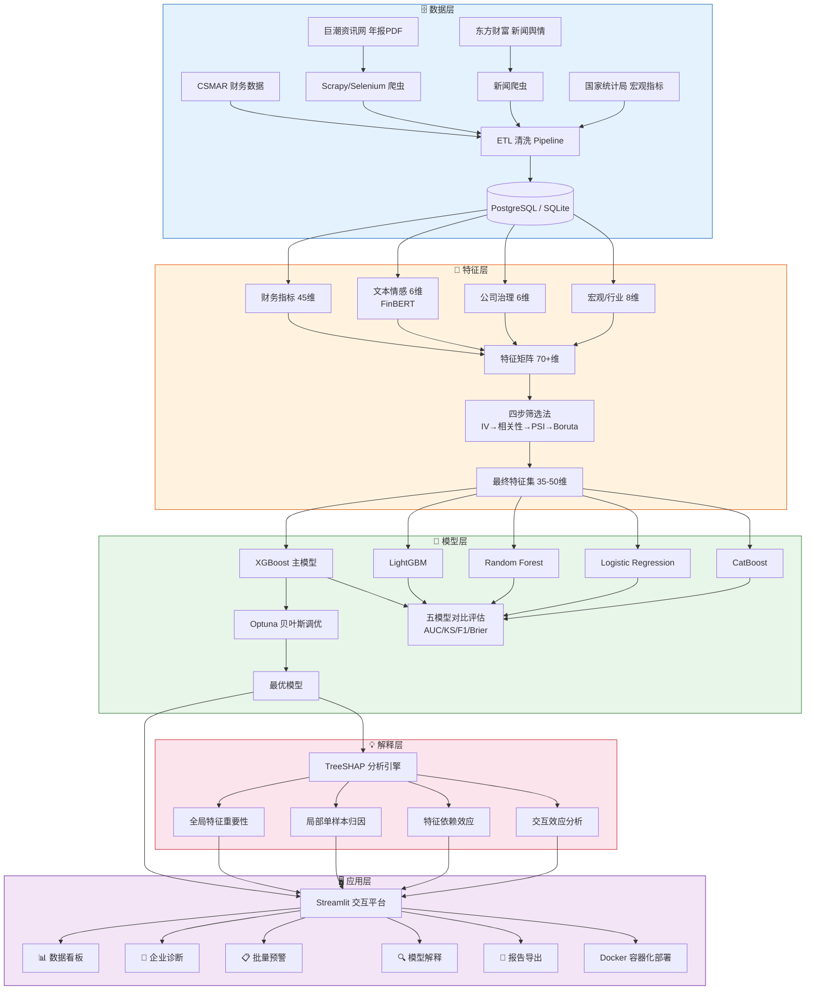

# 🏦 上市公司财务风险智能预警平台

> 基于 XGBoost + SHAP 可解释性分析的上市公司财务风险智能预警系统，融合多源异构数据与机器学习技术，提供从数据采集、特征工程、模型预测到交互式可视化的一站式解决方案。

[](./LICENSE)
[](https://www.python.org/)
[](https://streamlit.io/)
[](https://xgboost.readthedocs.io/)
[](https://shap.readthedocs.io/)

---

## 📌 项目简介

上市公司财务风险预警是资本市场健康运行的重要保障。传统 Z-score、Logistic 回归等方法在非线性关系捕捉和多维信息融合方面存在局限，而深度学习等"黑箱"模型又难以满足金融监管对可解释性的刚性要求。

本项目以**沪深A股制造业上市公司**为研究对象，构建了覆盖 **70+ 维特征**（财务指标、文本情感、公司治理、宏观环境）的多源异构数据体系，采用 **XGBoost** 作为核心预测模型，通过 **SHAP（SHapley Additive exPlanations）** 实现四维度可解释性分析，并基于 **Streamlit** 开发了包含数据看板、企业诊断、批量预警、模型解释和报告导出五大模块的交互式智能预警平台。

核心价值：在保证预测精度（OOT AUC ≥ 0.85）的同时，实现深度可解释性，弥合学术研究与实务应用之间的落地鸿沟。

---

## ✨ 功能特性

- 📊 **数据看板** — 行业风险热力图、年度 ST 趋势、TOP20 高风险企业、宏观经济仪表盘
- 🏢 **单企业诊断** — 风险评级卡片、六维雷达图、SHAP 归因瀑布图、历史风险轨迹追踪
- 📋 **批量预警** — 支持 CSV 上传或股票代码批量输入，一键评分并输出风险等级分布
- 🔍 **SHAP 可解释性** — 全局特征重要性、局部单样本归因、特征依赖效应、交互效应热力图
- 📄 **报告导出** — 单企业 PDF 风险诊断报告、批量 Excel 预警清单、模型评估报告
- ⚙️ **Docker 部署** — 一键容器化部署，确保环境一致性和答辩现场可靠性
- 🔄 **模型监控** — PSI 漂移检测、定期重训练机制，保障模型长期稳定性

---

## 🏗️ 系统架构



---

## 🛠️ 技术栈

| 类别 | 技术组件 | 版本 | 用途 |
|------|---------|------|------|
| **数据采集** | Scrapy + Selenium | 2.11 / 4.15 | 年报PDF下载、动态页面爬取 |
| **文本解析** | pdfplumber | 0.10 | 年报PDF文本提取 |
| **NLP** | Transformers (FinBERT) + jieba | 4.36 / 0.42 | MD&A文本情感分析 |
| **数据处理** | Pandas + NumPy + SQLAlchemy | 2.1 / 1.26 / 2.0 | ETL清洗、特征构建、数据存储 |
| **特征筛选** | Boruta + scikit-learn | 0.3 / 1.3 | IV/PSI/Boruta 四步特征筛选 |
| **机器学习** | XGBoost + LightGBM + CatBoost | 2.0 / 4.1 / 1.2 | 五模型对比、风险预测 |
| **超参数优化** | Optuna | 3.5 | TPE贝叶斯搜索 + MedianPruner剪枝 |
| **不平衡处理** | imbalanced-learn | 0.11 | SMOTE过采样（仅训练集） |
| **可解释性** | SHAP | 0.43 | TreeSHAP四维度分析 |
| **可视化前端** | Streamlit + Plotly + Matplotlib | 1.29 / 5.18 / 3.8 | 五模块交互式平台 |
| **报告生成** | ReportLab + Jinja2 | 4.0 / 3.1 | PDF/Excel报告导出 |
| **容器化** | Docker + Docker Compose | - | 一键部署、环境一致性 |

---

## 🚀 快速开始

### 环境要求

- Python ≥ 3.10
- Docker & Docker Compose（可选，用于容器化部署）
- CSMAR 数据库访问权限（或其他财务数据源）

### 安装步骤

```bash
# 1. 克隆项目
git clone https://github.com/your-username/financial-risk-warning-platform.git
cd financial-risk-warning-platform

# 2. 创建虚拟环境
python -m venv .venv
source .venv/bin/activate  # Linux/Mac
# .venv\Scripts\activate   # Windows

# 3. 安装依赖
pip install -r requirements.txt

# 4. （可选）准备数据
# 将CSMAR导出的数据放入 data/raw/ 目录
# 运行爬虫获取年报文本数据
python crawlers/cninfo_spider.py

# 5. 运行ETL与模型训练
python etl/feature_engineering.py
python models/train.py
python models/shap_analysis.py
```

### 启动平台

```bash
# 方式一：直接启动
streamlit run streamlit_app/app.py --server.port 8501

# 方式二：Docker 部署（推荐）
docker compose up -d --build
# 访问 http://localhost:8501
```

### Docker 离线部署（答辩场景）

```bash
# 提前导出镜像到U盘
docker save risk-warning-platform:latest -o risk_platform_v1.0.tar

# 答辩现场加载并启动
docker load < risk_platform_v1.0.tar
docker compose up -d
```

---

## 📁 项目结构

```
financial-risk-warning-platform/
├── data/                        # 数据目录
│   ├── raw/                     # 原始数据（CSMAR导出、爬虫下载）
│   ├── cleaned/                 # 清洗后数据
│   ├── feature_store/           # 特征矩阵（Parquet格式）
│   └── external/                # 外部数据（宏观指标等）
├── crawlers/                    # 爬虫模块
│   ├── cninfo_spider.py         # 巨潮资讯网年报爬虫
│   ├── eastmoney_spider.py      # 东方财富新闻爬虫
│   ├── qichacha_spider.py       # 企查查司法风险爬虫
│   └── config/                  # 爬虫配置（代理池、UA列表）
├── etl/                         # 数据处理模块
│   ├── clean_financial.py       # 财务数据清洗
│   ├── clean_text.py            # 文本数据清洗
│   ├── feature_engineering.py   # 70+维特征构建
│   └── feature_selection.py     # 四步特征筛选
├── models/                      # 模型模块
│   ├── train.py                 # 五模型训练与对比
│   ├── evaluate.py              # 模型评估（AUC/KS/F1/Brier）
│   ├── shap_analysis.py         # SHAP四维度分析
│   ├── monitor.py               # PSI漂移监控
│   └── artifacts/               # 模型权重、评估报告
├── streamlit_app/               # Streamlit 平台
│   ├── app.py                   # 主入口
│   ├── pages/
│   │   ├── 1_dashboard.py       # 📊 数据看板
│   │   ├── 2_diagnosis.py       # 🏢 企业诊断
│   │   ├── 3_batch_screening.py # 📋 批量预警
│   │   ├── 4_model_explain.py   # 🔍 模型解释
│   │   └── 5_report_export.py   # 📄 报告导出
│   ├── components/              # 可复用UI组件
│   ├── utils/                   # 工具函数
│   └── static/                  # 静态资源
├── reports/                     # 导出的PDF/Excel报告
├── cache/                       # SHAP缓存、预计算结果
├── notebooks/                   # 探索性分析 Jupyter Notebook
├── tests/                       # 单元测试
├── docs/                        # 使用手册、API文档
├── Dockerfile                   # Docker镜像构建文件
├── docker-compose.yml           # Docker Compose编排文件
├── requirements.txt             # Python依赖清单
└── README.md                    # 项目说明文档
```

---

## 📊 数据说明

### 数据来源

| 数据类型 | 来源 | 获取方式 |
|---------|------|---------|
| 财务报表数据 | CSMAR / Wind | API / Excel导出 |
| 公司治理数据 | CSMAR | API |
| ST/*ST标记 | CSMAR / 交易所公告 | API |
| 年报全文PDF | 巨潮资讯网 | Scrapy爬虫 |
| 财经新闻/舆情 | 东方财富 / 新浪财经 | Scrapy爬虫 |
| 宏观经济指标 | 国家统计局 / Wind | API |
| 司法/合规风险 | 企查查 / 天眼查 | Selenium爬虫 |

### 样本范围

- **行业**：沪深A股制造业上市公司（证监会行业分类C类），剔除金融业、房地产业
- **时间跨度**：2015–2024年（训练集2015–2022，验证集2023，测试集2024）
- **标签定义**：T年被实施ST/*ST处理作为正样本，使用T-2年及更早数据预测以避免前视偏差
- **样本配对**：1:3近邻匹配（匹配变量：行业、年份、总资产对数），预计约5,000条公司-年观测值

### 特征体系

共构建 **70+ 维**原始特征，经四步筛选法（IV值 → 相关性去冗余 → PSI稳定性 → Boruta重要性）保留 **35–50 维**最终特征：

| 维度 | 特征数 | 代表性指标 |
|------|-------|-----------|
| 偿债能力 | 10 | 流动比率、资产负债率、利息保障倍数 |
| 盈利能力 | 10 | ROA、ROE、毛利率、EBITDA利润率 |
| 营运能力 | 10 | 应收账款周转率、存货周转率、现金转换周期 |
| 成长能力 | 8 | 营收增长率、净利润增长率、研发费用增长率 |
| 现金流 | 7 | 经营现金流/净利润、自由现金流/总资产 |
| 文本情感 | 6 | MD&A正面/负面/不确定性得分（FinBERT） |
| 公司治理 | 6 | 股权集中度、独董比例、管理层持股 |
| 审计/市场/司法 | 8 | 审计意见类型、年换手率、涉诉次数 |
| 宏观/行业 | 8 | GDP增速、PMI、行业平均ROA |

---

## 🤖 模型说明

### 算法选择理由

| 模型 | 角色 | 选择依据 |
|------|------|---------|
| **XGBoost** | 主模型 | 表格数据性能优异（Grinsztajn et al., 2022）；SHAP原生支持；文献验证充分 |
| LightGBM | 强基线 | 训练速度快3–5倍；Leaf-wise策略在小样本上可能更优 |
| Random Forest | 集成基线 | 对超参数不敏感；天然处理非线性 |
| Logistic Regression | 传统基线 | Ohlson O-Score经典方法；可解释性最强 |
| CatBoost | 对照模型 | 类别特征原生支持；过拟合控制较好 |

### 评估指标

| 指标 | 合格线 | 优秀线 | 说明 |
|------|-------|-------|------|
| AUC-ROC | ≥ 0.85 | ≥ 0.90 | 阈值无关的综合判别力 |
| KS统计量 | ≥ 0.40 | ≥ 0.50 | 金融风控行业标准 |
| F1-Score | ≥ 0.60 | ≥ 0.75 | 兼顾精确率和召回率 |
| Brier Score | ≤ 0.15 | ≤ 0.10 | 概率校准质量 |

### 验证策略

- **5折 TimeSeriesSplit** 交叉验证（避免未来信息泄露）
- **时间序列外验证（OOT）**：2023年验证集 + 2024年测试集
- **稳健性检验**：更换标签定义、特征集、模型、匹配比例
- **安慰剂检验**：随机打乱标签后 AUC ≈ 0.5

### SHAP 可解释性

基于 TreeSHAP 构建四维度分析体系：

1. **全局特征重要性**：SHAP值绝对值均值排序，识别Top20关键风险因子
2. **局部单样本归因**：Waterfall Plot将风险评分分解为各特征正/负向贡献
3. **特征依赖效应**：Dependence Plot揭示非线性阈值和拐点
4. **交互效应**：Interaction Values热力图发现特征间协同/拮抗关系

---

## 💻 使用示例

### 单企业风险诊断

```python
# 在Streamlit平台中输入股票代码，即可获得：
# 1. 风险评级卡片（高/中/低 + 评分 + 同行业排名）
# 2. 六维雷达图（偿债/盈利/营运/成长/现金流/治理）
# 3. SHAP瀑布图（哪些因素推高/拉低了风险评分）
# 4. 历史风险轨迹（近5年风险评分变化趋势）
```

<!-- 截图占位：替换为实际平台截图 -->
<!--  -->

### SHAP 全局特征重要性

```python
import shap

# 全局Top20特征重要性
shap.summary_plot(shap_values, X_all, max_display=20, show=False)

# 单企业归因瀑布图
shap.waterfall_plot(
    shap.Explanation(
        values=shap_values[idx],
        base_values=explainer.expected_value,
        feature_names=X_all.columns.tolist()
    ),
    max_display=15, show=False
)
```

<!-- 截图占位：替换为实际SHAP可视化截图 -->
<!--  -->

### 批量预警

```bash
# 上传包含股票代码的CSV文件，一键批量评分
# 支持最多500只股票，响应时间 < 3秒
# 结果可导出为Excel/PDF格式
```

---

## 🗓️ 开发计划

| 阶段 | 周次 | 核心任务 | 交付物 |
|------|------|---------|-------|
| **阶段一** | W1–W3 | 数据采集与预处理 | 清洗后面板数据集（≥5,000条） |
| **阶段二** | W3–W6 | 特征工程与模型训练 | 最优模型 + SHAP分析结果 |
| **阶段三** | W5–W9 | Streamlit平台开发 | 五模块平台 + Docker镜像 |
| **阶段四** | W8–W14 | 实证检验与论文撰写 | 论文终稿 + 答辩材料 |

### TODO

- [x] 数据采集Pipeline搭建（CSMAR + 爬虫）
- [x] 70+维特征体系构建
- [x] 四步特征筛选法实现
- [x] 五模型对比实验框架
- [x] XGBoost + Optuna贝叶斯调优
- [x] SHAP四维度分析集成
- [x] Streamlit五大模块开发
- [x] Docker容器化部署
- [ ] 文本情感增量价值分组检验
- [ ] PSI模型监控自动化
- [ ] 在线增量更新机制
- [ ] 单元测试覆盖率 > 80%

---

## 📚 参考文献

1. **Altman, E. I.** (1968). Financial Ratios, Discriminant Analysis and the Prediction of Corporate Bankruptcy. *The Journal of Finance*, 23(4), 589–609.
2. **Lundberg, S. M., & Lee, S.-I.** (2017). A Unified Approach to Interpreting Model Predictions. *Advances in Neural Information Processing Systems*, 30.
3. **Grinsztajn, L., Oyallon, E., & Varoquaux, G.** (2022). Why Do Tree-Based Models Still Outperform Deep Learning on Tabular Data? *Advances in Neural Information Processing Systems*, 35.
4. **Gunnarsson, B. R., et al.** (2021). Understanding Credit Risk Modeling: A Comparative Study of Machine Learning Methods. *Expert Systems with Applications*, 185, 115636.
5. **Lundberg, S. M., et al.** (2020). From Local Explanations to Global Understanding with Explainable AI for Trees. *Nature Machine Intelligence*, 2(1), 56–67.

---

## 🙏 致谢与声明

### 致谢

感谢导师在项目选题、方法论指导和论文撰写过程中的悉心指导。感谢实验室同学在数据收集和代码调试方面的帮助。

### 学术用途声明

本项目为**大数据财务方向研究生毕业设计**成果，仅供学术研究和教学参考使用。平台输出的风险预警结果不构成任何投资建议或信用评级意见，使用者应结合自身专业判断做出决策。

### 数据来源声明

本项目的财务数据来源于 CSMAR 数据库，年报文本来源于巨潮资讯网公开披露信息，宏观数据来源于国家统计局。所有数据均为合法公开渠道获取，不涉及内幕信息或非公开数据。数据使用遵循相关数据库的服务条款和学术引用规范。

### AI辅助声明

项目实施过程中使用了AI工具辅助代码编写、文档撰写和方案设计。所有AI生成内容均经过人工审核、验证和调整，核心研究设计、实验方案和学术结论由作者独立完成。

---

## 📄 License

本项目采用 [MIT License](./LICENSE) 开源许可。

```
MIT License

Copyright (c) 2024 Financial Risk Warning Platform

Permission is hereby granted, free of charge, to any person obtaining a copy
of this software and associated documentation files (the "Software"), to deal
in the Software without restriction, including without limitation the rights
to use, copy, modify, merge, publish, distribute, sublicense, and/or sell
copies of the Software, and to permit persons to whom the Software is
furnished to do so, subject to the following conditions:

The above copyright notice and this permission notice shall be included in all
copies or substantial portions of the Software.

THE SOFTWARE IS PROVIDED "AS IS", WITHOUT WARRANTY OF ANY KIND, EXPRESS OR
IMPLIED, INCLUDING BUT NOT LIMITED TO THE WARRANTIES OF MERCHANTABILITY,
FITNESS FOR A PARTICULAR PURPOSE AND NONINFRINGEMENT. IN NO EVENT SHALL THE
AUTHORS OR COPYRIGHT HOLDERS BE LIABLE FOR ANY CLAIM, DAMAGES OR OTHER
LIABILITY, WHETHER IN AN ACTION OF CONTRACT, TORT OR OTHERWISE, ARISING FROM,
OUT OF OR IN CONNECTION WITH THE SOFTWARE OR THE USE OR OTHER DEALINGS IN THE
SOFTWARE.
```
