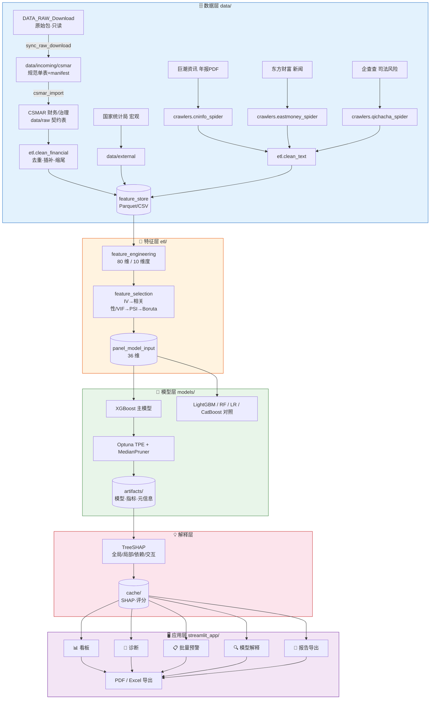
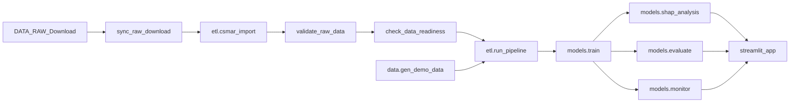

<div align="center">

# 🏦 上市公司财务风险智能预警平台

### Financial Risk Intelligent Early-Warning Platform for Listed Companies

> 基于 **XGBoost + SHAP** 的上市公司财务风险预警系统：融合 **80 维候选 / 36 维入选**的多源异构特征，提供从数据采集、特征工程、模型训练到交互式解释与报告导出的一站式解决方案。

[](./LICENSE)
[](https://www.python.org/)
[](https://streamlit.io/)
[](https://fastapi.tiangolo.com/)
[](https://vuejs.org/)
[](https://xgboost.readthedocs.io/)
[](https://shap.readthedocs.io/)
[](https://www.docker.com/)
[](./tests)

</div>

---

<a id="toc"></a>

## 📑 目录

| 板块 | 章节 |
|:---:|:---|
| 🏁 **概览** | [项目简介](#intro) · [功能特性](#features) |
| 🚀 **上手** | [快速开始](#quickstart) · [系统架构](#architecture) |
| 🔧 **工程** | [技术栈](#stack) · [项目结构](#tree) · [复现清单](#reproduce) |
| 📊 **数据与模型** | [数据说明](#data) · [模型与评估](#model) · [可解释性](#shap) |
| 📚 **附录** | [文档索引](#docs) · [常见问题](#faq) · [开发计划](#roadmap) · [参考文献](#references) · [声明与许可](#disclaimer) |

---

<a id="intro"></a>

## 📌 项目简介

传统 Z-score、Logistic 回归在非线性关系捕捉与多维信息融合上存在局限，深度学习等"黑箱"模型又难以满足金融监管对可解释性的刚性要求。本项目以**沪深 A 股制造业上市公司**为研究对象，构建覆盖**偿债、盈利、营运、成长、现金流、文本情感、公司治理、审计市场司法、宏观行业、数字化转型**十大维度的特征体系（80 维候选、四步筛选后 36 维入选），以 **XGBoost** 为主模型，通过 **TreeSHAP** 实现四维度可解释性分析，并提供**双前端**落地：**Streamlit**（快速原型、离线可用）与 **Vue 3 + FastAPI**（生产化前后端，`web/` + `api/`）。

**核心主张**：在保证预测精度（OOT AUC ≥ 0.85、KS ≥ 0.40）的同时，让每一个风险评分都可被拆解、审计与追溯。

### 核心指标速览

| 🎯 测试集 AUC | 📈 KS | 🔎 Recall@Top10 | 🧬 特征维度 | ✅ 就绪体检 |
|:---:|:---:|:---:|:---:|:---:|
| **0.8962** | **0.6609** | **66.93%** | 80 → **36** | PASS 26 / WARN 1 / BLOCK 0 |

> 以上为当前真实数据产物 `run_id=20261114-213525-da08d92c`（50 trials）的 2023 留出测试结果；训练现在即可复现，详见 [模型与评估](#model)。

**三个关键工程决策**：

| 决策 | 做法 | 为什么 |
|------|------|--------|
| 防前视偏差 | T 年 ST 标签 ↔ T-2 年特征 | ST 判定依据 T-1 年年报，年报于 T 年 4 月才披露，用 T 年特征会泄露未来信息 |
| 防过拟合 | 按年分组扩展窗口 CV + 2022 OOT + 2023 留出测试（2024 锁箱） | 财务数据强时序依赖，随机 K 折会让模型“看到未来”；2024 标签尚未披露，不能伪报测试指标 |
| 防口径漂移 | 特征元数据集中在 `config/feature_registry.py` | ETL、模型、前端、文档同源，避免"代码一套、论文一套" |

---

<a id="features"></a>

## ✨ 功能特性

| 模块 | 能力 |
|------|------|
| 📊 **数据看板** | 行业风险分布、行业 × 年度热力图、年度 ST 趋势、TOP-N 高风险企业、宏观环境雷达、数据质量监控 |
| 🏢 **企业诊断** | 风险评级卡片、六维健康度雷达（同侪分位）、SHAP 归因瀑布图、历史风险轨迹、核心指标同业对标 |
| 📋 **批量预警** | 粘贴代码 / 上传 CSV、阈值实时调节、风险等级分布、Excel/CSV 一键导出 |
| 🔍 **模型解释** | 全局重要性（特征 + 维度双视角）、依赖效应、交互强度、五模型对比、校准曲线、PSI 漂移监控 |
| 📄 **报告导出** | 单企业 PDF 诊断报告（内置中文字体，无外部依赖）、批量 Excel（含汇总 Sheet）、评估报告、数据字典 |
| ⚙️ **工程能力** | 一键 Docker 部署、115 项单元测试、四步特征筛选证据链、概率校准与成本阈值、模型元信息与运行清单留痕（数据/特征 hash、参数、阈值） |
| 🔐 **认证与权限** | JWT 双令牌（access 30min + refresh 7d 轮换）+ 四角色分权（管理员/分析师/审计员/查看者）+ **17 权限点**矩阵 + 集中式路由鉴权闸门 + 登录锁定/防枚举 + 审计日志 + 查看者导出水印 |
| 🔌 **FastAPI 服务层** | 100+ 端点（12 个路由包）：评分/解释/监控 + 财务分析/规则评分/预警闭环 + 企业/看板/审计 + 数据接入 + 平台扩展；前端可 API 优先、失败回退本地（**注**：`/predict/frame` what-if 反向模拟当前返回 501 尚未实现） |
| 📡 **数据实时接入** | 三通道：scheduler 定时拉取 + `/ingest/v1` X-API-Key 机器推送（幂等 + 质量闸门）+ SSE 事件流；接入→重打分→预警闭环 |
| 🤖 **LLM 智能研判** | 工具调用型 Agent（`api/agent/`）：5 步上限、19 个内置工具、工具结果 6000 字符截断、写操作人工审批；配 16 个会话管理端点与多模态附件视觉识别（`/attachments/{id}/read`） |
| 🔌 **MCP 接入** | 双向：作为客户端接入外部 MCP 服务并同步工具清单（`mcp_<tool>`）；同时通过 `POST /mcp` 把本平台评分/解释能力对外暴露为 MCP 工具 |
| 🧩 **插件与技能** | 插件工具 CRUD + 预设（工具白名单 + 方法论）组合 + 导入导出；技能（Skill）可被 Agent 动态发现与加载 |
| 🗂️ **工作台与协作** | 智能工作台（会话 / 表格 / 附件 / 插件 / 技能统一入口）、表格在线编辑与入库、只读分享链接与有效期控制、会话导出 md/json |
| 🖥️ **Vue 3 前端** | **12 视图 SPA**（Vite + TypeScript + ECharts）：数据看板 / 企业列表 / 企业诊断 / 预警中心 / 模型解释 / 财务分析 / 报告导出 / **智能工作台** / 数据接入中心 / 用户与角色 / 登录页 / 403 页，含按权限点过滤的路由守卫 |

---

<a id="quickstart"></a>

## 🚀 快速开始

> **先选路径**：7 种启动方式覆盖从"看效果"到"生产交付"的全部场景。不确定从哪开始时，按下面的速查表对号入座。

| 你的目标 | 推荐方式 | 前置条件 | 访问地址 |
|:---|:---|:---|:---|
| 日常改代码、前后端联调 | [0 · 本地联调](#start-dev) | Python + Node | `localhost:5173` |
| 3 分钟跑通全链路、只看效果 | [方式一 · 演示模式](#start-demo) | 仅 Python | `localhost:8501` |
| 接入 CSMAR 真实数据 | [方式二 · 真实数据](#start-real) | CSMAR 数据权限 | `localhost:8501` |
| 答辩演示 / 一键交付 | [方式三 · Docker](#start-docker) | Docker | `localhost:8501` |
| 服务化、供多端复用 | [方式四 · FastAPI](#start-api) | Python | `localhost:8000` |
| 生产化前端 SPA | [方式五 · Vue 3](#start-vue) | Python + Node | `localhost:5173` |
| 打包成桌面安装包 | [方式六 · Electron](#start-desktop) | Python + Node | 本地 `.exe` |

<a id="start-dev"></a>

### 0. 本地开发联调：后端 + 前端（日常开发推荐）

需要两个终端。**终端 1 启动后端**（Windows PowerShell）：

```powershell
cd D:\CodingEmber\financial-risk-warning-platform
.\.venv\Scripts\Activate.ps1                       # 激活虚拟环境（PowerShell 用 .ps1）
python -m uvicorn api.main:app --host 0.0.0.0 --port 8000 --reload
```

> 关键点：**必须用 `python -m uvicorn`，不要裸敲 `uvicorn`**。`uvicorn.exe` 装在 `.venv\Scripts\`，未激活时不在 PATH，会报「术语 'uvicorn' 不会被识别」。若 `Activate.ps1` 被执行策略拦截，直接跳过激活：`.\.venv\Scripts\python.exe -m uvicorn api.main:app --port 8000 --reload`。

**终端 2 启动前端**：

```powershell
cd D:\CodingEmber\financial-risk-warning-platform\web
npm install
npm run dev                                        # → http://localhost:5173
```

浏览器打开 **http://localhost:5173**，用初始管理员 **`admin` / `admin12345`** 登录（可用环境变量 `RISK_ADMIN_PASSWORD` 覆盖口令）。前端 `/auth`、`/predict` 等请求由 Vite 代理到 `127.0.0.1:8000`。

> 若前端报 `ECONNREFUSED 127.0.0.1:8000`，说明后端没起来（端口未监听），先完成终端 1 再刷新页面。

---

<a id="start-demo"></a>

### 方式一：演示模式（3 分钟跑通全链路，无需任何数据权限）

```bash
# 1. 环境
python -m venv .venv
source .venv/bin/activate          # Windows: .venv\Scripts\activate
pip install -r requirements.txt

# 2. 数据 + 特征（自动生成结构真实的演示数据：240 家公司 × 10 年）
python -m etl.run_pipeline

# 3. 训练 + 评估 + 解释
python -m models.train --trials 30
python -m models.evaluate
python -m models.shap_analysis

# 4. 启动平台
streamlit run streamlit_app/streamlit_app.py
# 浏览器打开 http://localhost:8501
```

一键等价命令：

```bash
make all      # data → pipeline → train → evaluate → shap（仅空目录演示）
make app      # 启动平台
make test     # 115 项单元测试
```

> 已有真实数据时 **不要** 跑 `make all`：`data.gen_demo_data` 会检测到 `data/raw/csmar_financial.csv` 并拒绝覆盖（确需覆盖加 `--force`，会先备份到 `data/demo_raw/backup_*`）。真实数据链路用 `make pipeline` 起。

<a id="start-real"></a>

### 方式二：接入真实数据（CSMAR 原始包）

数据分三层落地，**下载区只读、暂存区规范、契约区稳定**：

```text
DATA_RAW_Download/           ① 落地区：CSMAR 原始包解压后原样放入（不改名、不入库）
  └─ 资产负债表233415143.../FS_Combas.csv
data/incoming/csmar/raw/     ② 暂存区：sync 脚本规范化命名 + manifest（行数/SHA256/来源）
data/raw/*.csv               ③ 契约区：ETL 唯一读取入口（snake_case 主键 stock_code + year）
```

```bash
# 1) 原始包放入 DATA_RAW_Download/ 后，先预演再执行规范化
python -m scripts.sync_raw_download            # 预演：识别表、分片、行数
python -m scripts.sync_raw_download --write    # 执行：硬链接/流式拼接 + manifest

# 2) 现金流量表 XLSX → CSV（约 7 分钟），再解码写契约表
python -m scripts.convert_csmar_xlsx
python -m etl.csmar_import --step all --write

# 2.5) 口径补丁（重导入后必跑，幂等、自动备份）
python -m scripts.import_comscfi_official --write   # 官方折旧（FS_Comscfi，覆盖 99.94%）
python -m scripts.fix_interest_debt --write         # 带息债务口径（lt_debt 覆盖 100%）

# 3) 质量校验 + 训练就绪体检（G0–G5，BLOCK 会返回非零退出码）
python -m scripts.validate_raw_data
python -m scripts.check_data_readiness

# 4) 特征工程 + 四步筛选
python -m etl.run_pipeline
```

若导出文件已经是合约列名的合并表（而非 CSMAR 原始分表），改用通用映射层：

```bash
python -m etl.mapping --source D:\csmar\export --dry-run
python -m etl.mapping --source D:\csmar\export --write
```

> ### ✅ 当前真实数据状态 · 2026-11-15
> 已通过训练就绪体检：**PASS 26 / WARN 1 / BLOCK 0**，唯一 WARN 为 2024 锁箱待 2026 标签。

| 项 | 数值 |
|---|---|
| 原始财务表 | 52,203 公司-年（2013–2025，5,643 家） |
| 建模面板 | 22,814 行 / 3,629 家 / 2015–2023，证监会 C 制造业 |
| 特征 | 80 维候选（10 维度）→ 四步筛选 36 维；**全零特征 0 个** |
| 标签 | 官方 ST 标签 48,290 公司-年，1,897 正（3.93%），来源 CSMAR `SPT_Trdchg` |
| 切分 | 训练 16,233（712 正）/ 验证 3,209（75 正）/ 测试 3,372（127 正） |
| 口径修正 | 折旧改用官方 `FS_Comscfi`（2015–2023 覆盖 99.94%）；有息负债改用 CSMAR 带息债务口径（覆盖 100%，`lt_debt` 长期借款回填后 100%） |
| 2023 留出测试 | AUC 0.8962、PR-AUC 0.3986、KS 0.6609、Recall@Top10 66.93%、ECE 0.0126（50 trials；30 trials 为 PR-AUC 0.4268） |
| 2024 锁箱 | 待 2026 官方 ST 标签，不报告指标 |

> 训练**现在就可以跑**（`python -m models.train --trials 30`，约 5 分钟）；上述测试指标来自当前产物 `run_id=20261114-213525-da08d92c`（50 trials），与 `run_manifest.json` 的数据 SHA256 绑定。
>
> 落地区（`DATA_RAW_Download/`）还有 3 张已核对、尚未入库的官方表：`FI_T1` 偿债能力（586,759 行，`F011501A` 带息债务比覆盖 100%）、`FS_Comscfi` 间接法（327,535 行，折旧 `D000103000` 覆盖 99.84%）、`TRD_Year` 年个股回报率（60,366 行）；它们可直接关闭"折旧/长期负债"两项口径缺口，命令 `python -m scripts.sync_raw_download --only FI_T1,FS_Comscfi,TRD_Year --write`。
>
> 仍待补：2026 官方标签（解锁 2024 锁箱）、扣非净利润官方表（FI_Indicators）、2025 年 MD&A 文本。
> 缺口明细、补齐命令与验收标准见 [`docs/数据缺口与补齐清单_20261114.md`](./docs/analysis/数据缺口与补齐清单_20261114.md)；
> 目录、清洗规则与质量门见 [`docs/数据治理与目录规范.md`](./docs/design/数据治理与目录规范.md)。

<a id="start-docker"></a>

### 方式三：Docker 部署（答辩/交付推荐）

```bash
docker compose up -d --build          # 首次启动会自动补齐数据与模型
# 访问 http://localhost:8501

# 离线答辩场景
docker save risk-warning-platform:1.0 -o risk_platform_v1.0.tar
docker load < risk_platform_v1.0.tar && docker compose up -d
```

<a id="start-api"></a>

### 方式四：FastAPI 服务（可选，供多端复用）

Streamlit 默认本地直连领域层；需要服务化时启动 FastAPI 后端：

```bash
# ⚠️ 用「python -m uvicorn」，不要裸敲 uvicorn（uvicorn.exe 在 .venv 里，未激活时不在 PATH）
python -m uvicorn api.main:app --host 0.0.0.0 --port 8000 --reload
# 或 docker compose up -d api
curl http://localhost:8000/health
curl -X POST http://localhost:8000/predict/codes -H "Content-Type: application/json" \
     -d '{"codes":["000004"],"year":2023}'
```

> **Windows 用户**：先激活虚拟环境再启动，PowerShell 用 `Activate.ps1`（不是 `Activate.bat`，那是 cmd 用）：
> ```powershell
> .\.venv\Scripts\Activate.ps1
> python -m uvicorn api.main:app --host 0.0.0.0 --port 8000 --reload
> ```
> 若 `Activate.ps1` 被执行策略拦截，可直接用 venv 内的解释器，无需激活：
> ```powershell
> .\.venv\Scripts\python.exe -m uvicorn api.main:app --host 0.0.0.0 --port 8000 --reload
> ```

- 契约：`docs/FastAPI服务层设计.md`；三层架构与图表方案：`docs/前端架构与图表方案.md`；功能/预测/UI 设计：`docs/平台功能与预测设计.md`。
- 前端切远程：设置 `RISK_API_URL=http://localhost:8000`（`utils/backend.py` 自动 API 优先、失败回退本地）。
- 图表：默认 Plotly；把 `echarts.min.js` 放入 `streamlit_app/components/echarts_local/` 后，数据看板可切换 ECharts（离线本地渲染，不依赖 CDN）。
- 服务层除核心接口外，还含 `/finance/*`（财务分析）、`/risk/rules/*`（规则六维评分）、`/alerts*`（预警闭环）等阶段 1 移植接口，实现在 `api/services/`（`finance.py` / `rules.py` / `alerts.py`）。

<a id="start-vue"></a>

### 方式五：Vue 3 前端（现代化 SPA，需 Node）

项目内置一个 Vue 3 单页应用（`web/`），开发期由 Vite 按前缀代理到 FastAPI：

```bash
# 1) 启动后端（务必用 python -m uvicorn，详见方式四）
python -m uvicorn api.main:app --port 8000

# 2) 安装依赖并启动前端（开发模式 → http://localhost:5173）
cd web && npm install && npm run dev

# 3) 构建产物（web/dist/，可交给任意静态服务器托管）
npm run build
```

- 首次启动后端会自动创建初始管理员 **`admin` / `admin12345`**（可用环境变量 `RISK_ADMIN_PASSWORD` 覆盖，登录后请立即修改）；前端登录后按角色进入各自可访问的首页。
- 九大视图：数据看板 / 企业列表 / 企业诊断 / 预警中心 / 模型解释 / 财务分析 / 报告导出 / 数据接入中心 / 用户与角色（路由见 `web/src/router.ts`，顶栏菜单按登录用户的权限点过滤）。
- 财务分析含杜邦分析、Altman Z/Z2、Piotroski、Beneish 与同业对标（对应 `api/services/finance.py`）。
- 全站配色统一由 `web/src/lib/theme.ts` 的 `C` 常量提供（primary `#2563eb` / ok `#16a34a` / warn `#d97706` / danger `#dc2626`），ECharts 坐标轴/图例/雷达分割线随浅色·深色主题自动切换。
- 根目录 `index.html` 为项目落地页（导航入口），"进入平台"指向 `web/dist/index.html`。

<a id="start-desktop"></a>

### 方式六：桌面端（Electron 多平台打包）

三种交付形态共用同一套 `/finance/*` 契约与同一领域层，桌面端只是把「后端 + SPA」打成一个安装包：

```bash
# 1) 构建前端
cd web && npm install && npm run build

# 2) 打包后端（PyInstaller 冻结成独立 exe，自带 runtime 数据资产）
pip install pyinstaller
python scripts/build_backend.py

# 3) 打包 Windows 安装包（nsis + portable）
cd desktop && npm install && npm run dist
# 产物：desktop/release/FinancialRiskWarningPlatform-1.0.0-x64-Setup.exe
```

- 后端启动优先级：`RWP_BACKEND` 环境变量 → 打包产物 `resources/backend/risk-backend[.exe]` → 项目 `.venv` → 系统 `python`。
- 打包形态下只读资产（面板数据、模型产物、评分缓存）从 `resources/backend/runtime/` 读取；可写资产（`alerts.db`、市值快照、报告）落在 Electron 的 `userData/data/` 目录。
- 自检：`cd desktop && npm run smoke`（仅拉起后端 + 健康检查）。

---

<a id="architecture"></a>

## 🏗️ 系统架构



> 应用层现为双前端：**Streamlit**（`streamlit_app/`，本地直连、离线可用）与 **Vue 3 SPA**（`web/`，经 **FastAPI**（`api/`）取数）。两者共用同一领域层 `models/`，服务层接口见 `api/main.py`。

### 数据流水线（命令级）



---

<a id="stack"></a>

## 🛠️ 技术栈

| 类别 | 组件 | 用途 |
|------|------|------|
| 数据采集 | requests（+可选 Scrapy/Selenium）、pdfplumber | 年报 PDF 下载与 MD&A 文本抽取 |
| 数据处理 | pandas、numpy、pyarrow、SQLAlchemy | ETL、特征构建、Parquet/CSV 双格式存储 |
| 特征筛选 | scikit-learn、boruta（可选） | IV / VIF / PSI / Boruta 四步筛选 |
| 机器学习 | XGBoost、LightGBM、CatBoost | 五模型对比，XGBoost 为主模型 |
| 超参优化 | Optuna（TPE + MedianPruner） | 贝叶斯搜索，替代网格/随机搜索 |
| 可解释性 | SHAP（TreeExplainer） | 四维度归因分析 |
| 前端（Streamlit） | Streamlit + Plotly（+ ECharts 本地化选配） | 五大模块快速原型，全中文图表、离线可用 |
| 前端（Vue SPA） | Vue 3 + Vite + TypeScript + vue-router + ECharts | 12 视图生产化前端（`web/`） |
| 服务层 | FastAPI + Pydantic + httpx | 评分/解释/监控 + 财务/规则/预警闭环 HTTP 接口 |
| 报告 | ReportLab（内置 CID 中文字体）、openpyxl、pandoc + python-docx | PDF/Excel 导出 + 论文 Word 生成 |
| 工程 | pytest、ruff、Docker Compose、Makefile | 测试、规范、部署、一键复现 |

---

<a id="tree"></a>

## 📁 项目结构

```
financial-risk-warning-platform/
├── DATA_RAW_Download/            # 📦 下载落地区（只读、不入库）：CSMAR 原始包原样存放
├── api/                          # 🔌 FastAPI 服务层（100+ 端点，12 个路由包）
│   ├── main.py                   #   FastAPI 入口 + 核心路由 + 中间件编排 + SPA 静态托管
│   ├── schemas.py                #   Pydantic 请求模型
│   ├── middleware.py             #   安全头 / 访问日志 / 登录闸门
│   ├── rate_limit.py             #   限流
│   ├── audit.py                  #   审计日志
│   ├── routers/                  #   路由包（12）：enterprises/finance/alerts/explain/dashboard/
│   │                             #   attachments/audit/chat/datasources/mcp/plugins/settings/
│   │                             #   share/skills/tables
│   ├── services/                 #   领域层薄封装（16）：核心评分/解释/监控 + 财务/规则/预警 +
│   │                             #   LLM/插件/技能/表格/附件/数据源
│   ├── auth/                     #   认证与授权（10）：JWT 双令牌 / RBAC 17 权限点 / 守卫 / 撤销
│   ├── agent/                    #   LLM Agent（8）：循环 / 工具注册 / 提示词 / 上下文 /
│   │                             #   会话 / 事件 / 审批
│   ├── llm/                      #   LLM 客户端封装与预热
│   ├── mcp/                      #   MCP 客户端与服务（工具同步、对外暴露）
│   ├── ingest/                   #   数据接入（事件 / 质量闸门 / 安全）
│   ├── worker/                   #   后台任务与调度
│   ├── db/                       #   数据库建表与种子数据
│   └── datasources/              #   数据源配置
├── config/                       # ⚙️ 全局配置（唯一事实来源）
│   ├── settings.py               #   路径（含落地区/暂存区）、样本窗口、阈值、随机种子
│   └── feature_registry.py       #   80 维特征元数据（中英文名/维度/方向/口径）
├── crawlers/                     # 🕷️ 数据采集
│   ├── base.py                   #   限速会话、重试、PDF 流式下载
│   ├── cninfo_spider.py          #   巨潮资讯年报 + MD&A 抽取
│   ├── eastmoney_spider.py       #   东方财富个股新闻
│   ├── qichacha_spider.py        #   企查查司法/处罚（API 模式）
│   └── config/user_agents.py     #   UA 池与站点限速
├── etl/                          # 🔧 数据处理
│   ├── io_utils.py               #   Parquet/CSV 读写（自动降级）+ 统一日志
│   ├── mapping.py                #   通用列名映射（已合并表 → 契约）
│   ├── csmar_import.py           #   CSMAR 原始分表解码：科目代码 → 契约列，三表合并
│   ├── stats_utils.py            #   IV / PSI / VIF / KS / 分箱
│   ├── clean_financial.py        #   去重、三级插补、样本剔除
│   ├── clean_text.py             #   情感打分规范化
│   ├── feature_engineering.py    #   80 维特征构建 + 标签对齐（T-2）
│   ├── feature_selection.py      #   四步筛选 + 证据链报告
│   └── run_pipeline.py           #   流水线编排（一条命令跑通数据层）
├── models/                       # 🤖 模型
│   ├── data.py                   #   时间切分（2015-21 / 2022 / 2023；2024 锁箱）
│   ├── metrics.py                #   AUC/KS/F1/Brier/ECE + 阈值选择 + 分群
│   ├── train.py                   #   五模型 + 按年扩展窗口 CV + 校准 + Optuna
│   ├── evaluate.py               #   评估报告（Markdown/CSV/JSON）
│   ├── predict.py                #   推理服务（批量/单企业/缓存）
│   ├── shap_analysis.py          #   SHAP 四维度 + 缓存
│   ├── monitor.py                #   PSI 漂移 + 性能衰减 + 处置建议
│   └── artifacts/                #   模型权重、指标、对比表、runs/<run_id>/ 快照
├── streamlit_app/                # 🖥️ 前端
│   ├── streamlit_app.py          #   首页（状态自检 + 模块导航）
│   ├── pages/                    #   1_数据看板 / 2_企业诊断 / 3_批量预警 / 4_模型解释 / 5_报告导出 / 6_金融分析
│   ├── components/layout.py      #   KPI 行、页头、下载按钮
│   ├── components/echarts_local/ #   ECharts 本地组件（离线渲染，无 CDN）
│   └── utils/                    #   data（缓存取数）/ charts（Plotly）/ backend（API·本地回退）
│                                 #   api_client / echarts_options / report（PDF·Excel）/ styles
├── web/                          # 🖥️ Vue 3 SPA 前端（Vite + TypeScript + ECharts）
│   ├── index.html                #   SPA 入口
│   ├── package.json              #   vue / vue-router / echarts + vite 工具链
│   ├── vite.config.ts            #   开发代理（/health /predict /finance /alerts ... → :8000）
│   ├── src/api.ts                #   API 客户端 + TypeScript 类型契约
│   ├── src/router.ts             #   12 视图路由 + 登录页 + 403 页 + 路由守卫（按权限点）
│   ├── src/lib/theme.ts          #   全站配色常量 C + 主题 token（浅/深色自适应）
│   ├── src/lib/levels.ts         #   风险等级 / 评级配色（取自 theme.ts 的 C）
│   ├── src/views/                #   Dashboard / Enterprises / Enterprise / Alerts / Explain / Finance /
│   │                             #   Report / Workspace（智能工作台）/ DataSource / Users / Login / Forbidden
│   └── dist/                     #   构建产物（可直接静态托管）
├── desktop/                      # 🖥️ 桌面端（Electron + 内嵌 FastAPI）
│   ├── main.js                   #   主进程：动态端口 / 拉起后端 / 健康检查 / 托盘 / 菜单
│   ├── preload.js                #   预加载（contextIsolation）
│   ├── scripts/build-web.js      #   构建 Vue 并拷贝到 resources/web
│   ├── scripts/build-backend.js  #   PyInstaller 打包后端到 resources/backend
│   ├── resources/                #   web（前端产物）/ backend（后端 exe + runtime 数据）
│   └── release/                  #   安装包产物（nsis / portable）
├── index.html                    # 🌐 项目落地页（导航到 web/dist 与文档）
├── data/                         # 🗄️ 数据（详见 data/README.md）
│   ├── gen_demo_data.py          #   演示数据生成器（潜在风险因子驱动）
│   ├── mapping/csmar.yaml        #   CSMAR 字段映射（别名/单位/编码）
│   ├── incoming/csmar/           #   暂存区：raw/（规范单表+manifest）、desc/（字段说明）、批次目录
│   ├── raw/                      #   契约层：ETL 唯一读取入口（candidates/ 存未激活增量）
│   ├── cleaned/  feature_store/  external/  versioned/  demo_raw/
├── docs/                         # 📚 文档（见下方"文档索引"与 docs/README.md）
│   ├── README.md                 #   📌 文档中心：四分区全量索引 + 状态标记 + 取代关系
│   ├── design/                   #   ① 研究与系统设计（19 篇 + adr/）：调研报告 / 实施方案 /
│   │                             #   中期可行性分析 / 开题蓝图 / 架构说明书 / 运维手册 /
│   │                             #   API 契约 / 模型卡片 / 测试矩阵 / Agent 设计 / 证据冻结清单 /
│   │                             #   ADR-001~010 / 文档编写规范 / 项目诊断与开发建议书
│   ├── analysis/                 #   ② 数据与可行性分析（7 篇）：CSMAR 下载清单 / 可行性报告 /
│   │                             #   字段说明 / 数据查缺 / 缺口与补齐清单 / 补齐进展 / ST 标签核验
│   ├── literature/               #   ③ 文献与资料：49 项资源清单 / 精读笔记 / papers/（29 篇 PDF 原文）
│   ├── Attachment/               #   ④ 论文交付包：论文_第1-4章.md / 论文_系统设计与实现.md /
│   │   │                         #   论文_参考文献.md + P 编号映射表 / 论文_全文.docx / 综述与理论奠基.md
│   │   └── ...                   #   毕业设计模板/样本/任务书等附件（按 .gitignore 不入库）
│   └── screenshots/              #   界面截图（dashboard / enterprises / enterprise / alerts /
│                                 #   explain / finance / report）
├── notebooks/01_探索性分析.ipynb  # 📈 EDA：样本漏斗/标签/IV/SMD/PSI/基线/可行性评分卡
├── scripts/sync_raw_download.py   # 📥 落地区 → 暂存区：规范命名 + 分片拼接 + manifest
├── scripts/import_comscfi_official.py # 🔧 G-03：FS_Comscfi 官方折旧替换（幂等、备份）
├── scripts/fix_interest_debt.py   # 🔧 G-04：CSMAR 带息债务口径 + lt_debt 回填
├── scripts/build_annual_market_features.py # 🔧 TRD_Year → 年行情候选（仅消融）
├── scripts/check_data_readiness.py# ✅ 训练就绪体检（G0–G5，BLOCK 返回码 1）
├── scripts/gen_data_dictionary.py # 🔁 文档自动生成
├── scripts/convert_csmar_xlsx.py  # 🔁 现金流量表 XLSX 流式转 CSV
├── scripts/validate_raw_data.py   # ✅ 原始数据质量校验（结构/主键/标签/覆盖）
├── scripts/thesis_md2docx.lua     # 📄 pandoc 过滤器：mermaid→占位、去排版说明
├── scripts/postprocess_docx.py    # 📄 论文 Word 后处理：A4/宋体黑体/三线表/目录标题
├── scripts/add_front_matter.py    # 📄 封面 + 原创性声明 + 中英文摘要
├── tests/                        # ✅ 115 项测试（含 API/认证/权限/接入/前端）
│   ├── conftest.py               #   内存面板夹具（不写盘、不依赖模型）
│   ├── test_feature_registry.py  #   特征口径一致性
│   ├── test_feature_engineering.py
│   ├── test_stats_utils.py       #   IV/PSI/VIF/KS 数学正确性
│   ├── test_metrics.py
│   ├── test_calibration.py       #   等渗/Platt 回退/交叉拟合
│   ├── test_io_and_pipeline.py
│   ├── test_api.py               #   FastAPI 接口冒烟（无模型自动跳过）
│   └── test_frontend_hybrid.py   #   backend 抽象 + ECharts option 工厂
├── docker/entrypoint.sh          # 容器启动自检（缺数据/模型自动补齐）
├── Dockerfile  docker-compose.yml
├── Makefile  pyproject.toml  requirements.txt  .env.example  LICENSE
└── README.md
```

---

<a id="data"></a>

## 📊 数据说明

### 数据来源

| 数据类型 | 首选来源 | 获取方式 |
|---------|---------|---------|
| 财务报表 / 公司治理 / ST 标记 | CSMAR | 导出 CSV |
| 年报全文 PDF | 巨潮资讯网 | `crawlers.cninfo_spider` |
| 财经新闻 / 舆情 | 东方财富 | `crawlers.eastmoney_spider` |
| 司法 / 合规风险 | 企查查 API（备选：信用公示系统、裁判文书网） | `crawlers.qichacha_spider` |
| 宏观经济指标 | 国家统计局 / Wind | 手动或 API 下载 |

### 样本范围

- **行业**：沪深 A 股制造业（证监会 C 类），剔除金融（J）、房地产（K）、综合（S）
- **窗口**：训练 2015-2021，验证 2022（OOT），测试 2023（仅最终评估一次），2024 锁箱
- **标签**：T 年被实施 ST/*ST 为正样本，特征取 T-2 年
- **配对**：当前主实验使用全样本（未实现 1:3 近邻匹配）；1:3/1:5 匹配仅作为后续稳健性检验计划

### 特征体系（80 维 / 10 个维度）

| 维度 | 特征数 | 代表性指标 |
|------|-------|-----------|
| 偿债能力 | 10 | 流动比率、速动比率、资产负债率、利息保障倍数、有息负债率 |
| 盈利能力 | 10 | ROA、ROE、毛利率、净利率、EBITDA 利润率、扣非占比、EPS |
| 营运能力 | 10 | 应收/存货/固定资产周转率、现金转换周期、应付天数 |
| 成长能力 | 8 | 营收/利润/资产/权益增速、3 年复合增速、资本支出/折旧 |
| 现金流 | 7 | 经营现金流/净利润、自由现金流/总资产、连续为负年数 |
| 文本情感 | 6 | MD&A 正/负面得分、不确定性、情感极性/波动率、前瞻性比例 |
| 公司治理 | 6 | 股权集中度、Z 指数、董事会规模、独董比例、两职合一 |
| 审计/市场/司法 | 8 | 审计意见、四大审计、审计费用率、年换手率、波动率、涉诉/处罚次数 |
| 宏观/行业 | 8 | GDP/M2/CPI/PPI/PMI、社融增速、行业 ROA 与杠杆偏离度 |
| 数字化转型 | 7 | 数字化词频总强度、AI/区块链/云/大数据/应用词频、MD&A 数字化词频 |

完整口径见 [`docs/数据字典与特征口径.md`](./docs/design/数据字典与特征口径.md)（由注册表自动生成）。

### 四步特征筛选（当前真实数据）

```
80 维 ──IV≥0.02──▶ 74 维 ──|r|≤0.85 & VIF≤10──▶ 65 维
      ──PSI≤0.25──▶ 55 维 ──RF 重要性（Boruta 不可用时降级）──▶ 36 维
```

> 全零特征已从旧面板的 21 个降为 **0 个**；`audit_opinion` 作为领域先验强制保留。

每一步的 IV、VIF、PSI、Boruta 结论都写入 `data/feature_store/feature_selection_report.csv`，形成可复现的证据链。

---

<a id="model"></a>

## 🤖 模型与评估

### 五模型定位

| 模型 | 角色 | 选择依据 |
|------|------|---------|
| **XGBoost** | 主模型 | 表格数据表现稳健（Grinsztajn et al., 2022）；TreeSHAP 原生支持 |
| LightGBM | 强基线 | 训练快 3-5 倍，Leaf-wise 在小样本可能更优 |
| Random Forest | 集成基线 | 超参不敏感，天然非线性 |
| Logistic Regression | 传统基线 | Ohlson O-Score 经典方法，可解释性锚点 |
| CatBoost | 对照模型 | 类别特征原生支持，过拟合控制好 |

### 评估指标与合格线

| 指标 | 合格线 | 优秀线 | 说明 |
|------|-------|-------|------|
| PR-AUC | ≥ 0.20 | ≥ 0.30 | 主指标；不平衡场景下比 AUC 更能反映高风险识别力 |
| Recall@Top10 | ≥ 0.50 | ≥ 0.65 | 主指标；按分数复核前 10% 名单的召回率 |
| ECE | ≤ 0.05 | ≤ 0.02 | 主指标；校准后概率与真实 ST 频率的分箱误差 |
| AUC-ROC | ≥ 0.85 | ≥ 0.90 | 辅助判别力；不能当作准确率 |
| KS | ≥ 0.40 | ≥ 0.50 | 辅助排序指标 |
| Brier | ≤ 0.15 | ≤ 0.10 | 概率校准质量 |

> ### 🏆 真实数据评估结果（官方 ST 标签）
> 主模型 XGBoost(tuned)，当前产物 `run_id=20261114-213525-da08d92c`（50 trials）
>
> | 数据集 | AUC | PR-AUC | KS | Recall@Top10 | ECE |
> |:---:|:---:|:---:|:---:|:---:|:---:|
> | 验证 2022 | 0.9196 | 0.4116 | — | — | 0.0032 |
> | **测试 2023** | **0.8962** | **0.3986** | **0.6609** | **66.93%** | **0.0126** |
>
> 三项主指标（PR-AUC / Recall@Top10 / ECE）均达**优秀线**；辅助指标 KS 达优秀线、AUC 达合格线。
> 作为对照，默认预算（30 trials，`run_id=20261114-211237-da08d92c`）验证 PR-AUC 0.3981、测试 PR-AUC **0.4268**。
> 两者说明：**验证集只有 75 个正样本，继续加 trials 提升的是验证集排序而非泛化**；默认预算保持 30，报告时固定一次结果。
>
> **选型口径**：主模型按项目设定固定为 XGBoost（`selection.rule=designated_primary_model`），不按测试集挑模型；五模型验证/测试对比见 `models/artifacts/model_comparison.csv`，每次运行的模型与指标快照见 `models/artifacts/runs/<run_id>/`。详见 [`docs/训练评估口径与模型选择.md`](./docs/design/训练评估口径与模型选择.md)。
> 2024 锁箱未解锁，任何 2024/2026 指标均不在本表出现。

### 验证策略

```
Level 1  按年分组扩展窗口 CV（5 折，训练年份严格早于测试年份）
Level 2  OOT：训练 2015-2021 → 验证 2022 → 测试 2023；2024 锁箱
Level 3  稳健性：换标签定义 / 换特征集 / 换模型 / 换匹配比例 / 安慰剂检验
```

---

<a id="shap"></a>

## 💡 可解释性（TreeSHAP 四维度）

| 维度 | 输出 | 平台位置 |
|------|------|---------|
| 全局重要性 | mean(\|SHAP\|) 排序 + 维度贡献合计 | 🔍 模型解释 · 全局重要性 |
| 局部归因 | 单企业瀑布图（+ 推高 / − 降低） | 🏢 企业诊断 |
| 特征依赖 | 特征取值 vs SHAP 散点，识别非线性拐点 | 🔍 模型解释 · 依赖效应 |
| 交互效应 | Top 特征对的交互强度热力图 | 🔍 模型解释 · 交互效应 |

实现要点：

- **真正应用 TreeSHAP**：`shap.TreeExplainer(xgboost_final.json)` 直接解释主模型，输出**精确** Shapley 值，
  满足 `base_value + ΣSHAP = logit` 的可加性；当前缓存 22,814 样本 × 36 特征，`base_value = 0.1105`（log-odds）；
- **缓存带版本校验**：`cache/shap_meta.json` 记录 `run_id` 与特征数，模型重训后自动判定失效并重算，
  避免"新模型配旧解释"；`python -m models.shap_analysis --check` 可查一致性（不一致退出码 1）；
- **瀑布图末端概率已校准**：`local_contribution` 同时返回未校准 `raw_probability` 与校准后 `prediction`，
  与风险评级卡片口径一致（实测与 `predict_codes` 的 `st_prob` 差值为 0）；
- **Plotly 重绘 SHAP 图**，中文字体零配置、无方块字，且保留悬停/缩放交互；
- **交互强度用代理指标**（重要性加权相关系数），因为精确 SHAP interaction 为 O(T·L·D²)，演示场景过慢——这一取舍在文档与界面中均显式标注。

---

<a id="reproduce"></a>

## 🧪 复现清单

| 步骤 | 命令 | 预期产物 |
|------|------|---------|
| 0. 落地区规范化（真实数据） | `python -m scripts.sync_raw_download --write` | `data/incoming/csmar/raw/*` + `_manifest_raw_download.json` |
| 1. 原始数据 | `python -m data.gen_demo_data`（演示）/ `python -m etl.csmar_import --step all --write`（真实） | `data/raw/*.csv`（2,400 或 52,203 公司-年） |
| 2. 质量与就绪门禁 | `python -m scripts.validate_raw_data` + `python -m scripts.check_data_readiness` | `reports/data_quality/*.md/json`，BLOCK 时退出码 1 |
| 3. 特征工程 | `python -m etl.run_pipeline` | `panel_features.parquet`（22,814×96）、`selected_features.json`（36 维） |
| 4. 训练 | `python -m models.train --trials 30` | `xgboost_final.json`、`metrics.json`、`run_manifest.json` |
| 5. 评估 | `python -m models.evaluate` | `evaluation_report.md`、校准/分群 CSV |
| 6. 解释 | `python -m models.shap_analysis`（`--check` 校验缓存版本） | `shap_values.pkl`、`cache/shap_meta.json` |
| 7. 监控 | `python -m models.monitor` | `monitor_report.json`、`psi_detail.csv` |
| 8. 平台 | `streamlit run streamlit_app/streamlit_app.py` | 五大模块可交互 |
| 9. 测试 | `python -m pytest -q` | 115 passed |
| 10. 论文 | `pandoc docs/Attachment/论文_第1-4章.md docs/Attachment/论文_系统设计与实现.md docs/Attachment/论文_参考文献.md --lua-filter scripts/thesis_md2docx.lua --toc --standalone -o docs/Attachment/论文_全文.docx` → `python scripts/postprocess_docx.py docs/Attachment/论文_全文.docx` → `python scripts/add_front_matter.py docs/Attachment/论文_全文.docx` | `论文_全文.docx`（封面/声明/摘要/目录/正文/参考文献） |

---

<a id="docs"></a>

## 📚 文档索引

> **完整索引见 [`docs/README.md`](./docs/README.md)**（四分区全量索引，每篇标注状态标记与取代关系）。

### 📌 文档状态与索引约定

本项目文档数量较多，为避免「不知道哪一份是当前口径」，`docs/` 下的每篇文档都在开头带**元信息块**，并使用统一状态标记：

| 标记 | 含义 | 引用建议 |
|---|---|---|
| ✅ 已实现 | 与当前代码事实一致 | 可直接依赖 |
| 📝 设计稿 | 方案已定稿，实现已完成或待补验收记录 | 读作「意图」，行为以代码为准 |
| 📊 分析结论 | 某一時点诊断/评估结论 | 可能已被后续修复超越，引用前核对状态说明 |
| 🔄 被取代 | 已被更新口径取代 | 仅作历史留存，禁止引用其数据 |
| ⛔ 已废止 | 结论或路径已失效 | 禁止引用 |
| 🟡 待决 | 问题已识别、方案已给出 | 按 ADR 标注的阶段执行 |

**数字唯一真源**：[`docs/design/证据冻结清单.md`](./docs/design/证据冻结清单.md) —— 本 README、论文正文、首页数据块、评估报告中的每个指标都应能对应到其条目编号。
**决策唯一出处**：[`docs/design/adr/`](./docs/design/adr/README.md) —— ADR-001~010 记录了所有关键技术取舍的背景、候选选项与后果。

### 战略与决策

| 文档 | 内容 |
|------|------|
| [`docs/design/项目诊断与开发建议书.md`](./docs/design/项目诊断与开发建议书.md) | **五维基线 + 11 项问题清单（含证据与严重度）+ 5 阶段路线图 + 遗留项** |
| [`docs/design/开发路线图与里程碑.md`](./docs/design/开发路线图与里程碑.md) | P0–P4 任务、交付物、验收标准、风险预案与 13 步复现清单 |
| [`docs/design/证据冻结清单.md`](./docs/design/证据冻结清单.md) | **所有指标数字的唯一真源**（数据/切分/模型/解释四层 + 五处载体同步清单） |
| [`docs/design/adr/README.md`](./docs/design/adr/README.md) | 架构决策记录 ADR-001~010（背景/选项/决策/后果/状态） |
| [`docs/design/文档编写规范.md`](./docs/design/文档编写规范.md) | 元信息块模板、状态语义、分区职责、新增与失效文档流程 |

### 研究与论文

| 文档 | 内容 |
|------|------|
| [`docs/design/中期可行性分析与建议方案设计.md`](./docs/design/中期可行性分析与建议方案设计.md) | 中期交付诊断（5 项必修复项，**4 项已落地**）与交付清单 |
| [`docs/design/上市公司财务风险智能预警平台_深度调研报告与文献综述.md`](./docs/design/上市公司财务风险智能预警平台_深度调研报告与文献综述.md) | 学术文献综述、工程实践调研、可行性论证 |
| [`docs/Attachment/上市公司财务风险预警_文献综述与理论奠基.md`](./docs/Attachment/上市公司财务风险预警_文献综述与理论奠基.md) | **99KB 证据底稿**：23 篇本地 PDF、三级证据强度、四层理论框架与 7 条命题 |
| [`docs/design/开题报告_文献综述章节写作蓝图.md`](./docs/design/开题报告_文献综述章节写作蓝图.md) | 文献综述章节骨架、引用衔接、答辩预判问题 |
| [`docs/design/开题报告_研究内容与技术路线写作蓝图.md`](./docs/design/开题报告_研究内容与技术路线写作蓝图.md) | 研究内容、关键问题、技术路线图（Mermaid/draw.io） |
| [`docs/Attachment/论文_第1-4章.md`](./docs/Attachment/论文_第1-4章.md) | **论文正文稿**：第 1–4 章（绪论含文献综述/相关技术/数据与特征/模型） |
| [`docs/Attachment/论文_系统设计与实现.md`](./docs/Attachment/论文_系统设计与实现.md) | **论文正文稿**：第 5 章 系统设计与实现（总体架构/前端/服务/图表/选型） |
| [`docs/Attachment/论文_参考文献.md`](./docs/Attachment/论文_参考文献.md) | **论文参考文献**：GB/T 7714-2015 / APA 7th |
| [`docs/Attachment/论文_参考文献_P编号映射表.md`](./docs/Attachment/论文_参考文献_P编号映射表.md) | P 编号 ↔ 论文引用编号双向映射与证据等级 |
| [`docs/Attachment/论文_全文.docx`](./docs/Attachment/论文_全文.docx) | **论文 Word 版**：封面 + 原创性声明 + 第 1–5 章 + 参考文献，含目录、A4、宋体/黑体、三线表 |

### 系统设计与工程契约

| 文档 | 内容 |
|------|------|
| [`docs/design/系统架构设计说明书.md`](./docs/design/系统架构设计说明书.md) | 分层架构、模块职责、数据契约、接口设计、质量属性、演进路线 |
| [`docs/design/API契约与接口参考.md`](./docs/design/API契约与接口参考.md) | **100+ 端点完整契约**、鉴权中间件顺序、错误映射、前端视图对照 |
| [`docs/design/LLM-Agent与MCP设计说明.md`](./docs/design/LLM-Agent与MCP设计说明.md) | Agent 循环、19 个内置工具、审批与安全边界、MCP 双向接入、扩展指南 |
| [`docs/design/模型卡片与模型注册表规范.md`](./docs/design/模型卡片与模型注册表规范.md) | 模型卡片模板、四态注册表、晋级门槛（MLflow 的轻量替代） |
| [`docs/design/测试策略与覆盖矩阵.md`](./docs/design/测试策略与覆盖矩阵.md) | 测试分层、模块↔测试↔CI 矩阵、未覆盖风险区、CI 增强建议 |
| [`docs/design/上市公司财务风险智能预警平台_深度实施方案.md`](./docs/design/上市公司财务风险智能预警平台_深度实施方案.md) | 数据/模型/系统三层设计与风险预案（路线已收敛至《开发路线图》） |
| [`docs/design/大屏平台开发设计方案.md`](./docs/design/大屏平台开发设计方案.md) | 展示层设计：12 视图与交互规范 |
| [`docs/design/平台优化设计方案_用户权限与实时接入_20261117.md`](./docs/design/平台优化设计方案_用户权限与实时接入_20261117.md) | 认证、RBAC、审计、SSE 三通道接入方案 |
| [`docs/design/平台功能与预测设计.md`](./docs/design/平台功能与预测设计.md) | 功能/预测/UI 设计、预测契约、现状缺陷清单 |
| [`docs/design/前端架构与图表方案.md`](./docs/design/前端架构与图表方案.md) | Streamlit 壳 + FastAPI 服务层 + Plotly/ECharts 混合渲染、ECharts 本地化 |
| [`docs/design/平台使用与运维手册.md`](./docs/design/平台使用与运维手册.md) | 环境准备、操作说明、数据更新 SOP、故障排查、答辩演示脚本 |
| [`docs/design/训练评估口径与模型选择.md`](./docs/design/训练评估口径与模型选择.md) | 选型规则、指标口径、五模型验证/测试对比、30 vs 50 trials 过拟合证据 |

### 数据与文献

| 文档 | 内容 |
|------|------|
| [`docs/analysis/CSMAR手动下载清单.md`](./docs/analysis/CSMAR手动下载清单.md) | 13 张表的下载清单、筛选条件、命名规范、验收标准 |
| [`docs/analysis/CSMAR数据可行性报告.md`](./docs/analysis/CSMAR数据可行性报告.md) | 已到数据验证结果、字段级可用性矩阵、缺口与下载指引 |
| [`docs/analysis/数据缺口与补齐清单_20261114.md`](./docs/analysis/数据缺口与补齐清单_20261114.md) | **最新口径**：12 项缺口、补齐动作、验收标准、可训练性判定 |
| [`docs/analysis/数据查缺与可行性分析_20261114.md`](./docs/analysis/数据查缺与可行性分析_20261114.md) | 逐字段缺失率与可得性核查 |
| [`docs/design/数据治理与目录规范.md`](./docs/design/数据治理与目录规范.md) | 分层目录、命名规范、处理/清洗规则、G0–G5 质量门、候选激活流程 |
| [`docs/design/数据字典与特征口径.md`](./docs/design/数据字典与特征口径.md) | 80 维特征定义、数据表结构、缺失处理规则（自动生成） |
| [`docs/literature/文献与资料调研清单.md`](./docs/literature/文献与资料调研清单.md) | 49 项文献/代码/数据资源清单、检索策略、获取状态与缺口 |
| [`data/README.md`](./data/README.md) | 数据结构、字段约定、替换真实数据步骤 |

---

<a id="faq"></a>

## ❓ 常见问题

**Q：没有 CSMAR 权限能跑通吗？**
能。`data.gen_demo_data` 会生成结构真实、因果关系可学习的演示数据，全链路（筛选→训练→解释→看板）都可运行。

**Q：为什么验证集 AUC 只有 0.85 左右？**
演示数据的信噪比刻意设置得接近真实场景（正样本率 15%、含 2% 缺失与 0.5% 极端值）。真实数据上通常更高，但**不应以演示数字作为论文结论**。

**Q：parquet 读写报错？**
`etl.io_utils` 已内置降级：无 pyarrow 时自动改用同名 CSV，读写与文件检查都会自动适配（`resolve()`）。

**Q：`DATA_RAW_Download/`、`data/incoming/`、`data/raw/` 有什么区别？**
`DATA_RAW_Download/` 是下载落地区，保留 CSMAR 原始目录名与分片，**只读、不入库**；`data/incoming/csmar/raw/` 是暂存区，由 `scripts.sync_raw_download.py` 规范命名并写入 manifest；`data/raw/` 是契约层，列名 snake_case、主键 `stock_code + year`，是 ETL 唯一读取入口。这样换一次导出只影响暂存区，不会把下载批次写死进代码。

**Q：现在能不能直接训练？**
能。`python -m models.train --trials 30` 约 5 分钟；前置条件只有 4 个：面板 2015–2023 非空、标签 T+2 可对齐、特征与注册表同源、模型输入列齐全。`python -m scripts.check_data_readiness` 会逐项检查并在 BLOCK 时返回非零退出码（当前 PASS 26 / WARN 1 / BLOCK 0）。唯一未完成的是 2024 锁箱，需要 2026 年官方 ST 标签。

**Q：SHAP 图里中文是方块？**
本项目用 Plotly 重绘 SHAP 图，不依赖 matplotlib 字体配置；只有 `notebooks/` 中使用 matplotlib 时才需要设置 `font.sans-serif`。

**Q：如何替换模型？**
`models/train.py` 的 `build_baselines()` 返回字典，追加模型后自动进入对比、交叉验证与指标落盘；主模型取字典中的 `XGBoost` 键。

**Q：想加新的特征？**
在 `config/feature_registry.py` 增加一条 `FeatureSpec`，在 `etl/feature_engineering.py` 增加计算逻辑，再运行 `python -m scripts.gen_data_dictionary` 同步文档即可。

---

<a id="roadmap"></a>

## 🗓️ 开发计划

| 阶段 | 状态 | 内容 |
|------|------|------|
| 数据采集与预处理 | ✅ | 爬虫骨架、ETL、演示数据生成器 |
| 数据治理与门禁 | ✅ | 落地区→暂存区→契约区三层、`sync_raw_download`、G0–G5 就绪体检、缺口清单 |
| 特征工程与筛选 | ✅ | 80 维特征、四步筛选（→36 维）、证据链报告 |
| 模型训练与评估 | ✅ | 五模型对比、Optuna、OOT 评估、分群一致性 |
| SHAP 可解释性 | ✅ | 四维度分析 + 缓存 + Plotly 可视化 |
| Streamlit 平台 | ✅ | 五大模块 + 报告导出 |
| FastAPI 服务层 | ✅ | 评分/解释/监控 + 财务/规则/预警闭环接口 |
| 认证·权限·审计 | ✅ | JWT 双令牌 + 四角色 RBAC + 审计日志 + 登录页/路由守卫 |
| 数据实时接入 | ✅ | 定时拉取 + API Key 推送 + SSE 事件流 + 接入后重打分闭环 |
| 论文文档 | ✅ | 第 1–5 章正文稿 + 参考文献 + Word 版（`docs/Attachment/论文_全文.docx`） |
| 工程化 | ✅ | 115 项测试、Docker、Makefile、文档自动生成 |
| LLM-Agent 与 MCP | ✅ | Agent 循环（5 步上限 / 19 内置工具 / 写操作审批）+ MCP 双向接入 + 插件与技能 + 工作台 |
| **文档体系治理** | ✅ | `docs/desgin`→`docs/design`、`docs/附件`→`docs/Attachment`、四分区全量索引 + 状态标记、ADR-001~010、API 契约 / 模型卡片 / 测试矩阵 / Agent 设计 / 证据冻结清单（详见 [`docs/README.md`](./docs/README.md)） |
| **预处理无泄漏化** | ⬜ | `etl/clean_financial.py` 三处统计量改为训练期估计（ADR-007），需重跑并同步全部指标（ADR-010） |
| **稳健性证据链** | ⬜ | 消融 / 标签敏感性 / 样本敏感性 / SHAP 排名稳定性 四件套进论文第 4 章（P1） |
| **参考文献扩展** | ⬜ | 论文参考文献 14 条 → 覆盖综述底稿 23 篇 + P 编号映射表 |
| 待办 | ⬜ | 2024 锁箱（等 2026 官方标签）、扣非净利润官方口径核验（FI_Indicators）、2025 MD&A 文本、在线增量更新、模型注册表（已由《模型卡片与模型注册表规范》给出轻量替代路径） |

---

<a id="references"></a>

## 📖 参考文献

> **口径说明**：论文正文引用编号为 **[1]–[14]**，完整条目见 [`docs/Attachment/论文_参考文献.md`](./docs/Attachment/论文_参考文献.md)；本表为项目核心方法学文献的精简列示。
> 综述的**完整证据基础**（23 篇本地 PDF，按 A/B/C 三级证据强度）见 [`docs/Attachment/上市公司财务风险预警_文献综述与理论奠基.md`](./docs/Attachment/上市公司财务风险预警_文献综述与理论奠基.md)，编号 ↔ 论文引用编号的映射见 [`docs/Attachment/论文_参考文献_P编号映射表.md`](./docs/Attachment/论文_参考文献_P编号映射表.md)。
> 全部资源（文献 + 代码库 + 数据平台，49 项）见 [`docs/literature/文献与资料调研清单.md`](./docs/literature/文献与资料调研清单.md)。

1. Altman, E. I. (1968). Financial Ratios, Discriminant Analysis and the Prediction of Corporate Bankruptcy. *The Journal of Finance*, 23(4), 589–609.
2. Beaver, W. H. (1966). Financial Ratios as Predictors of Failure. *Journal of Accounting Research*, 4, 71–111.
3. Ohlson, J. A. (1980). Financial Ratios and the Probabilistic Prediction of Bankruptcy. *Journal of Accounting Research*, 18(1), 109–131.
4. Zmijewski, M. E. (1984). Methodological Issues Related to the Estimation of Financial Distress Prediction Models. *Journal of Accounting Research*, 22, 59–82.
5. Merton, R. C. (1974). On the Pricing of Corporate Debt: The Risk Structure of Interest Rates. *The Journal of Finance*, 29(2), 449–470.
6. Lundberg, S. M., & Lee, S.-I. (2017). A Unified Approach to Interpreting Model Predictions. *NeurIPS*, 30.
7. Lundberg, S. M., Erion, G., & Lee, S.-I. (2020). From Local Explanations to Global Understanding with Explainable AI for Trees. *Nature Machine Intelligence*, 2(1), 56–67.
8. Grinsztajn, L., Oyallon, E., & Varoquaux, G. (2022). Why Do Tree-Based Models Still Outperform Deep Learning on Typical Tabular Data? *NeurIPS*, 35.
9. Chen, T., & Guestrin, C. (2016). XGBoost: A Scalable Tree Boosting System. *KDD*, 785–794.
10. Akiba, T., et al. (2019). Optuna: A Next-generation Hyperparameter Optimization Framework. *KDD*, 2623–2631.

> 📌 **所有指标数字以 [`docs/design/证据冻结清单.md`](./docs/design/证据冻结清单.md) 为唯一真源**，本 README、论文正文、首页数据块与评估报告均应可回溯到该清单条目。

---

<a id="disclaimer"></a>

## 🙏 声明

- **学术用途**：本项目为大数据财务方向研究生毕业设计成果，输出结果不构成投资建议或信用评级意见。
- **数据合规**：财务数据来自 CSMAR，年报文本来自巨潮资讯网公开披露，宏观数据来自国家统计局；爬虫仅采集公开信息，遵守站点 robots 与请求频率限制。
- **AI 辅助**：编码与文档撰写过程中使用 AI 工具辅助，所有内容经人工审核与验证，研究设计与学术结论由作者独立完成。

## 📄 License

[MIT](./LICENSE)
