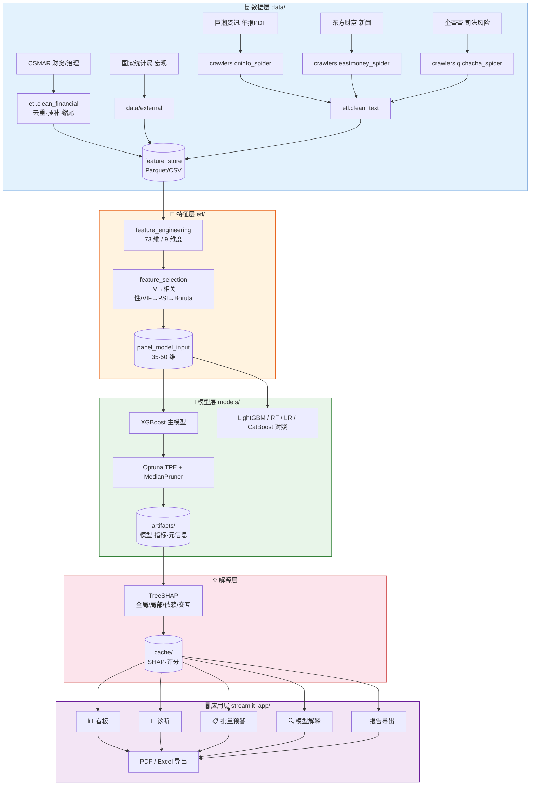
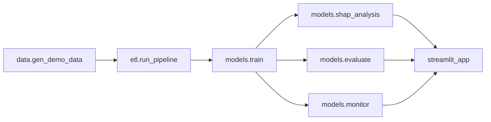

# 🏦 上市公司财务风险智能预警平台

> 基于 **XGBoost + SHAP** 的上市公司财务风险预警系统：融合 70+ 维多源异构特征，提供从数据采集、特征工程、模型训练到交互式解释与报告导出的一站式解决方案。

[](./LICENSE)
[](https://www.python.org/)
[](https://streamlit.io/)
[](https://xgboost.readthedocs.io/)
[](https://shap.readthedocs.io/)
[](./tests)

---

## 📌 项目简介

传统 Z-score、Logistic 回归在非线性关系捕捉与多维信息融合上存在局限，深度学习等"黑箱"模型又难以满足金融监管对可解释性的刚性要求。本项目以**沪深 A 股制造业上市公司**为研究对象，构建覆盖**财务指标、文本情感、公司治理、审计市场司法、宏观行业**九大维度的特征体系，以 **XGBoost** 为主模型，通过 **TreeSHAP** 实现四维度可解释性分析，并用 **Streamlit** 落地为五大模块的交互式预警平台。

**核心主张**：在保证预测精度（OOT AUC ≥ 0.85、KS ≥ 0.40）的同时，让每一个风险评分都可被拆解、审计与追溯。

**三个关键工程决策**：

| 决策 | 做法 | 为什么 |
|------|------|--------|
| 防前视偏差 | T 年 ST 标签 ↔ T-2 年特征 | ST 判定依据 T-1 年年报，年报于 T 年 4 月才披露，用 T 年特征会泄露未来信息 |
| 防过拟合 | TimeSeriesSplit + 2023 OOT + 2024 留出测试 | 财务数据强时序依赖，随机 K 折会让模型"看到未来" |
| 防口径漂移 | 特征元数据集中在 `config/feature_registry.py` | ETL、模型、前端、文档同源，避免"代码一套、论文一套" |

---

## ✨ 功能特性

| 模块 | 能力 |
|------|------|
| 📊 **数据看板** | 行业风险分布、行业 × 年度热力图、年度 ST 趋势、TOP-N 高风险企业、宏观环境雷达、数据质量监控 |
| 🏢 **企业诊断** | 风险评级卡片、六维健康度雷达（同侪分位）、SHAP 归因瀑布图、历史风险轨迹、核心指标同业对标 |
| 📋 **批量预警** | 粘贴代码 / 上传 CSV、阈值实时调节、风险等级分布、Excel/CSV 一键导出 |
| 🔍 **模型解释** | 全局重要性（特征 + 维度双视角）、依赖效应、交互强度、五模型对比、校准曲线、PSI 漂移监控 |
| 📄 **报告导出** | 单企业 PDF 诊断报告（内置中文字体，无外部依赖）、批量 Excel（含汇总 Sheet）、评估报告、数据字典 |
| ⚙️ **工程能力** | 一键 Docker 部署、49 项单元测试、四步特征筛选证据链、模型元信息与运行清单留痕（数据/特征 hash、参数、阈值） |

---

## 🚀 快速开始

### 方式一：演示模式（3 分钟跑通全链路，无需任何数据权限）

```bash
# 1. 环境
python -m venv .venv
source .venv/bin/activate          # Windows: .venv\Scripts\activate
pip install -r requirements.txt

# 2. 数据 + 特征（自动生成结构真实的演示数据：240 家公司 × 10 年）
python -m etl.run_pipeline

# 3. 训练 + 评估 + 解释
python -m models.train --trials 30
python -m models.evaluate
python -m models.shap_analysis

# 4. 启动平台
streamlit run streamlit_app/app.py
# 浏览器打开 http://localhost:8501
```

一键等价命令：

```bash
make all      # data → pipeline → train → evaluate → shap
make app      # 启动平台
make test     # 49 项单元测试
```

### 方式二：接入真实数据（CSMAR 原始分表）

原始导出直接放入 `data/raw/`（命名见 [`docs/CSMAR手动下载清单.md`](./docs/CSMAR手动下载清单.md)），
由导入层完成「科目代码解码 → 合并报表过滤 → 元转亿元 → 三表合并」：

```bash
python -m scripts.convert_csmar_xlsx          # 现金流量表 XLSX → 精简 CSV（约 7 分钟）
python -m etl.csmar_import --step all --write # 解码 + 合并 + 写契约表
python -m scripts.validate_raw_data           # 质量体检，报告在 reports/data_quality/
python -m etl.run_pipeline                    # 特征工程 + 四步筛选（需 ST 标签表）
```

若导出文件已经是合约列名的合并表（而非 CSMAR 原始分表），改用通用映射层：

```bash
python -m etl.mapping --source D:\csmar\export --dry-run
python -m etl.mapping --source D:\csmar\export --write
```

**当前真实数据状态（2026-11-11）**：财务/治理/审计三块已接入（52,203 个公司-年，2013–2025），
52/73 维特征有真实数值；**缺《特别处理表》→ `is_st` 无法生成 → 训练被阻断**。
缺口清单、字段级可用性与下载指引见 [`docs/CSMAR数据可行性报告.md`](./docs/CSMAR数据可行性报告.md)。

### 方式三：Docker 部署（答辩/交付推荐）

```bash
docker compose up -d --build          # 首次启动会自动补齐数据与模型
# 访问 http://localhost:8501

# 离线答辩场景
docker save risk-warning-platform:1.0 -o risk_platform_v1.0.tar
docker load < risk_platform_v1.0.tar && docker compose up -d
```

---

## 🏗️ 系统架构



### 数据流水线（命令级）



---

## 🛠️ 技术栈

| 类别 | 组件 | 用途 |
|------|------|------|
| 数据采集 | requests（+可选 Scrapy/Selenium）、pdfplumber | 年报 PDF 下载与 MD&A 文本抽取 |
| 数据处理 | pandas、numpy、pyarrow、SQLAlchemy | ETL、特征构建、Parquet/CSV 双格式存储 |
| 特征筛选 | scikit-learn、boruta（可选） | IV / VIF / PSI / Boruta 四步筛选 |
| 机器学习 | XGBoost、LightGBM、CatBoost | 五模型对比，XGBoost 为主模型 |
| 超参优化 | Optuna（TPE + MedianPruner） | 贝叶斯搜索，替代网格/随机搜索 |
| 可解释性 | SHAP（TreeExplainer） | 四维度归因分析 |
| 前端 | Streamlit + Plotly | 五大模块交互式平台，全中文图表 |
| 报告 | ReportLab（内置 CID 中文字体）、openpyxl | PDF/Excel 导出，零外挂字体 |
| 工程 | pytest、ruff、Docker Compose、Makefile | 测试、规范、部署、一键复现 |

---

## 📁 项目结构

```
financial-risk-warning-platform/
├── config/                       # ⚙️ 全局配置（唯一事实来源）
│   ├── settings.py               #   路径、样本窗口、阈值、随机种子
│   └── feature_registry.py       #   73 维特征元数据（中英文名/维度/方向/口径）
├── crawlers/                     # 🕷️ 数据采集
│   ├── base.py                   #   限速会话、重试、PDF 流式下载
│   ├── cninfo_spider.py          #   巨潮资讯年报 + MD&A 抽取
│   ├── eastmoney_spider.py       #   东方财富个股新闻
│   ├── qichacha_spider.py        #   企查查司法/处罚（API 模式）
│   └── config/user_agents.py     #   UA 池与站点限速
├── etl/                          # 🔧 数据处理
│   ├── io_utils.py               #   Parquet/CSV 读写（自动降级）+ 统一日志
│   ├── mapping.py                #   通用列名映射（已合并表 → 契约）
│   ├── csmar_import.py           #   CSMAR 原始分表解码：科目代码 → 契约列，三表合并
│   ├── stats_utils.py            #   IV / PSI / VIF / KS / 分箱
│   ├── clean_financial.py        #   去重、三级插补、缩尾、样本剔除
│   ├── clean_text.py             #   情感打分规范化
│   ├── feature_engineering.py    #   73 维特征构建 + 标签对齐（T-2）
│   ├── feature_selection.py      #   四步筛选 + 证据链报告
│   └── run_pipeline.py           #   流水线编排（一条命令跑通数据层）
├── models/                       # 🤖 模型
│   ├── data.py                   #   时间切分（2015-22 / 2023 / 2024）
│   ├── metrics.py                #   AUC/KS/F1/Brier/ECE + 阈值选择 + 分群
│   ├── train.py                   #   五模型 + TimeSeriesSplit + Optuna
│   ├── evaluate.py               #   评估报告（Markdown/CSV/JSON）
│   ├── predict.py                #   推理服务（批量/单企业/缓存）
│   ├── shap_analysis.py          #   SHAP 四维度 + 缓存
│   ├── monitor.py                #   PSI 漂移 + 性能衰减 + 处置建议
│   └── artifacts/                #   模型权重、指标、评估报告
├── streamlit_app/                # 🖥️ 前端
│   ├── app.py                    #   首页（状态自检 + 模块导航）
│   ├── pages/                    #   1_数据看板 / 2_企业诊断 / 3_批量预警 / 4_模型解释 / 5_报告导出
│   ├── components/layout.py      #   KPI 行、页头、下载按钮
│   └── utils/                    #   data（缓存取数）/ charts（Plotly）/ report（PDF·Excel）/ styles
├── data/                         # 🗄️ 数据（详见 data/README.md）
│   ├── gen_demo_data.py          #   演示数据生成器（潜在风险因子驱动）
│   ├── mapping/csmar.yaml        #   CSMAR 字段映射（别名/单位/编码）
│   ├── incoming/csmar/           #   下载日志、XLSX 转换产物、字段说明
│   ├── raw/  cleaned/  feature_store/  external/  demo_raw/
├── docs/                         # 📚 文档（见下方"文档索引"）
│   ├── desgin/                   #   调研报告、实施方案、开题蓝图、架构说明书、运维手册
│   ├── CSMAR手动下载清单.md       #   表清单、筛选条件、命名规范、验收标准
│   ├── CSMAR数据可行性报告.md     #   已到数据验证、字段级可用性、缺口与下载指引
│   ├── 数据字典与特征口径.md      #   由注册表自动生成
│   ├── 文献与资料调研清单.md      #   49 项资源清单与获取状态
│   ├── resources_catalog.csv     #   资源清单（机器可读）
│   ├── batch_download_resources.py
│   └── README_资源批量下载工具.md
├── notebooks/01_探索性分析.ipynb  # 📈 EDA：样本结构/IV/均值差/基线ROC
├── scripts/gen_data_dictionary.py # 🔁 文档自动生成
├── scripts/convert_csmar_xlsx.py  # 🔁 现金流量表 XLSX 流式转 CSV
├── scripts/validate_raw_data.py   # ✅ 原始数据质量校验（结构/主键/标签/覆盖）
├── tests/                        # ✅ 49 项单元测试
│   ├── conftest.py               #   内存面板夹具（不写盘、不依赖模型）
│   ├── test_feature_registry.py  #   特征口径一致性
│   ├── test_feature_engineering.py
│   ├── test_stats_utils.py       #   IV/PSI/VIF/KS 数学正确性
│   ├── test_metrics.py
│   └── test_io_and_pipeline.py
├── docker/entrypoint.sh          # 容器启动自检（缺数据/模型自动补齐）
├── Dockerfile  docker-compose.yml
├── Makefile  pyproject.toml  requirements.txt  .env.example  LICENSE
└── README.md
```

---

## 📊 数据说明

### 数据来源

| 数据类型 | 首选来源 | 获取方式 |
|---------|---------|---------|
| 财务报表 / 公司治理 / ST 标记 | CSMAR | 导出 CSV |
| 年报全文 PDF | 巨潮资讯网 | `crawlers.cninfo_spider` |
| 财经新闻 / 舆情 | 东方财富 | `crawlers.eastmoney_spider` |
| 司法 / 合规风险 | 企查查 API（备选：信用公示系统、裁判文书网） | `crawlers.qichacha_spider` |
| 宏观经济指标 | 国家统计局 / Wind | 手动或 API 下载 |

### 样本范围

- **行业**：沪深 A 股制造业（证监会 C 类），剔除金融（J）、房地产（K）、综合（S）
- **窗口**：训练 2015-2022，验证 2023（OOT），测试 2024（仅最终评估）
- **标签**：T 年被实施 ST/*ST 为正样本，特征取 T-2 年
- **配对**：1:3 近邻匹配（行业 + 年份 + 总资产对数），稳健性检验使用 1:5 与全样本

### 特征体系（73 维）

| 维度 | 特征数 | 代表性指标 |
|------|-------|-----------|
| 偿债能力 | 10 | 流动比率、资产负债率、利息保障倍数、有息负债率 |
| 盈利能力 | 10 | ROA、ROE、毛利率、EBITDA 利润率、扣非净利润占比 |
| 营运能力 | 10 | 应收/存货周转率、现金转换周期、收入含金量 |
| 成长能力 | 8 | 营收增速、3 年复合增速、资本支出/折旧 |
| 现金流 | 7 | 经营现金流/净利润、自由现金流/总资产、连续为负年数 |
| 文本情感 | 6 | MD&A 正/负面得分、不确定性、情感波动率 |
| 公司治理 | 6 | 股权集中度、Z 指数、独董比例、两职合一 |
| 审计/市场/司法 | 8 | 审计意见、四大审计、换手率、涉诉/处罚次数 |
| 宏观/行业 | 8 | GDP/M2/CPI/PPI/PMI、行业 ROA 与杠杆偏离度 |

完整口径见 [`docs/数据字典与特征口径.md`](./docs/数据字典与特征口径.md)（由注册表自动生成）。

### 四步特征筛选

```
73 维 ──IV≥0.02──▶ ~65 维 ──|r|≤0.85 & VIF≤10──▶ ~48 维
       ──PSI≤0.25──▶ ~45 维 ──Boruta/RF 重要性──▶ 29-45 维
```

每一步的 IV、VIF、PSI、Boruta 结论都写入 `data/feature_store/feature_selection_report.csv`，形成可复现的证据链。

---

## 🤖 模型与评估

### 五模型定位

| 模型 | 角色 | 选择依据 |
|------|------|---------|
| **XGBoost** | 主模型 | 表格数据表现稳健（Grinsztajn et al., 2022）；TreeSHAP 原生支持 |
| LightGBM | 强基线 | 训练快 3-5 倍，Leaf-wise 在小样本可能更优 |
| Random Forest | 集成基线 | 超参不敏感，天然非线性 |
| Logistic Regression | 传统基线 | Ohlson O-Score 经典方法，可解释性锚点 |
| CatBoost | 对照模型 | 类别特征原生支持，过拟合控制好 |

### 评估指标与合格线

| 指标 | 合格线 | 优秀线 | 说明 |
|------|-------|-------|------|
| AUC-ROC | ≥ 0.85 | ≥ 0.90 | 阈值无关的综合判别力 |
| KS | ≥ 0.40 | ≥ 0.50 | 金融风控行业标准 |
| F1 | ≥ 0.60 | ≥ 0.75 | 不平衡场景下的主指标 |
| Brier | ≤ 0.15 | ≤ 0.10 | 概率校准质量 |
| ECE | ≤ 0.05 | ≤ 0.02 | 分箱校准误差 |

> 演示数据（240 家公司 × 10 年）上的实测结果见 `models/artifacts/evaluation_report.md`，
> 五模型验证 AUC 约 0.82-0.87、KS 约 0.50-0.59。**真实数据结果以本地复现为准**。

### 验证策略

```
Level 1  5 折 TimeSeriesSplit（前向滚动，训练集始终早于测试集）
Level 2  OOT：训练 2015-2022 → 验证 2023 → 测试 2024
Level 3  稳健性：换标签定义 / 换特征集 / 换模型 / 换匹配比例 / 安慰剂检验
```

---

## 💡 可解释性（TreeSHAP 四维度）

| 维度 | 输出 | 平台位置 |
|------|------|---------|
| 全局重要性 | mean(\|SHAP\|) 排序 + 维度贡献合计 | 🔍 模型解释 · 全局重要性 |
| 局部归因 | 单企业瀑布图（+ 推高 / − 降低） | 🏢 企业诊断 |
| 特征依赖 | 特征取值 vs SHAP 散点，识别非线性拐点 | 🔍 模型解释 · 依赖效应 |
| 交互效应 | Top 特征对的交互强度热力图 | 🔍 模型解释 · 交互效应 |

实现要点：

- **Plotly 重绘 SHAP 图**，中文字体零配置、无方块字，且保留悬停/缩放交互；
- **计算一次、缓存复用**：`cache/shap_values.pkl` 存纯 numpy 数组，避免 pickle 解释器对象跨版本失效；
- **交互强度用代理指标**（重要性加权相关系数），因为精确 SHAP interaction 为 O(T·L·D²)，演示场景过慢——这一取舍在文档与界面中均显式标注。

---

## 🧪 复现清单

| 步骤 | 命令 | 预期产物 |
|------|------|---------|
| 1. 原始数据 | `python -m data.gen_demo_data` | `data/raw/*.csv`（2400 公司-年） |
| 2. 特征工程 | `python -m etl.run_pipeline` | `panel_features.parquet`、`selected_features.json` |
| 3. 训练 | `python -m models.train --trials 30` | `xgboost_final.json`、`metrics.json` |
| 4. 评估 | `python -m models.evaluate` | `evaluation_report.md`、校准/分群 CSV |
| 5. 解释 | `python -m models.shap_analysis` | `shap_values.pkl` |
| 6. 监控 | `python -m models.monitor` | `monitor_report.json`、`psi_detail.csv` |
| 7. 平台 | `streamlit run streamlit_app/app.py` | 五大模块可交互 |
| 8. 测试 | `python -m pytest -q` | 49 passed |

---

## 📚 文档索引

> 完整索引见 [`docs/README.md`](./docs/README.md)。

| 文档 | 内容 |
|------|------|
| [`docs/desgin/系统架构设计说明书.md`](./docs/desgin/系统架构设计说明书.md) | 分层架构、模块职责、数据契约、接口设计、质量属性、演进路线 |
| [`docs/desgin/平台使用与运维手册.md`](./docs/desgin/平台使用与运维手册.md) | 环境准备、五模块操作、数据更新 SOP、故障排查、答辩演示脚本 |
| [`docs/desgin/上市公司财务风险智能预警平台_深度实施方案.md`](./docs/desgin/上市公司财务风险智能预警平台_深度实施方案.md) | 14 周实施计划、数据/模型/系统三层设计、风险预案 |
| [`docs/desgin/上市公司财务风险智能预警平台_深度调研报告与文献综述.md`](./docs/desgin/上市公司财务风险智能预警平台_深度调研报告与文献综述.md) | 学术文献综述、工程实践调研、可行性论证 |
| [`docs/desgin/开题报告_文献综述章节写作蓝图.md`](./docs/desgin/开题报告_文献综述章节写作蓝图.md) | 文献综述章节骨架、引用衔接、答辩预判问题 |
| [`docs/desgin/开题报告_研究内容与技术路线写作蓝图.md`](./docs/desgin/开题报告_研究内容与技术路线写作蓝图.md) | 研究内容、关键问题、技术路线图（Mermaid/draw.io） |
| [`docs/CSMAR手动下载清单.md`](./docs/CSMAR手动下载清单.md) | 13 张表的下载清单、筛选条件、命名规范、验收标准 |
| [`docs/CSMAR数据可行性报告.md`](./docs/CSMAR数据可行性报告.md) | 已到数据验证结果、字段级可用性矩阵、缺口与补齐指引 |
| [`docs/数据字典与特征口径.md`](./docs/数据字典与特征口径.md) | 73 维特征定义、数据表结构、缺失处理规则 |
| [`docs/文献与资料调研清单.md`](./docs/文献与资料调研清单.md) | 49 项文献/代码/数据资源清单、检索策略、获取状态与缺口 |
| [`docs/README_资源批量下载工具.md`](./docs/README_资源批量下载工具.md) | 批量下载工具使用说明 |
| [`data/README.md`](./data/README.md) | 数据结构、字段约定、替换真实数据步骤 |

---

## ❓ 常见问题

**Q：没有 CSMAR 权限能跑通吗？**
能。`data.gen_demo_data` 会生成结构真实、因果关系可学习的演示数据，全链路（筛选→训练→解释→看板）都可运行。

**Q：为什么验证集 AUC 只有 0.85 左右？**
演示数据的信噪比刻意设置得接近真实场景（正样本率 15%、含 2% 缺失与 0.5% 极端值）。真实数据上通常更高，但**不应以演示数字作为论文结论**。

**Q：parquet 读写报错？**
`etl.io_utils` 已内置降级：无 pyarrow 时自动改用同名 CSV，读写与文件检查都会自动适配（`resolve()`）。

**Q：SHAP 图里中文是方块？**
本项目用 Plotly 重绘 SHAP 图，不依赖 matplotlib 字体配置；只有 `notebooks/` 中使用 matplotlib 时才需要设置 `font.sans-serif`。

**Q：如何替换模型？**
`models/train.py` 的 `build_baselines()` 返回字典，追加模型后自动进入对比、交叉验证与指标落盘；主模型取字典中的 `XGBoost` 键。

**Q：想加新的特征？**
在 `config/feature_registry.py` 增加一条 `FeatureSpec`，在 `etl/feature_engineering.py` 增加计算逻辑，再运行 `python -m scripts.gen_data_dictionary` 同步文档即可。

---

## 🗓️ 开发计划

| 阶段 | 状态 | 内容 |
|------|------|------|
| 数据采集与预处理 | ✅ | 爬虫骨架、ETL、演示数据生成器 |
| 特征工程与筛选 | ✅ | 73 维特征、四步筛选、证据链报告 |
| 模型训练与评估 | ✅ | 五模型对比、Optuna、OOT 评估、分群一致性 |
| SHAP 可解释性 | ✅ | 四维度分析 + 缓存 + Plotly 可视化 |
| Streamlit 平台 | ✅ | 五大模块 + 报告导出 |
| 工程化 | ✅ | 49 项测试、Docker、Makefile、文档自动生成 |
| 待办 | ⬜ | 文本情感增量价值分组检验、在线增量更新、模型注册表（MLflow） |

---

## 📖 参考文献

1. Altman, E. I. (1968). Financial Ratios, Discriminant Analysis and the Prediction of Corporate Bankruptcy. *The Journal of Finance*, 23(4), 589–609.
2. Beaver, W. H. (1966). Financial Ratios as Predictors of Failure. *Journal of Accounting Research*, 4, 71–111.
3. Ohlson, J. A. (1980). Financial Ratios and the Probabilistic Prediction of Bankruptcy. *Journal of Accounting Research*, 18(1), 109–131.
4. Zmijewski, M. E. (1984). Methodological Issues Related to the Estimation of Financial Distress Prediction Models. *Journal of Accounting Research*, 22, 59–82.
5. Merton, R. C. (1974). On the Pricing of Corporate Debt: The Risk Structure of Interest Rates. *The Journal of Finance*, 29(2), 449–470.
6. Lundberg, S. M., & Lee, S.-I. (2017). A Unified Approach to Interpreting Model Predictions. *NeurIPS*, 30.
7. Lundberg, S. M., Erion, G., & Lee, S.-I. (2020). From Local Explanations to Global Understanding with Explainable AI for Trees. *Nature Machine Intelligence*, 2(1), 56–67.
8. Grinsztajn, L., Oyallon, E., & Varoquaux, G. (2022). Why Do Tree-Based Models Still Outperform Deep Learning on Typical Tabular Data? *NeurIPS*, 35.
9. Chen, T., & Guestrin, C. (2016). XGBoost: A Scalable Tree Boosting System. *KDD*, 785–794.
10. Akiba, T., et al. (2019). Optuna: A Next-generation Hyperparameter Optimization Framework. *KDD*, 2623–2631.

完整文献清单（含中文文献、技术博客、开源项目、数据平台）见 [`docs/文献与资料调研清单.md`](./docs/文献与资料调研清单.md)。

---

## 🙏 声明

- **学术用途**：本项目为大数据财务方向研究生毕业设计成果，输出结果不构成投资建议或信用评级意见。
- **数据合规**：财务数据来自 CSMAR，年报文本来自巨潮资讯网公开披露，宏观数据来自国家统计局；爬虫仅采集公开信息，遵守站点 robots 与请求频率限制。
- **AI 辅助**：编码与文档撰写过程中使用 AI 工具辅助，所有内容经人工审核与验证，研究设计与学术结论由作者独立完成。

## 📄 License

[MIT](./LICENSE)
