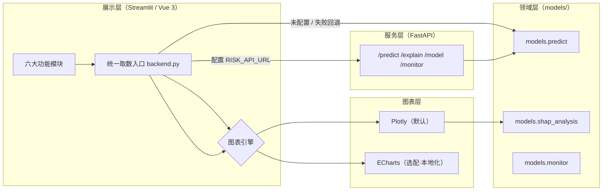

# 第 5 章　系统设计与实现

> 说明：本章为论文正文初稿，编号（第 5 章、5.x、图/表号）为占位，定稿时按学校模板统一重排。
> 本章对应工程实现：`streamlit_app/`（Streamlit 前端）、`web/`（Vue 3 SPA 前端）、
> `api/`（服务层）、`models/`（领域层）、`streamlit_app/components/echarts_local/`（图表组件）。口径与数据事实以
> `models/artifacts/run_manifest.json`、`data/feature_store/selected_features.json` 为准。

---

## 5.1 系统总体架构

财务风险预警系统在架构上采用**分层解耦**的设计：将系统划分为展示层、服务层、领域层与图表层，
各层职责单一、接口清晰，兼顾「离线演示可用」与「服务化复用」两种使用形态。展示层采用
**Streamlit（快速原型）与 Vue 3 SPA（生产化）双前端**并行，两者共用同一领域层与服务层。
总体架构如图 5-1 所示。



**图 5-1 系统总体架构**

各层职责与实现载体如表 5-1 所示。

| 层次 | 实现载体 | 主要职责 | 离线可用性 |
|---|---:|---|:---:|
| 展示层 | `streamlit_app/`（Streamlit）+ `web/`（Vue 3 SPA） | 页面布局、交互、状态管理、报告导出 | Streamlit 是 / Vue 需后端 |
| 服务层 | `api/`（FastAPI） | 评分/解释/监控的 HTTP 接口、输入校验、异常映射 | 是 |
| 领域层 | `models/` | 业务逻辑唯一实现，服务层与本地直连共用 | 是 |
| 图表层 | Plotly + ECharts | 可视化渲染 | 是（ECharts 本地化后） |

**表 5-1 分层职责**

该架构遵循以下设计原则：

1. **领域逻辑单一实现**：评分、解释、监控等业务逻辑只在 `models/` 实现一次，
   前端与服务层均通过调用该层复用，避免同一逻辑在多处重复实现导致口径漂移。
2. **双后端透明切换**：展示层通过统一入口 `backend.py` 取数。未配置服务地址时本地直连领域层；
   配置服务地址后走 HTTP 接口，且请求失败自动回退本地，从而保证系统在离线答辩环境中
   不因后端未启动而失效。
3. **可审计性**：所有评分与解释结果均携带模型运行标识 `run_id` 与「特征年 T → 标签年 T+2」的
   预测语义，任一风险分数均可回溯至其对应的模型版本、特征口径与阈值来源。

---

## 5.2 展示层设计（Streamlit + Vue 3）

### 5.2.1 功能模块划分

展示层以 Streamlit 作为交互框架，构建六个功能模块：平台首页、数据看板、企业诊断、批量预警、
模型解释与报告导出。各模块的输入、处理与输出如表 5-2 所示。

| 模块 | 主要功能 | 输入 | 输出 |
|---|---|---|---|
| 平台首页 | 就绪体检、关键指标、导航 | 无 | 系统状态、样本/特征/验证指标 |
| 数据看板 | 全市场风险态势 | 评分缓存 | 行业热力、时间趋势、TOP 排行、宏观环境、数据质量 |
| 企业诊断 | 单企业风险画像 | 股票代码、年度 | 风险卡片、六维雷达、SHAP 瀑布、历史轨迹 |
| 批量预警 | 名单批量评分 | 代码列表或 CSV | 分级清单、分布图、Excel/CSV 导出 |
| 模型解释 | 全局可解释性 | SHAP 缓存 | 全局重要性、依赖效应、交互效应、五模型对比、漂移监控 |
| 报告导出 | 诊断与预警报告 | 代码或名单 | 单企业 PDF、批量 Excel、评估报告 |

**表 5-2 功能模块划分**

### 5.2.2 统一取数与口径一致性

为避免各页面直接依赖领域层实现，展示层将数据访问收敛至统一入口模块
`streamlit_app/utils/backend.py`，对外提供 `get_predictions()`、`predict_codes()`、
`local_contribution()`、`global_importance()` 等接口。该入口按环境变量 `RISK_API_URL`
在「远程服务」与「本地直连」之间切换，实现后端无感替换。

在口径一致性方面，系统约定：

- 预测概率一律采用**校准后概率**，风险分级阈值与评估、监控模块同源读取；
- 预测语义统一为「特征年 T 的财务/治理/文本/行情/宏观数据 → 预测 T+2 年被实施 ST 的风险概率」，
  各页面以常驻说明文字进行标注，避免用户将预测结果误读为当年风险；
- SHAP 瀑布图末端概率与风险评级卡片采用同一校准器，保证解释结果与预测结果数值一致。

### 5.2.3 Vue 3 单页应用前端

除 Streamlit 外，系统还提供基于 Vue 3 的单页应用前端（`web/`），面向生产化部署。该前端采用
Vite + TypeScript 构建，通过 vue-router 组织七个视图：数据看板、企业列表、企业诊断、预警中心、
模型解释、财务分析与报告导出。开发期由 Vite 按路由前缀代理至 FastAPI 后端；构建产物可交由任意
静态服务器托管。图表统一采用 ECharts，与 Streamlit 侧共享同一套风险配色与数据口径。

在功能上，Vue 前端在 Streamlit 快速原型的基础上扩展了财务分析能力（杜邦分析、Altman Z/Z2、
Piotroski、Beneish 与同业对标）以及"规则评分触发预警 → 人工处置 → 处理流水留痕"的预警闭环，
由 `api/services/` 下的 `finance.py`、`rules.py` 与 `alerts.py` 支撑。

---

## 5.3 服务层设计（FastAPI）

### 5.3.1 设计思想

服务层采用 FastAPI 框架，将评分、解释与监控能力封装为无状态 HTTP 服务。其设计遵循「薄封装」原则：
服务层不复制业务逻辑，仅完成参数校验、领域层调用与结果序列化，业务规则仍由领域层统一实现。
模型与校准器在进程内加载一次并复用，避免每次请求重复加载。

### 5.3.2 接口契约

服务层主要接口如表 5-3 所示。所有成功响应均携带 `run_id` 与 `semantics` 字段；
错误统一返回 `{"detail": ...}` 结构。

| 方法 | 路径 | 说明 |
|---|---|---|
| GET | `/health` | 就绪检查：模型、面板、SHAP 缓存状态与 `run_id` 一致性 |
| GET | `/model/meta` | 模型元信息、阈值、特征清单 |
| POST | `/predict/codes` | 按股票代码批量评分，返回概率、风险等级、分位与未匹配代码 |
| GET | `/predict/top-risk` | 全市场 Top-K 高风险名单 |
| POST | `/predict/frame` | 单企业 what-if 打分（原始字段输入，预留接口） |
| GET | `/explain/{code}` | 单企业 SHAP 归因（校准后概率、基准值、特征贡献） |
| GET | `/explain/global` | 全局特征重要性 |
| GET | `/explain/dependence` | 特征依赖效应数据 |
| GET | `/explain/interactions` | 特征交互强度（代理指标） |
| GET | `/monitor/report` | 特征漂移（PSI）监控报告 |
| GET | `/features` | 特征注册表（数据字典） |
| GET | `/finance/overview` | 全市场财务概览（营收/利润/毛利率/ROE/负债率） |
| GET | `/finance/{code}/analysis` | 单企业财务分析（KPI、趋势、杜邦、Altman/Piotroski/Beneish、同业对标） |
| GET | `/finance/{code}/report` | 财务分析 Markdown 报告 |
| GET | `/risk/rules/{code}` | 规则六维评分（财务/法律/舆情/经营/信用/供应链） |
| GET | `/alerts`、`/alerts/summary` | 预警列表与汇总 |
| POST | `/alerts/generate` | 规则触发批量生成预警 |
| POST | `/alerts/{id}/handle` | 人工处置（待处理→处理中→已处置/已忽略） |
| GET | `/alerts/{id}/report` | 预警处置报告 |

**表 5-3 服务层接口契约**

### 5.3.3 异常与输入校验

服务层对领域层异常进行统一映射，保证接口行为可预期：

| 场景 | HTTP 状态码 | 返回内容 |
|---|---|---|
| 股票代码不存在 | 404 | `{"detail": {"code": ...}}`，批量场景并入 `unmatched` |
| 模型或数据缺失 | 503 | 附数据准备命令提示 |
| 输入参数非法 | 422 | 参数校验错误详情 |
| 内部异常 | 500 | 记录日志，不外泄堆栈 |

输入校验包括：股票代码规范化（补足 6 位）、年度范围约束、批量规模上限等，从入口拦截非法请求。

---

## 5.4 图表与可视化层设计

### 5.4.1 技术选型：Plotly 为主、ECharts 选配

可视化层采用「Plotly 为主、ECharts 选配」的混合方案，依据图表类型与交互需求选择渲染引擎，如表 5-4 所示。

| 图表 | 渲染引擎 | 选型理由 |
|---|---|---|
| SHAP 瀑布图、依赖效应、交互热力图 | Plotly | SHAP 库原生输出 Plotly 对象，零翻译成本且交互完善 |
| 六维健康度雷达、概率校准曲线、PSI、五模型对比 | Plotly | 已有成熟实现，中文与交互满足需求 |
| 行业×年度热力图、ST 趋势、行业风险柱 | Plotly 默认，可切 ECharts | ECharts 视觉表现力与大数据渲染更优 |
| 风险桑基图、特征→风险流向、区域地图 | ECharts（扩展） | Plotly 在桑基图与地图上能力较弱 |

**表 5-4 图表引擎分工**

### 5.4.2 可视化技术选型对比

| 指标 | Matplotlib | Plotly | ECharts |
|---|---:|---:|---:|
| 中文支持 | 需额外配置字体 | 原生友好 | 原生友好 |
| 交互能力 | 弱 | 强（悬停/缩放/导出） | 强（dataZoom/刷选/图例联动） |
| 大数据量渲染 | 一般 | 中等 | 强（Canvas） |
| 离线可用 | 是 | 是（Streamlit 内置） | 需本地化 |
| 与 Python 集成 | 原生 | 原生 | 需前端组件桥接 |

**表 5-5 可视化库对比**

综合权衡，本系统以 Plotly 作为默认渲染引擎，在保证开发效率与离线可用性的前提下，
对交互与视觉要求较高的部分图表引入 ECharts 作为可选增强。

### 5.4.3 ECharts 本地化方案

常规的 Streamlit 与 ECharts 集成通常依赖第三方组件并通过 CDN 加载 ECharts 运行时，
在离线演示环境中会出现图表无法渲染的问题。为此，本系统采用**自建无构建自定义组件**的方式，
将 ECharts 运行时文件本地化存放，组件通过本地脚本引用而不依赖任何外部 CDN。

组件目录结构如下：

```text
streamlit_app/components/echarts_local/
├── index.html          # 本地 <script src="./echarts.min.js">，无 CDN 依赖
├── echarts.min.js      # 固定版本 5.5.1，离线运行时
└── README.md           # 组件使用说明
```

Python 侧提供 `has_echarts()` 与 `render_echarts()` 两个接口。当本地运行时文件缺失时，
`has_echarts()` 返回假值，前端自动退回 Plotly 渲染，系统功能不受影响；文件就绪后，
数据看板页面出现「Plotly / ECharts」切换开关，用户可对比两种渲染效果。
该设计在保证离线可用性的同时，实现了可视化能力的可选增强。

### 5.4.4 风险语义与配色统一

为保证两套渲染引擎的视觉口径一致，系统统一定义风险等级配色：高风险为红色、中风险为橙色、
低风险为绿色，并禁止仅依赖颜色传递风险信息，所有风险标识均同时包含文字说明，以满足可读性要求。

---

## 5.5 关键设计决策

1. **前后端分离但不强制部署**：系统默认以本地直连方式运行，满足离线演示需求；同时提供
   服务层接口，支持多端复用与后续扩展，两种形态共用同一领域层实现。
2. **解释结果与预测结果同源校准**：SHAP 瀑布图的末端概率经与预测模块相同的校准器处理，
   从机制上避免「预测卡片」与「归因图」数值不一致的问题。
3. **图表引擎按场景分工**：SHAP 相关图表沿用 Plotly 以降低实现成本，其余对视觉表现要求
   更高的图表引入本地化 ECharts，兼顾开发效率与可视化质量。
4. **双前端并行**：Streamlit 用于快速原型与离线演示，Vue 3 SPA 用于生产化部署，两者共用同一
   领域层与服务层，保证"演示口径"与"生产口径"一致，避免两套逻辑分别维护导致漂移。

## 5.6 本章小结

本章从总体架构、展示层、服务层与图表层四个方面阐述了财务风险预警系统的设计思路与实现要点。
系统通过分层解耦保证了业务逻辑的单一实现与多端复用，通过双后端透明切换兼顾了离线演示与
服务化部署两种形态，通过 Plotly 与本地化 ECharts 的混合渲染在可视化质量与工程可维护性之间取得平衡。
