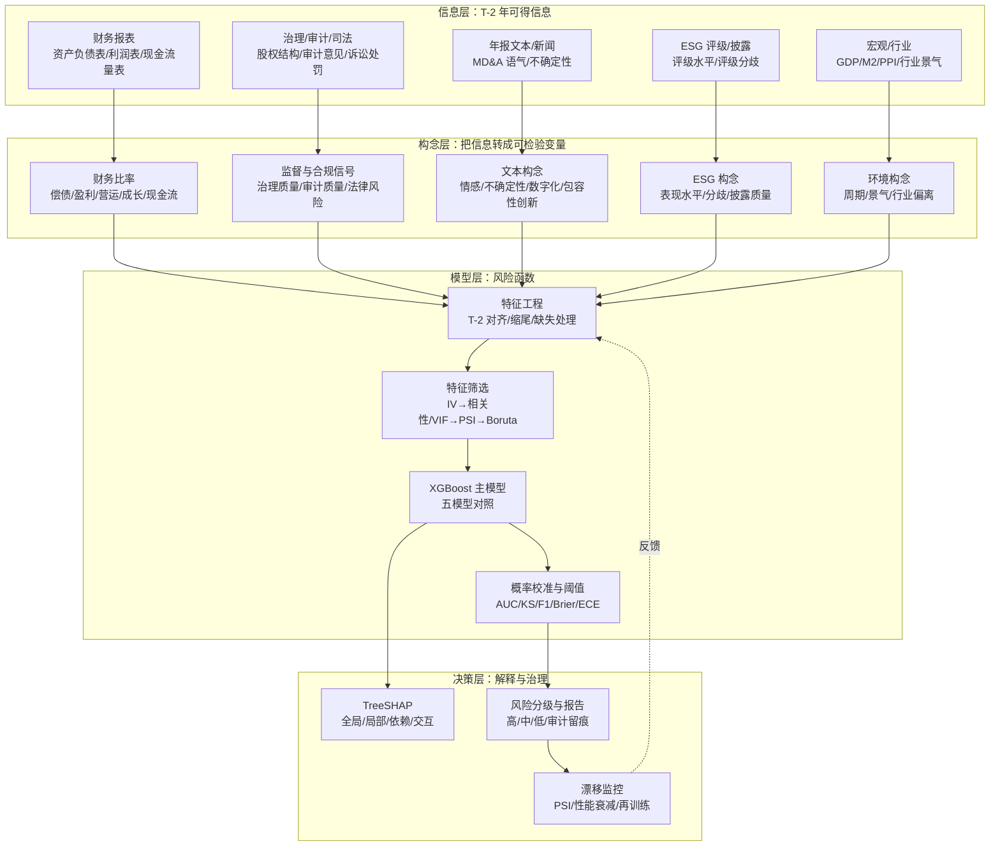

# 上市公司财务风险智能预警：文献综述与理论奠基

> **文档定位**：本项目（沪深 A 股制造业上市公司财务风险智能预警平台）的理论基础文档，可直接作为毕业论文第 2 章"文献综述"的底稿，也可作为开题答辩、模型设计说明与代码评审的引用依据。
>
> **语料范围**：`docs/downloads/papers` 下 24 个 PDF，去重后 **23 篇**核心文献；时间跨度 1966—2025 年。
>
> **阅读方式**：PyMuPDF 全文抽取 → 逐篇核读摘要、引言、研究设计、结果与结论 → 与项目 `config/feature_registry.py`、`models/data.py`、`models/metrics.py` 及既有调研文档交叉核对。
>
> **引用体例**：参考文献按 GB/T 7714-2015 编排；正文括注本地文献编号（Pxx），便于在项目内部追溯原文。
>
> **编制日期**：2026-11-11

> **阅读提示**：本文严格区分两类陈述——"本地 PDF 可核实的事实"与"一般背景知识"。凡本地 PDF 无法核实的数字，不进入证据表；凡属于推断而非原文结论的，均以"可能/提示/尚需检验"标注。这样做是为了避免把二手综述、二手引用或模型记忆当成原文证据。

---

## 摘要

本文以项目本地文献库中的 23 篇核心文献为证据基础，围绕财务风险预警的四个基本问题展开：**财务困境是否可预测、依据什么信息预测、用什么模型预测、如何使预测可信且可用**。文献覆盖从 Beaver（1966）的比率分析、Zmijewski（1984）的样本选择偏差、Merton（1974）的结构化违约模型，到 Chen & Guestrin（2016）的 XGBoost、Akiba et al.（2019）的 Optuna、Lundberg et al.（2020）的 TreeSHAP，再到破产预测的机器学习应用、ESG 评级分歧与基于大语言模型（LLM）的文本测度。本文提出"**信息—构念—模型—决策**"四层分析框架，并凝练出 7 条可检验命题；在此基础上，把文献证据逐条映射到项目的 73 维特征体系、T-2 标签对齐、时间外推验证、五模型对比、TreeSHAP 四维解释与 PSI 漂移监控等设计选择，识别出 8 个研究缺口。本文同时校正了既有调研文档中若干与本地 PDF 不一致的引用与数字，供论文写作直接使用。

**关键词**：财务困境；财务预警；XGBoost；TreeSHAP；ESG 评级分歧；大语言模型；样本选择偏差

---

## 1. 导论：为什么需要一次"以原文为准"的综述

### 1.1 项目的问题域

本项目要回答的不是一个纯算法问题，而是一个"**预测—解释—决策**"贯通的工程问题：

1. **预测**：在 T-2 年可获得的公开信息基础上，能否以可接受的判别力预测 T 年是否被实施 ST/*ST？
2. **解释**：当模型给出一个风险分数时，能否说清楚"为什么是这家公司、为什么是现在、哪些因素在推高/降低风险"？
3. **决策**：风险分数能否转化为可审计的等级、阈值、报告与处置建议，并在时间推移中保持可信？
4. **复现**：上述过程能否被第三方用同一数据、同一代码、同一口径复现？

这四个问题分别对应文献中的四条主线：**可预测性**（Beaver, 1966；吴世农、卢贤义, 2001）、**样本与估计**（Zmijewski, 1984）、**模型与调优**（Chen & Guestrin, 2016；Akiba et al., 2019）、**解释与治理**（Lundberg et al., 2020；Davis et al., 2023）。本综述的任务，是把这四条主线拧成一条可以支撑项目设计的逻辑链，而不是罗列论文。

### 1.2 本地文献库的构成

去重后共 23 篇。按主题与证据强度分布如下（证据强度定义见 §1.3）：

| 主题 | 文献编号 | 篇数 | 证据强度分布 |
|---|---|---|---|
| 经典理论与样本方法 | P03、P18、P31、P32 | 4 | A×4 |
| 集成学习算法与调优 | P27、P28 | 2 | A×2 |
| 机器学习破产/困境预测应用 | P08、P09、P23、P24、P29、P30 | 6 | B×4、C×2 |
| 可解释人工智能 | P07、P33 | 2 | A×1、B×1 |
| 文本、LLM 与构念测度 | P17、P20、P21 | 3 | A×1、B×1、C×1 |
| ESG、治理与财务绩效 | P04、P06、P19、P25、P26 | 5 | A×2、B×2、C×1 |
| 数据资产估值 | P22 | 1 | C×1 |
| **合计** | | **23** | **A×10、B×8、C×5** |

**时间结构**：1960—1980 年代 3 篇（P03、P32、P18），2001 年 1 篇（P31），2016—2020 年 4 篇（P27、P28、P30、P33），2022—2025 年 15 篇。中位数年份为 2022 年；2000 年以后文献 19 篇，占 82.6%。这说明本地库的重心在"**机器学习 + 可解释性 + 非财务信息**"这一当代议题上，经典文献主要承担概念与方法论锚点的作用。

**语言结构**：英文 14 篇，中文 9 篇。中文文献集中在 A 股实证、ESG 评级分歧与 LLM 测度三个方向，是"中国情境"证据的主要来源；英文文献提供经典理论、算法与可解释性方法论。

### 1.3 证据强度分级与阅读方法

本文不使用"好/坏论文"的主观评价，而以**证据可复核性**为标准分三级：

| 等级 | 标准 | 用途 | 本地文献 |
|---|---|---|---|
| **A（理论/方法奠基）** | 顶刊或顶会原创；提出可复用的理论、算法或方法论框架；被后续文献广泛引用 | 作为"理论依据"与"方法选择"的锚点 | P03、P04、P06、P18、P20、P27、P28、P31、P32、P33 |
| **B（同行评议实证）** | 有明确样本、期间、方法、指标；结果可复核；但样本或情境有限 | 作为"经验证据"与"参数区间"的参考 | P07、P08、P19、P21、P24、P25、P29、P30 |
| **C（工作论文/一般期刊/案例）** | 未经同行评议，或报告不完整、样本/指标不可复核，或期刊层级较低 | 作为"线索、工程参考、待验证假设"，不用于关键参数标定 | P09、P17、P22、P23、P26 |

补充说明：

- **P07** 本地为 2022-01-12 的 SSRN 工作论文，但出版版本为 *Journal of Financial Data Science*, 2023, 5(4): 9–39；本文按 B 级使用，引用时注明版本差异。
- **P06** 本地为 Harvard Business School Working Paper 20-084，出版版本为 *The Accounting Review*, 2022, 97(1): 147–175；按 A 级使用。
- **P23、P26、P22** 发表于 Hans Publishers 系列期刊（《电子商务评论》《运筹与模糊学》），同行评议强度有限，按 C 级使用；其价值在于提供中国样本的"存在性证据"，而非精确的参数估计。
- **P09** 为 arXiv 预印本，行文与报告质量较弱，本地 PDF 未见可复核的样本量与绩效表；按 C 级使用，且不作为任何绩效基准。

**阅读的边界**：

- **P03** 本地文件是 JSTOR 检索页的 1 页预览（原文档共 41 页），只能核实第 71—72 页的开头，无法逐表复核其全部统计结果。本文只采用其可核实的方法论要点，不引用其具体误判率。
- **P04** 有两个文件副本（文件名分别为"——"与"_"），内容为同一篇论文，已去重。
- 其余 PDF 均为全文或可读的出版版本；对仅有摘要可读的部分，正文会明确写"摘要报告"。

### 1.4 与既有调研文档的口径校正

项目既有的《深度调研报告与文献综述》与《文献与资料调研清单》在选题论证上有价值，但部分条目与本地 PDF 不一致。为避免"论文里写一套、原文里查不到"的风险，本文以本地 PDF 为准，做如下校正：

| # | 既有表述（摘要） | 本地 PDF 可核实的事实 | 本文处理 |
|---|---|---|---|
| 1 | P09 为"Gao, Jiang & Zhou (2023)，中国新三板 n=3,500，XGBoost AUC=0.89，LightGBM 0.88" | 确为 arXiv:2302.12118（2023-02-23），作者 Yuan Gao、Biao Jiang、Jietong Zhou；主题是中小企业财务困境，方法为 GSPCA-RVM（稀疏主成分 + 相关向量机）；本地 PDF 未见上述样本量与 AUC | 保留文献与 arXiv 编号；删除未经核实的绩效数字；不作为基准 |
| 2 | P07 为"Davis et al. (2023)，JFDS，AUC=0.85，SHAP 解释一致性>0.90" | 本地为 2022-01-12 SSRN 工作论文；摘要报告神经网络准确率 74.75%、简单规则可解释 70%—72% 的样本；未见 AUC=0.85 与"一致性>0.90" | 引用出版版本 *JFDS*, 2023, 5(4): 9–39；删除未核实数字 |
| 3 | P23 为"苗博威 (2020)，哈工大硕士论文，AUC=0.92，F1=0.76" | 本地 PDF 为路优（2025）《基于 LightGBM 的信息技术上市公司财务危机预测研究》，《电子商务评论》14(3): 1254–1263；472 家信息技术类 A 股公司；调参后 AUC=0.923 | 替换为路优（2025）；删除"苗博威"条目 |
| 4 | P24 为"王圣洁 (2022)，准确率 93.2%，召回率 89.5%" | 表 3 显示：准确率 93.50%、精确率 91.30%、召回率 70.00%、F1 79.24% | 按表 3 更正；召回率不是 89.5% |
| 5 | P19 为"R²=0.32，中介效应占比 28%" | 正文报告 ESG 评级分歧对绿色创新效率的系数 −0.101（10% 显著）、对债务资本成本 0.096（1% 显著）、债务资本成本对绿色创新效率 −0.130（1% 显著）；未见 R²=0.32、28% 这两个数字 | 删除未核实数字；只报告可核实的系数与显著性 |
| 6 | P26 为"ESG→ROA 系数=0.034***" | 摘要报告 ESG 显著提升企业绩效，融资约束与数字化转型起中介作用；未见 0.034 这一具体系数 | 不引用具体系数；只报告方向与机制 |
| 7 | P04 为"评级相关系数仅 0.33—0.71" | 摘要报告分歧分解：测量 56%、范围 38%、权重 6%；相关系数区间未在摘要中出现 | 用分解比例替代；相关系数需查正文表后再用 |
| 8 | P08 为"Dasilas & Rigani (2024) 系统综述" | 本地 P08 为 Lombardo、Bertogalli、Consoli、Recupero（2024）的原始研究，提出 Transformer 文本摘要 + 会计时间序列的端到端架构，不是综述 | 更正为 Lombardo et al.（2024）；综述性判断需另找文献 |

> **处理原则**：论文正文只写"本地 PDF 能核对到的数字"；需要引用但本地没有原文的经典文献（如 Altman, 1968；Ohlson, 1980），要么补下载原文，要么明确标注"转引自"并不把其具体数字当作一手证据。§10.4 给出补文献清单。

---

## 2. 概念界定与理论基础

### 2.1 "财务困境"的定义谱系与操作化

财务困境不是一个单一、边界清晰的自然类别，而是一个**由制度、会计与市场共同建构的构念**。本地文献提供了四种不同的操作化路径：

| 来源 | 定义/操作化 | 关键特征 | 对本项目的含义 |
|---|---|---|---|
| Beaver（1966，P03） | "失败"=企业无法按期偿付财务义务；操作事件包括破产、债券违约、银行账户透支、优先股股息未付 | 事件导向；79 家失败企业样本 | 困境是"可观察事件"，不是连续打分；标签应有明确事件锚点 |
| Zmijewski（1984，P18） | 财务困境；强调总体基础率极低（Dun & Bradstreet 数据：美国企业失败率自 1934 年以来从未超过 0.75%） | 样本导向；关注"谁进入样本" | 匹配样本会改变正负样本比例，进而改变概率估计 |
| 吴世农、卢贤义（2001，P31） | 财务困境又称财务危机；最严重的是破产；引 Ross 等区分企业失败、法定破产、技术破产、会计破产 | 过程导向；困境有先兆、可预测 | 预警窗口应前移；T-2 年特征是合理的 |
| 本项目 | T 年被实施 ST/*ST | 监管导向；中国 A 股制度标签 | 预测的是"监管认定的困境"，不是"破产"；两者不能等同 |

**ST 标签的构念效度问题**。本项目用 ST/*ST 作为正样本，有三个优点：可观察、可追溯、与中国资本市场参与者高度相关；但也有四个不可忽视的风险：

1. **ST 不是破产**。ST 是交易所对财务或其他异常状况的特别处理，包含财务指标、审计意见、规范运作等多重触发条件；把 ST 等同于破产，会高估模型的"违约预测"含义。
2. **标签含政策裁量**。ST 的认定与撤销涉及监管规则与执行尺度，可能随制度调整而变化；同一财务状态在不同年份可能对应不同标签。
3. **存在盈余管理/保壳行为**。公司可能通过调节利润、重组、政府补助等方式避免 ST，导致"财务恶化但标签为负"的样本，形成标签噪声。
4. **正样本稀少且不平衡**。这既是统计问题（Zmijewski, 1984），也是评估问题（Precision/Recall 比 Accuracy 更有意义）。

因此，论文中应明确写："本文的因变量是 **T 年 ST/*ST 状态**，它度量的是中国监管框架下的'财务或其他异常状况'，而非破产法意义上的违约。" 这句话既保护了构念效度，也为后续讨论"模型可迁移性"留下空间。

**T-2 对齐的制度逻辑**。ST 判定主要依据 T-1 年年度报告，而年报通常在 T 年 4 月底前披露；若用 T 年或 T-1 年的特征预测 T 年 ST，就会把"标签判定所依据的信息"提前放进特征，造成前视偏差。使用 T-2 年特征，可以保证在 T 年年初（甚至 T-1 年年报披露前）做出预测，具有真实的前瞻性。这一设计不是"多留一年"的保守，而是由披露时序决定的**信息可得性约束**。

### 2.2 可预测性的三重理论依据

#### 2.2.1 比率信号观：会计信息是困境的压缩信号

Beaver（1966）把"比率是否有用"从规范讨论转化为可检验的预测问题：如果财务比率真的承载关于企业偿付能力的信息，那么失败企业在失败前的比率分布应系统性偏离非失败企业，且偏离程度随失败临近而扩大。吴世农、卢贤义（2001）在中国 A 股上重复了这一逻辑：21 个财务指标中，有 16 个在困境发生前 1—2 年具有较强的信息时效性，净资产报酬率的判别成功率较高；三种模型在困境前 4 年的误判率在 28% 以内，Logistic 模型在困境前 1 年的误判率仅 6.47%。

这条理论线索的核心机制是：**财务比率把多张报表、多个科目压缩成可比的数量信号，而困境是一个资源约束逐步收紧的过程，因而会在比率上留下连续痕迹**。它的局限也很清楚：比率是会计加工的产物，受会计政策、盈余管理、表外负债与行业差异影响；单变量比率只能捕捉局部信号，无法处理交互与阈值效应。

#### 2.2.2 结构化违约观：股权是公司资产的看涨期权

Merton（1974，P32）把公司债定价建立在 Black-Scholes 期权框架上：企业资产价值服从随机过程，当资产价值低于债务面值时发生违约；股东权益可视为以企业资产为标的、以债务面值为执行价格的看涨期权。由此可以推导违约距离（distance-to-default）与违约概率，把"会计账面"转换为"市场前瞻"。

这条线索对本项目的启示是双重的：

- **正面**：市场信息（股价、波动率、换手率）包含会计信息之外的前瞻预期；项目在"审计/市场/司法"维度纳入换手率等市场特征，方向上是合理的。
- **反面**：Merton 模型依赖有效市场、连续交易、资产价值可观测等假设；中国 A 股存在涨跌停、停牌、壳价值、散户占比高等制度摩擦，违约距离与真实违约的映射并不稳定。因此项目**不直接采用 KMV/DD 作为主模型**，而是把市场特征作为辅助信号，这是有理论依据的克制。

#### 2.2.3 统计学习观：风险是高维非线性函数

XGBoost（Chen & Guestrin, 2016，P27）把风险建模为加法树集成：

\[
\hat{y}_i = \sum_{k=1}^{K} f_k(\mathbf{x}_i), \quad f_k \in \mathcal{F}
\]

目标函数为：

\[
\mathcal{L} = \sum_i l(y_i, \hat{y}_i) + \sum_k \Omega(f_k), \quad
\Omega(f) = \gamma T + \frac{1}{2}\lambda \|w\|^2 + \alpha \|w\|_1
\]

其中 \(T\) 是叶子数，\(w\) 是叶子权重。XGBoost 用二阶泰勒展开近似损失，用增益公式选择分裂点，并用稀疏感知算法处理缺失值、用加权分位数草图做近似学习。对财务预警而言，这套设计的价值在于：

- **非线性与交互**：财务比率对风险的影响往往不是线性的（例如资产负债率过高/过低都不健康），树模型可以自动学习阈值与交互；
- **缺失值**：财务数据存在科目缺失、行业口径差异，XGBoost 的稀疏感知分裂可以保留缺失信息；
- **表格数据**：在中等规模、特征工程充分的表格任务上，梯度提升树通常是强基线；
- **可解释接口**：树结构天然适配 TreeSHAP，能在多项式时间内给出精确的局部归因。

但统计学习观也有边界：它学的是**相关关系**，不是因果效应；它对分布漂移敏感；它的性能高度依赖标签质量、样本设计与验证方案。后文 §8 会把这些边界展开为评估规范。

#### 2.2.4 测量观：非财务信息是"带误差的信号"

ESG 评级、年报文本、数字化转型指数等非财务构念，都不是直接观测的变量，而是通过评级机构、词典、分类模型等"测量工具"构造出来的。Berg et al.（2022，P04）把 ESG 评级分歧分解为范围（38%）、测量（56%）、权重（6%）三部分，并发现"评级者效应"——评级机构对企业的整体看法会影响具体类别的测量。这意味着：

- 同一个"ESG 分数"在不同机构之间不可直接比较；
- 评级分歧本身可能携带信息（市场对"真实表现"的不确定性）；
- 把单一评级当作无误差的自变量，会引入测量误差与内生性。

文本与 LLM 测度同理：词典法受概念漂移影响（Lombardo et al., 2024，P08），LLM 分类受模型版本、提示词、标注口径影响（金星晔等，2024，P20；梁宇奇等，2024，P21）。因此，非财务特征进入预警模型时，必须同时报告**测量效度**与**增量价值**，而不是默认"维度越多越好"。

### 2.3 一个整合框架：信息—构念—模型—决策

把上述四条理论线索整合，可以得到本项目的四层分析框架：

这一框架的理论含义是：

- **信息层**决定"能不能预测"：如果 T-2 年信息与 T 年 ST 之间没有稳定关系，再复杂的模型也无济于事；
- **构念层**决定"预测的是什么"：财务比率、治理信号、文本语气、ESG 分歧是不同构念，不能混为一个"风险因子"；
- **模型层**决定"预测得多准、多稳"：算法选择、特征筛选、时间切分、校准共同决定样本外表现；
- **决策层**决定"预测有没有用"：解释、阈值、报告、监控把统计输出转化为可执行的预警。

### 2.4 七条可检验命题

以下命题不是文献的直接结论，而是本文基于文献提出的、可用项目数据检验的研究假设。每条都给出理论依据、操作化与证伪条件。

| 编号 | 命题 | 理论依据 | 操作化 | 证伪条件 |
|---|---|---|---|---|
| **P1** | 财务困境具有可预测性：T-2 年财务比率对 T 年 ST 具有显著判别力 | Beaver（1966）；吴世农、卢贤义（2001） | OOT AUC、KS；与随机基线比较 | OOT AUC 不显著高于 0.5，或 KS 接近 0 |
| **P2** | 非财务信息具有增量价值：治理、审计、司法、文本特征在财务特征之上提升判别力 | 王圣洁（2022，P24）；Lombardo et al.（2024，P08）；Christensen et al.（2022，P06） | 消融实验：财务特征 vs 财务+非财务；ΔAUC、ΔKS、ΔF1 | 增量不显著，或方向不稳定 |
| **P3** | 非线性集成优于线性概率模型：XGBoost 在同一样本/窗口/指标下优于 Logistic | Chen & Guestrin（2016）；Samara & Shinde（2025，P29）；王圣洁（2022） | 五模型对比；同一训练/验证/测试切分 | Logistic 的 OOT AUC/KS 不低于 XGBoost |
| **P4** | 测量分歧携带风险信息：ESG 评级分歧、文本不确定性对风险评分有正向贡献 | Berg et al.（2022）；Christensen et al.（2022）；张云齐等（2023，P25） | 分歧特征的单变量 IV、多变量增量、SHAP 方向 | 分歧特征无增量，或方向与预期相反且稳健 |
| **P5** | 时间外推比随机交叉验证更严格：随机 CV 会高估性能，OOT 性能存在系统性下降 | Zmijewski（1984）；Lombardo et al.（2024）；Lundberg et al.（2020） | 同一模型在 TimeSeriesSplit 与 OOT 上的 AUC/KS 差 | 两者差异不显著，或 OOT 反而更高 |
| **P6** | TreeSHAP 的解释是忠实的：局部 SHAP 之和等于预测值减去基准值；全局重要性排序在时间上稳定 | Lundberg et al.（2020）；Davis et al.（2023） | 加和一致性检验；跨年度排名相关；与置换重要性对比 | 加和误差超过数值精度；排名随年份剧烈翻转 |
| **P7** | 成本敏感阈值优于 0.5：在低基础率与不对称错判成本下，验证集选出的阈值能提升净收益 | Zmijewski（1984）；Davis et al.（2023） | 阈值—收益/成本曲线；与 0.5 阈值对比 | 0.5 阈值在净收益上不劣于调优阈值 |

> **使用建议**：论文第 3—5 章可围绕 P1—P3 展开（预测与模型），第 5—6 章围绕 P4、P6 展开（非财务信息与解释），第 6—7 章围绕 P5、P7 展开（评估与决策）。每条命题都应报告"支持/不支持/部分支持"，而不是只报告显著的结果。

---

## 3. 经典证据：财务比率的预测力与样本设计

### 3.1 Beaver（1966）：把"比率有用"变成可检验问题

Beaver 的贡献不在于提出某个具体公式，而在于确立了财务预警的实证范式：

- **定义可操作**：失败=企业无法按期偿付财务义务；操作事件包括破产、债券违约、银行账户透支、优先股股息未付。本地 PDF 明确记载，79 家失败企业中 59 家破产、16 家未付优先股股息、3 家债券违约、1 家银行账户透支。
- **样本可追溯**：以 79 家失败企业为处理组，比较失败前若干年的财务比率剖面。
- **问题可检验**：把"比率分析是否有效"转化为"比率在失败前是否具有判别力"，从而可以用统计方法评估，而不是停留在规范判断。

**不能从本地文件核实的内容**：本地 PDF 是 JSTOR 的 1 页预览（原文档 41 页），只能读到第 71—72 页开头，无法逐表复核其 30 个比率、配对样本设计、误判率与"现金流/总负债"这一具体结论。因此本文只采用其方法论要点，不引用具体数字。若论文需要引用 Beaver 的具体结果，应补下载全文（JSTOR 开放获取）后再写。

**对本项目的启示**：标签必须有明确的事件锚点；比率选择要有理论分组（偿债/盈利/营运/成长/现金流），而不是把所有比率一股脑丢进模型；单变量分析应作为多变量模型的前置步骤（项目的 IV 筛选即对应这一逻辑）。

### 3.2 Zmijewski（1984）：样本设计会改变你估计的"概率"

Zmijewski 的核心贡献，是把财务困境研究中的**样本选择偏差**从"技术细节"提升为"结论有效性"问题。文章考察了 17 项既有研究，发现：

- 17 项研究全部在"已知困境企业总体"上估计模型，并施加"完整数据"筛选；
- 其中 12 项使用配对样本设计（matched-pairs）收集非困境样本；
- 11 项研究的困境样本比例为 50%，只有 3 项低于 40%；
- 而总体基础率极低（Dun & Bradstreet 数据：美国企业失败率自 1934 年以来从未超过 0.75%）。

由此产生两类偏差：

1. **选择基础偏差（choice-based sample bias）**：样本是否进入研究依赖于因变量取值（先知道是否困境，再抽样）。这违反外生随机抽样假设，导致参数估计与概率估计渐近有偏；被过度抽样的组，其分类/预测错误率被低估。
2. **样本选择偏差（sample selection bias）**：只用"完整数据"样本，会剔除数据缺失的企业；如果缺失与困境相关，估计结果就有偏。

Zmijewski 的结论不是"配对样本不能用"，而是：**配对样本在稀有事件研究中成本有效，但必须使用调整估计方法，并报告总体基础率**。否则，模型输出的"违约概率"不是总体的违约概率，而是"样本内的人为比例"。

**对本项目的启示**：

- 项目采用 1:3 近邻匹配（行业+年份+总资产对数），这是成本有效的设计，但必须承认它改变了正负样本比例；
- **AUC/KS 对样本比例相对不敏感，Brier/ECE 与绝对概率阈值对样本比例敏感**；因此论文应同时报告判别力指标与校准指标，并在业务阈值之前做基础率校正（先验校正或 Platt/Isotonic 再校准）；
- 稳健性检验应至少包括 1:5 匹配与全样本（不匹配）两种设计，观察结论是否稳定；
- 不能把"样本内准确率 93%"直接外推为"总体准确率 93%"。

### 3.3 吴世农、卢贤义（2001）：中国 A 股最早的系统性多模型比较之一

这篇论文是本地库中唯一一篇 2001 年的中文经典，其设计在今天看来仍然规范：

- **样本**：70 家财务困境公司 + 70 家财务正常公司（1:1 配对）；
- **指标**：21 个财务指标，覆盖偿债、盈利、营运、成长等维度；
- **窗口**：困境发生前 5 年，逐年做剖面分析与单变量判定；
- **方法**：Fisher 线性判定、多元线性回归、Logistic 回归三种模型；
- **结果**：16 个指标在困境前 2 年或 1 年信息时效性较强，净资产报酬率判别成功率较高；三种模型在困境前 4 年误判率在 28% 以内；Logistic 在同信息集下误判率最低，困境前 1 年仅 6.47%。

**理论意义**：

1. 在中国 A 股上验证了"财务困境有先兆、可预测"这一基本命题；
2. 证明了**窗口越长、信息越弱**：越接近困境，判别力越强；这为 T-2 窗口提供了中国证据；
3. 证明了**模型形式有影响，但信息集更重要**：三种模型共享 6 个预测指标，Logistic 最优，说明在当时的数据条件下，线性概率模型已经能捕捉主要信号。

**局限**：

- 1:1 配对，样本量小（140 家），无法代表总体基础率；
- 2001 年的会计制度、退市规则与今天差异很大；
- 没有样本外时间验证，误判率是样本内/回测结果；
- 没有处理缺失值、极端值、行业异质性。

**对本项目的启示**：Logistic 应作为不可或缺的基线（项目已纳入五模型对比）；T-2 窗口有中国证据支持；但必须用 OOT 与校准弥补早期研究的验证缺陷。

### 3.4 小结：三条稳健事实与两条警告

**三条稳健事实**：

1. **可预测性**：财务比率在困境前 1—2 年具有实质判别力，这一点在 1966 年的美国样本与 2001 年的中国样本上得到重复。
2. **窗口衰减**：越远离困境，判别力越弱；T-2 是一个兼顾"信息量"与"可用性"的窗口。
3. **模型有增益，信息集更关键**：从单变量到多变量、从线性到非线性，模型形式的改进能提升精度，但标签质量、样本设计、特征口径往往比算法选择更能解释绩效差异。

**两条警告**：

1. **不要把匹配样本的准确率当成总体准确率**（Zmijewski, 1984）。匹配改变了正负样本比例，概率与阈值需要再校准。
2. **不要用同一期或未来信息预测当期标签**。ST 判定依据 T-1 年年报，T 年年报在 T+1 年才披露；用 T 年特征预测 T 年 ST 会泄露未来信息。T-2 对齐是底线，不是可选项。

---

## 4. 方法演进：从判别分析到集成树

### 4.1 XGBoost：为什么它是表格财务数据的合理默认

Chen & Guestrin（2016，P27）的 XGBoost 不是"又一个梯度提升树"，而是把**正则化目标、稀疏感知、近似分位数、缓存与分片**整合成一个可扩展系统。对财务预警而言，最相关的四个设计是：

1. **正则化目标**：目标函数同时惩罚损失与模型复杂度（叶子数、叶子权重 L1/L2），降低小样本过拟合风险；
2. **二阶近似**：用损失函数的二阶泰勒展开选择分裂，收敛更快、分裂更稳；
3. **稀疏感知**：对缺失值学习默认分裂方向，避免"缺失即删除"造成样本损失；
4. **加权分位数草图**：在分布式/大数据场景下近似学习分裂点，保证可扩展性。

这三条与财务数据的匹配度很高：财务比率量纲差异大、缺失常见、非线性与交互普遍、样本量中等。XGBoost 因此成为本项目的合理默认，而不是因为"它最先进"。

**边界**：

- XGBoost 不是因果模型。SHAP 值解释的是"模型如何使用特征"，不是"特征对结果的因果效应"；
- 对分布漂移敏感。宏观经济、会计制度、退市规则变化会让"特征—标签"映射漂移；
- 对小样本、高噪声数据，正则化与早停比"调得更深"更重要；
- 对类别不平衡，需要配合 scale_pos_weight、阈值调优与校准，而不是只看 AUC。

### 4.2 Optuna：把调参变成可复现的搜索过程

Akiba et al.（2019，P28）提出 Optuna 的三条设计原则：

- **Define-by-run API**：搜索空间在运行时动态构造，而不是预先声明；
- **高效的搜索与剪枝**：支持 TPE（Tree-structured Parzen Estimator）等贝叶斯方法，并对中间结果不佳的 trial 提前剪枝；
- **可部署架构**：从单机交互到分布式计算均可。

对本项目的意义：

- 用 TPE + MedianPruner 替代网格/随机搜索，在有限预算下更高效；
- 搜索空间、随机种子、剪枝策略、试验次数都应写入模型元信息，保证可复现；
- **风险**：如果调参在验证集上反复进行，验证集会被"隐性过拟合"；因此应使用 TimeSeriesSplit 的内层验证，或独立的调参集，最终只在 2023 OOT 上做一次模型选择，2024 测试集只评估一次。

### 4.3 应用证据：不同数据、不同任务、不同结论

| 文献 | 样本/期间 | 方法 | 关键结果（原文可核实） | 设计启示与局限 |
|---|---|---|---|---|
| **P29** Samara & Shinde（2025） | 8,262 家美国企业，1999—2018 | Logistic、SVM、随机森林、ANN、RNN；特征工程、特征选择、SMOTE、标准化 | 随机森林准确率约 95%，Logistic 约 57% | 预处理与类别平衡对结果影响很大；只报告准确率，未报告 AUC/KS/校准；高准确率可能来自平衡后的测试集，不能直接外推 |
| **P30** Hosaka（2019） | 102 家日本退市/事实破产企业 + 2,062 家上市企业，4 个财务期 | 把财务比率转成灰度图像，用 CNN 分类；用加权平均生成合成样本，共 7,520 张图像 | CNN 优于传统方法；相关比率相邻放置、更深网络能提升精度；合成数据不能替代真实数据 | 图像化是一种"结构先验"，把比率间相关性编码进空间邻接；可解释性弱；合成数据有风险 |
| **P08** Lombardo et al.（2024） | 6,190 家美国上市公司，1999—2018 | Transformer 文本摘要模块 + 会计多变量时间序列模块，端到端联合训练 | 会计模块准确率 78%，文本模块 81%，联合模型 87.5%；违约召回率 0.84，II 类错误 16.12 | 文本的增量来自"披露内容选择"而非词典词频；概念漂移是词典法的核心弱点；模型复杂、复现成本高 |
| **P23** 路优（2025） | 472 家信息技术类 A 股公司 | LightGBM；网络参数调优；特征重要性排序 | 调参后 AUC=0.923；研发投入占营业收入比例的重要性最高 | 单一行业、样本量有限；未纳入宏观环境；未与统计模型结合；AUC 高不代表校准好 |
| **P24** 王圣洁（2022） | 288 家财务造假公司，493 个造假样本；1:1 配对后 986 个样本；2016—2021 | XGBoost；52 项财务与非财务指标；十折交叉验证；Harmonic 调参 | 准确率 93.50%、精确率 91.30%、召回率 70.00%、F1 79.24%；涉诉案件数、审计意见、股权集中度、三会召开、换手率进入前十 | 任务不是"财务困境"而是"财务造假"，标签不同；1:1 平衡；随机划分；非财务指标在平衡样本中重要性上升，说明"类别平衡会改变特征重要性" |
| **P09** Gao, Jiang & Zhou（2023） | 中小企业（样本量未在本地 PDF 中清晰报告） | GSPCA（稀疏主成分）+ RVM（相关向量机）；融合财务、治理、市场交易数据 | 本地 PDF 未见可复核的绩效表；方法叙述为主 | 选题方向（多源信息+SME）有价值，但报告不完整，不能作为绩效基准；提示"可复现性"本身是研究质量的一部分 |

**如何读这张表**：

- 不能横向比较"95% vs 93.5% vs 87.5%"，因为样本、期间、标签、类别比例、评估口径都不同；
- 应该纵向看"同一篇论文内部，什么设计导致了什么结果"：P29 的预处理、P30 的图像先验、P08 的文本模块、P24 的类别平衡，都是**设计选择**而非单纯算法优势；
- 对本项目最有直接参考价值的是 P24（A 股、财务+非财务、XGBoost、类别平衡）与 P08（文本增量、概念漂移），而不是 P29 的绝对准确率。

### 4.4 深度学习的位置：文本与图像的增量，而非表格的替代

本地文献给出的图景是清晰的：

- **在纯表格、中等样本的财务困境任务上**，树集成仍是强基线；P29 的随机森林、P24 的 XGBoost、P23 的 LightGBM 都支持这一点。
- **深度学习的显著增益主要来自"新增信息形态"**：P30 把比率变成图像，利用空间邻接；P08 把年报文本变成可学习的摘要表示，文本模块单独达到 81% 准确率。它们不是"用深度网络替代表格树"，而是"用深度网络处理树模型不擅长的非结构化信息"。
- **深度学习的代价**是可解释性、训练成本、复现难度与过拟合风险；在毕业设计的时间与数据条件下，把 XGBoost 作为主模型、把深度学习作为对照/扩展，是更稳健的策略。

因此，本项目的五模型对比（XGBoost、LightGBM、Random Forest、Logistic、CatBoost）是合理的：它覆盖了"线性基线—装袋—提升—类别特征友好"四类归纳偏置，能在同一数据切分下回答"树集成是否真的更好"，而不是先验地宣称 XGBoost 最优。

### 4.5 方法证据的综合判断

| 判断 | 支持证据 | 反例/边界 |
|---|---|---|
| 树集成在表格财务数据上是强基线 | P24、P29、P23、P27 | P30 的 CNN 在图像化数据上更强；P08 的联合模型在文本+时序上更强 |
| 特征工程与预处理能显著改变结果 | P29（SMOTE/特征选择）、P24（类别平衡改变重要性）、P23（参数调优） | 过度预处理可能引入泄漏；SMOTE 必须在训练集内做 |
| 文本信息具有增量价值 | P08（文本 81%、联合 87.5%）、P24（非财务指标进入前十） | 增量取决于文本质量、覆盖率和任务；并非所有样本都适用 |
| 深度学习不是表格任务的默认最优 | P24、P29、P23 | P30、P08 说明它在非结构化数据上有独特优势 |
| 绝对准确率不可跨研究比较 | 所有应用的样本/标签/口径不同 | 需要统一基准与开放数据才能做元分析 |

---

## 5. 可解释性：从局部归因到全局治理

### 5.1 TreeSHAP 的方法论贡献

Lundberg et al.（2020，P33）的三个贡献，正好对应本项目"四维解释"的设计：

1. **多项式时间精确算法**：对树集成，TreeSHAP 可以在 \(O(TLD^2)\) 时间内计算 Shapley 值（T 树数、L 最大叶子数、D 特征数），把原本指数级的博弈论计算变成可用工程；
2. **局部交互效应**：直接度量特征对之间的交互，而不仅是主效应；
3. **全局结构**：把大量局部解释组合成全局重要性、依赖关系、人群子群与漂移监测。

SHAP 值满足三条公理：

- **局部准确性**：所有特征的 SHAP 值之和 = 模型预测值 − 基准值；
- **缺失性**：未参与预测的特征 SHAP 值为 0；
- **一致性**：若模型对某特征的依赖增强，该特征的 SHAP 值不应减小。

这三条使 SHAP 区别于"特征重要性"这类启发式指标：它有明确的加和分解，可用于逐条审计"这个风险分数由哪些特征贡献"。

**边界**：

- SHAP 解释的是**模型**，不是**世界**；高 SHAP 值不等于因果效应；
- 特征相关时，Shapley 值会在相关特征之间分配贡献，可能出现"符号翻转"或"归因不稳定"；
- 精确交互计算的复杂度高；项目 README 明确说明交互强度使用"重要性加权相关系数"作为代理指标，这是工程取舍，应在论文与界面中显式标注，不能宣称是精确 SHAP interaction；
- SHAP 的稳定性需要检验：跨年度、跨样本、跨模型版本的排名是否一致。

### 5.2 多利益相关者的解释需求：Davis et al.（2023）

Davis et al.（2022 工作论文；2023 JFDS 出版）用一个 HELOC 真实数据集，把"可解释"拆成四类利益相关者的不同需求：

| 利益相关者 | 需求 | 方法 | 对本项目模块的映射 |
|---|---|---|---|
| 贷款机构 | 每一次预测都要有解释 | 对每个预测生成 SHAP/LIME 解释 | 企业诊断：SHAP 瀑布图 |
| 监管者 | 极端情景下的稳健性 | 压力测试 | 模型解释：阈值/分群/校准 |
| 贷款申请人 | 知道"怎么做才能改变结果" | 多样化反事实 | 企业诊断：核心指标对标/改进方向 |
| 数据科学家 | 理解模型整体逻辑 | 简单规则、最优树、ILP | 模型解释：全局重要性/依赖/交互 |

论文的关键发现是：神经网络在 HELOC 上达到 74.75% 准确率；简单的规则可以解释 70%—72% 的样本。这说明**解释不必以牺牲全部精度为代价**，但"全局简单规则"和"局部精确归因"是两种不同的解释产品，不能互相替代。

**对本项目的启示**：

- 平台五个模块（看板、诊断、批量预警、模型解释、报告导出）实际上对应不同利益相关者；应在论文中明确"谁需要哪种解释"；
- 企业诊断页应给出"推高/降低"的局部归因，而不是只给全局重要性；
- 报告导出应包含基准值、Top-k 贡献、模型版本、特征口径，形成审计留痕；
- 不应宣称 SHAP 能告诉企业"改变某个指标就能避免 ST"；反事实/改进建议只能作为"模型内探索"，不是因果承诺。

### 5.3 解释的忠实性、稳定性与可操作性

三个评价维度：

| 维度 | 问题 | 检验方法 | 项目做法 |
|---|---|---|---|
| **忠实性** | 解释是否真实反映模型？ | SHAP 加和一致性；与模型输出对比；与置换重要性对比 | 局部瀑布图带基准值；加和误差检查 |
| **稳定性** | 同一企业跨时间/跨样本的解释是否稳定？ | 跨年度排名相关；Bootstrap 重采样；不同随机种子 | 缓存 SHAP 值；模型元信息记录种子；跨年对比 |
| **可操作性** | 解释能否转化为行动？ | 业务专家评审；反事实合理性；成本约束 | 核心指标同业对标；风险等级；报告建议 |

**常见误区**：

- 把"全局重要性高"当成"该企业的主要风险"——全局重要性与局部归因是两件事；
- 把"SHAP 为正"当成"该特征导致风险"——它只表示"相对于基准，该特征推高了模型输出"；
- 把"解释图好看"当成"模型可信"——解释的忠实性需要数值检验，不是视觉检验。

---

## 6. 非财务信息（一）：文本与 LLM 测度

### 6.1 为什么文本可能有用：概念漂移与披露增量

Lombardo et al.（2024，P08）对"词典法"的批评切中要害：词典与词频特征是固定的，但语言使用、披露风格、监管要求会随时间变化，导致**概念漂移**——同一个词在不同年份的含义与信号强度不同。他们用 Transformer 文本摘要模块学习"哪些披露内容对预测更有价值"，再与会计时间序列联合训练，得到三个可比较的结果：

- 会计模块单独：准确率 78%；
- 文本模块单独：准确率 81%；
- 联合模型：准确率 87.5%，违约召回率 0.84。

这说明：**文本不是"锦上添花"，在特定任务上可以单独达到与会计数据相当的水平；联合使用的增量是实质性的**。但也要注意，这是美国 SEC 10-K 文本、英文语境、6190 家公司的大样本；迁移到中文年报 MD&A 时，分词、语气、披露格式、监管问询都会改变信号。

### 6.2 情感分析：FinBERT 与 GPT-4o 的分工

Shen & Zhang（2024，P17）在 Financial PhraseBank 上比较了 FinBERT 微调、GPT-4o 零样本/少样本等配置，核心结论是：

- **微调后的 FinBERT 在领域内仍然最强**；
- **GPT-4o 在提供少量金融文本示例（few-shot）时，可以接近微调 FinBERT 的水平**；
- 零样本 GPT-4o 的表现弱于领域微调模型。

这对项目的启示不是"用 GPT-4o 替代 FinBERT"，而是**按任务选工具**：

| 场景 | 推荐 | 理由 |
|---|---|---|
| 大规模、稳定的情感打分 | 微调 FinBERT/BERT | 成本低、可复现、领域适配好 |
| 小样本、新构念、快速探索 | LLM few-shot | 无需训练、语义理解强、适合冷启动 |
| 需要解释"为什么这段文本是负面的" | LLM + 人工校验 | 生成式解释可读性好，但需防幻觉 |
| 生产环境 | 冻结版本 + 缓存 + 回归测试 | LLM 版本更新会导致分数漂移 |

**关键风险**：LLM 的输出受提示词、温度、模型版本影响；同一段文本在不同时间调用可能得到不同分数。若把 LLM 分数直接作为特征，必须记录模型版本、提示词、调用日期，并做时间外推验证。

### 6.3 构念测度：数字化转型与包容性创新

两篇中文文献处理的是同一个方法论问题：**如何把"企业数字化转型""包容性创新"这类抽象构念，从年报文本中可靠地测量出来**。

**金星晔等（2024，P20）** 的问题意识非常清晰：现有研究对数字化转型的测度存在"测度对象不统一、测度方法不科学"两大问题，导致结论不可比较、难以复制、相互冲突。他们的方案是：

1. 对 2006—2020 年上市公司年报中的句子进行人工打标签；
2. 用标注结果训练/微调多个机器学习模型（包括大语言模型），选择分类效果最好的 ERNIE；
3. 用 ERNIE 预测全部文本中句子的标签，构造企业数字化转型指标；
4. 用理论分析与数据交叉验证证明新指标比已有方法更准确；
5. 实证发现数字化转型显著提高财务绩效，大数据、人工智能、移动互联、云计算、物联网均显著，区块链不显著；对财务绩效较差的企业效果更强；机制是改善效率与降低成本。

**梁宇奇等（2024，P21）** 的方案更接近"词典召回 + 模型判别"的工程流水线：

1. 构建关键词词典，对 2013—2022 年 31,549 份上市公司年报中包含关键词的有效语句进行人工标记；
2. 用标记结果微调 BERT；
3. 选择分类性能最好的模型对全部文本分类，构造企业包容性创新指标；
4. 用地区分布、行业差异、国家政策相关性做效度检验。

两篇论文的共同方法论价值：

- **构念测度不是"跑个词典词频"**，而是"定义构念→构造标注集→训练分类器→全量打分→效度检验"的完整链路；
- **人工标注是锚**：没有人工标注，无法判断分类器学到的到底是构念还是披露风格；
- **效度检验是必需**：地区、行业、政策相关性、与已有指标的相关性，都是"测量是否可信"的证据；
- **模型选择要报告**：为什么选 ERNIE/BERT，分类性能如何，标注一致性如何，都会影响指标的可复现性。

### 6.4 测量效度、版本漂移与时效性

把文本/LLM 特征引入财务预警，需要过四道关：

| 关卡 | 问题 | 检验/治理 |
|---|---|---|
| **构念效度** | 文本分数真的测量了"风险"吗？ | 与人工评分、与财务困境标签、与已有量表的相关性 |
| **标注效度** | 人工标签是否一致？ | 多人标注 + Cohen's kappa/一致率；标注指南 |
| **版本漂移** | 模型/词典更新后分数是否变化？ | 冻结模型版本；固定提示词；回归测试集 |
| **时效性** | 文本在预测时点是否可得？ | 用披露日期而非会计年度对齐；避免使用预测时点之后的新闻/年报 |

### 6.5 对本项目的设计含义

项目当前有 6 个文本特征（MD&A 正面/负面得分、不确定性、情感波动率等），属于"词典/规则"路线。基于本地文献，建议分三步走：

1. **短期（不改变现有特征）**：把文本特征的构造口径、词典版本、MD&A 抽取规则写进数据字典；做"财务 vs 财务+文本"的消融实验，报告 ΔAUC/ΔKS；如果增量不显著，诚实报告，而不是硬说"多源特征有效"。
2. **中期（构念扩展）**：选择 1—2 个与风险最相关的构念（如"管理层讨论中的不确定性""数字化转型"），按 P20/P21 的流水线做小规模人工标注 + BERT/ERNIE 微调，构造新特征；报告标注一致性、分类性能、与词典法的相关性。
3. **长期（版本治理）**：把文本模型版本、提示词、训练数据、评估结果纳入模型元信息；建立"文本特征漂移"监控，避免模型更新导致预警分数跳变。

**不要做的事**：不要把 LLM 的"情感判断"直接当作因果解释；不要用同一年的年报文本预测同一年的 ST；不要在未做增量检验的情况下，宣称"文本特征提升了模型效果"。

---

## 7. 非财务信息（二）：ESG 评级分歧与治理

### 7.1 ESG 评级为何分歧：范围、测量与权重

Berg et al.（2022，P04）用六家知名评级机构（KLD、Sustainalytics、Moody's ESG/Vigeo-Eiris、S&P Global/RobecoSAM、Refinitiv/Asset4、MSCI）的数据，把评级差异映射到统一分类体系，并分解为三部分：

- **测量（measurement）56%**：同一类别下，不同机构对同一企业的具体指标取值不同；
- **范围（scope）38%**：不同机构覆盖的类别/指标不同；
- **权重（weight）6%**：不同机构对类别的加权不同。

进一步，他们发现"评级者效应"：评级机构对企业的整体看法会影响具体类别的测量。这意味着评级不是"客观测量 + 随机误差"，而是"机构视角 + 方法选择 + 测量误差"的混合产物。

**理论含义**：

- ESG 评级不是一维、可比的"分数"，而是多维、方法依赖的"构念"；
- 评级分歧不是简单的"噪声"，它可能包含"不同机构对同一事实的不同解读"；
- 用单一评级作为自变量，会把测量误差、机构效应、范围差异混在一起。

### 7.2 分歧的经济后果：披露、波动与融资

Christensen et al.（2022，P06）研究"ESG 披露是否解释评级分歧"，得到一个反直觉但重要的结论：

- **更高的 ESG 披露，反而导致更大的评级分歧**；
- 这一结论在公司固定效应与"强制披露冲击"的双重差分设计下仍成立；
- 评级机构对"结果型指标（outcomes）"的分歧大于"投入型指标（policies/inputs）"；
- 披露对"结果型指标"的分歧放大更强；
- 分歧的后果：更高的收益波动率、更大的绝对价格变动、更低的外部融资可能性。

**解释**：披露增加了信息量，但也增加了"解读空间"；不同机构对同一披露的加工方式不同，导致分歧扩大。这与"披露越多、信息越透明、分歧越小"的朴素直觉相反。

**与本项目的关联**：如果 ESG 分歧与波动率、融资约束相关，那么它可以作为"风险信号"进入预警模型；但要注意，Christensen 研究的是美国/全球样本，ESG 披露制度与中国不同，不能直接外推。

### 7.3 中国证据：ESG 分歧与债务资本成本

张云齐、杨淏宇、张笑语（2023，P25）用 A 股上市公司面板（回归表 N=16,848）检验 ESG 评级分歧对债务资本成本的影响，发现：

- 分歧越高的企业，债务资本成本越高；
- 利用 2019 年香港交易所 ESG 信息披露规则改革做政策冲击，发现"披露不规范"是重要机制：市场认为企业真实 ESG 表现可能背离评级均值，因而要求额外风险溢价；
- 用滞后一期的 ESG 分歧作为工具变量做 2SLS，结论仍成立；
- 进一步发现：虽然债务成本上升，但权益成本也上升，企业的资产负债率反而上升（更多选择债务融资）。

**理论含义**：ESG 分歧不只是"评级机构吵架"，它会被债务市场定价；分歧的机制是"信息不确定性/披露规范性"，而不是"ESG 水平高低"。

### 7.4 中国证据：分歧、绿色创新与财务绩效

李季鹏、李叶（2024，P19）用 2016—2022 年沪深 A 股样本（回归表 N=18,931）发现：

- ESG 评级分歧越大，企业绿色创新效率越低；
- 债务资本成本起部分中介作用：分歧→债务成本上升→绿色创新效率下降；
- 分析师关注度、公司治理水平较高时，负向影响被削弱；
- 重污染企业、环境不确定性较高时，负向影响更强。

成佳敏（2025，P26）用 2011—2022 年沪深 A 股样本发现：

- ESG 表现显著提升企业财务绩效；
- 融资约束、数字化转型在 ESG 与绩效之间起中介作用；
- 非国有企业、东部/中部地区、非重污染企业的正向影响更强。

**把三篇放在一起看**：

| 构念 | 文献 | 方向 | 机制 | 对预警的含义 |
|---|---|---|---|---|
| ESG 表现水平 | P26 | 正向影响财务绩效 | 缓解融资约束、促进数字化转型 | ESG 水平可能是"韧性"信号，但不能直接等同于"低风险" |
| ESG 评级分歧 | P25 | 提高债务资本成本 | 披露不规范→信息不确定性→风险溢价 | 分歧可作为"信息风险"特征 |
| ESG 评级分歧 | P19 | 降低绿色创新效率 | 债务成本中介；分析师/治理调节 | 分歧可能通过融资约束影响长期竞争力 |
| ESG 披露 | P06 | 提高评级分歧 | 披露增加解读空间；结果型指标更明显 | 披露数量≠披露质量；需区分"披露多"与"分歧小" |

**关键区分**：不要把这些结论混成"ESG 越好，风险越低"。P26 讲的是"ESG 表现→财务绩效"，P25/P19 讲的是"评级分歧→融资成本/创新效率"，P06 讲的是"披露→分歧"。三者是不同构念、不同机制，不能互相替代。

### 7.5 数据资产估值（P22）：边缘文献的定位

杨洋、宋良荣（2025，P22）以比亚迪为例，用多期超额收益法（MPEEM）评估数据资产价值：以 2019—2023 年营业收入为基础预测自由现金流，结合 1 年期与 5 年以上银行贷款利率设定资产收益率，用行业平均 WACC 折现，分离各资产贡献收益，得到数据资产价值。

**为什么它在本地库**：可能是为"数据资产入表""无形资产/数据要素"提供背景。但它与本项目的核心问题（财务困境预警）关联较弱：

- 它是单案例估值研究，不是因果/预测研究；
- MPEEM 依赖大量假设（收益期限、折现率、资产贡献分割），主观性强；
- 期刊层级较低，方法细节与稳健性有限。

**建议**：论文中最多在"非财务信息/无形资产"背景中提一句，不要把它作为核心理论依据；如果未来要研究"数据资产入表对企业风险的影响"，需要补充数据资产会计准则、披露规则与更大样本的实证文献。

### 7.6 对本项目的设计含义

1. **区分三个构念**：ESG 表现水平、ESG 评级分歧、ESG 披露质量。不要用一个"ESG 分数"同时代表三者。
2. **优先使用分歧而非单一评级**：如果数据允许，构造"多机构评级标准差/极差"作为分歧特征；如果只有单一评级，至少加入"是否有评级""评级机构数量"作为覆盖度控制。
3. **把披露质量作为调节/控制**：披露规范性可能同时影响分歧与风险，遗漏它会混淆估计。
4. **不做因果承诺**：在预测模型中可以纳入 ESG 特征，但在论文中应写"关联/增量信息"，不要写"ESG 分歧导致 ST"。
5. **注意样本期与制度变化**：2019 年 HKEX 改革、2020 年后中国 ESG 披露要求变化，都可能导致特征分布漂移；应在时序验证中检查。

---

## 8. 评估与治理：让"高 AUC"成为可审计的结论

### 8.1 样本设计：匹配、基础率与外部效度

| 问题 | 文献警示 | 本项目做法 | 需要报告的 |
|---|---|---|---|
| 匹配样本改变正负比例 | Zmijewski（1984）：过度抽样使概率与错误率有偏 | 1:3 近邻匹配（行业+年份+总资产对数） | 匹配前后正样本率；匹配变量；匹配质量 |
| 总体基础率极低 | 美国企业失败率 <0.75%（P18 引 D&B） | 不把样本内概率当总体概率 | 基础率校正方法；校准前后 Brier/ECE |
| 外部效度 | P31 样本 140 家、2001 年；P23 单一行业 | 制造业 + 多行业对照；稳健性 1:5/全样本 | 分行业、分规模、分年份的绩效 |
| 标签噪声 | ST 含政策裁量/盈余管理 | 明确"监管困境"定义；稳健性换标签 | 标签定义敏感性分析 |

### 8.2 时间外推：随机 CV 为什么会骗人

财务数据具有强时序依赖：宏观经济周期、会计制度、退市规则、行业景气都会改变"特征—标签"映射。随机 K 折会让模型在训练中"看到未来"的同分布样本，导致：

- 性能高估；
- 特征重要性不稳定；
- 阈值在样本外失效。

本地文献的支持：

- P08 明确以"概念漂移"为动机，强调模型需要随时间适应；
- P33 把"监测部署模型的特征退化"作为 TreeSHAP 的应用之一；
- P18 的样本偏差讨论提醒我们：估计结果依赖"谁进入样本"，时间切分也是一种样本设计。

**本项目做法**：训练 2015—2022，验证 2023（OOT），测试 2024（只评估一次）；内层用 5 折 TimeSeriesSplit。论文应报告"随机 CV vs OOT"的差距，并把差距本身作为结论的一部分（P5）。

### 8.3 类别不平衡：SMOTE、配对与阈值

| 方法 | 文献 | 优点 | 风险 |
|---|---|---|---|
| SMOTE 过采样 | P29 | 提升少数类召回；实现简单 | 合成样本可能不真实；必须在训练集内做；会改变概率校准 |
| 1:1 配对 | P24、P31 | 平衡、计算高效 | 改变基础率；概率高估；浪费多数类信息 |
| 1:3 匹配 | 本项目 | 保留更多多数类；缓解极端不平衡 | 仍需校准；匹配质量依赖协变量 |
| 阈值调优 | P07、P18 | 直接对应业务成本 | 阈值在样本外不稳定；需验证集选择 |

**指标选择**：

- **AUC-ROC**：阈值无关的排序能力，适合模型比较；但在极端不平衡下可能偏乐观；
- **KS**：金融风控常用，衡量正负样本累积分布的最大差距；
- **F1/Recall/Precision**：依赖阈值，适合业务场景；
- **Brier/ECE**：衡量概率校准，匹配样本下尤其重要；
- **PR-AUC**：在正样本极少时比 ROC-AUC 更敏感（本地文献未直接使用，但方法上应补充）。

### 8.4 概率校准：匹配样本的"隐形债务"

Zmijewski 的警告在本项目上有一个非常具体的后果：1:3 匹配后，样本正样本率约为 25%，而总体 ST 率通常远低于此。模型在匹配样本上输出的 0.5，不等于总体意义上的 50% 风险。若直接把 0.5 当作"高风险"阈值，会高估风险企业的数量。

**治理方案**：

1. **先验校正**：用总体基础率 \(\pi\) 与样本基础率 \(\pi_s\) 调整截距：\(\text{logit}(p) \leftarrow \text{logit}(p_s) + \log\frac{\pi}{1-\pi} - \log\frac{\pi_s}{1-\pi_s}\)；
2. **再校准**：在验证集上用 Platt scaling 或 Isotonic regression，报告校准前后的 Brier/ECE；
3. **阈值分层**：高风险/中风险阈值由验证集 + 业务成本确定，写入 `model_meta.json`，评估、监控、前端同源读取；
4. **报告可靠性图**：不要只报 AUC；校准曲线是"概率是否可信"的直接证据。

### 8.5 漂移监控：PSI、性能衰减与解释漂移

| 监控对象 | 指标 | 触发条件 | 处置 |
|---|---|---|---|
| 特征分布 | PSI | PSI > 0.25（项目筛选阈值） | 检查口径/数据源；必要时剔除或重训 |
| 预测分布 | 分数均值/分位数 | 显著偏移 | 检查阈值是否仍适用 |
| 性能 | AUC/KS/F1 衰减 | 低于合格线或显著下降 | 重训/换特征/换模型 |
| 解释 | 全局重要性排名、SHAP 均值 | 排名剧烈变化 | 检查特征相关性与漂移 |
| 业务 | 高风险占比、复核命中率 | 异常升高/降低 | 人工复核；校准 |

P33 的"用局部解释监测模型退化"提供了一个方法论支点：不仅监控输入分布，也监控"模型在用什么特征"。本项目已有 `models/monitor.py`（PSI + 性能衰减 + 处置建议），应在论文中把监控结果作为"模型可运维性"的证据，而不是附录里的装饰。

### 8.6 可复现性：P09 的反面教材

P09 的选题（中小企业、多源信息、稀疏主成分+相关向量机）并不差，但本地 PDF 的报告方式暴露了一个常见问题：**读者无法从论文中复现样本、特征、调参、评估**。这直接削弱了研究价值。

本项目在工程上已经具备较好的复现基础：

- `config/feature_registry.py` 作为特征口径的唯一事实来源；
- `models/artifacts/model_meta.json` 记录数据/特征 hash、参数、阈值；
- `models/train.py` 固定随机种子、TimeSeriesSplit、Optuna 试验记录；
- `tests/` 覆盖特征口径、IV/PSI/VIF/KS、指标计算、IO/流水线；
- Docker/Makefile 提供一键复现。

论文中应把这些作为"方法透明度"的一部分写出来，而不是只写"使用了 XGBoost + SHAP"。

### 8.7 评估矩阵

| 维度 | 常见做法 | 风险 | 本项目做法 | 文献依据 |
|---|---|---|---|---|
| 样本 | 1:1 配对 | 改变基础率；外部效度差 | 1:3 匹配 + 1:5/全样本稳健性 | P18、P24、P31 |
| 切分 | 随机 K 折 | 前视偏差；高估性能 | TimeSeriesSplit + 2023 OOT + 2024 留出 | P08、P18、P33 |
| 不平衡 | 仅 accuracy | 忽略少数类 | AUC/KS/F1/Brier/ECE + 阈值调优 | P29、P24、P07 |
| 校准 | 只报 AUC | 概率不可用 | 先验校正/再校准 + 可靠性图 | P18、P07 |
| 解释 | 只报全局重要性 | 无法审计个案 | TreeSHAP 四维 + 报告留痕 | P33、P07 |
| 漂移 | 静态模型 | 性能衰减 | PSI + 性能衰减 + 解释漂移 | P33、P08 |
| 复现 | 不记录参数 | 无法复现 | 模型元信息 + 测试 + Docker | P09（反面） |

---

## 9. 研究缺口与本项目的理论定位

### 9.1 八个研究缺口

| 编号 | 缺口 | 现有证据 | 本项目回应 | 可检验产出 |
|---|---|---|---|---|
| **G1** | 标签与窗口的构念效度：ST 常被等同于破产，T-2 对齐缺少制度解释 | P03、P18、P31 提供定义与窗口证据，但未处理中国 ST 制度 | 明确"监管困境"定义；T-2 由披露时序决定；换标签稳健性 | 标签定义表；敏感性分析 |
| **G2** | 匹配样本的概率校准：多数中国研究只报准确率/AUC，不报校准 | P18 警告；P24/P31 使用 1:1 | 1:3 匹配 + 先验校正/再校准 + Brier/ECE | 校准前后对比；可靠性图 |
| **G3** | 多源特征的系统性增量检验：维度多，但缺少消融 | P08（文本增量）、P24（非财务重要性）、P06/P25（ESG 分歧） | 9 维特征体系；财务 vs 财务+非财务消融 | ΔAUC/ΔKS/ΔF1；分维度贡献 |
| **G4** | 模型比较的可比性：样本/窗口/指标不一致，结论难比较 | P29/P30/P08/P23/P24 各说各话 | 同一数据切分下的五模型对比 | 统一指标表；OOT 结果 |
| **G5** | 可解释性的四维贯通：多数只报全局重要性 | P33 提供方法论；P07 提供多利益相关者框架 | TreeSHAP 全局/局部/依赖/交互 + 报告 | 加和一致性；排名稳定性；案例 |
| **G6** | 时间外推与漂移监控：静态评估多，在线监控少 | P08 概念漂移；P33 监测退化 | OOT + PSI + 性能衰减 + 再训练建议 | 年度 PSI；性能衰减曲线 |
| **G7** | LLM 文本测度的工程化：标注成本、版本漂移、时效性 | P17（FinBERT vs GPT-4o）、P20/P21（构念测度流水线） | 短期词典特征 + 中期小规模 LLM 构念 + 版本冻结 | 标注一致性；增量检验；版本记录 |
| **G8** | ESG 分歧作为风险信号的本土证据：多关注融资成本/创新，少关注 ST 预警 | P04/P06（分歧）、P25/P19（中国后果）、P26（绩效） | 把分歧/披露质量作为候选特征，做增量与方向检验 | 分歧特征 IV/SHAP；稳健性 |

> 还可加一条 **G9（工程复现）**：财务预警研究普遍缺少可运行、可审计的平台；本项目以 Streamlit + Docker + 测试 + 模型元信息回应。为避免表太长，正文把它并入 G5/G6 讨论。

### 9.2 本项目的研究问题与贡献

**总问题**：在沪深 A 股制造业中，如何构建一个**既具有样本外判别力、又能被解释和审计**的财务风险预警系统？

**子问题**：

- **RQ1（预测）**：T-2 年多源特征能否稳健预测 T 年 ST？XGBoost 相对线性/其他树模型的增益有多大？
- **RQ2（增量）**：治理、审计、司法、文本、ESG、宏观等非财务特征，在财务特征之上是否提供稳定增量？增量来自哪些维度？
- **RQ3（解释）**：TreeSHAP 的四维解释能否在保持判别力的同时，提供局部可审计、全局可理解、跨期可监控的归因？
- **RQ4（决策）**：在匹配样本与低基础率条件下，概率校准与成本敏感阈值如何影响预警的可用性？

**预期贡献**：

1. **证据贡献**：给出一套中国制造业 ST 预警的"标签—窗口—特征—模型—评估"一体化证据链；
2. **方法贡献**：把样本选择偏差、时间外推、概率校准、四维 SHAP 放在同一个实验框架中，而不是各自孤立；
3. **工程贡献**：把上述方法落地为可运行、可复现、可审计的平台；
4. **实践贡献**：为投资者、信贷机构、监管者提供"风险分数 + 归因 + 报告"的可用产品。

### 9.3 设计选择—文献依据对照表

| 项目设计 | 具体做法 | 文献依据 | 需要警惕 |
|---|---|---|---|
| 样本范围 | 沪深 A 股制造业（C 类），剔除金融/地产/综合 | P31（A 股）、P24（A 股）、P23（单行业） | 行业异质性；制造业内部差异 |
| 标签 | T 年 ST/*ST 为正；T-2 年特征 | P03（事件定义）、P31（窗口衰减）、P18（样本设计） | ST≠破产；政策裁量；标签噪声 |
| 配对 | 1:3 近邻匹配（行业+年份+总资产对数） | P18（choice-based bias）、P24/P31（1:1 对照） | 概率高估；需校准；匹配质量 |
| 时间切分 | 2015—2022 训练；2023 验证；2024 测试 | P08（概念漂移）、P33（监测）、P18（样本设计） | 制度变化；测试集只能看一次 |
| 主模型 | XGBoost | P27（算法）、P24/P23（A 股应用）、P29（树集成） | 不是普遍最优；需五模型对比 |
| 对照模型 | LightGBM、RF、Logistic、CatBoost | P29（RF/LR）、P23（LightGBM）、P31（Logistic） | 调参预算公平；同一特征集 |
| 调参 | Optuna TPE + MedianPruner | P28 | 验证集过拟合；试验次数；随机种子 |
| 特征筛选 | IV→相关性/VIF→PSI→Boruta | P18（样本）、P29（特征选择）、P33（漂移） | 在训练集内做；避免用测试集 |
| 评估 | AUC/KS/F1/Brier/ECE + 分群 | P29（准确率）、P07（多利益相关者）、P18（校准） | 指标口径；置信区间；多重比较 |
| 解释 | TreeSHAP 全局/局部/依赖/交互 | P33（TreeSHAP）、P07（多利益相关者） | 相关特征归因；交互为代理指标；非因果 |
| 文本 | MD&A 情感/不确定性；LLM 路线图 | P08（文本增量）、P17（FinBERT/GPT-4o）、P20/P21（构念测度） | 概念漂移；版本冻结；时效性 |
| ESG | 评级水平/分歧/披露质量 | P04/P06（分歧）、P25/P19（中国后果）、P26（绩效） | 构念混淆；内生性；样本期 |
| 监控 | PSI + 性能衰减 + 解释漂移 | P33、P08 | 阈值 0.25 是经验值；需分特征设定 |
| 工程 | Streamlit + Docker + 测试 + 元信息 | P07（多利益相关者）、P09（反面） | 演示数据不能当真实结论 |

**当前工程状态（据 README，2026-11-11）**：财务/治理/审计三块已接入（52,203 个公司-年，2013—2025），52/73 维特征有真实数值；**缺《特别处理表》，`is_st` 无法生成，训练被阻断**。这意味着：

- 本综述提出的 P1—P7 尚未在真实数据上检验；当前所有模型指标只能来自演示数据，不能作为论文结论；
- 数据补齐的优先级应是"标签 > 文本/ESG 覆盖 > 宏观"；没有标签，特征再多也无法训练；
- 论文中应把"数据可得性"作为研究局限的一部分，而不是隐藏。

---

## 10. 论文写作建议

### 10.1 章节映射

| 论文章节 | 对应本文 | 核心论点 | 建议引用 |
|---|---|---|---|
| 2.1 理论基础与模型演进 | §2、§3 | 从比率信号到结构化违约，再到统计学习；困境可预测但条件性 | P03、P18、P31、P32 |
| 2.2 机器学习在财务预警中的应用 | §4 | 树集成是表格数据的强基线；深度学习增益主要来自非结构化信息 | P27、P28、P29、P30、P08、P23、P24 |
| 2.3 可解释人工智能 | §5 | TreeSHAP 提供忠实局部归因；解释需面向不同利益相关者 | P33、P07 |
| 2.4 非财务特征 | §6、§7 | 文本/LLM 与 ESG 分歧是"带误差的信号"；增量需检验 | P17、P20、P21、P04、P06、P19、P25、P26 |
| 2.5 文献评述与研究空间 | §8、§9 | 样本设计、时间外推、校准、漂移、复现是主要缺口 | P18、P08、P33、P09 |

### 10.2 引用策略与措辞

1. **方法引用原始文献**：XGBoost 引 P27，Optuna 引 P28，TreeSHAP 引 P33；不要引二手博客。
2. **经验证据引用本地可核实的论文**：A 股样本引 P24/P31/P23/P19/P25/P26；美国样本引 P29/P08；日本样本引 P30。
3. **区分"文献报告"与"本项目实测"**：写"P24 报告 XGBoost 准确率 93.50%"可以；写"本项目准确率 93.5%"必须来自本项目结果。
4. **不要用"显著"代替"经济意义"**：报告系数、置信区间、增量幅度，而不只是 p 值。
5. **不要用"证明"代替"支持"**：观察性数据支持关联，不支持因果；除非有识别策略（IV/DID/RDD）。
6. **对未读原文的文献，不要引具体数字**；可以引其结论方向，但应标注"转引自"。

### 10.3 答辩预判问题

| 问题 | 建议回答 | 证据 |
|---|---|---|
| 为什么用 XGBoost，而不是深度学习？ | 表格数据、中等样本、缺失值、非线性与交互；XGBoost 是强基线且有 TreeSHAP 原生支持；深度学习的主要增量在文本/图像，不在纯表格 | P27、P29、P30、P08 |
| 为什么用 T-2 年特征？ | ST 判定依据 T-1 年年报，年报在 T 年 4 月披露；T-2 特征在预测时点可得；文献显示窗口越长判别力越弱 | P31、P03、P18 |
| 为什么 1:3 匹配？ | 稀有事件下匹配提高效率；1:3 保留更多多数类信息；稳健性做 1:5/全样本；匹配后需校准 | P18、P24、P31 |
| ST 能代表破产吗？ | 不能；ST 是监管标签，含政策裁量与盈余管理；论文明确"监管困境"而非"破产" | P03、P18 |
| AUC 0.85 够不够？ | 取决于基础率、错判成本、业务场景；应同时报告 KS/F1/Brier/ECE 与 OOT；没有绝对标准 | P07、P18、P29 |
| SHAP 能证明因果吗？ | 不能；SHAP 解释模型，不解释世界；用于审计与沟通，不用于因果承诺 | P33、P07 |
| ESG 分歧怎么用？ | 作为"信息不确定性"特征；做增量与方向检验；不做因果断言；区分表现/分歧/披露 | P04、P06、P25、P19 |
| 文本特征值得吗？ | 有证据支持增量，但取决于测量质量；先做消融，再决定是否入模；LLM 需版本治理 | P08、P17、P20、P21 |
| 模型漂移怎么办？ | PSI + 性能衰减 + 解释漂移；定期重训；阈值同源更新 | P33、P08 |
| 创新点是什么？ | 不是"用了 XGBoost"，而是"九维特征 + T-2 对齐 + OOT/校准 + 四维 SHAP + 可复现平台"的系统性整合 | §9 |

### 10.4 局限性与补文献清单

**本综述的局限**：

1. **语料边界**：只覆盖本地 23 篇，不是系统性综述（systematic review），没有做数据库检索、去重、PRISMA 流程；不能声称"覆盖了全部文献"。
2. **经典缺失**：本地库没有 Altman（1968）、Ohlson（1980）、Grinsztajn et al.（2022）、Lundberg & Lee（2017）原文；本文对 Z-Score、O-Score、表格数据基准、SHAP 原始框架的讨论只能作为背景，不能作为一手证据。
3. **证据层级不均**：5 篇 C 级文献（P09、P17、P22、P23、P26）用于"存在性/工程线索"，不用于参数标定；P03 只有 1 页预览。
4. **出版偏误**：本地库中的高绩效研究更可能被收录；负结果/失败复现较少。
5. **制度差异**：美国/日本样本的结论不能直接外推到中国 A 股；ESG 披露制度、ST 规则、会计口径都不同。
6. **时间**：文献截止 2025 年，2026 年后的新文献未覆盖。

**建议补充的文献**（按优先级）：

| 优先级 | 文献 | 用途 | 获取方式 |
|---|---|---|---|
| P0 | Altman（1968）Z-Score | 经典理论锚点；与 Beaver/吴世农形成完整谱系 | JSTOR/图书馆 |
| P0 | Ohlson（1980）O-Score | Logistic 基线；与 P31 对照 | JSTOR |
| P0 | Lundberg & Lee（2017）SHAP | SHAP 原始框架；补足 P33 之前的公理/算法 | NeurIPS 开放获取 |
| P1 | Grinsztajn et al.（2022） | 表格数据树模型 vs 深度学习；支撑模型选择 | NeurIPS 开放获取 |
| P1 | 中国 ST 制度/退市规则研究 | 补足标签构念效度 | CNKI/交易所规则 |
| P1 | 中国年报文本/问询函研究 | 补足文本特征的制度背景 | CNKI |
| P2 | ESG 评级分歧的更多中国证据 | 补足 P25/P19 的样本期与机制 | CNKI/CSSCI |
| P2 | 财务困境预测的系统综述/元分析 | 补足"证据分布"与出版偏误 | Web of Science/Scopus |

---

## 11. 结论

本文以本地 23 篇文献为证据基础，得到五点结论：

1. **财务困境是可预测的，但"可预测"是条件性的**。条件包括：标签定义、预测窗口、样本设计、制度环境。Beaver（1966）与吴世农、卢贤义（2001）分别在美国与中国样本上证明财务比率具有实质判别力；Zmijewski（1984）则证明，样本设计会改变你估计的"概率"。因此，任何"高准确率"都必须附带标签、窗口、样本与校准说明。

2. **树集成是当前表格财务数据的稳健默认，但不是普遍最优**。XGBoost/LightGBM/随机森林在本地应用文献中表现良好；深度学习的显著增益主要来自文本（P08）与图像（P30）等非结构化信息。把 XGBoost 作为主模型、把深度学习作为对照/扩展，是有文献依据的克制，而不是技术保守。

3. **可解释性不是装饰，而是模型治理的一部分**。TreeSHAP 提供多项式时间的精确局部归因、交互度量与全局结构；Davis et al.（2023）进一步说明，不同利益相关者需要不同的解释产品。SHAP 解释的是模型，不是因果；它的价值在于审计、沟通与调试，而不在于"证明某个指标导致风险"。

4. **非财务信息的价值是条件性的**。文本、ESG、治理、司法等特征可能提供增量，但增量取决于测量质量、覆盖率、时效性与构念区分。ESG 评级分歧（P04、P06、P25、P19）是一个有前景的"信息不确定性"信号，但不能与"ESG 表现水平"混为一谈；LLM 文本测度（P17、P20、P21）需要标注、效度检验与版本治理，不能默认"用了大模型就更准"。

5. **本项目的理论贡献，在于把这些条件显式化**：T-2 对齐、1:3 匹配与校准、时间外推、五模型对比、四维 SHAP、PSI 漂移监控、可复现工程。这些设计不是为了堆功能，而是为了回应文献中的四个缺口——**样本偏差、时间漂移、概率不可校准、解释不可审计**。当前真实数据仍缺 ST 标签，模型尚未在真实样本上验证；这是本项目下一阶段最优先要解决的问题，也是所有理论主张能否成立的前提。

---

## 参考文献

[1] Beaver, W. H. Financial ratios as predictors of failure[J]. Journal of Accounting Research, 1966, 4: 71-111.（本地编号 P03；本地文件为 JSTOR 1 页预览）

[2] Berg, F., Kölbel, J. F., Rigobon, R. Aggregate confusion: The divergence of ESG ratings[J]. Review of Finance, 2022, 26(6): 1315-1344.（P04）

[3] Christensen, D., Serafeim, G., Sikochi, A. Why is corporate virtue in the eye of the beholder? The case of ESG ratings[J]. The Accounting Review, 2022, 97(1): 147-175.（P06；本地为 HBS Working Paper 20-084）

[4] Davis, R., Lo, A. W., Mishra, S., Nourian, A., Singh, M., Wu, N., Zhang, R. Explainable machine learning models of consumer credit risk[J]. The Journal of Financial Data Science, 2023, 5(4): 9-39.（P07；本地为 2022-01-12 SSRN 工作论文）

[5] Lombardo, G., Bertogalli, A., Consoli, S., Recupero, D. R. Natural language processing and deep learning for bankruptcy prediction: An end-to-end architecture[J]. IEEE Access, 2024, 12: 151075-151091.（P08）

[6] Gao, Y., Jiang, B., Zhou, J. Financial distress prediction for small and medium enterprises using machine learning techniques[EB/OL]. arXiv:2302.12118, 2023.（P09）

[7] Shen, Y., Zhang, P. K. Financial sentiment analysis on news and reports using large language models and FinBERT[EB/OL]. arXiv:2410.01987, 2024.（P17）

[8] Zmijewski, M. E. Methodological issues related to the estimation of financial distress prediction models[J]. Journal of Accounting Research, 1984, 22: 59-82.（P18）

[9] 李季鹏, 李叶. ESG评级分歧对企业绿色创新效率的影响研究[J]. 工业技术经济, 2024(10).（P19）

[10] 金星晔, 左从江, 方明月, 李涛, 聂辉华. 企业数字化转型的测度难题：基于大语言模型的新方法与新发现[J]. 经济研究, 2024(3).（P20）

[11] 梁宇奇, 赵云辉, 付星星, 赵瑞鹏. 企业包容性创新的测度：基于大语言模型的新方法[J]. 科学决策, 2024(12): 86-99.（P21）

[12] 杨洋, 宋良荣. 基于多期超额收益法的数据资产价值评估——以比亚迪为例[J]. 运筹与模糊学, 2025, 15(3): 422-429.（P22）

[13] 路优. 基于LightGBM的信息技术上市公司财务危机预测研究[J]. 电子商务评论, 2025, 14(3): 1254-1263.（P23）

[14] 王圣洁. 基于XGBoost算法的财务造假识别研究[J]. 山东理工大学学报(自然科学版), 2022, 36(6): 74-79.（P24）

[15] 张云齐, 杨淏宇, 张笑语. ESG评级分歧与债务资本成本[J]. 金融评论, 2023(4): 22-43, 124.（P25）

[16] 成佳敏. ESG表现与企业财务绩效——融资约束、数字化转型的中介效应研究[J]. 电子商务评论, 2025, 14(1): 2556-2570.（P26）

[17] Chen, T., Guestrin, C. XGBoost: A scalable tree boosting system[C]//Proceedings of the 22nd ACM SIGKDD International Conference on Knowledge Discovery and Data Mining. 2016: 785-794.（P27）

[18] Akiba, T., Sano, S., Yanase, T., Ohta, T., Koyama, M. Optuna: A next-generation hyperparameter optimization framework[C]//Proceedings of the 25th ACM SIGKDD International Conference on Knowledge Discovery & Data Mining. 2019: 2623-2631.（P28）

[19] Samara, K., Shinde, A. Bankruptcy prediction using machine learning and data preprocessing techniques[J]. Analytics, 2025, 4(3): 22.（P29）

[20] Hosaka, T. Bankruptcy prediction using imaged financial ratios and convolutional neural networks[J]. Expert Systems with Applications, 2019, 117: 287-299.（P30）

[21] 吴世农, 卢贤义. 我国上市公司财务困境的预测模型研究[J]. 经济研究, 2001(6).（P31）

[22] Merton, R. C. On the pricing of corporate debt: The risk structure of interest rates[J]. The Journal of Finance, 1974, 29(2): 449-470.（P32）

[23] Lundberg, S. M., Erion, G., Chen, H., DeGrave, A., Prutkin, J. M., Nair, B., Katz, R., Himmelfarb, J., Bansal, N., Lee, S.-I. From local explanations to global understanding with explainable AI for trees[J]. Nature Machine Intelligence, 2020, 2(1): 56-67.（P33）

---

## 附录 A　逐篇阅读卡片

> **说明**：每张卡片记录"研究问题—数据—方法—发现—局限—本项目用途"。凡本地 PDF 无法核实的数字，卡片中注明"未核实"；凡仅有摘要可读的，注明"据摘要"。卡片按本地编号排序。

### P03　Beaver（1966）｜证据等级 A
- **问题**：财务比率能否预测企业失败？哪些比率在失败前具有判别力？
- **数据**：79 家失败企业；失败事件包括破产（59）、优先股股息未付（16）、债券违约（3）、银行账户透支（1）。
- **方法**：单变量比率分析；比较失败前若干年的比率剖面；以"预测能力"评估比率。
- **发现**：本地 PDF 仅 1 页预览，可核实"失败"的操作化定义与 79 家样本；完整结果（30 个比率、误判率、最佳比率）未能从本地文件核实。
- **局限**：单变量、样本小、年代久远；本地文件不完整。
- **用途**：确立"比率可预测失败"的实证范式；为项目的财务比率分组与 IV 筛选提供理论起点。

### P04　Berg, Kölbel & Rigobon（2022）｜A
- **问题**：ESG 评级为何在不同机构之间分歧？分歧来自范围、测量还是权重？
- **数据**：六家评级机构（KLD、Sustainalytics、Moody's ESG/Vigeo-Eiris、S&P Global/RobecoSAM、Refinitiv/Asset4、MSCI）。
- **方法**：把不同评级方法映射到统一分类体系；分解分歧来源；检验"评级者效应"。
- **发现**：测量贡献 56%、范围 38%、权重 6%；评级者的整体看法会影响具体类别测量。
- **局限**：以全球样本为主；评级机构的方法随时间变化；未直接给出中国 A 股证据。
- **用途**：说明 ESG 是"带测量误差的构念"；支持"用分歧而非单一评级"的设计；为 P4 命题提供依据。

### P06　Christensen, Serafeim & Sikochi（2022）｜A
- **问题**：ESG 披露能否解释评级分歧？
- **数据**：上市公司样本；公司固定效应 + 强制披露冲击的双重差分设计（据摘要）。
- **方法**：面板回归、固定效应、DID；区分结果型指标与投入型指标。
- **发现**：更高的 ESG 披露反而导致更大的评级分歧；结果型指标的分歧大于投入型；分歧与更高收益波动、更大绝对价格变动、更低外部融资可能性相关。
- **局限**：本地为 HBS 工作论文；样本以美国/全球为主；披露制度与中国不同。
- **用途**：支持"披露数量≠披露质量"；为把"分歧/披露"作为风险信号提供理论依据；提醒不要简单认为"多披露就降低风险"。

### P07　Davis et al.（2023）｜B
- **问题**：如何为不同利益相关者解释消费信贷 ML 模型？
- **数据**：FICO HELOC 真实数据集。
- **方法**：神经网络、随机森林、最优树、归纳逻辑编程（ILP）、LIME、SHAP、反事实、压力测试。
- **发现**：神经网络准确率 74.75%；简单规则可解释 70%—72% 的样本；不同利益相关者需要不同解释产品。
- **局限**：消费信贷而非公司财务困境；本地为 2022 工作论文；解释的因果性有限。
- **用途**：为平台"看板—诊断—批量—解释—报告"的多角色设计提供框架；支持"解释不是单一图表"的观点。

### P08　Lombardo et al.（2024）｜B
- **问题**：如何用 NLP/深度学习利用年报文本，提升破产预测并适应概念漂移？
- **数据**：6,190 家美国上市公司，1999—2018。
- **方法**：Transformer 文本摘要模块 + 会计多变量时间序列模块，端到端联合训练。
- **发现**：会计模块 78%、文本模块 81%、联合 87.5% 准确率；违约召回率 0.84；II 类错误 16.12。
- **局限**：美国 SEC 文本、英文语境；模型复杂；可解释性弱；复现成本高。
- **用途**：证明文本的增量价值；为项目的 MD&A 文本特征与"概念漂移"讨论提供依据；提醒文本模型需要版本治理。

### P09　Gao, Jiang & Zhou（2023）｜C
- **问题**：如何为中小企业做财务困境预测？
- **数据**：中小企业样本（本地 PDF 未清晰报告样本量与期间）。
- **方法**：GSPCA（稀疏主成分）+ RVM（相关向量机）；融合财务、治理、市场交易数据。
- **发现**：以方法叙述为主；本地 PDF 未见可复核的绩效表与基准比较。
- **局限**：报告不完整；无法复现；不能作为绩效基准。
- **用途**：作为"多源信息 + SME"的选题线索；作为"可复现性"的反面教材；不引用其绩效数字。

### P17　Shen & Zhang（2024）｜C
- **问题**：LLM 与 FinBERT 在金融情感分析上的表现差异？
- **数据**：Financial PhraseBank；新闻、财报、公司公告（据摘要）。
- **方法**：FinBERT 微调；GPT-4o 零样本/少样本；准确率、精确率、召回率、F1。
- **发现**：微调 FinBERT 最强；GPT-4o few-shot 可接近 FinBERT；零样本较弱。
- **局限**：arXiv 预印本；数据集规模有限；未涉及中文；LLM 版本/提示词敏感。
- **用途**：为"按任务选工具"提供依据；支持"LLM 用于冷启动/标注辅助，而非无条件替代领域模型"的判断。

### P18　Zmijewski（1984）｜A
- **问题**：非随机样本如何影响财务困境模型的估计？
- **数据**：17 项既有研究的样本设计综述；美国企业失败基础率数据。
- **方法**：概念分析 + 经验检验；选择基础偏差与样本选择偏差；Probit/加权估计。
- **发现**：12/17 项使用配对样本，11/17 困境比例为 50%；过度抽样导致参数与概率估计有偏，错误率被低估；配对样本需调整估计并报告基础率。
- **局限**：1984 年的美国数据；方法框架经典但需结合现代校准技术。
- **用途**：本项目 1:3 匹配、概率校准、Brier/ECE 的理论依据；提示"匹配样本准确率≠总体准确率"。

### P19　李季鹏、李叶（2024）｜B
- **问题**：ESG 评级分歧如何影响企业绿色创新效率？
- **数据**：2016—2022 年沪深 A 股；回归表 N=18,931。
- **方法**：面板回归；债务资本成本中介；分析师关注度/治理水平调节；异质性分析。
- **发现**：分歧越大，绿色创新效率越低；债务资本成本部分中介；分析师关注与治理水平削弱负向影响；重污染/高环境不确定性更强。
- **局限**：ESG 分歧度量依赖评级机构覆盖；绿色创新效率测度有争议；内生性处理有限。
- **用途**：支持"ESG 分歧→融资约束→长期竞争力"的机制；为把分歧作为风险特征提供中国证据；不做因果承诺。

### P20　金星晔等（2024）｜A
- **问题**：如何更科学地测度企业数字化转型？
- **数据**：2006—2020 年上市公司年报句子；人工标注 + 全量文本。
- **方法**：人工打标签 → 训练/微调多个模型（含 LLM）→ 选 ERNIE 做句子分类 → 构造企业指标 → 效度检验与实证。
- **发现**：新指标比已有方法更准确；数字化转型显著提高财务绩效；大数据/AI/移动互联/云计算/物联网显著，区块链不显著；对绩效较差企业更强；机制是效率改善与成本降低。
- **局限**：标注成本高；模型版本与标注口径影响指标；以数字化转型为构念，不是风险预警。
- **用途**：为文本构念测度提供"标注—分类—全量—效度"的方法论模板；支持项目中期扩展文本特征。

### P21　梁宇奇等（2024）｜B
- **问题**：如何测度企业包容性创新？
- **数据**：2013—2022 年 31,549 份上市公司年报；含关键词的有效语句人工标记。
- **方法**：关键词词典召回 → 人工标注 → BERT 微调 → 全量分类 → 地区/行业/政策效度检验。
- **发现**：构建了企业包容性创新指标；指标具有地区分布、行业差异、政策相关性，效度较好。
- **局限**：词典召回可能漏掉隐喻/新表述；BERT 分类依赖标注质量；构念与财务风险的距离较远。
- **用途**：提供"词典+模型"的低成本工程流水线；为项目文本特征扩展提供可操作模板。

### P22　杨洋、宋良荣（2025）｜C
- **问题**：如何评估企业数据资产价值？
- **数据**：比亚迪 2019—2023 年营业收入等财务数据。
- **方法**：多期超额收益法（MPEEM）；1 年期/5 年以上贷款利率设定资产收益率；行业平均 WACC 折现；分离各资产贡献收益。
- **发现**：给出比亚迪数据资产价值评估结果；展示 MPEEM 的操作流程。
- **局限**：单案例；假设多、主观性强；期刊层级较低；与财务困境预警关联弱。
- **用途**：仅作为"数据资产/无形资产"背景；不作为核心理论依据。

### P23　路优（2025）｜C
- **问题**：如何预测信息技术类上市公司财务危机？
- **数据**：472 家沪深 A 股信息技术类公司（国泰安）。
- **方法**：LightGBM；网络参数调优；特征重要性排序。
- **发现**：调参后 AUC=0.923；研发投入占营业收入比例的重要性最高。
- **局限**：单一行业；未纳入宏观环境；未与统计模型结合；未报告校准/时间外推。
- **用途**：支持 LightGBM 作为对照模型；提示"行业专用模型"的局限；不把 AUC=0.923 当作本项目目标。

### P24　王圣洁（2022）｜B
- **问题**：如何用 XGBoost 识别财务造假？非财务指标是否重要？
- **数据**：288 家财务造假公司、493 个造假样本；1:1 配对后 986 个样本；2016—2021 年 A 股。
- **方法**：XGBoost；52 项财务与非财务指标；十折交叉验证；Harmonic 调参；ROC/准确率/覆盖率。
- **发现**：准确率 93.50%、精确率 91.30%、召回率 70.00%、F1 79.24%；涉诉案件数、审计意见、股权集中度、三会召开、换手率进入前十；非财务指标在平衡样本中重要性上升。
- **局限**：任务是财务造假而非财务困境；1:1 平衡；随机划分；样本期较短。
- **用途**：A 股最直接的应用参照；支持"治理/审计/司法特征"进入模型；提示类别平衡会改变特征重要性。

---

### P25　张云齐、杨淏宇、张笑语（2023）｜B
- **问题**：ESG 评级分歧是否影响企业债务资本成本？机制是什么？
- **数据**：A 股上市公司面板；回归表 N=16,848（样本期未在摘要中给出）。
- **方法**：面板回归 + 企业/年份固定效应；2019 年香港交易所 ESG 信息披露改革政策冲击；滞后一期分歧作为工具变量做 2SLS；稳健性检验。
- **发现**：ESG 分歧越高，债务资本成本越高；披露不规范是重要机制；债务成本上升的同时权益成本也上升，企业资产负债率反而上升。
- **局限**：ESG 分歧度量依赖评级覆盖；政策冲击来自香港，对内地的外溢需论证；内生性虽有 IV，但排他性约束可讨论。
- **用途**：支持"分歧=信息风险"的定价含义；为把分歧作为候选特征提供中国证据；提醒区分"分歧"与"ESG 水平"。

### P26　成佳敏（2025）｜C
- **问题**：ESG 表现如何影响企业财务绩效？融资约束与数字化转型是否中介？
- **数据**：2011—2022 年沪深 A 股公司。
- **方法**：面板回归；融资约束（KZ 指数）与数字化转型（年报词频）中介；异质性分析。
- **发现**：ESG 显著提升企业绩效；数字化转型与融资约束起中介作用；非国有、东部/中部、非重污染企业的正向影响更强。
- **局限**：期刊层级较低；ESG 与数字化测度较粗；内生性处理有限；摘要未给出具体系数。
- **用途**：提供"ESG—融资约束—绩效"的中国证据；作为背景，不作为核心参数来源。

### P27　Chen & Guestrin（2016）｜A
- **问题**：如何构建可扩展、正则化的树提升系统？
- **数据/场景**：多种分类/排序基准；大规模稀疏数据。
- **方法**：正则化目标；二阶泰勒近似；稀疏感知分裂；加权分位数草图；缓存/分片。
- **发现**：XGBoost 在多个基准上达到当时最优，且可扩展到数十亿样本；稀疏感知与近似学习是关键。
- **局限**：不是因果模型；对分布漂移敏感；需要调参。
- **用途**：本项目主模型的算法依据；为缺失值处理、正则化、可扩展性提供解释。

### P28　Akiba et al.（2019）｜A
- **问题**：下一代超参数优化框架应具备什么设计？
- **方法**：Define-by-run API；TPE 等采样器；剪枝（含 MedianPruner）；分布式架构。
- **发现**：Optuna 在多个任务上高效、易用、可扩展；剪枝显著减少无效试验。
- **局限**：搜索空间设计仍依赖人工；验证集反复使用会过拟合；不保证全局最优。
- **用途**：本项目 Optuna TPE + MedianPruner 的依据；提醒记录搜索空间、种子、试验次数。

### P29　Samara & Shinde（2025）｜B
- **问题**：数据预处理与不同 ML 模型对破产预测的影响？
- **数据**：8,262 家美国企业，1999—2018。
- **方法**：Logistic、SVM、随机森林、ANN、RNN；特征工程、特征选择、SMOTE、标准化。
- **发现**：随机森林准确率约 95%，Logistic 约 57%；预处理与类别平衡显著影响结果。
- **局限**：只报告准确率；未报告 AUC/KS/校准；平衡后的测试集可能高估；复现细节有限。
- **用途**：支持"预处理与类别平衡很重要"；提醒不要跨研究比较准确率；作为树集成的应用证据。

### P30　Hosaka（2019）｜B
- **问题**：能否把财务比率转成图像，用 CNN 预测破产？
- **数据**：102 家日本退市/事实破产企业 + 2,062 家上市企业；4 个财务期；7,520 张图像。
- **方法**：财务比率 → 灰度图像；CNN；加权平均生成合成样本；与传统方法比较。
- **发现**：CNN 优于传统方法；相关比率相邻放置、更深网络提升精度；合成数据不能替代真实数据。
- **局限**：图像化是强结构先验；可解释性弱；日本样本；合成数据有风险。
- **用途**：说明深度学习在"非结构化表示"上的潜力；作为"为什么本项目不把 CNN 作为主模型"的对照。

### P31　吴世农、卢贤义（2001）｜A
- **问题**：中国上市公司财务困境能否用财务指标预测？哪种模型更好？
- **数据**：70 家困境公司 + 70 家正常公司；21 个财务指标；困境前 5 年。
- **方法**：剖面分析、单变量判定；Fisher 线性判定、多元线性回归、Logistic 回归。
- **发现**：16 个指标在困境前 1—2 年信息时效性较强，净资产报酬率判别成功率较高；三种模型困境前 4 年误判率 <28%；Logistic 前 1 年误判率 6.47%。
- **局限**：1:1 配对；样本小；2001 年制度背景；无 OOT。
- **用途**：中国 A 股经典证据；支持 T-2 窗口与 Logistic 基线；提醒匹配样本的基础率问题。

### P32　Merton（1974）｜A
- **问题**：如何为存在违约风险的公司债定价？
- **方法**：Black-Scholes 期权框架；股权作为以企业资产为标的的看涨期权；违约当资产价值低于债务面值；推导风险结构。
- **发现**：建立了结构化违约模型；违约概率与资产价值、波动率、杠杆、期限相关。
- **局限**：有效市场、连续交易、资产价值可观测等假设；中国制度摩擦下映射不稳定。
- **用途**：为"市场前瞻信息"提供理论基础；解释项目为何纳入市场特征但不直接采用 KMV。

### P33　Lundberg et al.（2020）｜A
- **问题**：如何为树集成提供精确、可扩展、可解释的局部与全局解释？
- **方法**：TreeSHAP 多项式时间算法；局部交互效应；全局结构（重要性、依赖、子群、漂移监测）。
- **发现**：TreeSHAP 在多个医学 ML 任务上揭示非线性风险因素、子群与交互；可用于监测模型退化。
- **局限**：解释模型而非因果；相关特征归因不稳定；精确交互复杂度高。
- **用途**：本项目四维 SHAP 的方法论依据；为交互代理指标、解释稳定性检验提供边界说明。

---

## 附录 B　证据分布与核读深度

### B.1 主题 × 证据等级

| 主题 | A | B | C | 合计 |
|---|---|---|---|---|
| 经典理论与样本方法 | 4 | 0 | 0 | 4 |
| 集成学习算法与调优 | 2 | 0 | 0 | 2 |
| 机器学习应用 | 0 | 3 | 3 | 6 |
| 可解释人工智能 | 1 | 1 | 0 | 2 |
| 文本/LLM/构念测度 | 1 | 1 | 1 | 3 |
| ESG/治理/绩效 | 2 | 2 | 1 | 5 |
| 数据资产估值 | 0 | 0 | 1 | 1 |
| **合计** | **10** | **8** | **5** | **23** |

### B.2 核读深度

| 深度 | 文献 | 说明 |
|---|---|---|
| 全文/多节核读 | P04、P08、P18、P24、P25、P27、P28、P31、P32、P33 | 摘要、引言、方法、结果/结论中的关键段落 |
| 摘要 + 关键段 | P06、P07、P17、P19、P20、P21、P26、P29、P30 | 摘要、研究设计/结果中的可核实数字 |
| 摘要 + 方法段 | P09、P22、P23 | 方法与样本描述；绩效表不完整或未提取 |
| 仅预览 | P03 | JSTOR 1 页预览；只采用方法论要点 |

> **诚实声明**：本文不是 PRISMA 系统综述，没有做双人独立编码、发表偏倚检验或元分析。上述分级与核读深度用于说明"证据从哪里来"，不是对论文质量的终审。

---

## 附录 C　核读记录、元数据与未核实事项

### C.1 引用元数据对照

| 编号 | 本文采用条目 | 本地版本 | 备注 |
|---|---|---|---|
| P03 | Beaver (1966), JAR, 4: 71-111 | JSTOR 1 页预览 | 全文未核 |
| P04 | Berg et al. (2022), Review of Finance, 26(6): 1315-1344 | 出版版 PDF（两份重复） | 已去重 |
| P06 | Christensen et al. (2022), TAR, 97(1): 147-175 | HBS WP 20-084 | 出版信息经外部核对 |
| P07 | Davis et al. (2023), JFDS, 5(4): 9-39 | SSRN WP, 2022-01-12 | 出版信息经作者主页核对 |
| P08 | Lombardo et al. (2024), IEEE Access, 12: 151075-151091 | 出版版 PDF | 页码按起始页与页数推算 |
| P09 | Gao et al. (2023), arXiv:2302.12118 | arXiv PDF | 无同行评议 |
| P17 | Shen & Zhang (2024), arXiv:2410.01987 | arXiv PDF | 无同行评议 |
| P18 | Zmijewski (1984), JAR, 22: 59-82 | JSTOR 出版版 | — |
| P19 | 李季鹏、李叶 (2024), 工业技术经济, 2024(10) | 期刊 PDF | 页码未提取 |
| P20 | 金星晔等 (2024), 经济研究, 2024(3) | 期刊排版 PDF | — |
| P21 | 梁宇奇等 (2024), 科学决策, 2024(12): 86-99 | 期刊 PDF | 页码按起始页与页数推算 |
| P22 | 杨洋、宋良荣 (2025), 运筹与模糊学, 15(3): 422-429 | 期刊 PDF | — |
| P23 | 路优 (2025), 电子商务评论, 14(3): 1254-1263 | 期刊 PDF | — |
| P24 | 王圣洁 (2022), 山东理工大学学报(自然科学版), 36(6): 74-79 | 期刊 PDF | — |
| P25 | 张云齐等 (2023), 金融评论, 2023(4): 22-43, 124 | 期刊 PDF | 页码经外部核对 |
| P26 | 成佳敏 (2025), 电子商务评论, 14(1): 2556-2570 | 期刊 PDF | — |
| P27 | Chen & Guestrin (2016), KDD: 785-794 | 会议 PDF | — |
| P28 | Akiba et al. (2019), KDD: 2623-2631 | 预印本 PDF | — |
| P29 | Samara & Shinde (2025), Analytics, 4(3): 22 | 期刊 PDF | — |
| P30 | Hosaka (2019), ESWA, 117: 287-299 | 接受稿 PDF | 出版卷页经记忆核对，建议再查 |
| P31 | 吴世农、卢贤义 (2001), 经济研究, 2001(6) | 期刊 PDF | 页码未提取 |
| P32 | Merton (1974), JF, 29(2): 449-470 | 1973 工作论文 PDF | 出版信息为标准文献信息 |
| P33 | Lundberg et al. (2020), Nature Machine Intelligence, 2(1): 56-67 | PMC 作者稿 | — |

### C.2 未核实/不采用的具体数字

| 编号 | 未核实/不采用的数字 | 原因 | 本文替代写法 |
|---|---|---|---|
| P03 | 30 个比率、误判率、最佳比率 | 本地仅 1 页预览 | 只写方法论与 79 家样本 |
| P04 | 评级相关系数 0.33—0.71 | 摘要未给出；正文表未提取 | 用 56%/38%/6% 分解 |
| P06 | 具体回归系数 | 本地为 WP；未提取全部表 | 只写方向与显著性 |
| P07 | AUC=0.85、解释一致性>0.90 | 本地摘要未见 | 用 74.75% 准确率、70%—72% 规则覆盖 |
| P09 | 新三板 n=3,500、AUC=0.89/0.88 | 本地 PDF 未见 | 只写方法框架；不作基准 |
| P17 | 具体 F1 数值 | 结果表未提取 | 只写"FinBERT 最强、GPT-4o few-shot 接近" |
| P19 | R²=0.32、中介 28% | 本地正文未见 | 用 −0.101/0.096/−0.130 与显著性 |
| P20 | 具体样本量、F 值 | 未提取全部表 | 用 2006—2020、ERNIE、方向性结论 |
| P22 | 估值结果 | 未提取 | 只写方法与案例 |
| P23 | 样本期间、F1 | 未提取 | 用 472 家、AUC=0.923 |
| P25 | 样本期间、具体系数 | 未提取全部表 | 用 N=16,848、方向、IV-2SLS |
| P26 | 0.034*** | 本地摘要未见 | 只写方向与中介 |
| P29 | AUC/KS | 原文未报告 | 用准确率 95% vs 57% |
| P31 | 页码 | 未提取 | 只写 2001(6) |

### C.3 对论文写作的三条硬约束

1. **凡引用具体数字，必须能在本地 PDF 或补下载的原文中找到页码/表号**；否则改为方向性表述，或标注"转引自"。
2. **凡涉及因果，必须区分"预测关联"与"因果效应"**；本地文献中只有 P25 使用 IV、P06 使用 DID，其余多为面板回归/预测模型，不能写"导致"。
3. **凡涉及本项目绩效，必须标注数据来源**：演示数据、真实数据、还是文献报告；三者不能混写。

---

## 附：本文件与项目其他文档的关系

| 文档 | 关系 |
|---|---|
| `docs/文献与资料调研清单.md` | 记录检索过程与资源清单；本文对其中的引用口径做了校正（§1.4） |
| `docs/desgin/上市公司财务风险智能预警平台_深度调研报告与文献综述.md` | 早期调研报告；本文以本地 PDF 为准，补充了逐篇卡片、证据分级与设计映射 |
| `docs/desgin/开题报告_文献综述章节写作蓝图.md` | 章节骨架；本文可作为其"内容填充"的底稿，但需按学校格式调整 |
| `docs/数据字典与特征口径.md` | 特征口径；本文的 §9.3 把特征维度与文献依据对应起来 |
| `config/feature_registry.py` | 73 维特征的唯一事实来源；本文引用的维度名称以此为准 |

---

*文档版本：v1.0｜编制：SCNet 智能助手｜核读范围：`docs/downloads/papers` 去重后 23 篇｜如需补充 Altman/Ohlson/Grinsztajn/Lundberg & Lee，请按 §10.4 清单获取原文后再更新本文。*
