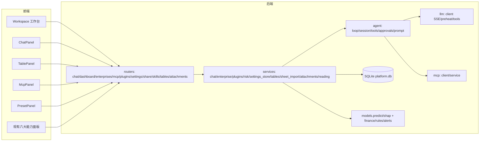

## 产品概述

将旧项目 risk-warning-platform 的 server/app 后端（Python FastAPI，P0–P5）与 web 全量界面迁入当前 financial-risk-warning-platform，并用 Python 重实现旧项目 Rust 独有的 P6（表格对象 + 多模态读取）。迁移后统一以 stock_code（6 位字符串）为业务主键，融合当前项目的 XGBoost/TreeSHAP 评分、SHAP 解释、面板数据与设计规范，保留 streamlit、Vue web、Electron 桌面端三种交付形态。

## 核心功能

- 企业档案与数据源：企业列表/建档/按 code 刷新公开财报与公告（akshare/新浪/东财），幂等入库
- 预警闭环：六维规则评分、预警生成/处置流转、报告
- 金融分析引擎：KPI、双轴趋势、杜邦分解、Altman Z/Z''、Piotroski F、Beneish M、异常勾稽、同业对标、Markdown 报告（已具备，保持并纳入统一入口）
- LLM Agent 对话：SSE 流式、工具调用、会话管理与上下文压缩、动作授权闸门、用量统计
- 技能库与插件：内置技能、手搓声明式 HTTP 插件、Agent 预设、会话导出/导入/分享
- MCP 双向：本平台作为 MCP 服务器对外提供工具，同时作为客户端接入外部 MCP 服务
- 设置面板：模型/端点/密钥的 DB 覆盖热生效，敏感字段掩码回显
- P6 表格对象：在线创建/编辑/撤销、勾稽校验（资产=负债+权益）拦截入库、与金融分析/六维评分联动
- P6 多模态：附件上传内容寻址去重、视觉读取识图填表、CSV/XLSX/TSV 确定性导入（宽长表识别、单位识别、数值容错）

## 视觉与交互

沿用旧项目 workspace/dock 工作台界面（命令面板打开对话/表格/MCP/预设面板），深色主题为默认，延续当前 Vue 的 C 配色常量与 ECharts 深色坐标轴适配，新面板与现有六大能力面板风格统一。

## 技术栈

- 后端：Python 3.12 + FastAPI + uvicorn（扩展现有 api/main.py），httpx 访问外部数据源与 LLM，akshare 公开数据，标准库 sqlite3 持久化
- LLM：复用并增强现有 api/services/llm.py 的 LlmClient（OpenAI 兼容 /chat/completions），补齐 SSE 流式、工具调用、用量统计、重试与提示词缓存预热
- 前端：Vue3 + TypeScript + Vite + ECharts（沿用现有技术栈），迁移旧 workspace/dock 面板
- 桌面端：Electron + PyInstaller 打包（沿用现有 desktop 链路）
- 数据：主键 stock_code；结构化业务数据落 SQLite（对齐 alerts.py 现有 stdlib sqlite3 用法），模型/面板数据继续用 parquet/pkl

## 技术架构

采用分层架构：路由层（api/routers）→ 服务层（api/services）→ 领域/数据层（api/db、api/agent、api/mcp、api/skills）。现有 finance/rules/alerts/datasources/analyze 服务与路由保持不变，新增模块以独立 router 挂载，避免破坏既有接口。

## 模块划分

- 路由层：新增 chat/dashboard/enterprises/mcp/plugins/settings/share/skills/tables/attachments 十个 router，挂载到 main.py
- 服务层：移植 enterprise/plugins/risk/settings_store，新增 chat、tables、sheet_import、attachments、reading
- Agent 层：移植 agent（loop/session/tools/approvals/context/events/prompt）与 llm（client 流式/preheat/tools）
- MCP 层：移植 mcp/client 与 mcp/service
- 技能层：移植 skills/service
- 数据层：新增 api/db（database/models/seed），用 stdlib sqlite3 建表与样例灌入
- P6：tables/sheet_import/attachments/reading 四服务，落实 status draft→confirmed→ingested、勾稽 BALANCE_MISMATCH、source=file 可信度 1.0、source=vision 未确认不得入库

## 关键决策

- 统一 stock_code 主键：旧 enterprise_id 口径替换为 6 位 code，finance/rules/alerts/datasources/analyze 已改造完成，作为范式
- 不引入 SQLAlchemy：沿用现有 alerts.py 的标准库 sqlite3 模式，避免与当前项目依赖冲突，降低 PyInstaller 打包体积
- 复用现有 finance/rules/alerts 服务：避免重复实现，Agent 工具与六维评分直接调用现有服务函数
- LLM 客户端增强而非重写：在现有 LlmClient 上补 SSE 流式与工具调用，保持 analyze.py 研判路径兼容
- 内容寻址存储：附件按 sha256 去重落 WRITABLE_DIR/attachments，Reading 形态支持历史文本化投影
- 金标准比对：金融引擎/规则/技能/预设/设置/MCP 用 parity 测试保证迁移一致性，P6 用探针验证

## 实现要点

- SSE 聊天流式响应用 StreamingResponse，工具结果超长时给出合法 JSON 截断说明
- 会话上下文压缩按 token 估算（阈值 0.8、保留 0.16），历史多模态轮次降级为文本投影
- 附件去重先算 sha256 再落盘，视觉读取结果 source=vision 必须确认后才允许入库
- 表格入库后联动金融分析与六维评分（无财报企业录入后即可分析）
- 新路由前缀加入 vite.config.ts 的 API_PREFIXES；打包脚本补充隐藏导入（api.routers/api.agent/api.mcp/api.skills/api.db）与运行时资产

## 设计风格

延续现有深色金融大屏风格：以深蓝黑底为主基调、毛玻璃卡片与细边框分隔，核心信息用 C 常量色（primary/ok/warn/danger）高亮。工作台采用 dock 面板布局，对话/表格/MCP/预设四类面板可组合停靠，命令面板统一打开，状态栏显示模型/连接状态。

## 页面规划

- 工作台（/workspace）：左侧命令/工具区 + 中央 dock 区，面板可拖拽停靠与开关
- 对话面板：SSE 流式气泡、附件缩略图、工具调用过程折叠展示、授权闸门交互
- 表格面板：电子表格式网格、勾稽校验提示、入库状态徽章、撤销/重做
- MCP 面板：外部 MCP 服务列表与连通状态、工具调用测试
- 预设面板：Agent 预设与插件列表、白名单工具过滤
- 共享对话页（/share/:token）：只读回放对话

## 交互与响应

面板支持拖拽停靠与尺寸调整，深浅主题切换时 ECharts 坐标轴随 themeVersion 重建；移动端 dock 降级为单列堆叠；加载态与错误态与现有页面统一。

## 推荐扩展

### SubAgent

- **code-explorer**
- 用途：在迁移实施阶段精确核对旧项目 server/app 各服务/路由与 Rust P6 的接口契约、业务规则与前端面板依赖
- 预期产出：端点清单、函数签名、勾稽与多模态规则、面板组件依赖，确保移植不遗漏、不臆造

### Skill

- **lsp-code-analysis**
- 用途：对旧项目 Rust/Python 与当前项目进行符号级导航，定位规则引擎、工具注册表、前端面板的调用关系
- 预期产出：关键定义与引用点，支撑按 stock_code 口径改造与功能对齐
- **xlsx**
- 用途：构造 CSV/XLSX/TSV 确定性导入样本并验证 P6 sheet_import 的宽长表识别、单位识别与数值容错
- 预期产出：可复用的导入测试样本与解析结果对照
- **playwright-cli**
- 用途：对迁移后的 Vue 工作台进行浏览器端到端冒烟，覆盖对话、表格、导入、共享页
- 预期产出：UI 冒烟通过记录，验证面板可交互且与后端联通