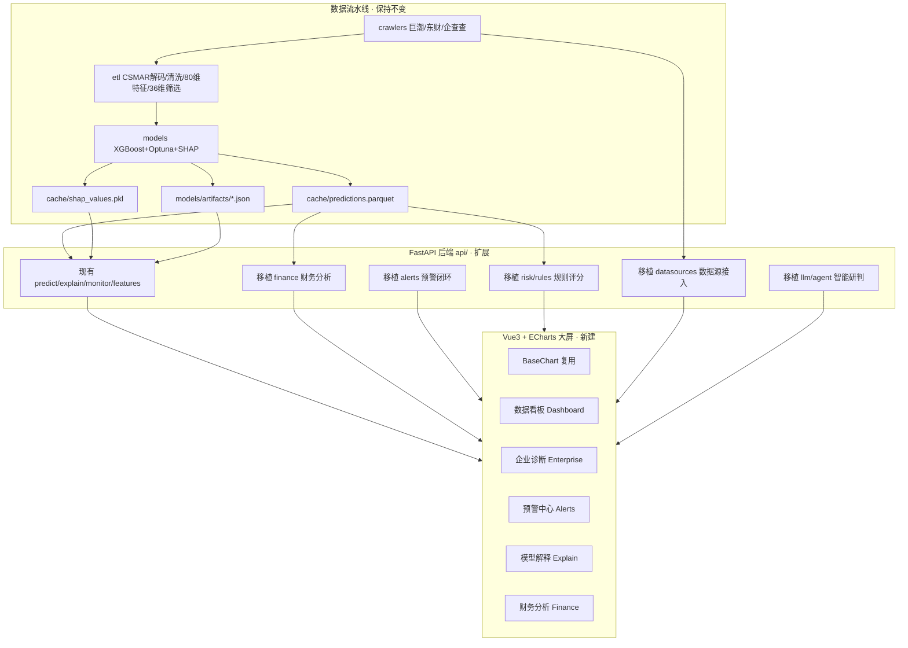
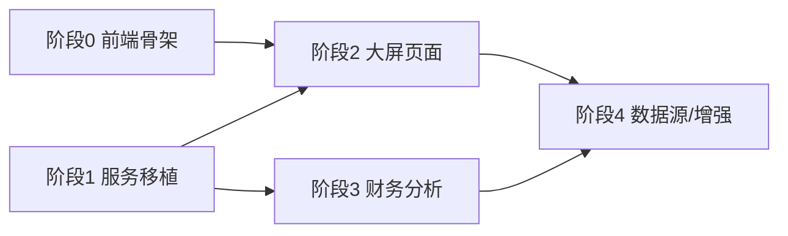

# 大屏平台开发设计方案

> 将 `financial-risk-warning-platform` 的展示层从 Streamlit 一次性迁移为 Vue3 + ECharts 专业大屏/看板，并系统性复用旧项目 `risk-warning-platform` 的前端组件骨架与后端服务能力（财务分析、预警闭环、规则评分、数据源接入、LLM/Agent 研判）。

| 项 | 内容 |
|---|---|
| 版本 | v1.0 |
| 日期 | 2026-11-15 |
| 适用范围 | 新项目 `financial-risk-warning-platform` 展示层重构 |
| 上游参考 | 旧项目 `risk-warning-platform`（`web/`、`server/app/`） |
| 关联文档 | `docs/FastAPI服务层设计.md`、`docs/前端架构与图表方案.md`、`docs/平台功能与预测设计.md`、`docs/数据字典与特征口径.md`、`docs/训练评估口径与模型选择.md` |

**来源标注约定**（贯穿全文）：

- `[复用]`：从旧项目直接迁移代码/组件，仅做数据源与字段适配。
- `[移植]`：算法/逻辑整体搬迁，重新适配新项目契约与数据访问层。
- `[新建]`：新项目原创实现。

---

## 1. 背景与目标

### 1.1 现状与问题

新项目已建成完整的「数据 → 特征 → 模型 → 展示」流水线：

- 数据流水线：`crawlers/`（巨潮/东财/企查查）→ `etl/`（CSMAR 解码、清洗、80 维特征、四步筛选 36 维）→ `models/`（XGBoost 五模型 + Optuna + TreeSHAP）。
- 服务层：`api/`（FastAPI 0.115），已实现 `/predict/*`、`/explain/*`、`/monitor/report`、`/features`。
- 展示层：`streamlit_app/`（Streamlit 1.29 + Plotly），6 页（首页、数据看板、企业诊断、批量预警、模型解释、报告导出）。

当前展示层存在定位偏差：**平台实际定位是大屏/看板**，而 Streamlit 适合快速原型与内部工具，在深色大屏视觉、精细布局、分辨率自适应、多屏联动、动效交互上能力有限。

旧项目恰好拥有一套成熟的专业看板实现（Vue3 + ECharts + 深色双主题 + 财务/风险/预警后端服务），可系统性拆借。

### 1.2 目标

1. **展示层 Vue 化**：以旧项目 `web/` 为骨架，一次性把展示层从 Streamlit 迁移为 Vue3 + ECharts 专业大屏。
2. **服务能力补齐**：把旧项目五项服务移植进新项目 `api/`，补齐「财务分析、预警闭环、规则评分、数据源接入、LLM/Agent 研判」。
3. **数据流水线不动**：`crawlers/etl/models` 及 parquet/pkl 数据资产保持不变，统一通过 FastAPI 对外暴露。
4. **口径单一来源**：风险等级、阈值、色板、特征口径对齐，消除「文档一套、代码一套」。

### 1.3 关键决策

| 决策 | 结论 | 理由 |
|---|---|---|
| 展示层路线 | 直接 Vue3 大屏迁移（不做过渡态） | 大屏是最终定位，过渡态造成双倍维护 |
| 后端归属 | 统一到新项目 `api/`，不引入旧项目 Rust/Python 服务进程 | 避免双进程、双数据源、双口径 |
| 服务复用策略 | 算法逻辑整体搬迁 + 数据访问层适配新项目契约 | 运行时零依赖旧项目 |
| 数据流水线 | 保持不变 | 已稳定产出模型与评分缓存 |

---

## 2. 总体架构设计

### 2.1 目标架构



### 2.2 分层职责

| 层 | 职责 | 变更 |
|---|---|---|
| 数据流水线 | 爬取 → ETL → 建模 → 评分/解释缓存 | 不变 |
| 服务层 `api/` | 统一对外契约，桥接数据资产与前端 | 扩展：移植五项服务 |
| 展示层 | Vue3 + ECharts 大屏，`fetch('/api/*')` | 新建（复用旧项目组件） |
| 配置 `config/` | 路径、阈值、色板、特征口径单一来源 | 微调：色板统一 |

### 2.3 前后端通信

- 前端 `web/src/api.ts` 统一封装 `fetch()`，开发期由 Vite 按路由前缀（`/predict`、`/explain`、`/finance`、`/alerts` 等）代理到 FastAPI（端口 8000）。注意：新项目 FastAPI 路由不含 `/api` 前缀。
- 生产由 FastAPI 托管 `web/dist` 静态资源（SPA fallback），同源部署。
- CORS：开发期放行 `http://localhost:5173`；生产同源无需 CORS。

---

## 3. Vue3 大屏前端设计

### 3.1 技术栈（`[复用]` 旧项目）

| 依赖 | 版本 |
|---|---|
| vue | ^3.5 |
| vue-router | ^5.3 |
| echarts | ^6.1 |
| vite | ^8.2 |
| typescript | ~6.0 |
| @vitejs/plugin-vue | ^6.0 |

**刻意保留的约束**：不引入第三方 UI 组件库、不引入 Pinia/Vuex、不引入 Tailwind，延续旧项目「手写 CSS + CSS 变量 + 自定义响应式 store」的轻量路线，保证深色大屏视觉可控。

### 3.2 目录结构（`[新建]`，以旧项目为骨架）

```
web/
├── index.html
├── vite.config.ts            # 按前缀代理（/predict 等）→ 127.0.0.1:8000
├── package.json
└── src/
    ├── main.ts               # createApp + router + 主题初始化
    ├── router.ts             # 大屏路由
    ├── App.vue               # 顶栏 + 主题切换 + 全局状态栏
    ├── style.css             # [复用] 双主题 CSS 变量 + 组件样式
    ├── api.ts                # [新建] 统一 API 客户端 + 类型（对照旧项目）
    ├── components/
    │   ├── BaseChart.vue     # [复用] ECharts 通用封装
    │   └── KpiCard.vue       # [复用] 统计卡（原 .stat-card）
    ├── views/
    │   ├── DashboardView.vue     # [复用+改造] 数据看板
    │   ├── EnterpriseView.vue    # [复用+改造] 企业诊断（融合 SHAP）
    │   ├── AlertsView.vue        # [复用+改造] 预警中心
    │   ├── ExplainView.vue       # [新建] 模型解释
    │   ├── FinanceView.vue       # [复用] 财务分析
    │   └── ReportView.vue        # [新建] 报告导出
    └── lib/
        ├── levels.ts         # [复用] 风险等级色板 + 工具函数
        └── format.ts         # [复用] fmtTime 等
```

### 3.3 组件复用映射表

| 旧项目组件 | 大屏目标 | 处理方式 | 说明 |
|---|---|---|---|
| `components/BaseChart.vue` | 通用图表 | `[复用]` | init/resize/dispose + watch 深度更新，直接搬 |
| `views/DashboardView.vue` | 数据看板 | `[复用+改造]` | 统计卡/环形分布/堆叠柱/时间线/矩阵表，数据源改为 `/api/predict/top-risk`、`/api/features` |
| `views/EnterpriseDetailView.vue` | 企业诊断 | `[复用+改造]` | 六维雷达 + 评级标尺 + 评分明细，维度改为新项目 6 维；叠加 SHAP 瀑布图 |
| `views/AlertsView.vue` | 预警中心 | `[复用+改造]` | 统计卡/chips/列表详情双栏/处置流水，接 `/api/alerts/*` |
| `views/FinanceView.vue` | 财务分析 | `[复用]` | KPI/趋势/杜邦/Z·F·M/同业对标，接 `/api/finance/*` |
| `views/EnterprisesView.vue` | 企业列表 | `[复用+改造]` | 列表 + 跳转诊断，主键从 `id` 改为 `stock_code` |
| `views/AnalyzeView.vue` | 智能研判 | `[复用+改造]` | 可选，接 LLM/Agent 研判（P2） |
| `views/ShareView.vue` | 只读分享 | `[复用]` | 可选 |
| `components/SpreadsheetGrid.vue` | 在线表格 | `[暂缓]` | 非大屏核心，P2 再议 |
| `panels/*`（Chat/Table/Mcp/Preset） | — | `[删除]` | 工作台对话面板，不在大屏范围 |
| `workspace/*`（DockZone/store/StatusBar） | — | `[删除]` | 停靠式工作台，大屏用固定栅格布局替代 |

### 3.4 主题与色板（`[复用]` + 统一）

#### 3.4.1 深色主题（`[复用]` `web/src/style.css`）

```css
[data-theme='dark'] {
  --text: #e2e8f0;
  --text-sub: #94a3b8;
  --bg: #0b1220;        /* 大屏主背景 */
  --bg-elev: #111a2e;
  --card: #131d33;      /* 卡片背景 */
  --border: #24314f;
  --border-soft: #1b2740;
  --hover: #17223a;
  --sidebar: #080e1c;
  --shadow: 0 1px 2px rgba(0,0,0,.3), 0 8px 24px rgba(0,0,0,.35);
}
```

主色 `--primary: #2563eb`、强调色 `--accent: #06b6d4`、语义色 `--ok #16a34a` / `--warn #d97706` / `--danger #dc2626` 保持不变。字体 `Microsoft YaHei / PingFang SC`。

#### 3.4.2 风险等级色板（口径统一）

新旧项目存在**两套风险等级口径**，必须显式对齐，否则看板与论文/模型口径冲突：

| 口径 | 旧项目（规则五档） | 新项目（模型三档，权威） |
|---|---|---|
| 定义 | `red/orange/yellow/green/gray` | `高风险/中风险/低风险` |
| 依据 | 六维规则评分 0~100 | XGBoost 概率 `st_prob` + `RISK_THRESHOLDS` |
| 阈值 | ≥85 green / ≥70 yellow / ≥55 orange / else red | ≥0.50 高风险 / ≥0.25 中风险 / else 低风险 |

**统一策略**：主风险等级以模型概率三档为准（与新项目 `config/settings.py`、`model_meta.json` 同源）；色板沿用旧项目 `LEVELS` 色相并扩展三档语义，收敛到 `config/settings.py` 的 `RISK_COLORS`：

```python
RISK_COLORS = {
    "高风险": "#dc2626",   # 原 #d62728 统一为旧项目 red
    "中风险": "#ea580c",   # 原 #ff9f1c 统一为旧项目 orange
    "低风险": "#16a34a",   # 原 #2ca02c 统一为旧项目 green
    "数据不足": "#94a3b8",
}
```

前端 `lib/levels.ts` 沿用旧项目 `LEVELS`、`gradeColor`、`scoreColor`、`levelOf`、`fmtTime` 工具函数（`[复用]`），仅将等级枚举与后端三档对齐。

### 3.5 页面划分与路由

| 路由 | 页面 | 复用来源 | 数据源（API） |
|---|---|---|---|
| `/` | 数据看板 | `DashboardView.vue` | `/api/predict/top-risk`、`/api/model/meta`、`/api/monitor/report` |
| `/enterprises` | 企业列表 | `EnterprisesView.vue` | `/api/predict/codes`（批量查询） |
| `/enterprise/:code` | 企业诊断 | `EnterpriseDetailView.vue` | `/api/predict/codes`、`/api/explain/{code}`、`/api/risk/rules/{code}` |
| `/alerts` | 预警中心 | `AlertsView.vue` | `/api/alerts/*` |
| `/explain` | 模型解释 | `[新建]` | `/api/explain/global`、`/explain/dependence`、`/explain/interactions` |
| `/finance/:code` | 财务分析 | `FinanceView.vue` | `/api/finance/*` |
| `/report` | 报告导出 | `[新建]` | `/api/finance/{code}/report`、`/api/alerts/{id}/report` |

### 3.6 大屏适配设计（`[新建]`）

Streamlit 不具备、而 Vue 大屏必须补的能力：

1. **分辨率自适应**：以 1920×1080 为基准，用 `transform: scale()` 等比缩放适配任意分辨率，或 CSS Grid + `vh/vw` 流式布局。
2. **多屏联动**：顶栏全局「筛选年份/行业」状态，跨页面与图表联动（`reactive store` 实现，延续旧项目 `workspace/store.ts` 的自定义响应式思路）。
3. **深色主题强制**：大屏默认锁定 `data-theme='dark'`，仅保留手动切换入口。
4. **ECharts 性能**：`BaseChart.vue` 已含 resize/dispose 生命周期管理；大数据量矩阵表用虚拟滚动或分页。
5. **自动刷新**：看板顶部定时器（如 60s）刷新 `/api/predict/top-risk`，配合轮询。

---

## 4. 后端服务复用与移植设计

### 4.1 移植总原则

1. **算法逻辑整体搬迁，数据访问层重写**：五项服务的计算逻辑从旧项目 `server/app/services/` 搬运，但旧项目依赖 SQLAlchemy 的 SQLite 企业库，新项目无此库，需改为从 `data/` 的 parquet/csv 读取。
2. **主键适配**：旧项目主键为 `enterprise_id`（整数），新项目主键为 `stock_code`（6 位字符串），所有接口与查询统一改用 `stock_code`。
3. **与 XGBoost 双引擎融合**：规则评分与模型概率并列输出，模型概率为主风险等级，规则评分作为维度细分与可解释性补充。
4. **异常与降级**：延续新项目 `api/services.py` 的 `ServiceUnavailable → 503` 模式，数据缺失不报 500。

### 4.2 财务分析服务 `finance.py`（`[移植]`）

**来源**：`risk-warning-platform/server/app/services/finance.py`（49KB，六块能力：概览 KPI、趋势序列、杜邦分解、Z/F/M 财务预警模型、同业对标、异常勾稽）。

**数据依赖映射**：

| 能力 | 旧数据依赖 | 新数据依赖 |
|---|---|---|
| KPI / 趋势 | `Finance` 表（metrics_json） | `data/cleaned/panel_clean.parquet`、`feature_store/panel_features.parquet` |
| 杜邦分解 | 净利率/总资产周转率/权益乘数 | `feature_registry` 已有 `net_margin/asset_turnover/equity_multiplier` |
| Altman Z/Z'' | 营运资本/留存收益/EBIT/权益市值/负债 | `panel_clean.parquet` 原始科目重算 |
| Piotroski F / Beneish M | 9 项信号 / 8 项指数 | 原始三表科目（`csmar_financial.csv` 契约列） |
| 同业对标 | 同行业分位数 | 已有 `metrics_by_industry.csv`、`industry_roa_gap/industry_debt_gap` |
| 异常勾稽 | 规则引擎 | 直接搬运 |

**新增路由**：

```
GET /api/finance/overview                         # 全量财务概览列表
GET /api/finance/{code}/analysis?years=5&peers=true  # 单企业深度分析
GET /api/finance/{code}/report?years=5            # 财务报告（Markdown/PDF）
```

**契约**：复用旧项目 `FinanceAnalysis` / `FinanceKpi` / `FinanceSeries` / `DupontRow` / `AltmanModel` / `peers` / `anomalies` 响应结构（见旧项目 `web/src/api.ts` 第 76~177 行），仅将 `enterprise.id` 替换为 `stock_code`。

### 4.3 预警闭环 `alerts.py`（`[移植]`）

**来源**：`risk-warning-platform/server/app/services/alerts.py`（生成/列表/处置流转/报告，闭环：评分触发 → 人工处置 → 流水留痕）。

**移植点**：

- 预警生成：沿用「企业+维度+等级」指纹幂等去重（`fingerprint = "{code}:{dimension}:{level}"`）。
- 处置状态机：`pending → handling → resolved/ignored`，动作 `start/resolve/ignore/reopen`，沿用 `transitions` 表。
- **持久化**：新项目无 SQLite，引入轻量存储（`sqlite3` 标准库或 `SQLModel`），落盘 `cache/alerts.db`，与数据资产同目录。
- 报告导出：`report_markdown` 沿用，数据来源描述改为「CSMAR + 公开信源」。

**新增路由**：

```
GET    /api/alerts?status=&level=&stock_code=    # 预警列表
GET    /api/alerts/summary                       # 统计（总数/待处理/处理中/按等级）
POST   /api/alerts/generate                      # 批量生成（基于预测结果 + 规则）
POST   /api/alerts/{id}/handle                   # 处置流转
GET    /api/alerts/{id}/report                   # 预警报告
```

### 4.4 规则评分 `risk/rules.py`（`[移植]`）

**来源**：`risk-warning-platform/server/app/services/rules.py`（六维评分引擎 0~100）+ `risk.py`（LLM 研判）。

**移植点**：

- `rules.py` 的六维评分（`dim_score`、`score_to_level`、`grade_of`、`rules_verdict`）整体搬运。
- 数据映射：旧项目六维为 `finance/legal/news/operation/credit/supply`（经营风险视角），映射到新项目数据：

| 旧项目规则维度 | 新项目数据源 |
|---|---|
| finance 财务健康 | `feature_store` 的 solvency/profitability/cashflow 特征 + `panel_clean.parquet` |
| legal 法律合规 | `data/raw/legal_events.csv`（`litigation_count/penalty_count` 特征） |
| news 舆情声誉 | `data/raw/text_sentiment.csv`（`mdna_negative/sentiment_polarity` 特征） |
| operation 经营能力 | `growth/operation` 特征 |
| credit 信用状况 | `legal_events.csv` 失信/被执行字段（需从原始表提取） |
| supply 供应链稳定 | 暂缺，标注 `[P2 数据缺口]` |

- **双引擎融合**：`/api/risk/rules/{code}` 返回六维规则评分 + AAA~C 评级；`/api/predict/codes` 返回模型三档概率。前端企业诊断页同时展示二者，主等级以模型概率为准。

**新增路由**：

```
GET /api/risk/rules/{code}    # 规则六维评分 + 评级（补充模型解释）
```

### 4.5 数据源接入 `datasources`（`[移植]`）

**来源**：`risk-warning-platform/server/app/datasources/registry.py`（多源降级链 + 字段级合并 + 幂等入库）。

**移植点**：

- 复用 `SOURCES` 优先级表与 `MERGE_DIMS` 合并策略（`finance/news` 多源合并，其余降级优先）。
- 数据源实现：旧项目 `akshare_src`（东财摘要 + 巨潮诉讼）、`sina_src`（新浪三表）、`announcement_src`（东财公告）作为**增量补充**接入新项目 `crawlers/`，弥补实时行情与财务摘要缺失。
- 幂等入库逻辑（`upsert_records`）沿用，目标存储改为 parquet 增量合并（或并入 `data/raw` 契约表）。

**新增路由**：

```
GET  /api/datasources                       # 数据源状态
POST /api/enterprise/{code}/refresh         # 刷新单企业（触发重算 + 预警）
```

### 4.6 LLM/Agent 智能研判（`[移植]`，P2）

**来源**：`risk-warning-platform/server/app/llm/`（OpenAI 兼容网关）+ `server/app/agent/`（Agent 循环/工具/会话）+ `risk.py`（LLM 研判交叉校验）。

**移植点**（工作量大，标记 P2）：

- `llm/client.py`（三参数 `base_url/api_key/model`）+ `risk.py` 的 `_run_agent` 工具调用循环 + `_extract_json` 容错解析。
- Agent 循环 / 会话压缩 / 插件 / MCP / 技能库属于通用能力，建议**先不搬**，仅复用「LLM 研判 + 规则交叉校验」核心切片。
- 可选路由：`POST /api/analyze/{code}`（LLM 研判，规则为准交叉校验）。

**优先级**：五项服务中，`finance`/`alerts`/`risk-rules` 为 P0（大屏刚需），`datasources` 为 P1（增量补充），`LLM/Agent` 为 P2（增强，非阻塞）。

---

## 5. 前后端接口契约

### 5.1 路由总表（现有 + 新增）

| 前缀 | 方法 | 路径 | 来源 | 说明 |
|---|---|---|---|---|
| — | GET | `/health` | `[现有]` | 健康检查 + run_id + artifacts |
| — | GET | `/model/meta` | `[现有]` | 模型元信息 |
| — | POST | `/predict/codes` | `[现有]` | 批量评分 |
| — | POST | `/predict/frame` | `[现有]` | what-if 打分（501 占位） |
| — | GET | `/predict/top-risk` | `[现有]` | Top-N 高风险 |
| — | GET | `/explain/global` | `[现有]` | 全局重要性 |
| — | GET | `/explain/dependence` | `[现有]` | 依赖效应 |
| — | GET | `/explain/interactions` | `[现有]` | 交互效应 |
| — | GET | `/explain/{code}` | `[现有]` | 单企业 SHAP |
| — | GET | `/monitor/report` | `[现有]` | 监控报告 |
| — | GET | `/features` | `[现有]` | 特征字典 |
| finance | GET | `/finance/overview` | `[新增·移植]` | 财务概览 |
| finance | GET | `/finance/{code}/analysis` | `[新增·移植]` | 财务深度分析 |
| finance | GET | `/finance/{code}/report` | `[新增·移植]` | 财务报告 |
| alerts | GET | `/alerts` | `[新增·移植]` | 预警列表 |
| alerts | GET | `/alerts/summary` | `[新增·移植]` | 预警统计 |
| alerts | POST | `/alerts/generate` | `[新增·移植]` | 批量生成 |
| alerts | POST | `/alerts/{id}/handle` | `[新增·移植]` | 处置流转 |
| alerts | GET | `/alerts/{id}/report` | `[新增·移植]` | 预警报告 |
| risk | GET | `/risk/rules/{code}` | `[新增·移植]` | 规则六维评分 |
| — | GET | `/datasources` | `[新增·移植]` | 数据源状态 |
| — | POST | `/enterprise/{code}/refresh` | `[新增·移植]` | 刷新单企业 |

### 5.2 关键响应结构

#### 5.2.1 批量评分 `/predict/codes`（`[现有]`，主数据源）

```jsonc
{
  "run_id": "20261114-213525-da08d92c",
  "semantics": "特征年 T → 标签年 T+2 的 ST 风险概率",
  "items": [
    {
      "stock_code": "000001",
      "company_name": "示例股份",
      "industry": "计算机、通信和其他电子设备制造业",
      "year": 2023,
      "st_prob_raw": 0.612,
      "st_prob": 0.578,        // 校准后概率（主风险等级依据）
      "risk_level": "高风险",   // 三档：高风险/中风险/低风险
      "risk_percentile": 96.2
    }
  ],
  "unmatched": []
}
```

#### 5.2.2 企业诊断聚合（前端合成 `[新建]`）

企业诊断页由三个接口聚合：`/predict/codes`（模型概率）+ `/explain/{code}`（SHAP 贡献）+ `/risk/rules/{code}`（规则六维）。前端 `api.ts` 组装为诊断视图，结构参考旧项目 `RiskSnapshot` / `AnalyzeResp`：

```jsonc
{
  "stock_code": "000001",
  "model": { "st_prob": 0.578, "risk_level": "高风险", "risk_percentile": 96.2 },
  "rules": {
    "score": 62.5, "grade": "BBB", "grade_label": "关注", "level": "orange",
    "dimensions": { "finance": { "score": 58, "level": "orange", "note": "..." } }
  },
  "shap": { "contributions": [{ "feature": "debt_to_asset", "value": 0.083 }] }
}
```

#### 5.2.3 财务分析 `/finance/{code}/analysis`（`[移植]`）

复用旧项目 `FinanceAnalysis` 结构（旧项目 `web/src/api.ts` 第 123~177 行）：`kpi[]`、`trends`、`dupont{formula,rows,attribution}`、`models{altman,piotroski,beneish}`、`peers`、`anomalies[]`、`data_quality`。唯一改动：`enterprise` 对象由 `{id,name,...}` 改为 `{stock_code,company_name,industry,...}`。

### 5.3 数据字段映射表

| 概念 | 旧项目字段 | 新项目字段/来源 | 说明 |
|---|---|---|---|
| 企业主键 | `enterprise.id`（int） | `stock_code`（6 位 str） | 全链路替换 |
| 企业名称 | `name` | `company_name` | `predictions.parquet` |
| 行业 | `industry` | `industry`（证监会门类） | `feature_registry`/面板 |
| 风险概率 | — | `st_prob`（校准后） | `cache/predictions.parquet` |
| 风险等级 | `level`（五档） | `risk_level`（三档） | 以模型三档为准 |
| 规则评分 | `rules.score`（0~100） | `/risk/rules/{code}` | 补充视图 |
| 评级 | `grade` + `grade_label`（AAA~C） | 沿用 | `rules.py` `GRADE_TABLE` |
| 特征贡献 | — | `shap.contributions` | `shap_values.pkl` |
| 财务指标 | `Finance.metrics_json` | `panel_clean.parquet` 科目 | finance 服务重算 |
| 预警状态 | `status`（pending/handling/...） | 沿用 | `alerts.db` |
| 处置流水 | `notes_json` | 沿用 | `alerts.db` |

### 5.4 六维口径差异说明（重要）

| 维度体系 | 维度 | 用途 |
|---|---|---|
| 旧项目 `DIM_LABEL`（经营风险六维） | finance/legal/news/operation/credit/supply | 规则引擎 + 预警工单 |
| 新项目 `RADAR_DIMENSIONS`（财务健康六维） | solvency/profitability/operation/growth/cashflow/governance | 企业诊断雷达图 |

二者维度语义不同：旧项目是「经营风险」视角（含法律/舆情/信用/供应链），新项目是「财务健康」视角（纯财务特征）。大屏企业诊断页以**新项目 6 维财务雷达为主视图**；若启用规则引擎，则叠加旧项目 6 维经营风险作为第二视图，避免混用。

---

## 6. 分阶段实施路线

### 6.1 阶段划分

| 阶段 | 内容 | 产出 | 优先级 |
|---|---|---|---|
| 阶段 0 | 前端骨架搭建 | Vue 工程 + 主题 + BaseChart + 路由 | P0 |
| 阶段 1 | 服务移植 | finance/alerts/risk-rules 三个服务 + 路由 | P0 |
| 阶段 2 | 大屏页面实现 | 数据看板/企业诊断/预警中心/模型解释 | P0 |
| 阶段 3 | 财务分析与报告 | FinanceView + 报告导出 | P1 |
| 阶段 4 | 数据源与增强 | datasources 接入 + LLM/Agent | P1/P2 |

### 6.2 阶段任务拆解（可执行）

**阶段 0 — 前端骨架**（`[复用]`）
1. 以旧项目 `web/` 为底，复制 `package.json`、`vite.config.ts`、`index.html`、`style.css`、`components/BaseChart.vue`。
2. 重写 `router.ts` 为大屏路由（见 §3.5）。
3. 新建 `api.ts`（对照旧项目，去掉 chat/mcp/plugins/tables/attachments 等非大屏接口）。
4. 校验 `fetch('/api/predict/top-risk')` 联通。

**阶段 1 — 服务移植**（`[移植]`）
1. 新建 `api/services/finance.py`：搬旧项目 `finance.py`，数据访问改为读 parquet。
2. 新建 `api/services/alerts.py` + `cache/alerts.db`（SQLite）。
3. 新建 `api/services/rules.py`：搬六维评分，数据映射见 §4.4。
4. `api/main.py` 注册 `/finance/*`、`/alerts/*`、`/risk/rules/*` 路由。
5. 单元测试：各接口在 `DEMO_MODE=1` 下返回合法 JSON。

**阶段 2 — 大屏页面**（`[复用+改造]`）
1. `DashboardView.vue`：接 `/predict/top-risk`，改造统计卡与图表数据源。
2. `EnterpriseView.vue`：聚合 `/predict/codes` + `/explain/{code}` + `/risk/rules/{code}`。
3. `AlertsView.vue`：接 `/alerts/*`，实现处置流转交互。
4. `ExplainView.vue`：新建，接 `/explain/global|dependence|interactions`。

**阶段 3 — 财务分析与报告**（`[复用]`）
1. `FinanceView.vue`：接 `/finance/*`。
2. `ReportView.vue`：导出入口（财务报告 + 预警报告）。

**阶段 4 — 数据源与增强**（`[移植]`）
1. `datasources/` 移植 + `/api/datasources`、`/api/enterprise/{code}/refresh`。
2. LLM/Agent 研判（P2，视需要）。

### 6.3 依赖关系



---

## 7. 风险与对策

| 风险 | 影响 | 对策 |
|---|---|---|
| 数据访问层重写不彻底（finance 依赖 SQLite 表） | 服务移植后算不出结果 | 阶段 1 先用 `DEMO_MODE` 数据打通，再切真实 parquet；单测覆盖 |
| 主键 `id → stock_code` 遗漏 | 接口 404/错位 | 契约层统一校验 `CODE_PATTERN = ^\d{6}$`（沿用 `api/schemas.py`） |
| 两套风险等级口径冲突 | 看板与论文不一致 | §3.4.2 统一策略：主等级用模型三档，色板统一到 `RISK_COLORS` |
| 六维雷达语义混淆 | 诊断页误导 | §5.4 明确两套维度体系，主视图用财务六维 |
| 大屏分辨率适配成本 | 部署时变形 | 阶段 0 即引入 `scale()` 基准适配，避免后期返工 |
| LLM/Agent 范围蔓延 | 工期失控 | 阶段 4 才做，且只复用「研判+交叉校验」核心切片 |

### 7.1 回退策略

- **前端**：Vue 工程独立于 Streamlit，`streamlit_app/` 保留不动，迁移期间两条展示路径并存，随时可切回。
- **后端**：新增路由为增量扩展，不改动现有 `/predict`、`/explain` 契约，现有 Streamlit 页面不受影响。
- **数据**：所有新落盘文件（`cache/alerts.db` 等）与现有数据资产同目录、可独立删除。

---

## 8. 附：来源标注汇总

| 模块 | 复用方式 | 源路径 |
|---|---|---|
| 前端骨架/组件/主题 | `[复用]` | `risk-warning-platform/web/` |
| API 类型与契约参考 | `[复用]` | `risk-warning-platform/web/src/api.ts` |
| 财务分析服务 | `[移植]` | `risk-warning-platform/server/app/services/finance.py` |
| 预警闭环服务 | `[移植]` | `risk-warning-platform/server/app/services/alerts.py` |
| 规则评分引擎 | `[移植]` | `risk-warning-platform/server/app/services/rules.py` |
| LLM 研判切片 | `[移植]` | `risk-warning-platform/server/app/services/risk.py` + `llm/` |
| 数据源接入 | `[移植]` | `risk-warning-platform/server/app/datasources/registry.py` |
| 现有模型/数据服务 | `[现有]` | `financial-risk-warning-platform/api/`、`models/`、`config/` |
| 大屏适配/模型解释页 | `[新建]` | — |
