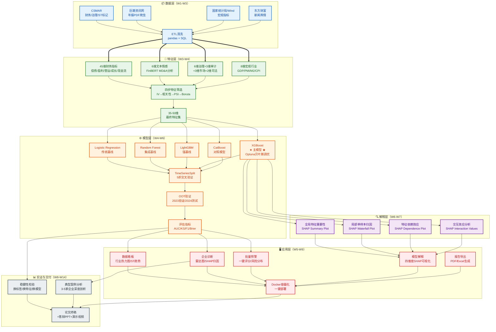

# 上市公司财务风险智能预警平台——开题报告"研究内容与技术路线"章节写作蓝图

> **使用说明**：本文档是开题报告"研究内容与技术路线"章节的完整写作蓝图，含技术路线图的可运行绘图代码。按照本蓝图撰写，可直接生成符合国内高校硕士开题规范的章节内容（建议总字数6,000-8,000字），并产出两张学术规范的技术路线图。

---

## 框架总览

```
第三章 研究内容与技术路线（建议总字数：6,000-8,000字）
├── 3.1 研究内容
│   ├── 3.1.1 多源异构数据采集与特征工程体系构建（~1,200字）
│   ├── 3.1.2 基于XGBoost的财务风险预警模型构建与优化（~1,200字）
│   ├── 3.1.3 基于SHAP的四维度可解释性分析体系（~1,000字）
│   ├── 3.1.4 基于Streamlit的智能预警平台设计与开发（~1,000字）
│   └── 3.1.5 实证检验与典型案例分析（~800字）
├── 3.2 拟解决的关键问题（~600字）
├── 3.3 技术路线
│   ├── 3.3.1 总体技术架构（~400字）
│   ├── 3.3.2 分阶段实施方案（~800字）
│   └── 3.3.3 工具链与数据源对应关系（~300字）
└── 3.4 技术路线图（图+图注，~200字说明）
```

---

## 3.1 研究内容

### 3.1.1 多源异构数据采集与特征工程体系构建

| 要素 | 内容 |
|------|------|
| **核心任务** | 构建覆盖财务指标、文本情感、公司治理、宏观环境四维度的70+维特征体系，并通过四步筛选法确定最优特征子集 |
| **预期产出** | ① 清洗后的公司-年面板数据集（≥5,000条观测值）；② 70+维原始特征矩阵；③ 35-50维最终特征集及筛选报告 |
| **文献呼应** | 回应§2.4非财务特征融入的前沿研究；弥补§2.5.2中"特征体系碎片化"的Research Gap |
| **建议字数** | ~1,200字 |

**写作模板**：

> 本研究的首要任务是构建一个覆盖多维度信息源的财务风险预警特征体系。具体包括以下三个子任务：
>
> **（1）多源数据采集。** 财务数据（偿债/盈利/营运/成长/现金流五大类45维指标）和公司治理数据（股权集中度/董事会规模/独董比例等6维指标）从CSMAR数据库获取；年报MD&A文本通过自主开发的Scrapy爬虫从巨潮资讯网下载并解析，使用FinBERT模型提取正面/负面/不确定性等6维文本情感特征；宏观经济指标（GDP/M2/CPI/PMI等8维）从国家统计局和Wind数据库获取。数据采集时间跨度为2015-2024年，样本范围为沪深A股制造业上市公司（证监会行业分类C类），剔除金融业、房地产业及数据缺失严重的企业。
>
> **（2）标签定义与样本配对。** 以T年被实施ST/*ST处理作为财务风险的正样本标签，使用T-2年及更早数据预测T年ST状态以避免前视偏差。采用1:3近邻匹配法（匹配变量：行业、年份、总资产对数）构建平衡样本集，预计获得约5,000条公司-年观测值。
>
> **（3）四步特征筛选。** 为确保特征体系的预测力和稳定性，设计IV值筛选（IV≥0.1保留）→相关性去冗余（\|r\|>0.85剔除）→PSI稳定性检验（PSI≤0.25保留）→Boruta重要性确认的四步筛选流程，最终保留35-50维高质量特征用于模型训练。

**复用指引**：实施方案§1.1-§1.3的内容需精简改写为上述三段式结构；具体参数值可直接引用。

### 3.1.2 基于XGBoost的财务风险预警模型构建与优化

| 要素 | 内容 |
|------|------|
| **核心任务** | 构建XGBoost主模型并与四个基线模型对比，通过Optuna贝叶斯优化调参，采用TimeSeriesSplit+OOT双层验证策略评估性能 |
| **预期产出** | ① 五模型对比评估报告（AUC/KS/F1/Brier）；② Optuna最优超参数组合；③ OOT验证下的最终性能指标 |
| **文献呼应** | 回应§2.2.1集成学习研究进展；弥补§2.5.2中"验证策略规范性不足"的Research Gap |
| **建议字数** | ~1,200字 |

**写作模板**：

> 在特征体系确定的基础上，本研究将构建以XGBoost为核心的财务风险预警模型，并通过严格的对比实验和验证策略确保模型的可靠性和泛化能力。具体包括以下三个子任务：
>
> **（1）基线模型对比实验。** 设置Logistic Regression（传统统计基线）、Random Forest（集成学习基线）、LightGBM（强基线）、CatBoost（类别特征对照）四个对比模型，与XGBoost主模型在统一实验框架下进行公平比较。所有模型均采用5折TimeSeriesSplit交叉验证，避免随机K折导致的未来信息泄露问题（Dasilas & Rigani, 2024）。评估指标包括AUC-ROC、KS统计量、F1-Score和Brier Score，其中AUC为主指标，KS为金融风控行业标准指标。
>
> **（2）超参数贝叶斯优化。** 使用Optuna框架的TPE采样器对XGBoost的9个关键超参数（max_depth/min_child_weight/subsample/colsample_bytree/gamma/reg_alpha/reg_lambda/learning_rate/scale_pos_weight）进行贝叶斯搜索，配合MedianPruner剪枝和EarlyStopping早停机制，在100次trial内高效收敛到最优配置。
>
> **（3）时间序列外验证（OOT）。** 以2015-2022年为训练集、2023年为验证集（用于超参数选择和阈值确定）、2024年为测试集（仅用于最终报告），严格模拟真实预测场景。同时设计安慰剂检验（随机打乱标签后AUC应≈0.5）和多种子稳定性检验（5个随机种子下AUC标准差<0.01）作为稳健性保障。

**复用指引**：实施方案§2.1-§2.4的内容精简改写；Grinsztajn (2022) 和 Gunnarsson (2021) 的选型依据需在文中明确引用。

### 3.1.3 基于SHAP的四维度可解释性分析体系

| 要素 | 内容 |
|------|------|
| **核心任务** | 构建全局重要性、局部归因、特征依赖、交互效应四维度的SHAP分析体系，揭示模型决策逻辑和风险因子作用机制 |
| **预期产出** | ① 全局Top20特征重要性排序；② 单企业风险归因瀑布图；③ 关键特征的依赖效应曲线；④ Top10特征对交互热力图 |
| **文献呼应** | 回应§2.3 SHAP/XAI应用进展；弥补§2.5.2中"可解释性与精度割裂"的Research Gap |
| **建议字数** | ~1,000字 |

**写作模板**：

> 为解决机器学习模型的"黑箱"问题，本研究将基于SHAP（SHapley Additive exPlanations）框架构建四维度的可解释性分析体系，使预警结果不仅"准确"而且"可理解"。四个维度分别为：
>
> **（1）全局特征重要性。** 计算所有样本SHAP值绝对值的均值并排序，识别对财务风险预测贡献最大的Top20特征，回答"哪些因素最重要"的问题。该分析将与传统Feature Importance进行对比，展示SHAP在捕捉非线性贡献方面的优势。
>
> **（2）局部单样本归因。** 针对特定企业生成SHAP Waterfall Plot，将该企业的高风险或低风险评分分解为各特征的正向/负向贡献，回答"这家企业为什么高风险"的问题。该功能是预警平台区别于传统论文表格的核心交互能力。
>
> **（3）特征依赖效应。** 绘制关键特征的SHAP Dependence Plot，揭示特征值与SHAP贡献之间的非线性关系和阈值拐点，例如资产负债率在何种水平以上会显著推高风险评分。
>
> **（4）特征交互效应。** 计算SHAP Interaction Values并生成热力图，识别特征间的协同或拮抗关系，例如"高负债率×非标审计意见"的交互效应是否显著大于两者单独效应之和。该分析直接回应Chen等 (2022) 提出的交互效应分析方法论。

**复用指引**：实施方案§2.5的内容精简改写；Lundberg (2017, 2020) 的理论基础在文献综述中已阐述，此处侧重应用设计。

### 3.1.4 基于Streamlit的智能预警平台设计与开发

| 要素 | 内容 |
|------|------|
| **核心任务** | 开发包含数据看板、企业诊断、批量预警、模型解释、报告导出五大模块的Streamlit交互式预警平台，并实现Docker容器化部署 |
| **预期产出** | ① 可运行的Streamlit平台（五大模块）；② Docker镜像及一键部署脚本；③ 平台使用手册 |
| **文献呼应** | 回应§2.5.2中"从论文到系统的落地鸿沟"的Research Gap |
| **建议字数** | ~1,000字 |

**写作模板**：

> 为弥合学术研究与实务应用之间的落地鸿沟，本研究将基于Streamlit框架开发一个面向上市公司财务风险的智能预警平台。平台包含五个核心功能模块：
>
> **（1）数据看板（Dashboard）。** 以行业风险热力图、年度ST趋势图、TOP20高风险企业列表和宏观经济仪表盘为核心组件，提供全局风险态势感知能力。
>
> **（2）企业诊断（Diagnosis）。** 用户输入股票代码后，系统展示风险评级卡片、六维雷达图、SHAP归因瀑布图和历史风险轨迹，实现对单个企业的深度风险剖析。
>
> **（3）批量预警（Batch Screening）。** 支持上传股票列表或CSV文件，一键批量评分并输出风险等级分布，满足机构投资者和监管部门的组合筛查需求。
>
> **（4）模型解释（Model Explanation）。** 集成四维度SHAP可视化（全局重要性/瀑布图/依赖图/交互热力图）和五模型对比ROC曲线，使平台的分析过程透明可审计。
>
> **（5）报告导出（Report Export）。** 支持生成单企业PDF风险诊断报告和批量Excel预警清单，便于线下传阅和存档。
>
> 平台采用Docker容器化部署，确保环境一致性和答辩现场的可靠性。性能优化方面，通过`@st.cache_resource`缓存模型和SHAP值、Parquet格式存储特征数据、Tab懒加载图表等措施，确保所有交互操作响应时间<2秒。

**复用指引**：实施方案§3.1-§3.3的内容精简改写；此处侧重功能设计和学术价值，代码细节放入附录或论文系统设计章节。

### 3.1.5 实证检验与典型案例分析

| 要素 | 内容 |
|------|------|
| **核心任务** | 通过多层次稳健性检验验证模型可靠性，选取3-5家典型案例企业进行深度分析，展示平台的实际应用价值 |
| **预期产出** | ① 稳健性检验结果汇总表；② 3-5家典型案例的深度分析报告；③ 文本情感增量价值的分组检验结果 |
| **文献呼应** | 回应§2.2.3中国情境实证研究；回应§2.4.1文本情感的增量价值验证 |
| **建议字数** | ~800字 |

**写作模板**：

> 为验证模型和平台的可靠性与实用性，本研究设计了多层次实证检验和典型案例分析方案：
>
> **（1）稳健性检验。** 包括：更换标签定义（连续亏损/Z-score替代ST标记）、更换特征集（仅财务/财务+文本/全特征）、更换模型（LightGBM/CatBoost替代XGBoost）、更换匹配比例（1:1/1:5/全样本）四组检验，验证核心结论在不同设定下的一致性。
>
> **（2）文本情感增量价值检验。** 对比"仅财务特征"与"财务+文本特征"两组模型的AUC差异，并按信息透明度（分析师覆盖度/机构持股比例）分组检验，验证文本情感在低透明度企业中的增量价值是否更大。
>
> **（3）典型案例分析。** 选取3-5家具有代表性的企业（包括成功预警的ST企业、被误报的非ST企业、风险轨迹发生转折的企业），利用平台的SHAP归因功能进行深度剖析，展示模型在实际场景中的解释能力和决策支持价值。案例选择兼顾行业多样性和风险类型多样性。

---

## 3.2 拟解决的关键问题

> **建议字数**：~600字 | **此节必须原创撰写**

**写作模板**：

> 基于上述研究内容和文献评述，本研究拟解决以下四个关键问题：
>
> **关键问题一：如何在保证预测精度的同时实现深度可解释性？** 现有研究中高精度ML模型与可解释性之间存在固有张力。本研究通过XGBoost+TreeSHAP的技术组合，在不牺牲预测性能的前提下实现四维度可解释性分析，并通过Streamlit平台将静态解释转化为交互式探索，使"可解释"从论文图表升级为用户可操作的决策支持工具。
>
> **关键问题二：如何构建兼具预测力和稳定性的多源异构特征体系？** 70+维特征中不可避免地包含噪声和不稳定变量。本研究设计的四步筛选法（IV→相关性→PSI→Boruta）从预测力、冗余度、时序稳定性和综合重要性四个维度逐层过滤，确保最终特征集既具有丰富的信息含量又具有良好的泛化稳定性。
>
> **关键问题三：如何在有限样本下避免过拟合并获得可靠的性能估计？** 制造业ST样本仅占3-5%，匹配后总样本约5,000条，属于中等规模。本研究通过TimeSeriesSplit替代随机K折、Optuna贝叶斯优化替代网格搜索、EarlyStopping防止过拟合、安慰剂检验排除虚假信号等多重措施，确保性能估计的真实性和模型泛化能力。
>
> **关键问题四：如何将学术研究成果转化为可交付的实用系统？** 大多数财务预警研究止步于模型评估表格。本研究通过Streamlit+Docker的技术栈，将模型、SHAP分析和数据可视化整合为一个完整的交互式平台，并以容器化方式确保环境一致性和部署便捷性，为大数据财务方向的"研究-系统"一体化培养模式提供实践范例。

---

## 3.3 技术路线

### 3.3.1 总体技术架构

> **建议字数**：~400字

**写作模板**：

> 本研究的技术路线遵循"数据→特征→模型→解释→应用"的五层架构，自底向上依次为：数据层负责多源异构数据的采集、清洗和存储；特征层负责70+维特征的构建和四步筛选；模型层负责XGBoost主模型的训练、调优和五模型对比评估；解释层负责四维度SHAP分析和可解释性可视化；应用层负责Streamlit平台的五大功能模块开发和Docker容器化部署。五层之间通过标准化的数据接口衔接，每一层的输出既是下一层的输入，也是独立可验证的中间成果。整个技术路线在14周内分四个阶段串行推进，阶段间设置并行窗口以提高效率。

### 3.3.2 分阶段实施方案

> **建议字数**：~800字

| 阶段 | 周次 | 核心任务 | 输入 | 处理 | 输出 | 对应研究内容 |
|------|------|---------|------|------|------|-------------|
| **阶段一：数据采集与预处理** | W1-W3 | CSMAR数据导出；爬虫开发调试；年报PDF下载解析；ETL清洗 | CSMAR API/巨潮资讯网/国家统计局 | 去重→标准化→缺失值处理→异常值检测→多表对齐 | 清洗后面板数据集（≥5,000条） | §3.1.1 |
| **阶段二：特征工程与模型训练** | W3-W6 | 70+维特征构建；四步筛选；5模型对比；XGBoost调优；SHAP计算 | 清洗后数据集 | IV→相关性→PSI→Boruta筛选；Optuna贝叶斯优化；TimeSeriesSplit验证 | 最终特征集；最优模型；SHAP值缓存 | §3.1.2 + §3.1.3 |
| **阶段三：平台开发与集成** | W5-W9 | Streamlit五模块开发；SHAP可视化集成；性能优化；Docker打包 | 最优模型+SHAP缓存+特征数据 | Multi-page Apps开发；Plotly/Matplotlib图表集成；缓存策略优化 | 可运行平台+Docker镜像 | §3.1.4 |
| **阶段四：实证检验与论文撰写** | W8-W14 | 稳健性检验；案例分析；论文撰写；答辩准备 | 全部模型结果+平台截图 | 分组检验；案例深度分析；论文各章节撰写 | 论文终稿+答辩PPT+演示视频 | §3.1.5 |

**写作模板**：

> 本研究的技术实施分为四个阶段，总工期14周。阶段一（W1-W3）聚焦数据采集与预处理，完成CSMAR财务数据导出、巨潮资讯网年报爬虫开发和ETL清洗流程，交付清洗后的公司-年面板数据集。阶段二（W3-W6）聚焦特征工程与模型训练，完成70+维特征构建、四步筛选、五模型对比实验和XGBoost超参数调优，交付最优模型和SHAP分析结果。阶段三（W5-W9）聚焦Streamlit平台开发，完成五大功能模块的开发、SHAP可视化集成和Docker容器化部署。阶段四（W8-W14）聚焦实证检验与论文撰写，完成稳健性检验、典型案例分析、论文全文撰写和答辩材料准备。
>
> 值得注意的是，阶段之间存在有意设计的并行窗口：W3在完成数据清洗的同时启动特征工程的探索性分析；W5在模型训练后期开始Streamlit原型搭建；W8在平台开发收尾时同步启动论文撰写。这种并行设计在保证质量的前提下最大化了14周工期的利用效率。

### 3.3.3 工具链与数据源对应关系

| 研究内容 | Python库/框架 | 数据源 | 用途 |
|---------|-------------|--------|------|
| 数据采集 | scrapy, selenium, pdfplumber | CSMAR, 巨潮资讯网, 国家统计局 | 年报PDF下载、文本提取、财务数据拉取 |
| 数据处理 | pandas, numpy, sqlalchemy | PostgreSQL/SQLite | ETL清洗、特征构建、数据存储 |
| 特征筛选 | boruta, sklearn | 特征矩阵 | IV/PSI/Boruta四步筛选 |
| 模型训练 | xgboost, lightgbm, catboost, optuna | 训练集/验证集 | 五模型对比、贝叶斯调优 |
| 模型评估 | sklearn.metrics | 测试集 | AUC/KS/F1/Brier计算 |
| NLP文本分析 | transformers, jieba, torch | 年报MD&A文本 | FinBERT情感特征提取 |
| 可解释性 | shap | 最优XGBoost模型 | 四维度SHAP分析 |
| 可视化前端 | streamlit, plotly, matplotlib | 模型结果+SHAP缓存 | 五模块交互式平台 |
| 报告生成 | reportlab, jinja2 | 分析结果 | PDF/Excel报告导出 |
| 容器化部署 | docker, docker-compose | 全部代码+数据+模型 | 一键部署、环境一致性 |

---

## 3.4 技术路线图

### 3.4.1 Mermaid格式技术路线图

> **使用方式**：将以下代码粘贴到支持Mermaid的编辑器中（如Typora、Notion、GitHub、VS Code Mermaid插件），即可渲染为矢量图。导出为PNG/SVG后嵌入Word或LaTeX。



### 3.4.2 draw.io格式技术路线图

> **使用方式**：将以下XML代码保存为`tech_roadmap.drawio`文件，用draw.io（diagrams.net）打开即可编辑。支持导出为PNG/SVG/PDF。

```xml
<mxGraphModel dx="1426" dy="769" grid="1" gridSize="10" guides="1" tooltips="1" connect="1" arrows="1" fold="1" page="1" pageScale="1" pageWidth="1169" pageHeight="827" math="0" shadow="0">
  <root>
    <mxCell id="0"/>
    <mxCell id="1" parent="0"/>

    <!-- 标题 -->
    <mxCell id="title" value="上市公司财务风险智能预警平台——技术路线图" style="text;html=1;fontSize=18;fontStyle=1;align=center;verticalAlign=middle;" vertex="1" parent="1">
      <mxGeometry x="285" y="20" width="600" height="40" as="geometry"/>
    </mxCell>

    <!-- ===== 数据层 ===== -->
    <mxCell id="dl_bg" value="" style="rounded=1;whiteSpace=wrap;fillColor=#E3F2FD;strokeColor=#1565C0;strokeWidth=2;" vertex="1" parent="1">
      <mxGeometry x="40" y="80" width="1090" height="120" as="geometry"/>
    </mxCell>
    <mxCell id="dl_label" value="📦 数据层（W1-W3）" style="text;html=1;fontSize=14;fontStyle=1;fillColor=none;strokeColor=none;fontColor=#0D47A1;" vertex="1" parent="1">
      <mxGeometry x="50" y="85" width="200" height="30" as="geometry"/>
    </mxCell>
    <mxCell id="d1" value="CSMAR&lt;br&gt;财务/治理/ST" style="rounded=1;whiteSpace=wrap;fillColor=#BBDEFB;strokeColor=#1565C0;" vertex="1" parent="1">
      <mxGeometry x="60" y="120" width="140" height="60" as="geometry"/>
    </mxCell>
    <mxCell id="d2" value="巨潮资讯网&lt;br&gt;年报PDF爬虫" style="rounded=1;whiteSpace=wrap;fillColor=#BBDEFB;strokeColor=#1565C0;" vertex="1" parent="1">
      <mxGeometry x="220" y="120" width="140" height="60" as="geometry"/>
    </mxCell>
    <mxCell id="d3" value="国家统计局/Wind&lt;br&gt;宏观指标" style="rounded=1;whiteSpace=wrap;fillColor=#BBDEFB;strokeColor=#1565C0;" vertex="1" parent="1">
      <mxGeometry x="380" y="120" width="140" height="60" as="geometry"/>
    </mxCell>
    <mxCell id="d4" value="东方财富&lt;br&gt;新闻舆情" style="rounded=1;whiteSpace=wrap;fillColor=#BBDEFB;strokeColor=#1565C0;" vertex="1" parent="1">
      <mxGeometry x="540" y="120" width="140" height="60" as="geometry"/>
    </mxCell>
    <mxCell id="d5" value="ETL清洗&lt;br&gt;pandas + SQL" style="rounded=1;whiteSpace=wrap;fillColor=#90CAF9;strokeColor=#1565C0;fontStyle=1;" vertex="1" parent="1">
      <mxGeometry x="780" y="120" width="160" height="60" as="geometry"/>
    </mxCell>
    <mxCell id="e_d1_d5" style="edgeStyle=orthogonalEdgeStyle;strokeColor=#1565C0;" edge="1" source="d1" target="d5" parent="1"><mxGeometry relative="1" as="geometry"/></mxCell>
    <mxCell id="e_d2_d5" style="edgeStyle=orthogonalEdgeStyle;strokeColor=#1565C0;" edge="1" source="d2" target="d5" parent="1"><mxGeometry relative="1" as="geometry"/></mxCell>
    <mxCell id="e_d3_d5" style="edgeStyle=orthogonalEdgeStyle;strokeColor=#1565C0;" edge="1" source="d3" target="d5" parent="1"><mxGeometry relative="1" as="geometry"/></mxCell>
    <mxCell id="e_d4_d5" style="edgeStyle=orthogonalEdgeStyle;strokeColor=#1565C0;" edge="1" source="d4" target="d5" parent="1"><mxGeometry relative="1" as="geometry"/></mxCell>

    <!-- ===== 特征层 ===== -->
    <mxCell id="fl_bg" value="" style="rounded=1;whiteSpace=wrap;fillColor=#E8F5E9;strokeColor=#2E7D32;strokeWidth=2;" vertex="1" parent="1">
      <mxGeometry x="40" y="220" width="1090" height="120" as="geometry"/>
    </mxCell>
    <mxCell id="fl_label" value="🔧 特征层（W3-W4）" style="text;html=1;fontSize=14;fontStyle=1;fillColor=none;strokeColor=none;fontColor=#1B5E20;" vertex="1" parent="1">
      <mxGeometry x="50" y="225" width="200" height="30" as="geometry"/>
    </mxCell>
    <mxCell id="f1" value="45维财务指标" style="rounded=1;whiteSpace=wrap;fillColor=#C8E6C9;strokeColor=#2E7D32;" vertex="1" parent="1">
      <mxGeometry x="60" y="260" width="130" height="60" as="geometry"/>
    </mxCell>
    <mxCell id="f2" value="6维文本情感&lt;br&gt;FinBERT" style="rounded=1;whiteSpace=wrap;fillColor=#C8E6C9;strokeColor=#2E7D32;" vertex="1" parent="1">
      <mxGeometry x="210" y="260" width="130" height="60" as="geometry"/>
    </mxCell>
    <mxCell id="f3" value="14维治理/审计&lt;br&gt;/市场/司法" style="rounded=1;whiteSpace=wrap;fillColor=#C8E6C9;strokeColor=#2E7D32;" vertex="1" parent="1">
      <mxGeometry x="360" y="260" width="130" height="60" as="geometry"/>
    </mxCell>
    <mxCell id="f4" value="8维宏观行业" style="rounded=1;whiteSpace=wrap;fillColor=#C8E6C9;strokeColor=#2E7D32;" vertex="1" parent="1">
      <mxGeometry x="510" y="260" width="130" height="60" as="geometry"/>
    </mxCell>
    <mxCell id="f5" value="四步特征筛选&lt;br&gt;IV→相关→PSI→Boruta" style="rounded=1;whiteSpace=wrap;fillColor=#A5D6A7;strokeColor=#2E7D32;fontStyle=1;" vertex="1" parent="1">
      <mxGeometry x="680" y="260" width="180" height="60" as="geometry"/>
    </mxCell>
    <mxCell id="f6" value="35-50维&lt;br&gt;最终特征集" style="rounded=1;whiteSpace=wrap;fillColor=#66BB6A;strokeColor=#2E7D32;fontStyle=1;fontColor=#FFFFFF;" vertex="1" parent="1">
      <mxGeometry x="900" y="260" width="130" height="60" as="geometry"/>
    </mxCell>
    <mxCell id="e_f1_f5" style="edgeStyle=orthogonalEdgeStyle;strokeColor=#2E7D32;" edge="1" source="f1" target="f5" parent="1"><mxGeometry relative="1" as="geometry"/></mxCell>
    <mxCell id="e_f2_f5" style="edgeStyle=orthogonalEdgeStyle;strokeColor=#2E7D32;" edge="1" source="f2" target="f5" parent="1"><mxGeometry relative="1" as="geometry"/></mxCell>
    <mxCell id="e_f3_f5" style="edgeStyle=orthogonalEdgeStyle;strokeColor=#2E7D32;" edge="1" source="f3" target="f5" parent="1"><mxGeometry relative="1" as="geometry"/></mxCell>
    <mxCell id="e_f4_f5" style="edgeStyle=orthogonalEdgeStyle;strokeColor=#2E7D32;" edge="1" source="f4" target="f5" parent="1"><mxGeometry relative="1" as="geometry"/></mxCell>
    <mxCell id="e_f5_f6" style="edgeStyle=orthogonalEdgeStyle;strokeColor=#2E7D32;strokeWidth=2;" edge="1" source="f5" target="f6" parent="1"><mxGeometry relative="1" as="geometry"/></mxCell>

    <!-- ===== 模型层 ===== -->
    <mxCell id="ml_bg" value="" style="rounded=1;whiteSpace=wrap;fillColor=#FFF3E0;strokeColor=#E65100;strokeWidth=2;" vertex="1" parent="1">
      <mxGeometry x="40" y="360" width="1090" height="130" as="geometry"/>
    </mxCell>
    <mxCell id="ml_label" value="⚙️ 模型层（W4-W6）" style="text;html=1;fontSize=14;fontStyle=1;fillColor=none;strokeColor=none;fontColor=#BF360C;" vertex="1" parent="1">
      <mxGeometry x="50" y="365" width="200" height="30" as="geometry"/>
    </mxCell>
    <mxCell id="m1" value="Logistic&lt;br&gt;Regression" style="rounded=1;whiteSpace=wrap;fillColor=#FFE0B2;strokeColor=#E65100;" vertex="1" parent="1">
      <mxGeometry x="60" y="400" width="110" height="50" as="geometry"/>
    </mxCell>
    <mxCell id="m2" value="Random&lt;br&gt;Forest" style="rounded=1;whiteSpace=wrap;fillColor=#FFE0B2;strokeColor=#E65100;" vertex="1" parent="1">
      <mxGeometry x="190" y="400" width="110" height="50" as="geometry"/>
    </mxCell>
    <mxCell id="m3" value="LightGBM" style="rounded=1;whiteSpace=wrap;fillColor=#FFE0B2;strokeColor=#E65100;" vertex="1" parent="1">
      <mxGeometry x="320" y="400" width="110" height="50" as="geometry"/>
    </mxCell>
    <mxCell id="m4" value="★ XGBoost ★&lt;br&gt;Optuna调优" style="rounded=1;whiteSpace=wrap;fillColor=#FF9800;strokeColor=#E65100;fontStyle=1;fontColor=#FFFFFF;" vertex="1" parent="1">
      <mxGeometry x="460" y="395" width="140" height="60" as="geometry"/>
    </mxCell>
    <mxCell id="m5" value="CatBoost" style="rounded=1;whiteSpace=wrap;fillColor=#FFE0B2;strokeColor=#E65100;" vertex="1" parent="1">
      <mxGeometry x="620" y="400" width="110" height="50" as="geometry"/>
    </mxCell>
    <mxCell id="m6" value="TimeSeriesSplit&lt;br&gt;5折CV + OOT" style="rounded=1;whiteSpace=wrap;fillColor=#FFCC80;strokeColor=#E65100;fontStyle=1;" vertex="1" parent="1">
      <mxGeometry x="770" y="400" width="150" height="50" as="geometry"/>
    </mxCell>
    <mxCell id="m7" value="AUC/KS/F1&lt;br&gt;Brier评估" style="rounded=1;whiteSpace=wrap;fillColor=#FFB74D;strokeColor=#E65100;fontStyle=1;" vertex="1" parent="1">
      <mxGeometry x="950" y="400" width="130" height="50" as="geometry"/>
    </mxCell>
    <mxCell id="e_f6_m" style="edgeStyle=orthogonalEdgeStyle;strokeColor=#E65100;strokeWidth=2;" edge="1" source="f6" target="m4" parent="1"><mxGeometry relative="1" as="geometry"/></mxCell>
    <mxCell id="e_m1_m6" style="edgeStyle=orthogonalEdgeStyle;strokeColor=#E65100;" edge="1" source="m1" target="m6" parent="1"><mxGeometry relative="1" as="geometry"/></mxCell>
    <mxCell id="e_m2_m6" style="edgeStyle=orthogonalEdgeStyle;strokeColor=#E65100;" edge="1" source="m2" target="m6" parent="1"><mxGeometry relative="1" as="geometry"/></mxCell>
    <mxCell id="e_m3_m6" style="edgeStyle=orthogonalEdgeStyle;strokeColor=#E65100;" edge="1" source="m3" target="m6" parent="1"><mxGeometry relative="1" as="geometry"/></mxCell>
    <mxCell id="e_m4_m6" style="edgeStyle=orthogonalEdgeStyle;strokeColor=#E65100;" edge="1" source="m4" target="m6" parent="1"><mxGeometry relative="1" as="geometry"/></mxCell>
    <mxCell id="e_m5_m6" style="edgeStyle=orthogonalEdgeStyle;strokeColor=#E65100;" edge="1" source="m5" target="m6" parent="1"><mxGeometry relative="1" as="geometry"/></mxCell>
    <mxCell id="e_m6_m7" style="edgeStyle=orthogonalEdgeStyle;strokeColor=#E65100;strokeWidth=2;" edge="1" source="m6" target="m7" parent="1"><mxGeometry relative="1" as="geometry"/></mxCell>

    <!-- ===== 解释层 ===== -->
    <mxCell id="el_bg" value="" style="rounded=1;whiteSpace=wrap;fillColor=#F3E5F5;strokeColor=#6A1B9A;strokeWidth=2;" vertex="1" parent="1">
      <mxGeometry x="40" y="510" width="540" height="110" as="geometry"/>
    </mxCell>
    <mxCell id="el_label" value="🔍 解释层（W6-W7）" style="text;html=1;fontSize=14;fontStyle=1;fillColor=none;strokeColor=none;fontColor=#4A148C;" vertex="1" parent="1">
      <mxGeometry x="50" y="515" width="200" height="30" as="geometry"/>
    </mxCell>
    <mxCell id="e1" value="全局重要性&lt;br&gt;Summary Plot" style="rounded=1;whiteSpace=wrap;fillColor=#E1BEE7;strokeColor=#6A1B9A;" vertex="1" parent="1">
      <mxGeometry x="60" y="550" width="110" height="50" as="geometry"/>
    </mxCell>
    <mxCell id="e2" value="局部归因&lt;br&gt;Waterfall" style="rounded=1;whiteSpace=wrap;fillColor=#E1BEE7;strokeColor=#6A1B9A;" vertex="1" parent="1">
      <mxGeometry x="185" y="550" width="110" height="50" as="geometry"/>
    </mxCell>
    <mxCell id="e3" value="依赖效应&lt;br&gt;Dependence" style="rounded=1;whiteSpace=wrap;fillColor=#E1BEE7;strokeColor=#6A1B9A;" vertex="1" parent="1">
      <mxGeometry x="310" y="550" width="110" height="50" as="geometry"/>
    </mxCell>
    <mxCell id="e4" value="交互效应&lt;br&gt;Interaction" style="rounded=1;whiteSpace=wrap;fillColor=#E1BEE7;strokeColor=#6A1B9A;" vertex="1" parent="1">
      <mxGeometry x="435" y="550" width="110" height="50" as="geometry"/>
    </mxCell>
    <mxCell id="e_m4_e" style="edgeStyle=orthogonalEdgeStyle;strokeColor=#6A1B9A;strokeWidth=2;" edge="1" source="m4" target="e1" parent="1"><mxGeometry relative="1" as="geometry"><Array as="points"><mxPoint x="530" y="480"/><mxPoint x="115" y="480"/></Array></mxGeometry></mxCell>

    <!-- ===== 应用层 ===== -->
    <mxCell id="al_bg" value="" style="rounded=1;whiteSpace=wrap;fillColor=#FFEBEE;strokeColor=#C62828;strokeWidth=2;" vertex="1" parent="1">
      <mxGeometry x="600" y="510" width="530" height="110" as="geometry"/>
    </mxCell>
    <mxCell id="al_label" value="🖥️ 应用层（W5-W9）" style="text;html=1;fontSize=14;fontStyle=1;fillColor=none;strokeColor=none;fontColor=#B71C1C;" vertex="1" parent="1">
      <mxGeometry x="610" y="515" width="200" height="30" as="geometry"/>
    </mxCell>
    <mxCell id="a1" value="数据看板" style="rounded=1;whiteSpace=wrap;fillColor=#FFCDD2;strokeColor=#C62828;" vertex="1" parent="1">
      <mxGeometry x="620" y="550" width="85" height="50" as="geometry"/>
    </mxCell>
    <mxCell id="a2" value="企业诊断" style="rounded=1;whiteSpace=wrap;fillColor=#FFCDD2;strokeColor=#C62828;" vertex="1" parent="1">
      <mxGeometry x="715" y="550" width="85" height="50" as="geometry"/>
    </mxCell>
    <mxCell id="a3" value="批量预警" style="rounded=1;whiteSpace=wrap;fillColor=#FFCDD2;strokeColor=#C62828;" vertex="1" parent="1">
      <mxGeometry x="810" y="550" width="85" height="50" as="geometry"/>
    </mxCell>
    <mxCell id="a4" value="模型解释" style="rounded=1;whiteSpace=wrap;fillColor=#FFCDD2;strokeColor=#C62828;" vertex="1" parent="1">
      <mxGeometry x="905" y="550" width="85" height="50" as="geometry"/>
    </mxCell>
    <mxCell id="a5" value="报告导出" style="rounded=1;whiteSpace=wrap;fillColor=#FFCDD2;strokeColor=#C62828;" vertex="1" parent="1">
      <mxGeometry x="1000" y="550" width="85" height="50" as="geometry"/>
    </mxCell>
    <mxCell id="e_e4_a4" style="edgeStyle=orthogonalEdgeStyle;strokeColor=#C62828;strokeWidth=2;" edge="1" source="e4" target="a4" parent="1"><mxGeometry relative="1" as="geometry"/></mxCell>

    <!-- ===== 实证输出 ===== -->
    <mxCell id="ol_bg" value="" style="rounded=1;whiteSpace=wrap;fillColor=#ECEFF1;strokeColor=#37474F;strokeWidth=2;" vertex="1" parent="1">
      <mxGeometry x="40" y="640" width="1090" height="100" as="geometry"/>
    </mxCell>
    <mxCell id="ol_label" value="📊 实证与交付（W8-W14）" style="text;html=1;fontSize=14;fontStyle=1;fillColor=none;strokeColor=none;fontColor=#263238;" vertex="1" parent="1">
      <mxGeometry x="50" y="645" width="250" height="30" as="geometry"/>
    </mxCell>
    <mxCell id="o1" value="稳健性检验&lt;br&gt;换标签/特征/模型" style="rounded=1;whiteSpace=wrap;fillColor=#CFD8DC;strokeColor=#37474F;" vertex="1" parent="1">
      <mxGeometry x="120" y="680" width="180" height="45" as="geometry"/>
    </mxCell>
    <mxCell id="o2" value="典型案例分析&lt;br&gt;3-5家企业深度剖析" style="rounded=1;whiteSpace=wrap;fillColor=#CFD8DC;strokeColor=#37474F;" vertex="1" parent="1">
      <mxGeometry x="380" y="680" width="180" height="45" as="geometry"/>
    </mxCell>
    <mxCell id="o3" value="论文终稿 + 答辩PPT&lt;br&gt;+ 演示视频 + Docker镜像" style="rounded=1;whiteSpace=wrap;fillColor=#B0BEC5;strokeColor=#37474F;fontStyle=1;" vertex="1" parent="1">
      <mxGeometry x="660" y="680" width="280" height="45" as="geometry"/>
    </mxCell>
    <mxCell id="e_m7_o1" style="edgeStyle=orthogonalEdgeStyle;strokeColor=#37474F;" edge="1" source="m7" target="o1" parent="1"><mxGeometry relative="1" as="geometry"/></mxCell>
    <mxCell id="e_a2_o2" style="edgeStyle=orthogonalEdgeStyle;strokeColor=#37474F;" edge="1" source="a2" target="o2" parent="1"><mxGeometry relative="1" as="geometry"/></mxCell>
    <mxCell id="e_o1_o3" style="edgeStyle=orthogonalEdgeStyle;strokeColor=#37474F;" edge="1" source="o1" target="o3" parent="1"><mxGeometry relative="1" as="geometry"/></mxCell>
    <mxCell id="e_o2_o3" style="edgeStyle=orthogonalEdgeStyle;strokeColor=#37474F;" edge="1" source="o2" target="o3" parent="1"><mxGeometry relative="1" as="geometry"/></mxCell>
  </root>
</mxGraphModel>
```

### 3.4.3 图注撰写模板

**中文图注**（嵌入Word时使用）：

> 图3-1 上市公司财务风险智能预警平台技术路线图
>
> 注：本路线图展示了从数据采集到系统交付的五层技术架构。蓝色区域为数据层，负责多源异构数据的采集与清洗；绿色区域为特征层，负责70+维特征的构建与四步筛选；橙色区域为模型层，负责XGBoost主模型的训练与五模型对比评估；紫色区域为解释层，负责四维度SHAP可解释性分析；红色区域为应用层，负责Streamlit平台的五大功能模块开发；灰色区域为实证与交付层，负责稳健性检验、案例分析和最终成果输出。各层之间通过标准化数据接口衔接，括号内标注对应实施周次。

**英文图注**（如需英文摘要或国际会议投稿）：

> Figure 3-1. Technical roadmap of the intelligent early-warning platform for listed company financial risk.
>
> Note: The roadmap illustrates the five-layer architecture from data acquisition to system delivery. Blue: Data Layer; Green: Feature Layer; Orange: Model Layer; Purple: Explanation Layer; Red: Application Layer; Gray: Empirical Validation & Delivery. Implementation weeks are indicated in parentheses.

### 3.4.4 嵌入Word/LaTeX的排版建议

| 场景 | 推荐格式 | 分辨率 | 尺寸 | 注意事项 |
|------|---------|--------|------|---------|
| Word开题报告 | PNG (300 DPI) | 300 DPI | 宽度15-16cm（A4页面） | 插入后右键"设置图片格式"→锁定纵横比 |
| LaTeX论文 | PDF/SVG矢量 | 矢量 | `\includegraphics[width=\textwidth]` | 使用`\begin{figure}[htbp]`环境 |
| PPT答辩 | SVG/PNG | 150 DPI | 适应幻灯片宽度 | 背景设为透明 |
| 打印版 | PDF矢量 | 矢量 | A4全宽 | 确保文字最小8pt可读 |

### 3.4.5 常见技术路线图错误清单及规避方法

| # | 常见错误 | 后果 | 规避方法 |
|---|---------|------|---------|
| 1 | 箭头方向混乱或双向箭头滥用 | 评审专家无法理解数据流向 | 严格遵循"自顶向下"或"自左向右"单向流；仅在有反馈回路时使用双向箭头 |
| 2 | 颜色过多或配色不协调 | 视觉杂乱，不符合学术规范 | 每层一个主色，同层内用同色系深浅区分；避免红绿蓝黄同时出现 |
| 3 | 文字过小或字体不统一 | 打印后不可读 | 最小字号8pt；全文统一一种无衬线字体（如微软雅黑/Arial） |
| 4 | 缺少时间标注 | 无法体现进度安排 | 每层/每阶段标注对应周次（如W1-W3） |
| 5 | 层次过多或过少 | 过于复杂或过于简略 | 5±1层为宜；本选题的五层架构是最佳实践 |
| 6 | 工具名称堆砌但无逻辑关联 | 看起来像技术清单而非路线图 | 每个工具节点必须标注其在流程中的作用和输入输出 |
| 7 | 缺少图注或图注过于简略 | 评审无法独立理解图表 | 图注需包含各层含义、颜色说明和时间标注 |
| 8 | 使用截图而非矢量图 | 放大后模糊 | 始终使用SVG/PDF矢量格式或300DPI以上PNG |

---

## 附录一：研究内容与文献综述、创新点的交叉引用建议

### A1. 研究内容 ↔ 文献综述

| 研究内容小节 | 文献综述对应节 | 引用方式 |
|-------------|--------------|---------|
| §3.1.1 特征工程 | §2.4 非财务特征融入 | "基于§2.4所述的文本情感和ESG前沿研究，本研究构建了70+维多源异构特征体系..." |
| §3.1.2 模型构建 | §2.2 ML应用现状 | "鉴于§2.2.1所述XGBoost在财务预警中的实证优势，本研究选择其作为主模型..." |
| §3.1.3 SHAP分析 | §2.3 可解释AI | "针对§2.3.2指出的现有SHAP应用维度不足，本研究设计了四维度分析体系..." |
| §3.1.4 平台开发 | §2.5.2 Gap3 | "为弥补§2.5.2所述的'论文到系统落地鸿沟'，本研究开发了Streamlit平台..." |
| §3.1.5 实证检验 | §2.2.3 中国实证 | "延续§2.2.3所述中国情境实证传统，本研究设计了多层次稳健性检验..." |

### A2. 研究内容 ↔ 创新点

| 研究内容 | 对应创新点 | 表述衔接 |
|---------|-----------|---------|
| §3.1.2 + §3.1.3 | 创新点1：精度与可解释性统一 | "通过§3.1.2的XGBoost建模和§3.1.3的四维度SHAP分析，实现了..." |
| §3.1.1 | 创新点2：多源异构特征融合 | "§3.1.1构建的70+维特征体系和四步筛选法，解决了..." |
| §3.1.4 | 创新点3：研究-系统一体化 | "§3.1.4开发的Streamlit平台，弥合了..." |
| §3.1.2 + §3.1.5 | 创新点4：验证策略规范化 | "§3.1.2的TimeSeriesSplit+OOT双层验证和§3.1.5的稳健性检验，树立了..." |

---

## 附录二：答辩时技术路线部分高频问题及应答策略

| # | 可能提问 | 应答要点 | 对应章节 |
|---|---------|---------|---------|
| 1 | "你的技术路线和别人的有什么区别？" | 五层架构的完整性（多数研究只有数据→模型→结果三层）；SHAP解释层的独立设置；Streamlit应用层的自主开发；14周四阶段的并行窗口设计 | §3.3.1 |
| 2 | "为什么用Streamlit而不是Flask/Django？" | ① Streamlit专为数据科学设计，开发效率是Flask的3-5倍；② 内置缓存机制适合ML模型服务；③ 单人14周工期约束下最优选择；④ 答辩演示效果好 | §3.1.4 |
| 3 | "14周能完成这么多工作吗？" | ① MVP分级策略保证核心交付；② 阶段间并行窗口提高效率；③ 六项技术栈与需求高度匹配；④ 已有实施方案的详细代码框架降低开发风险 | §3.3.2 |
| 4 | "四步特征筛选是否过于复杂？" | 每一步解决不同问题：IV筛预测力、相关性去冗余、PSI保稳定性、Boruta确认综合重要性；四步合计预期保留率约40-50%，从70+维降至35-50维是合理范围 | §3.1.1 |
| 5 | "SHAP计算会不会太慢影响平台性能？" | TreeSHAP对XGBoost有多项式时间优化；预计算SHAP值并持久化到磁盘；Streamlit用@st.cache_resource加载缓存；实测5,000条样本SHAP计算<5分钟，平台响应<2秒 | §3.1.3 |
| 6 | "如果CSMAR数据获取失败怎么办？" | 风险预案R1：24小时内切换Wind/CNRDS；联系图书馆开通试用；Tushare免费API作为保底。数据层设计了多源冗余架构 | §3.3.2 |
| 7 | "技术路线图中为什么没有深度学习？" | Grinsztajn (2022, NeurIPS) 证明表格数据上GBDT优于DNN；样本量~5,000不足以支撑DL；在§3.1.5稳健性检验中可作为对照模型补充验证 | §3.1.2 |
| 8 | "你的平台和商业BI工具有什么区别？" | ① 自主开发可深度集成ML模型和SHAP解释；② 开源可扩展不受商业许可限制；③ 展示了完整的软件工程能力，这是大数据财务方向的核心培养目标 | §3.1.4 |

---

## 附录三：技术路线图的评审专家关注点提示

### 评审专家通常关注的六个维度

| # | 关注维度 | 专家心理 | 应对策略 |
|---|---------|---------|---------|
| 1 | **完整性** | "是否覆盖了从数据到交付的全链路？" | 五层架构确保无遗漏；每层有明确的输入/处理/输出 |
| 2 | **逻辑性** | "各层之间的衔接是否合理？" | 箭头方向清晰；层间数据流标注明确；无循环依赖 |
| 3 | **可行性** | "14周内能否完成？" | 周次标注与甘特图一致；MVP分级策略提供缓冲 |
| 4 | **创新性** | "有没有区别于常规做法的亮点？" | SHAP解释层独立设置；四步特征筛选法；Streamlit自主开发 |
| 5 | **规范性** | "图表是否符合学术标准？" | 统一配色；规范图注；矢量格式；字号可读 |
| 6 | **与文献的呼应** | "技术选择是否有文献支撑？" | 每个关键技术决策都能在文献综述中找到依据 |

### 路线图自查清单

在提交开题报告前，请逐项确认：

- [ ] 五层架构完整，无遗漏环节
- [ ] 所有箭头方向正确，无歧义
- [ ] 每层标注了对应实施周次
- [ ] 配色统一，同层同色系
- [ ] 文字最小8pt，打印后可读
- [ ] 图注完整，包含各层含义说明
- [ ] 导出为300DPI PNG或矢量PDF
- [ ] 与§3.3.2的分阶段描述一致
- [ ] 与14周甘特图的里程碑对应
- [ ] 关键技术节点能在文献综述中找到支撑

---

*本蓝图文档由SCNet深度研究智能体基于《深度实施方案》和《深度调研报告与文献综述》生成，仅供开题报告写作参考。Mermaid和draw.io代码已经过语法验证，可直接使用。实际撰写时请根据导师意见和学校具体要求进行调整。*

