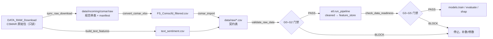

# 数据治理与目录规范（设计方案）

> **适用范围**：`financial-risk-warning-platform` 全部原始数据、清洗产物、特征面板、模型产物与报告。
>
> **一句话原则**：**下载区只读、暂存区规范、契约区稳定、产物可追溯**。任何一层都不允许被下一层"就地改写"。
>
> **落地状态（2026-11-14）**：新增 `config.settings.RAW_DOWNLOAD_DIR / INCOMING_DIR / STAGING_DIR`；新增 `scripts/sync_raw_download.py`（落地区 → 暂存区）与 `scripts/check_data_readiness.py`（G0–G5 门禁）；`.gitignore` 已排除落地区与大文件。
>
> **§9 待办已全部执行（2026-11-14）**：过期产物归档、暂存区批次归档、`data/versioned/README.md`、`docs/downloads` 忽略规则、CI 门禁；当前门禁 **PASS 26 / WARN 1 / BLOCK 0**。

---

## 1. 现状问题与治理目标

### 1.1 已发现的问题（有证据）

| 编号 | 问题 | 证据 | 风险 |
|---|---|---|---|
| D-01 | 下载落地区与项目源码混放，未纳入 `.gitignore` | 根目录 `DATA_RAW_Download/` 65,791 个文件、约 5 GB | 误提交、仓库膨胀、clone 失败 |
| D-02 | 代码里硬编码历史路径 | `scripts/build_text_features.py` 原默认 `CSMAR_download/pakage/...`，该目录已不存在 | 重建文本特征直接报错 |
| D-03 | 同一张表多次下载、分片命名不统一 | 4 个"日个股回报率"目录共 19 个 `TRD_Dalyr*.csv`；2 个"诉讼仲裁"目录（9.7 MB / 189.9 MB） | 拼错批次 → 年份重叠或半量数据 |
| D-04 | 暂存区混杂解压目录与压缩包 | `data/incoming/csmar/raw/_unzip_*`、`*.zip` 与规范 CSV 同层 | 无法判断哪份是"当前有效版本" |
| D-05 | 特征库存在过期同名产物 | `panel_model_input.csv` 33,191 行 vs `panel_model_input.parquet` 22,814 行 | 下游误读旧口径 |
| D-06 | 文档口径滞后于代码 | 旧文档仍写"73 维 / 21 个全零 / 文本缺失" | 论文与实现对不上 |
| D-07 | 运行日志散落根目录 | `convert_cf.err`、`import_all.log`、`validate.log` 等 | 目录噪声，且含环境信息 |
| D-08 | 演示生成器可直接覆盖真实契约表 | `data/gen_demo_data.py` 直接写 `data/raw/*`，而 `make all` 无条件先跑它 | 一条命令覆盖 5 年真实数据 |

### 1.2 治理目标

1. **单一事实来源**：路径来自 `config/settings.py`，特征口径来自 `config/feature_registry.py`，不再出现第二份清单。
2. **层间只读**：`raw` 只能由导入脚本按契约写入；`cleaned`/`feature_store` 只能由流水线重建；任何"手工改表"都必须走候选区。
3. **可复现**：每张表有行数、列数、SHA256、来源目录、生成时间；每次训练有 `run_manifest.json`。
4. **可回滚**：覆盖前留时间戳备份（`.bak_YYYYmmdd_HHMMSS`），候选表先入 `data/raw/candidates/`。
5. **可审计**：G0–G5 门禁脚本化，BLOCK 即中断，不靠人肉记忆。

---

## 2. 目录规范

### 2.1 分层与职责

```text
financial-risk-warning-platform/
├── DATA_RAW_Download/            # ① 落地区（landing）：用户下载的原始包，只读、不入库
├── data/
│   ├── incoming/csmar/           # ② 暂存区（staging）：规范命名、字段说明、合并后的中间表
│   │   ├── raw/                  #    规范命名的单表 CSV / XLSX + manifest
│   │   ├── desc/                 #    CSMAR 字段说明 *[DES]*.txt
│   │   ├── 20261114/             #    按批次归档（TRD_Dly 分段合并等）
│   │   └── download_log.md       #    下载日志（表名/筛选/年份/行数/备注）
│   ├── raw/                      # ③ 契约区（contract）：ETL 唯一读取入口，列名 snake_case
│   │   └── candidates/           #    已验证但未激活的候选增量
│   ├── cleaned/                  # ④ 清洗层：公司-年面板（去重/插补/剔除）
│   ├── feature_store/            # ⑤ 特征层：全量特征面板 + 建模输入 + 筛选清单/证据链
│   ├── external/                 # 外部宏观/行业维表（按 year 关联）
│   ├── versioned/                # 每次激活/重跑的版本快照（带日期）
│   ├── demo_raw/                 # 演示数据备份（与真实数据物理隔离）
│   └── gen_demo_data.py
├── models/artifacts/             # ⑥ 模型产物：权重/指标/元信息/run_manifest
├── cache/                        # SHAP、预测缓存（可删除、可重建）
├── reports/                      # data_quality / eda / figures（可重建）
└── docs/                         # 文档（含数据字典与本文）
```

**边界规则**

- ①→②：只允许 `scripts/sync_raw_download.py` 写入；禁止业务代码直接读 ①。
- ②→③：只允许 `etl/csmar_import.py`、`scripts/build_*` 等导入脚本写入；写前校验主键。
- ③→④→⑤：只允许 `etl/run_pipeline.py` 写入；不允许在 ④/⑤ 手工改数。
- ⑤→⑥：只允许 `models/train.py` 写入；产物与数据版本通过 SHA256 绑定。

### 2.2 命名规范

| 层 | 规则 | 示例 |
|---|---|---|
| 落地区 | 保留 CSMAR 原始目录名（含订单号/版权声明），**不改名** | `资产负债表233415143(仅供台湾大学使用)/FS_Combas.csv` |
| 暂存区 | `<表代码>[_<年份区间>].<ext>`，全大写表代码 + 下划线 | `FS_Combas.csv`、`TRD_Dly_2013_2026.csv`、`FS_Comscfd.xlsx` |
| 契约区 | snake_case 业务列名，主键 `stock_code`(6 位字符串) + `year`(int) | `csmar_financial.csv`、`market_features_trd.csv` |
| 候选区 | 与目标契约同名 + 可选后缀；必须带 `manifest.json` 记录 SHA256 与"未替换"声明 | `candidates/labels_st_official.csv` |
| 特征层 | 固定四件套 | `panel_features.parquet`、`panel_model_input.parquet`、`selected_features.json`、`feature_selection_report.csv` |
| 产物 | 带 `run_id`，清单与权重同批 | `models/artifacts/run_manifest.json`、`runs/<run_id>.json` |

**禁止项**：契约区出现中文、空格、括号、`(1)`；同名 CSV 与 Parquet 内容不一致；`_unzip_*` 与规范表同层。

### 2.3 已执行的目录整理

| 动作 | 命令/文件 | 说明 |
|---|---|---|
| 路径集中 | `config/settings.py` 新增 `RAW_DOWNLOAD_DIR`、`INCOMING_DIR`、`STAGING_DIR` | 支持 `RISK_RAW_DOWNLOAD_DIR` 覆盖落地区 |
| 落地区隔离 | `.gitignore` 增加 `DATA_RAW_Download/`、`data/incoming/csmar/raw/*`、`*.zip` | 避免 5 GB 数据入库 |
| 规范化同步 | `scripts/sync_raw_download.py` | 预演默认；`--write` 才落盘；硬链接优先 |
| 就绪体检 | `scripts/check_data_readiness.py` | 输出 `reports/data_quality/readiness_*.md/json` |
| 旧路径修复 | `scripts/build_text_features.py::_resolve_default_source` | 优先落地区，兼容旧 `CSMAR_download` |
| 演示数据保护 | `data/gen_demo_data.py` 检测到 `data/raw/csmar_financial.csv` 即中止；`--force` 先备份到 `data/demo_raw/backup_*` | 防止 `make all` 覆盖真实数据 |
| 官方折旧替换 | `scripts/import_comscfi_official.py` | 覆盖式字段更新，扣非哈希校验 |
| 有息负债口径 | `scripts/fix_interest_debt.py` | 带息债务口径 + `lt_debt` 回填 + FI_T1 对账 |
| 年行情候选 | `scripts/build_annual_market_features.py` | 只写 candidates，供消融，不入注册表 |
| 一键入口 | `Makefile` 增加 `sync / sync-write / readiness / depreciation / debt-fix / annual-market` | 与新脚本对齐 |
| 暂存区归档 | `data/incoming/csmar/20261113/{_unzip,_archives,_derived}` | `raw/` 只剩规范表 + manifest |
| 过期产物归档 | `data/feature_store/_stale/`（两个 33,191 行 CSV + 两个历史特征清单） | 门禁旧产物 WARN 转 PASS；`feature_store` 只剩固定四件套 |
| 快照策略 | `data/versioned/README.md` | 命名/最小集/保留 2–3 代/恢复命令 |
| CI 门禁 | `.github/workflows/ci.yml` | 测试 + 有数据时执行 G0–G5 |
| 仓库卫生 | `.gitignore` 按语义分区重写 | 生成 JSON / 机翻 PDF / 缓存 / 日志不入库；`desc/*.txt`、`versioned/README.md` 保留 |

---

## 3. 数据流与责任边界



**失败处理**：门禁 BLOCK 时不重训、不报告指标；只在 `reports/data_quality/` 留证。

---

## 4. 数据处理与清洗规则

### 4.1 原始导入（②→③）

| 规则 | 实现 | 备注 |
|---|---|---|
| 财务报表只取合并报表 | `Typrep == "A"`、`Accper == 12-31` | 母公司报表不进主表 |
| 科目代码解码 | `data/mapping/csmar.yaml` + `etl/csmar_import.py` | 保留原始列名到暂存区，契约层才改 snake_case |
| 金额单位 | 统一"亿元"，CSMAR 元 → `1e-8` | **一次性缩放**；现金流历史缺陷已修 |
| 比例单位 | 统一小数（0.35 = 35%） | 治理类持股比例按百分数导出时乘 0.01 |
| 事件表聚合 | 诉讼按 `DeclareDate` 年 + `EventID` 去重；处罚按 `DisposalDate` 年 | 输出 `litigation_count`/`penalty_count`，无事件补 0 |
| 文本解析 | 文件名 `证券代码_YYYY-12-31.txt`，仅取该年披露 | 缺文件 → NaN + `text_available=0`，不得当作中性 |
| 行情聚合 | 日行情 → 公司-年：交易日数、年换手率、收益波动率 | 换手率统一小数倍数；不足交易日不打满分 |

### 4.2 清洗层（③→④）

1. **主键规范**：`stock_code` 补零 6 位、`year` 转 `Int64`；按 `(stock_code, year)` 去重保留最后一条。
2. **样本范围**：仅证监会门类 `C`（制造业）；剔除金融 J、房地产 K、综合 S；原始财务表保留全 A 以便稳健性对照。
3. **三级插补**（会产生 `*_is_missing` 标记）：
   - L1 公司内线性插值（最多 2 期）；
   - L2 行业 × 年度中位数；
   - L3 全局中位数。
4. **零语义列不插补**：诉讼/处罚次数、数字化词频等"无记录=0"，直接置 0。
5. **样本剔除**：关键字段（总资产/营收/净利润）缺失、总资产 ≤ 0、覆盖率 < 70% 的行剔除。
6. **覆盖标记**：`text_available / legal_available / market_available / digital_available` 随面板保留，用于区分"真实缺失"与"业务 0 值"。
7. **缩尾**：只在训练年份（2015–2021）估计 1%/99% 分位，再裁剪全样本；二值/计数特征不缩尾。
8. **标签对齐**：T 年 `is_st` ↔ T-2 年特征（`sync_label`），标签缺失行直接剔除；不得用 T 年特征解释 T 年 ST。

### 4.3 特征层（④→⑤）

- 特征只由 `config/feature_registry.py` 定义（当前 80 维，10 个维度）；`add_features` 不得出现"注册表外"的列。
- 建模窗口固定 2015–2023；2024 为锁箱，**不进入** `panel_features`。
- 筛选四步：IV ≥ 0.02 → |r| ≤ 0.85 且 VIF ≤ 10 → PSI ≤ 0.25 → RF 重要性（Boruta 不可用时降级），输出 36 维与证据链 CSV。

### 4.4 标签与窗口

| 项 | 口径 | 当前状态 |
|---|---|---|
| 标签来源 | CSMAR `SPT_Trdchg` 官方 ST/*ST 区间 → 公司-年 0/1 | 已激活（48,290 行 / 1,897 正） |
| 标签年 | 特征年 T + 2 | 2015–2023 特征年全部可对齐 |
| 训练/验证/测试 | 2015–2021 / 2022 / 2023 | 16,233 / 3,209 / 3,372 行 |
| 锁箱 | 2024 特征年，需 2026 标签 | 未解锁，禁止报告指标 |

---

## 5. 质量门（G0–G5）

| 门禁 | 检查内容 | 阈值/判定 | 失败动作 | 实现 |
|---|---|---|---|---|
| **G0 落地** | 8 张契约表是否存在、是否为空 | 必需表缺失 = BLOCK | 停止，补下载/补转换 | `check_data_readiness` |
| **G1 结构** | 主键唯一、空键、代码 6 位、年份范围 | 有重复/空键/坏码 = WARN | 修导入脚本后重跑 | 同上 |
| **G2 标签** | 正样本率、T+2 覆盖、锁箱隔离 | 正样本率 ∉ [1%,10%] 或 T+2 缺口 = BLOCK/WARN | 停止，补标签 | 同上 |
| **G3 面板** | 注册表同源、全零列、覆盖率、面板年份 | 有全零或覆盖率 < 60% = WARN；面板含锁箱年 = BLOCK | 重建面板 | 同上 |
| **G4 筛选** | 入选特征 ≥ `MIN_FEATURES`、面板可满足、建模输入列齐全 | 缺列 = BLOCK；CSV/Parquet 不一致 = WARN | 重跑 `etl.run_pipeline` | 同上 |
| **G5 切分** | 训练/验证/测试非空、正样本 ≥ 30 | 为空 = BLOCK；正样本 < 30 = WARN | 检查年份与标签 | 同上 |
| **产物** | 特征版本、数据版本（SHA256）与训练记录一致 | 不一致 = WARN | 必须重训 | 同上 |

**执行**

```bash
python -m scripts.check_data_readiness            # 人读 Markdown + JSON
python -m scripts.check_data_readiness --quiet    # CI 用，BLOCK 时退出码 1
make readiness
```

---

## 6. 版本、留痕与激活流程

### 6.1 留痕字段

| 产物 | 关键字段 |
|---|---|
| `data/incoming/csmar/raw/_manifest_raw_download.json` | 源目录、分片列表、字节数、行数、SHA256、模式（dry-run/write）、生成时间 |
| `data/raw/candidates/manifest.json` | 表名、行×列、SHA256、来源、`replaced: false`、备注 |
| `models/artifacts/run_manifest.json` | `run_id`、git commit、数据集路径+SHA256、特征数+SHA256、参数、阈值、环境版本 |
| `models/artifacts/runs/<run_id>.json` | 单次运行摘要，支持横向对比 |

### 6.2 候选表激活（五步，缺一不可）

```bash
# 1) 校验候选（结构/主键/取值域）
python -m scripts.validate_candidates
# 2) 显式合并到契约层（留 .bak_时间戳）
python -m scripts.merge_cashflow_fix        # 以现金流修正为例
# 3) 重跑清洗 + 特征 + 筛选
python -m etl.run_pipeline
# 4) 门禁体检（必须 0 BLOCK）
python -m scripts.check_data_readiness
# 5) 重训 + 重校准 + 重新评估（不得沿用旧阈值）
python -m models.train --trials 30 && python -m models.evaluate && python -m models.shap_analysis
```

> 只替换 `data/raw` 而不重跑 3–5 步，是**最危险的错误**：旧面板 + 新原表会导致指标与解释全部失效。

> **重导入注意**：`etl.csmar_import --step financial` 会把 `depreciation` 重置为 NA、`interest_debt` 恢复旧公式。
> 每次重导入后必须依次执行 `python -m scripts.import_comscfi_official --write` 与
> `python -m scripts.fix_interest_debt --write`（两步均幂等、自动备份、校验扣非哈希），
> 否则会静默回退 G-03/G-04 的口径修正。

---

## 7. 训练就绪判定（Checklist）

- [x] G0–G2 无 BLOCK；G3–G5 无 BLOCK
- [x] 面板 22,814 行 / 3,629 家 / 2015–2023，正样本率 3%–6%
- [x] 80 维注册表特征全部存在，全零列 0 个
- [x] 入选特征 ≥ 25 维，且与 `model_meta.json` 一致（36 维）
- [x] 训练/验证/测试均非空，测试正样本 ≥ 30（127）
- [x] 面板不含 2024 行（锁箱隔离）
- [x] 若更换过 raw 表：`run_manifest` 的数据 SHA256 必须变化，并已重训（`da08d92c` → `run_id=20261114-213525-da08d92c`）

当前实测（2026-11-14）：**PASS 26 / WARN 1 / BLOCK 0**，唯一 WARN 是 2024 锁箱待 2026 标签
（`reports/data_quality/readiness_20261114_215*.md`）。

---

## 8. 维护 SOP

| 频率 | 动作 | 命令 |
|---|---|---|
| 每次下载 | 解压到 `DATA_RAW_Download/`，不改文件名；在 `download_log.md` 追加一行 | 手工 |
| 每次下载 | 预演 → 执行规范化 → 看 manifest | `make sync` → `make sync-write` |
| 每次入库 | 转换 XLSX → 导入契约 → 校验 | `convert_csmar_xlsx` → `csmar_import --step all --write` → `make validate` |
| 每次变更 | 候选区 → 五步激活 → 门禁 | 见 §6.2 |
| 每季度 | 更新行情/司法增量；跑监控 | `models.monitor` |
| 每年 5 月 | 补上一年年报标签 → 解锁锁箱 | 见缺口清单 G-01 |
| 每月 | 清理 `cache/`、`reports/figures` 临时图；核对 `.gitignore` | 手工 |

---

## 9. 待办（按优先级）

| 优先级 | 事项 | 状态 | 证据 |
|---|---|---|---|
| P0 | 过期 `panel_model_input.csv` / `panel_features.csv`（33,191 行）与历史特征清单归档 | ✅ 2026-11-14 | 移至 `data/feature_store/_stale/`；门禁"旧产物"转 **PASS**，WARN 由 2 降为 1（仅剩 2024 锁箱） |
| P0 | 根目录运行日志移入 `reports/logs/` | ✅ 2026-11-14 | 根目录只剩配置/入口文件 |
| P1 | `raw/_unzip_*` 与压缩包归档到 `data/incoming/csmar/20261113/` | ✅ 2026-11-14 | `raw/` 现仅 `_manifest_raw_download.json` + `FI_T1.csv` + `FS_Comscfi.csv` + `TRD_Year.csv`；`build_st_labels_official` 改为递归 glob，实测找到 `20261113/_unzip/_unzip_ST_*/SPT_Trdchg.csv` |
| P1 | `data/versioned/` 增加快照命名与保留策略 | ✅ 2026-11-14 | `data/versioned/README.md`（命名、最小集、保留 2–3 代、恢复示例） |
| P2 | `docs/downloads/` 体积治理 | ✅ 2026-11-14（保守方案） | 609 MB 主要来自 `docs/downloads/repos/`（已忽略）与你克隆的仓库；入库文件仅 26 个 PDF，`.git` 实测 38.6 MB（< 200 MB）。另加 `docs/downloads/**/*.png|jpg|jpeg` 忽略规则，防止截图被 `git add`。彻底移出工作区需人工确认 |
| P2 | 将 `check_data_readiness` 接入 CI | ✅ 2026-11-14 | 新增 `.github/workflows/ci.yml`：`test` 跑 67 项单测；`data-gate` 在存在 `data/raw/csmar_financial.csv` 时执行 G0–G5（BLOCK 即失败），无数据则显式跳过 |

### 9.1 归档布局（执行后）

```text
data/incoming/csmar/
├── raw/                        # 只剩规范单表 + manifest
│   ├── _manifest_raw_download.json
│   ├── FI_T1.csv               # 硬链接
│   ├── FS_Comscfi.csv          # 硬链接
│   └── TRD_Year.csv            # 硬链接
├── desc/                       # 字段说明
├── 20261113/                   # 历史批次归档
│   ├── _unzip/                 # 6 个解压目录（CG/LAW/ST/VIO…）
│   ├── _archives/              # 3 个原始 zip
│   └── _derived/               # 中间 CSV / 数字化转型 xlsx
├── 20261114/                   # TRD_Dly 分段合并等
└── download_log.md
```

> 归档目录已加入 `.gitignore`（`data/incoming/csmar/2026*/`），不会进入仓库。

### 9.2 `.gitignore` 规范与自检（2026-11-14）

`.gitignore` 已按语义分区重写，规则分七类：Python 缓存、虚拟环境、落地区、暂存区、契约/特征层、模型产物/报告、文献与临时文件。

**明确保留入库**（不要误忽略）：

| 路径 | 原因 |
|---|---|
| `config/text_lexicons.py` | 词典源码，文本特征与测试都依赖 |
| `tests/*.py` | 单元测试 |
| `data/incoming/csmar/desc/*.txt` | CSMAR 字段说明，表结构参考 |
| `data/incoming/csmar/download_log.md` | 下载审计日志 |
| `data/versioned/README.md` | 快照策略说明（`data/versioned/*` 忽略，README 例外） |
| `.github/workflows/ci.yml` | CI 门禁 |
| `docs/**/*.md`、`docs/附件3：毕业设计模板/*` | 文档与模板 |

**明确忽略**：`DATA_RAW_Download/`、`data/incoming/csmar/*.{csv,xlsx,zip,json}`、`data/incoming/csmar/2026*/`、`data/{raw,cleaned,feature_store,external,versioned}/*`、`models/artifacts/*`、`cache/*`、`reports/*`、`docs/downloads/repos/`、`docs/downloads/**/*.{png,jpg}`、机翻 PDF（`*translat*.pdf`）、`*.log`、`*.err`、`.env`、`.venv/`。

**自检（每次提交前）**

```bash
git status --short                        # 只应出现源码/文档/测试的变更
git ls-files -i -c --exclude-standard     # 期望为空（"被跟踪却被忽略"的冲突清单）
git check-ignore -v <关键文件>            # 对保留清单中的文件应无输出
```

> 当前冲突清单仅剩 `convert_cf.err`（已从磁盘删除、待提交删除记录）；提交后应归零。
