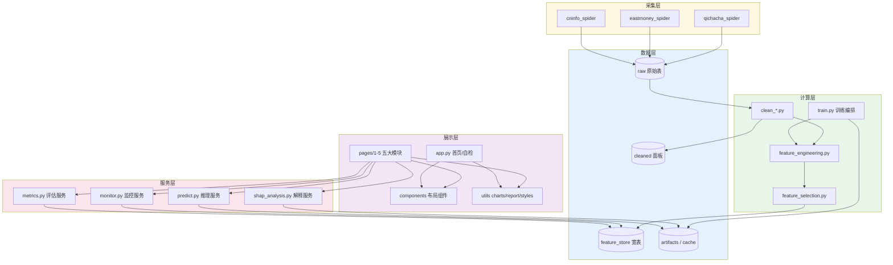
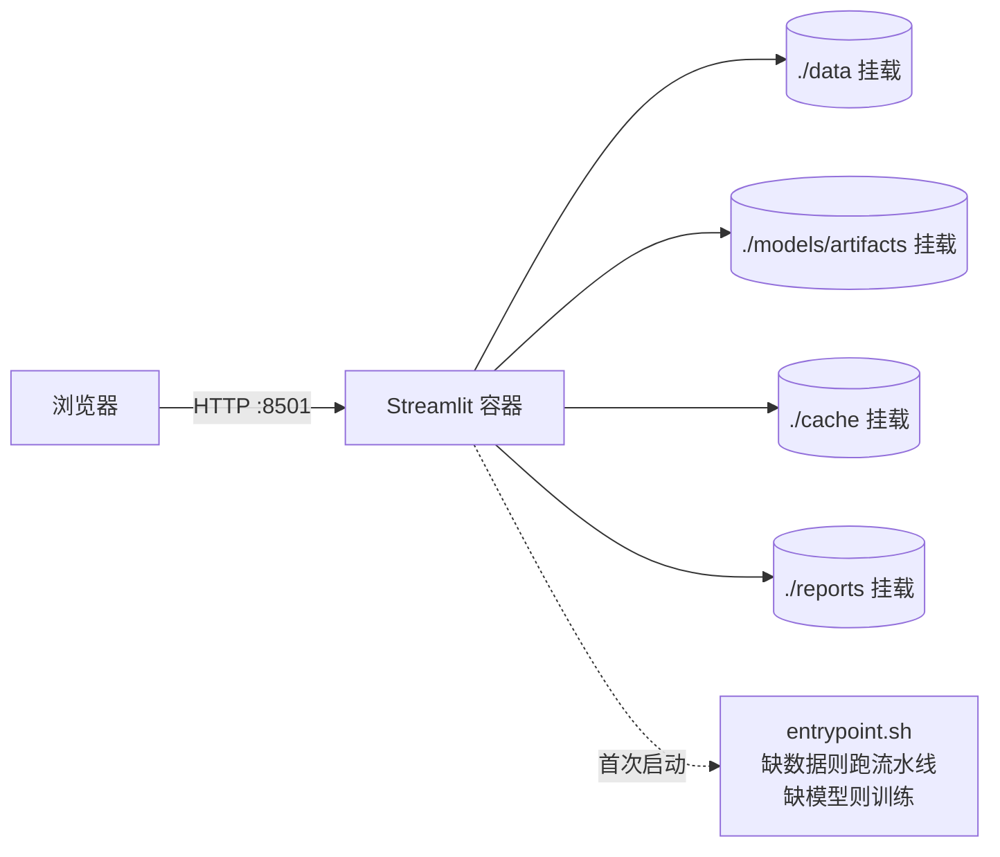
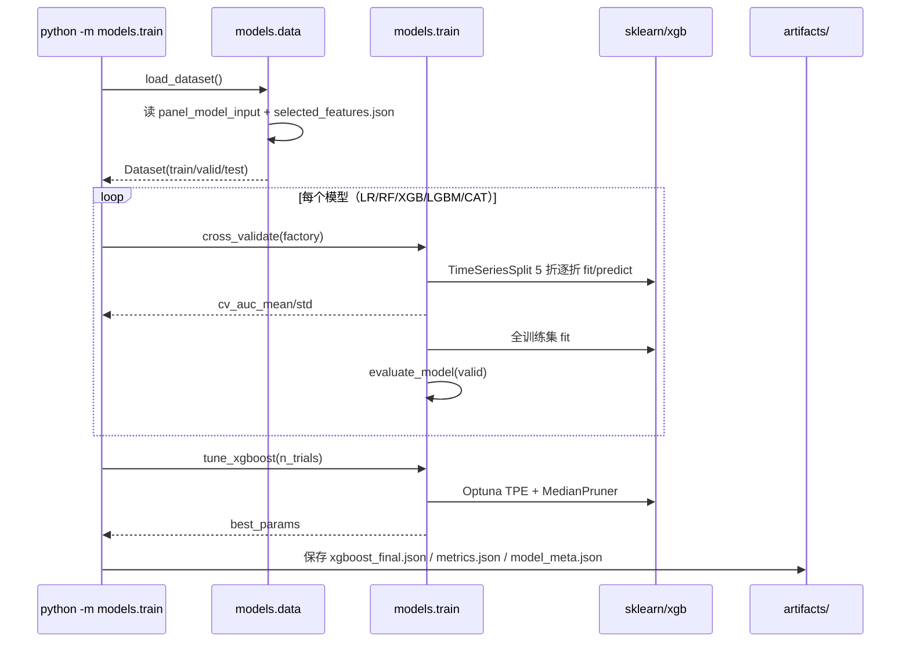
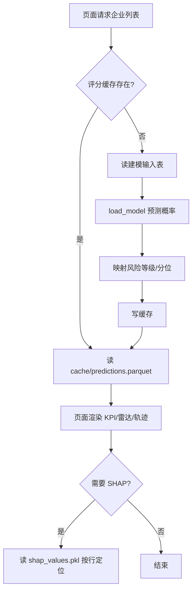
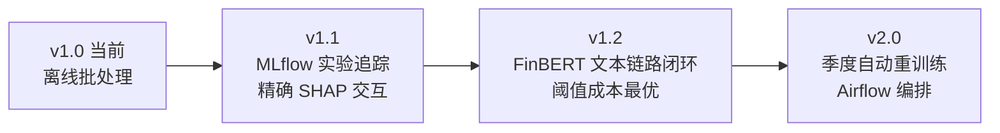

# 上市公司财务风险智能预警平台 · 系统架构设计说明书

| 项目 | 内容 |
|------|------|
| 文档版本 | v1.0 |
| 更新日期 | 2026-11-08 |
| 对应代码版本 | `1.0.0`（`pyproject.toml`） |
| 读者对象 | 开发者、答辩评审、后续维护者 |
| 关联文档 | [深度实施方案](./上市公司财务风险智能预警平台_深度实施方案.md) · [数据字典](../数据字典与特征口径.md) · [README](../../README.md) |

---

## 1. 文档目的与设计原则

本说明书描述系统的**静态结构**（有哪些模块、各自负责什么、之间如何耦合）与**动态行为**（数据如何流动、失败如何降级），并给出可验证的约束。目标是让一个未参与开发的人，在 30 分钟内能定位"改某个需求应该动哪个文件"。

### 1.1 五条架构原则

| 原则 | 具体落地 | 违反后果 |
|------|---------|---------|
| **单一事实来源** | 特征元数据只在 `config/feature_registry.py`，路径只在 `config/settings.py` | 文档与代码口径漂移，答辩时无法自证 |
| **约定优于配置** | 文件名、主键、目录结构固定，模块间零参数传递即可协作 | 每接一个新数据源就要改多处 |
| **失败可降级** | parquet→CSV、Boruta→RF 重要性、Excel→CSV、SHAP 缺失→提示 | 一处依赖缺失导致演示白屏 |
| **时间不可逆** | 所有切分、筛选统计量只在训练窗口估计 | 前视偏差，结论不可信 |
| **解释与预测同源** | SHAP 直接作用于落盘的主模型，不另训代理模型 | 解释与预测不一致，属学术硬伤 |

### 1.2 明确的非目标

- **不做实时流式计算**：财务数据为季度/年度频率，离线批处理足够；
- **不做多租户与权限体系**：单机学术工具，登录鉴权只会增加答辩风险；
- **不做在线学习**：标签滞后 2 年，在线更新无意义，采用季度批量重训练。

---

## 2. 架构总览

### 2.1 分层视图



**依赖方向严格单向**：展示层 → 服务层 → 计算层 → 数据层。反向依赖只有一处例外：`streamlit_app/utils/data.py` 直接读取 `etl.io_utils.read_table`（避免为单纯的读盘再包一层服务），该例外已被限制在单一函数内。

### 2.2 部署拓扑



单容器、无外部数据库，是有意为之：答辩现场只需 `docker load` + `up -d`，不存在"数据库连不上"的失败模式。

---

## 3. 模块设计

### 3.1 模块职责矩阵

| 模块 | 文件 | 职责 | 输入 | 输出 | 依赖 |
|------|------|------|------|------|------|
| 配置 | `config/settings.py` | 路径、样本窗口、阈值、种子 | — | 常量 | — |
| 特征注册 | `config/feature_registry.py` | 73 维元数据、雷达维度、方向 | — | `FeatureSpec` 列表 | — |
| 采集-年报 | `crawlers/cninfo_spider.py` | 公告检索、PDF 下载、MD&A 抽取 | 股票代码+年份 | PDF / txt / 索引 CSV | `crawlers/base.py` |
| 采集-新闻 | `crawlers/eastmoney_spider.py` | 个股新闻采集 | 代码 | `news_raw.csv` | `crawlers/base.py` |
| 采集-司法 | `crawlers/qichacha_spider.py` | 司法/处罚记录 | 代码 / 企业名 | `legal_events_api.csv` | API Key |
| 清洗 | `etl/clean_financial.py` | 去重、三级插补、缩尾、剔除 | 原始表 | 清洗面板 | `io_utils` |
| 特征工程 | `etl/feature_engineering.py` | 73 维计算、标签对齐、宽表合并 | 清洗面板 | 特征面板 | `clean_*`, `stats_utils` |
| 特征筛选 | `etl/feature_selection.py` | IV→相关性/VIF→PSI→Boruta | 特征面板 | 特征清单 + 报告 | `stats_utils` |
| 流水线 | `etl/run_pipeline.py` | 编排、缺失数据自举 | CLI 参数 | 建模输入表 | 上述全部 |
| 数据加载 | `models/data.py` | 时间切分、特征清单读取 | 建模输入表 | `Dataset` | `io_utils` |
| 训练 | `models/train.py` | 五模型、CV、Optuna、落盘 | `Dataset` | 模型 + 指标 + 元信息 | sklearn/xgb/lgbm/catboost |
| 评估 | `models/evaluate.py` | 指标表、阈值敏感性、分群、校准 | 模型 + `Dataset` | Markdown/CSV/JSON | `metrics` |
| 指标 | `models/metrics.py` | AUC/KS/F1/Brier/ECE、阈值、分级 | y, prob | dict/DataFrame | sklearn |
| 推理 | `models/predict.py` | 批量/单企业打分、缓存 | 特征表 | 评分表 | 模型 |
| 解释 | `models/shap_analysis.py` | 四维度 SHAP、缓存 | 模型 + `Dataset` | SHAP 缓存/表 | shap |
| 监控 | `models/monitor.py` | PSI 漂移、性能衰减、建议 | 面板 + 模型 | JSON/CSV | `stats_utils` |
| 前端 | `streamlit_app/**` | 五模块交互、导出 | 缓存服务 | 页面/文件 | 全部服务 |

### 3.2 关键设计点

#### 3.2.1 为什么特征注册表要"重"到放元数据

```python
@dataclass(frozen=True)
class FeatureSpec:
    key: str            # 列名（ETL/模型用）
    cn: str             # 中文名（图表坐标轴）
    group: str          # 维度（雷达图/维度贡献）
    higher_better: bool # 方向（分位翻转、报告措辞）
    source: str         # 来源（数据字典、缺失排查）
    note: str           # 口径（论文附录）
```

一处定义，六处消费：ETL 校验列是否齐全 → 筛选报告标注中文名 → 雷达图按 `RADAR_DIMENSIONS` 取数 → 瀑布图显示中文 → PDF 报告排版 → 数据字典自动生成。**新增特征的成本 = 加一条 + 加一段计算逻辑**。

#### 3.2.2 标签对齐的"倒挂"设计

```python
# etl/feature_engineering.py
def sync_label(features, labels):
    lagged = labels.copy()
    lagged["year"] = lagged["year"] - settings.LABEL_HORIZON   # 标签年份前移 2 年
    return features.merge(lagged, on=["stock_code", "year"], how="left")
```

数据流上是"把标签搬到特征行"，语义上是"用 T-2 年特征预测 T 年 ST"。这样处理的好处是**模型侧无需知道 horizon 的存在**——所有下游只看到 `(stock_code, year, features..., is_st)`，一致性由一处保证。

#### 3.2.3 四步筛选为什么必须"只用训练集"

| 步骤 | 若用全样本 | 后果 |
|------|-----------|------|
| IV | 验证/测试的标签信息进入筛选 | 特征选择泄漏，OOT 指标虚高 |
| PSI | 用未来分布判断"稳定性" | 稳定的定义被污染 |
| Boruta | 同上 | 重要性排序不可复现 |

实现上，`step1/step2/step4` 内部统一执行 `panel[panel["year"].between(*TRAIN_YEAR_RANGE)]`，`step3` 进一步把训练窗口前后对半作为"开发期/验证期"——这是 PSI 能成立的最小前提。

#### 3.2.4 解释层缓存格式

不 pickle `shap.Explanation`（跨版本易失效），只存数组：

```python
cache = {
    "values": (n, d) float64,      # SHAP 矩阵
    "base_value": float,           # 期望值（log-odds）
    "features": list[str],         # 列序
    "feature_values": (n, d),      # 原始特征值（依赖图用）
    "index": DataFrame[stock_code, year],  # 行对齐
}
```

前端按 `(stock_code, year)` 反查行号，取最新一期做瀑布图；这样"单企业归因"无需重新计算 SHAP。

---

## 4. 数据架构

### 4.1 三层数据与契约

| 层 | 落地文件 | 粒度 | 主键 | 生成者 | 消费者 |
|----|---------|------|------|-------|-------|
| L0 原始 | `data/raw/*.csv` | 单表记录 | `stock_code + year`（宏观为 `year`） | 爬虫 / CSMAR / 演示生成器 | 清洗 |
| L1 清洗 | `data/cleaned/panel_clean.parquet` | 公司-年 | 同上 | `clean_financial` | 特征工程 |
| L2 特征 | `data/feature_store/panel_features.parquet` | 公司-年 | 同上 | `feature_engineering` | 筛选 |
| L3 建模 | `data/feature_store/panel_model_input.parquet` | 公司-年 | 同上 | `feature_selection` + 流水线 | 训练/推理 |
| L4 产物 | `models/artifacts/*`、`cache/*` | — | — | 训练/解释 | 前端 |

**为什么同时保留 L2 和 L3**：L2 是"全量 73 维"，供探索性分析、特征重要性复核、换特征集的稳健性检验；L3 是"筛选后 29-45 维"，供训练与推理。二者共存使"换特征集重训"只需改一个读取路径。

### 4.2 存储格式与降级

| 场景 | 首选 | 降级 | 触发条件 |
|------|------|------|---------|
| 表格落盘 | Parquet（体积小、类型保真） | 同名 `.csv`（UTF-8-SIG） | 无 pyarrow / numpy 版本不兼容 |
| 路径探测 | `resolve(path)` | 自动匹配 `.csv` 兄弟文件 | 同上 |
| 报告导出 | xlsx（openpyxl） | CSV | 无 openpyxl |

> 该降级机制在 Windows 迷你环境（numpy 1.26 + pyarrow 26 不兼容）中被真实触发并验证。

### 4.3 容量估算（真实数据规模）

| 数据 | 规模 | 估算体积 |
|------|------|---------|
| 财务主表 | 2,800 家 × 10 年 ≈ 28,000 行 × 30 列 | ~12 MB |
| 特征面板（73 维） | 同上 | ~35 MB parquet |
| 年报 PDF | 2,800 × 10 份 × 2 MB | ~56 GB（建议只留 MD&A 文本，约 60 MB） |
| SHAP 缓存 | 5,000 样本 × 45 特征 float64 | ~1.8 MB |

**结论**：除 PDF 原文件外，全链路可在 4 GB 内存的笔记本上完成，无需分布式计算。

### 4.4 命名与单位约定

| 约定 | 规则 | 校验位置 |
|------|------|---------|
| 股票代码 | 6 位字符串，补零（`000001`） | `_normalize_keys` |
| 年度 | 整数 `year` | `_normalize_keys` |
| 金额 | 亿元 | `data/README.md` |
| 比率 | 小数（0.35 = 35%） | `feature_registry.note` |
| 特征列 | 小写下划线英文 | 注册表 |
| 产物文件 | 语义化英文 + 后缀 | `settings.py` |

---

## 5. 关键流程

### 5.1 训练流程时序



**幂等性**：重复执行会覆盖同名产物；`metrics.json` 保留全部模型结果，供前端对比，不做增量合并——保证"任何一次训练结果都可完整复现"。

### 5.2 推理流程（页面 → 结果）



缓存策略：`st.cache_data(ttl=1800)` 管数据，`st.cache_resource` 管模型/元信息，进程内只加载一次；`predictions.parquet` 落盘以支持"重启即用"。

### 5.3 监控流程

```
每月（或事件触发）：
  1. feature_drift(reference=2022, current=最新年) → 逐特征 PSI
  2. performance_drift() → 重算 AUC/KS/Brier，与基准比较
  3. 决策规则：PSI>0.25 或 ΔAUC<-0.03 → 建议重训练
  4. 输出 monitor_report.json + psi_detail.csv，前端"漂移监控"Tab 渲染
```

---

## 6. 接口设计

### 6.1 内部函数接口（稳定契约）

| 接口 | 签名 | 稳定性 |
|------|------|--------|
| 构建面板 | `build_panel(**raw_tables) -> DataFrame` | 稳定，供测试与流水线共用 |
| 特征筛选 | `select_features(panel, write=True) -> list[str]` | 稳定 |
| 数据加载 | `load_dataset(features=None) -> Dataset` | 稳定 |
| 训练 | `train_all(trials, use_optuna, cv) -> dict` | 稳定 |
| 评估 | `evaluate_model(y_true, y_prob, threshold) -> dict` | 稳定（字段名即报告列名） |
| 推理 | `predict_frame(df) -> DataFrame` | 稳定，新增列只增不改 |
| 单企业画像 | `company_profile(code) -> dict` | 稳定 |
| 归因 | `local_contribution(code, year) -> dict` | 稳定 |
| 漂移 | `build_report(ref_year, cur_year) -> dict` | 稳定 |

### 6.2 CLI 接口

| 命令 | 关键参数 | 幂等 | 退出码 |
|------|---------|------|--------|
| `python -m data.gen_demo_data` | `--companies 240 --seed 42` | 是（固定种子） | 0/1 |
| `python -m etl.run_pipeline` | `--refresh --companies --skip-selection` | 是 | 0/1 |
| `python -m models.train` | `--trials --no-optuna --no-cv` | 是（覆盖） | 0/1 |
| `python -m models.evaluate` | — | 是 | 0/1 |
| `python -m models.shap_analysis` | — | 是 | 0/1 |
| `python -m models.monitor` | `--reference --current` | 是 | 0/1 |
| `python -m crawlers.cninfo_spider` | `--codes --years --limit --dry-run` | 是（跳过已下载） | 0/1 |
| `python -m scripts.gen_data_dictionary` | — | 是 | 0 |

### 6.3 文件级契约（前后端唯一耦合点）

| 文件 | 生产者 | 消费者 | 必需字段 |
|------|-------|-------|---------|
| `panel_model_input.parquet` | 流水线 | 训练、推理 | `stock_code, year, is_st` + 特征列 |
| `selected_features.json` | 筛选 | 训练、推理 | `features: list[str]` |
| `xgboost_final.json` | 训练 | 推理 | XGBoost 原生格式 |
| `model_meta.json` | 训练 | 前端 | `features, created_at, risk_thresholds` |
| `metrics.json` | 训练 | 前端 | `{模型名: {auc, ks, f1, brier}}` |
| `shap_values.pkl` | 解释 | 前端 | `values, base_value, features, index` |
| `predictions.parquet` | 推理 | 前端 | `stock_code, year, st_prob, risk_level` |

> 前端**只**通过 `streamlit_app/utils/data.py` 访问这些文件，禁止页面里出现裸路径，否则替换存储层时会散弹式修改。

### 6.4 前端页面契约

| 页面 | 必需数据 | 缺数据时的行为 |
|------|---------|--------------|
| 首页 | 面板、模型、指标 | 展示流水线命令引导并 `st.stop()` |
| 数据看板 | 评分缓存 | 自动触发打分后渲染 |
| 企业诊断 | 评分缓存 + SHAP 缓存 | SHAP 缺失时降级为"仅概率"，给出重算命令 |
| 批量预警 | 评分缓存 | 同上 |
| 模型解释 | SHAP + metrics + monitor | 分 Tab 独立降级 |
| 报告导出 | 评分 + SHAP + 评估报告 | PDF 省略归因章节，Excel 降级 CSV |

---

## 7. 质量属性设计

### 7.1 可测试性

| 层次 | 策略 | 现状 |
|------|------|------|
| 纯函数 | 数学性质断言（PSI 同分布≈0、KS 完全分离=1、VIF 共线>10） | ✅ 覆盖 |
| 特征口径 | 列齐全、无 inf、主键唯一、正样本二值、成长率量级 | ✅ 覆盖 |
| 注册表 | 维度数量与设计文档一致、每个特征有中文名与口径 | ✅ 覆盖 |
| 流水线 | 返回列名、PSI/IV 边界 | ✅ 冒烟覆盖 |
| 前端 | 手工验收清单（见 §8.2） | ⚠️ 未自动化 |

测试夹具 `tests/conftest.py` 用**内存小样本**（24 家公司）构建面板：不写盘、不依赖已训练模型，保证 `pytest` 在干净克隆上 3 秒内通过。

### 7.2 性能

| 操作 | 演示规模实测 | 真实规模预估 | 优化手段 |
|------|------------|------------|---------|
| 流水线（清洗+特征+筛选） | 4.2 s | 60-120 s | 向量化、避免 apply |
| 五模型训练（含 CV） | 30-60 s | 3-5 min | `n_jobs=-1`、直方图树 |
| Optuna 30 trials | 2-4 min | 10-20 min | MedianPruner 砍掉 30-50% |
| SHAP（2400 样本） | 3 s | 10-20 s | TreeSHAP 精确算法 |
| 页面首屏 | < 2 s | < 3 s | 三级缓存 + 预计算缓存 |

### 7.3 可靠性与降级矩阵

| 缺失项 | 检测点 | 降级动作 | 用户可见提示 |
|-------|-------|---------|------------|
| pyarrow | `write_table` 异常 | 改存 CSV | 无（透明） |
| boruta | `step4` 异常 | RF 重要性 Top65% | 日志标注方法 |
| lightgbm/catboost | `build_baselines` | 跳过该模型 | 日志告警 |
| SHAP 缓存 | 页面检查 | 归因区显示命令提示 | 明确文案 |
| openpyxl | `batch_excel` | 返回 CSV 字节 | 文件名后缀不同 |
| 模型文件 | `load_model` | 抛 `FileNotFoundError` + 训练命令 | 页面红框引导 |
| 原始数据 | `run_pipeline` | 自动生成演示数据 | 日志说明 |

### 7.4 安全与合规

| 风险 | 措施 |
|------|------|
| 爬虫频率 | 站点级限速（巨潮 3s、东财 2s、企查查 5s），单域并发 ≤2 |
| 凭证管理 | 一律走环境变量（`.env.example` 模板，`.env` 已 gitignore） |
| 个人信息 | 司法数据只用官方 API 的企业级聚合字段，不落个人姓名/身份证 |
| 学术诚信 | 平台页脚与 PDF 报告均含"不构成投资建议"声明；报告标注模型版本与生成时间 |

---

## 8. 运维与演进

### 8.1 发布流程

```
1. 改代码 → python -m pytest -q（35 项必须全绿）
2. python -m scripts.gen_data_dictionary（文档同步）
3. python -m etl.run_pipeline && python -m models.train（回归验证）
4. docker compose up -d --build（容器验证）
5. git tag v1.x.x
```

### 8.2 手工验收清单（答辩前必查）

- [ ] 首页状态区 5 项全部 🟢
- [ ] 看板：行业热力图、ST 趋势、TOP20 均有数据且中文正常
- [ ] 诊断：任选一家企业，雷达 6 维、瀑布图、历史轨迹均渲染
- [ ] 批量：粘贴 5 个代码 → 结果表出现 → Excel 可下载并打开
- [ ] 解释：4 个 Tab 均无异常；校准曲线贴近对角线
- [ ] 导出：PDF 中文正常、页数 2-3 页；数据字典 CSV 可打开
- [ ] 断网重启容器 → 仍可正常访问（离线可用）

### 8.3 已知技术债

| 编号 | 问题 | 影响 | 计划 |
|------|------|------|------|
| TD-1 | SHAP 交互效应用代理指标（加权相关），非精确 interaction values | 学术严谨性打折，已在界面标注 | 数据量降至 500 样本时切换到精确算法 |
| TD-2 | 风险等级阈值硬编码在 `settings`，未做业务成本最优化 | 阈值非"最优"，只是"合理" | 引入误报/漏报成本矩阵求解最优阈值 |
| TD-3 | 前端未做自动化 UI 测试 | 改版可能破坏页面 | Playwright 冒烟测试（答辩后） |
| TD-4 | 缺少 MLflow 等实验追踪，仅靠 JSON 留痕 | 多实验对比需手工整理 | 后续接入 MLflow |
| TD-5 | 文本情感为演示/离线打分，未接 FinBERT 在线推理 | 真实文本链路未闭环 | 增加 `transformers` 可选依赖与批处理脚本 |

### 8.4 演进路线



---

## 附录 A：设计 → 代码映射表

| 设计文档章节 | 代码位置 |
|-------------|---------|
| 样本范围与剔除规则 | `config/settings.py` + `etl/clean_financial.drop_invalid` |
| 数据源矩阵 | `crawlers/*` + `data/README.md` |
| 73 维特征体系 | `config/feature_registry.py` + `etl/feature_engineering.py` |
| 四步特征筛选 | `etl/feature_selection.py` + `etl/stats_utils.py` |
| 标签定义（T-2） | `etl/feature_engineering.sync_label` + `settings.LABEL_HORIZON` |
| 五模型对比 | `models/train.build_baselines` |
| Optuna 搜索空间 | `models/train.tune_xgboost` |
| 时间序列验证 | `models/train.cross_validate` + `models/data.load_dataset` |
| 评估指标与阈值 | `models/metrics.py` |
| SHAP 四维度 | `models/shap_analysis.py` |
| PSI 监控 | `models/monitor.py` + `etl/stats_utils.psi_table` |
| 五大模块 UI | `streamlit_app/pages/*` |
| PDF/Excel 报告 | `streamlit_app/utils/report.py` |

## 附录 B：配置项清单

| 配置 | 默认值 | 含义 | 调整建议 |
|------|-------|------|---------|
| `TRAIN_YEAR_RANGE` | (2015, 2022) | 训练窗口 | 数据质量差可缩至 2017 起 |
| `VALID_YEAR` / `TEST_YEAR` | 2023 / 2024 | OOT 与测试年 | 与数据可得性同步 |
| `LABEL_HORIZON` | 2 | 标签前瞻年数 | 稳健性检验可设 1 或 3 |
| `RISK_THRESHOLDS` | 0.50 / 0.25 | 高/中风险分界 | 按误报成本调整 |
| `IV_MIN` | 0.02 | IV 筛选阈值 | 特征过少时降到 0.01 |
| `CORR_MAX` / `VIF_MAX` | 0.85 / 10 | 共线性阈值 | 标准做法，不建议改 |
| `PSI_BLOCK` / `PSI_WARN` | 0.25 / 0.10 | 漂移阈值 | 行业通用 |
| `MIN_FEATURES` | 25 | 筛选下限保险丝 | 样本小时可下调 |
| `RANDOM_SEED` | 42 | 全局种子 | 复现用，不建议改 |

---

*本说明书与代码同步维护。修改架构相关代码时，请同步更新本文档对应章节，并在提交信息中注明。*
