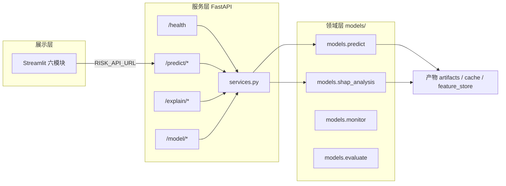

# FastAPI 服务层设计（预警平台后端）

> | 元信息 | 值 |
> |---|---|
> | 状态 | 🔄 **被取代** |
> | 取代关系 | 已被 [`API契约与接口参考.md`](./API契约与接口参考.md) 取代（当前 100+ 端点的完整契约） |
> | 说明 | 本文仅覆盖早期 `/predict` `/explain` 契约，保留作历史留存；具体行为以代码为准 |

> 目的：把「评分、解释、监控」从 Streamlit 页面里抽出来，做成无状态 HTTP 服务，前端只负责交互与展示。
> 默认仍保持 Streamlit 本地直连可用；设置 `RISK_API_URL` 后前端可切到远程后端。

---

## 1. 系统架构



- **服务层无状态**：模型/校准器进程内加载一次，请求只读，不落写业务状态（评分缓存刷新除外）。
- **领域层复用**：直接调用 `models.predict / shap_analysis / monitor`，不复制业务逻辑。
- **前端双模式**：本地直连（默认，零配置）与远程 API（`RISK_API_URL`），切换不改页面代码。

---

## 2. 目录结构

```text
api/
├── __init__.py
├── main.py          # FastAPI 实例、lifespan、CORS、路由注册
├── schemas.py       # Pydantic 请求/响应模型（v2）
├── services.py      # 对 models/ 的薄封装 + 异常 → HTTP 错误码
└── deps.py          # 模型/面板缓存加载（lru_cache）
tests/test_api.py    # TestClient 冒烟（无模型时自动 skip）
```

---

## 3. API 契约

统一约定：错误返回 `{ "detail": {...} }`；成功响应含 `run_id` 与 `semantics`。

### 3.1 健康与元信息

| 方法/路径 | 说明 | 响应要点 |
|---|---|---|
| `GET /health` | 就绪检查 | `{status, run_id, data_sha256, artifacts:{model,shap,predictions}}`，异常项 503 |
| `GET /model/meta` | 模型元信息 | `model_meta.json` + `thresholds` + `selection` |

### 3.2 预测

| 方法/路径 | 请求体 | 响应 |
|---|---|---|
| `POST /predict/codes` | `{codes:str[], year:int|None, threshold_override:{high,medium}|None}` | 见下方 `PredictionItem[]`，未匹配代码进 `unmatched` |
| `POST /predict/frame` | `{rows:[{...原始字段}]}` | what-if 打分 + `coverage` 告警（P1，先返回 501 占位） |
| `GET /predict/top-risk` | `?year=&limit=&industry=` | 全市场 Top-K 名单 |

`PredictionItem`：

```jsonc
{
  "stock_code": "000004", "company_name": "国农科技", "industry": "C27",
  "year": 2023, "st_prob_raw": 0.045, "st_prob": 0.0065,
  "risk_level": "低风险", "risk_percentile": 0.604
}
```

### 3.3 解释

| 方法/路径 | 说明 |
|---|---|
| `GET /explain/{code}?year=` | 单样本归因：`{prediction(校准后), raw_probability, base_value, contributions[]}` |
| `GET /explain/global?top_n=` | 全局重要性 |
| `GET /explain/dependence?feature=` | 依赖效应散点数据 |
| `GET /explain/interactions?top_n=` | 交互代理指标（标注非精确 TreeSHAP） |

### 3.4 监控与特征

| 方法/路径 | 说明 |
|---|---|
| `GET /monitor/report` | PSI/漂移报告 |
| `GET /features` | 特征注册表（字典） |

---

## 4. 异常映射

| 领域异常 | HTTP | detail |
|---|---|---|
| 代码不存在 | 404 | `{code, "unmatched"}` |
| 模型/面板缺失 | 503 | 附 `PIPELINE_HINT` 命令 |
| 特征缺失 | 422 | 附缺失字段与覆盖度 |
| 内部异常 | 500 | 记录日志，不泄露堆栈 |

---

## 5. 部署

```bash
# 开发
uvicorn api.main:app --host 0.0.0.0 --port 8000 --reload
# 生产（单进程即可，22k 行打分 <3s）
uvicorn api.main:app --host 0.0.0.0 --port 8000 --workers 1
```

Docker（在现有 compose 增加 `api` 服务，共享 `models/artifacts` 与 `cache/` 卷）：

```yaml
api:
  build: .
  command: ["uvicorn", "api.main:app", "--host", "0.0.0.0", "--port", "8000"]
  ports: ["8000:8000"]
  volumes: ["./models/artifacts:/app/models/artifacts", "./cache:/app/cache", "./data:/app/data"]
```

环境变量：

| 变量 | 默认 | 说明 |
|---|---|---|
| `RISK_API_URL` | 空 | Streamlit 前端切远程后端时设置 |
| `RISK_CORS_ORIGINS` | `*` | 允许的跨域来源，生产收紧 |

---

## 6. 安全与稳健性

- 默认仅内网使用；对外需加鉴权（简单 Token / API Gateway）。
- 输入校验：`codes` 正则 `^\d{6}$`、`year` 范围 2015–2023、`limit ≤ 1000`。
- 只读接口 + 可选 `refresh` 写缓存需单独鉴权。
- 所有响应带 `run_id`，前端据此提示「模型版本已更新」。

---

## 7. 与现有本地直连的关系

| 层 | 本地模式（现状） | API 模式（改造后） |
|---|---|---|
| 数据 | `streamlit_app.utils.data` 直接 `models.predict` | 经 `api_client`，失败 fallback 本地 |
| 一致性 | 已由 `models.predict/shap` 的 run_id 校验兜底 | 服务端同逻辑 |
| 好处 | 零部署 | 多端复用、解耦、可水平扩展 |

迁移步骤（P2）：新增 `streamlit_app/utils/backend.py`，暴露与 `data.py` 相同的函数签名，内部按 `RISK_API_URL` 分流；页面只需把 `D.xxx` 换成 `backend.xxx`，不改业务渲染。
