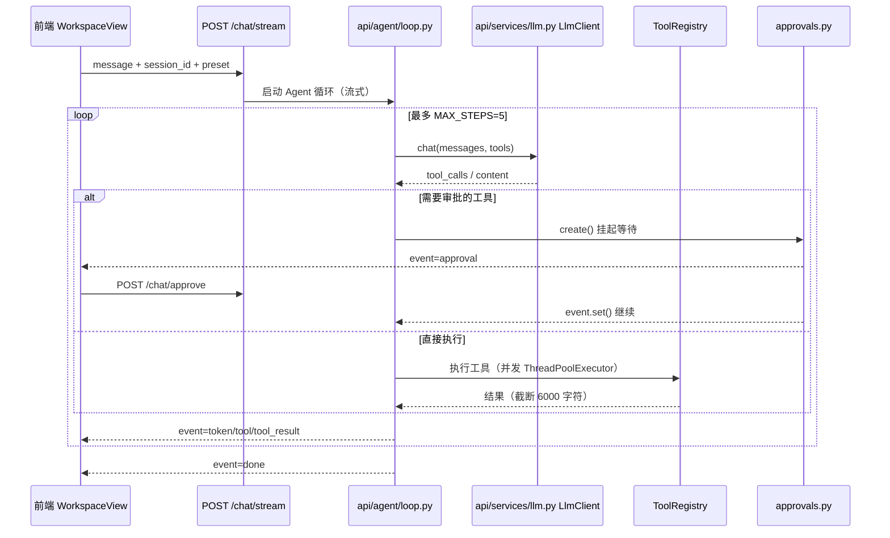

# LLM-Agent 与 MCP 设计说明

> | 元信息 | 值 |
> |---|---|
> | 状态 | ✅ 与代码一致（基于 `api/agent/`、`api/llm/`、`api/mcp/`、`api/services/llm.py` 实测，2026-11-19） |
> | 版本 | v1.0 |
> | 取代关系 | 首次建立。此前仅在《大屏平台开发设计方案》§1.2 中以「移植 llm/agent 智能研判」一句带过 |
> | 读者 | 需要扩展工具/插件/技能/MCP 的开发者；答辩时需说明 Agent 边界与安全约束的评审者 |

---

## 1. 定位与边界

平台内置一个**工具调用型 Agent**，让分析师以自然语言驱动风险研判：Agent 负责理解问题、选择工具、汇总证据；**模型负责判断与计算**。

### 1.1 硬约束（不可协商）

> **LLM 的结论仅作研判辅助，不得直接作为风险评级、预警处置或投资决策的唯一依据。**

平台中的风险评分、风险等级、预警生成与处置状态**全部来自确定性代码**（`models/predict.py`、`api/services/rules.py`、`api/services/alerts.py`），LLM 只负责：

- 调用只读/受控工具获取证据；
- 组织语言、解释归因、给出关注建议。

因此「Agent 说这家公司风险高」**不会**写进预警工单；预警只由模型评分与规则触发。

### 1.2 能力边界

| 能做 | 不能做 |
|---|---|
| 检索企业、查询评分与六维画像、读取风险事实 | 修改模型、切换 champion 模型 |
| 查询预警工单、生成处置报告 | 自行处置预警（需审批且受 `alert:handle` 权限约束） |
| 调用财务分析（杜邦、Altman Z/Z''、Piotroski、Beneish、同业对标） | 直接写业务库（表格写入需 `enterprise:manage`） |
| 触发公开数据源刷新（写操作，需授权） | 访问平台未注册的外部资源 |
| 通过 MCP 使用管理员已注册的外部工具 | 自行注册 MCP 服务（需 `system:config`） |

---

## 2. 架构



### 2.1 模块清单

| 文件 | 职责 |
|---|---|
| `api/agent/loop.py` | Agent 循环主体：消息拼装、工具执行、事件流、截断与步数上限 |
| `api/agent/tools.py` | `Tool` / `ToolRegistry` 定义与三类工具注册（内置 / 插件 / MCP） |
| `api/agent/prompt.py` | `SYSTEM_PROMPT` 与提示词拼装 |
| `api/agent/context.py` | 会话上下文与压缩 |
| `api/agent/session.py` | `Session` 数据类、`SessionStore`（SQLite 持久化）、`sanitize_tool_pairs()` |
| `api/agent/events.py` | `AgentEvent` 事件模型 |
| `api/agent/approvals.py` | 待审批工具调用的挂起/唤醒 |
| `api/services/llm.py` | `LlmClient` / `LlmConfig` / `LlmException`（含重试判定） |
| `api/llm/__init__.py` | 预热等辅助能力 |
| `api/mcp/client.py` | `McpClient`（JSON-RPC over HTTP）、`McpTool` |
| `api/mcp/service.py` | MCP 服务注册表（DB 持久化）、工具同步、测试连接 |
| `api/routers/mcp.py` | MCP 管理端点 + 把平台作为 MCP Server 对外暴露 |
| `api/routers/plugins.py` | 插件工具 CRUD、预设 CRUD、导入导出 |
| `api/routers/skills.py` | 技能 CRUD |
| `api/routers/chat.py` | 会话管理、导出、分享、流式对话、审批回调 |

---

## 3. Agent 循环

### 3.1 关键常量

| 常量 | 值 | 位置 | 作用 |
|---|---|---|---|
| `MAX_STEPS` | **5** | `api/agent/loop.py:18` | 单次会话最多 5 轮「模型 ↔ 工具」往返，防止无限循环 |
| `MAX_TOOL_RESULT_CHARS` | **6000** | `api/agent/loop.py:19` | 单个工具结果截断长度，防止超长上下文 |
| `Event` 类型 | `token` / `reasoning` / `tool` / `tool_result` / `approval` / `usage` / `compaction` / `done` / `error` | `api/agent/events.py:10` | 前端据此渲染流式输出 |

### 3.2 事件模型

```python
@dataclass
class AgentEvent:
    event: str          # 见上表
    data: dict = field(default_factory=dict)
    ts: datetime = field(default_factory=datetime.utcnow)
```

事件经 `/chat/stream` 以 SSE 下发，前端 `WorkspaceView.vue` 增量渲染。

### 3.3 工具执行

- 工具调用通过 `ThreadPoolExecutor` **并发**执行，结果按调用序归位；
- 工具返回统一为 JSON 可序列化结构；
- 结果超过 `MAX_TOOL_RESULT_CHARS` 时截断，避免上下文爆炸；
- `api/agent/session.py:sanitize_tool_pairs()` 在每次请求前整理消息序列：**丢弃孤立的 tool 消息**（有 call 无 result）、**补齐缺失的 tool 结果**（返回「工具结果缺失，请重新调用该工具获取数据」），以满足提供方对消息配对的要求。

---

## 4. 工具体系

### 4.1 工具契约

```python
@dataclass
class Tool:
    name: str            # 唯一名，≤64 字符
    description: str     # 给模型看的自然语言说明
    parameters: dict     # JSON Schema
```

注册表 `ToolRegistry` 提供 `register()`，并按 `preset` 中的 `tools` / `skills` 白名单过滤。`list_skills` 与 `load_skill` 为**始终可用**（`ALWAYS` 集合），因为它们是「加载领域方法论」的入口。

### 4.2 三类来源

| 来源 | 注册函数 | 命名 | 说明 |
|---|---|---|---|
| 内置 | `build_registry()` | 原名 | 19 个内置工具 |
| 插件 | `register_custom_tools(reg)` | `custom_<name>`（截断 64） | 来自 `api/services/plugins.py` 的已启用插件 |
| MCP | `register_mcp(reg)` | `mcp_<tool>`（前缀） | 来自已启用的外部 MCP 服务，描述前缀 `[MCP:<server_name>]` |

### 4.3 内置工具清单（19 个）

| 类别 | 工具 | 写操作 |
|---|---|:---:|
| 企业检索 | `search_enterprise`、`get_score_profile`、`list_enterprises_by_level`、`get_platform_overview` | — |
| 风险解释 | `get_risk_facts` | — |
| 预警 | `list_alerts`、`handle_alert`、`get_alert_report` | ⚠️ `handle_alert` |
| 数据 | `refresh_enterprise_data`、`resolve_stock_code`、`add_enterprise` | ⚠️ 后两者 |
| 财务 | `get_financial_analysis`、`compare_financials`、`screen_by_financial_metric` | — |
| 技能 | `list_skills`、`load_skill` | — |
| 研判 | `run_risk_analysis` | ⚠️ 耗时 10–40 秒 |

> 「写操作」列的工具在调用时会走审批流程（见 §5）。

### 4.4 预设（Preset）

预设是「一组工具 + 一组技能 + 参数」的组合，由 `api/routers/plugins.py` 管理（CRUD + 导入导出）。前端在发起对话时携带 `preset`，Agent 据此收窄工具集。

---

## 5. 审批与安全边界

### 5.1 审批流程

```
Agent 决定调用写操作工具
  → approvals.create(session_id, tool_call_id, name, args, description)
  → 生成 PendingApproval（id 10 位 hex，threading.Event 阻塞）
  → 前端收到 event=approval，展示工具名与参数
  → 用户点「同意 / 拒绝」
  → POST /chat/approve {approval_id, approved}
  → approvals.resolve() → pa.event.set() → Agent 循环继续
```

`approvals.py` 用 `threading.Lock` 保护 `_pending` 字典；`resolve()` 对同一审批只生效一次（`pa.event.is_set()` 判断），`discard()` 用于清理。

### 5.2 安全边界清单

| 边界 | 机制 | 落点 |
|---|---|---|
| 工具白名单 | preset 过滤 + `ALWAYS` 例外集 | `api/agent/tools.py:137` |
| 步数上限 | `MAX_STEPS = 5` | `api/agent/loop.py:18` |
| 结果截断 | `MAX_TOOL_RESULT_CHARS = 6000` | `api/agent/loop.py:19` |
| 写操作审批 | `PendingApproval` + `threading.Event` | `api/agent/approvals.py` |
| 权限校验 | Agent 工具调用复用 RBAC 权限点（`alert:handle`、`enterprise:manage` 等） | `api/auth/guards.py` |
| API Key 不落盘 | 只存 SHA256 摘要，明文仅签发时返回一次 | `api/auth/passwords.py::hash_token` |
| MCP 服务凭据 | `auth_header` 由管理员配置；**建议后续加密存储**（ADR-009 相关待办） | `api/mcp/service.py` |
| 会话归属 | 会话持久化在 `chat_session` 表，可按属主隔离 | `api/agent/session.py` |
| 审计 | 关键写操作经审计日志记录 | `api/audit.py` |
| 上下文合法性 | `sanitize_tool_pairs()` 保证 tool 消息配对合法 | `api/agent/session.py:46` |

### 5.3 已知风险（列入 P2）

| 风险 | 说明 | 建议 |
|---|---|---|
| MCP URL 可配置 | 管理员可配置任意 URL → 潜在 SSRF | 增加出网域名/内网地址黑名单 |
| `auth_header` 明文入库 | MCP 服务的鉴权头以明文存 DB | 用 `Fernet` 类对称加密（同上游 ZNCBZS 做法） |
| 插件可执行 | 插件工具本质是可执行逻辑 | 插件名与入参严格白名单校验 |
| 提示词注入 | 表格/附件/新闻内容可进入 prompt | 内容与指令分离，工具结果标注为「不可信数据」 |
| 全局异常回显 | 500 响应带异常类型与消息 | 生产环境改为通用文案（见《API 契约与接口参考》§1.2） |

---

## 6. LLM 客户端

### 6.1 配置

`api/services/llm.py` 的 `LlmConfig` 字段与环境变量（`config/settings.py`）：

| 配置 | 环境变量 | 说明 |
|---|---|---|
| `base_url` | `LLM_BASE_URL` | 兼容 OpenAI `/chat/completions` 的服务地址 |
| `api_key` | `LLM_API_KEY` | 鉴权密钥 |
| `model` | `LLM_MODEL` | 模型名 |
| `max_tokens` | `LLM_MAX_TOKENS` | 单次生成上限 |
| `timeout_s` | `LLM_TIMEOUT_S` | 请求超时 |
| — | `LLM_DISABLE_THINKING` | 关闭推理型模型的思考段 |

### 6.2 错误模型

```python
class LlmException(RuntimeError):
    status_code: int   # -1=网络/IO；0=响应异常；其它=HTTP 状态码
    def retryable(self) -> bool:
        return self.status_code < 0 or self.status_code in (408, 429) or self.status_code >= 500
```

即：**网络错误、408、429、5xx 可重试**；4xx（除 408/429）不可重试。

### 6.3 用量统计

`LlmClient.last_usage` 记录最近一次调用的 Token 用量，`/chat/usage` 端点按会话汇总。

---

## 7. MCP 接入

### 7.1 作为客户端（消费外部 MCP 服务）

```
POST /mcp/servers            注册（name, url, auth_header, require_approval）
POST /mcp/servers/{id}/test  连通性测试
POST /mcp/servers/{id}/sync  同步工具清单（→ mcp_server_tools 表）
```

`McpClient(url, auth_header, timeout=30.0)` 以 JSON-RPC 风格调用 `tools/list` 与 `tools/call`；同步得到的工具转为 `McpTool(name, description, input_schema)`，注册进 `ToolRegistry` 时命名为 `mcp_<tool>`。

### 7.2 作为服务端（把平台暴露为 MCP Server）

`POST /mcp` 接收 JSON-RPC 请求，用 `api/agent/tools.py::build_registry()` 提供工具目录与调用能力——使其他 Agent 或客户端可以把本平台的评分/解释能力当作工具使用。

> 注意：`/mcp` 位于 `EXEMPT` 之外，需要 `system:config` 权限。

### 7.3 `require_approval` 标志

MCP 服务可标记为「调用前需人工审批」，与内置写操作工具共用 `api/agent/approvals.py` 的审批通道。

---

## 8. 扩展开发指南

### 8.1 新增一个内置工具

1. 在 `api/agent/tools.py::build_registry()` 内定义函数并 `reg.register(Tool(name, description, parameters))`；
2. 工具入参 schema 用 JSON Schema 描述；
3. 返回值必须可 JSON 序列化，且**长度可控**（超长会被截断至 6000 字符）；
4. 若为写操作，需在调用前走审批（参考 `handle_alert`、`add_enterprise` 的实现）；
5. 若需要新权限点，同步 `api/auth/rbac.py` 与 `api/auth/guards.py`；
6. 补测试（见《测试策略与覆盖矩阵》§3）。

### 8.2 新增一个插件工具

1. 在 `/plugins/tools` 创建（`name`、`description`、`parameters`、`implementation`）；
2. 启用后由 `register_custom_tools()` 自动注册为 `custom_<name>`；
3. 通过预设（preset）把它纳入特定对话场景。

### 8.3 新增一个技能（Skill）

1. 在 `/skills` 创建，内容为该场景的**执行指令**；
2. Agent 需先调用 `list_skills` 发现，再 `load_skill` 载入完整指令后执行；
3. 技能内容长度需设上限，防止提示词膨胀。

### 8.4 新增一个 MCP 服务

1. 管理员在 `/mcp/servers` 注册并测试连通性；
2. `sync` 同步工具清单；
3. 启用后自动进入 Agent 工具集；
4. **必须**先完成 §5.3 的 SSRF 与凭据加密加固，再在对外环境启用。

---

## 9. 答辩要点（Agent 部分的常见质询）

| 质询 | 回答要点 |
|---|---|
| LLM 会不会直接给出风险结论？ | 不会。评分、等级、预警均由确定性代码产生，LLM 只负责调用工具与组织语言。 |
| 工具调用怎么防越权？ | 三层：preset 工具白名单 → RBAC 权限点 → 写操作人工审批。 |
| 会不会陷入死循环？ | `MAX_STEPS=5` 硬上限。 |
| 上下文爆掉怎么办？ | 工具结果截断 6000 字符；会话支持压缩（`compaction` 事件、`compacted_until` / `compact_count`）。 |
| 提示词注入风险？ | 已知风险，见 §5.3；当前靠「工具结果标注 + 白名单 + 审批」缓解，列入 P2。 |
| MCP 会不会成为攻击面？ | 是。SSRF 与凭据明文两项已列入 P2 加固清单。 |

---

## 10. 相关

- 《API 契约与接口参考》——`/chat`、`/mcp`、`/plugins`、`/skills`、`/attachments` 端点清单
- 《测试策略与覆盖矩阵》§3——Agent / MCP 的未覆盖区
- 《ADR-008 JWT 双令牌与四角色 RBAC》——权限点体系
- 《大屏平台开发设计方案》——Agent 能力的来源与移植标注