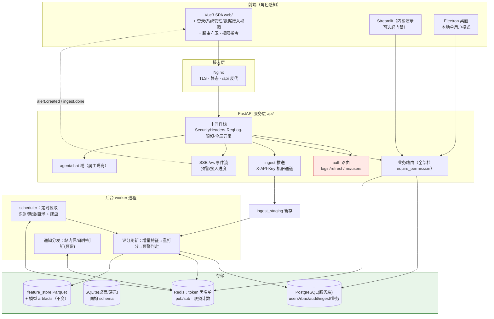

# 财务风险智能预警平台 · 优化设计方案（用户/权限/实时接入/部署/UI）

> 版本：v1.0 ｜ 日期：2026-11-17 ｜ 状态：📝 设计稿（实现已完成，待补验收记录）
> 适用项目：`financial-risk-warning-platform`（下称 **FRWP**）
> 复用来源：`risk-warning-platform`（下称 **RWP**）、`ZNCBZS`（智能财报助手）
> 核对说明（2026-11-19）：本文描述的认证、RBAC、审计、限流、SSE 三通道与 13 个路由**均已落地**；落地后的完整契约见 [《API 契约与接口参考》](./API契约与接口参考.md)，测试覆盖见 [《测试策略与覆盖矩阵》](./测试策略与覆盖矩阵.md)。

---

## 0. 摘要（TL;DR）

FRWP 已具备完整的数据→特征→模型→解释→多端展示链路（Streamlit / Vue SPA / FastAPI / Electron），但**整体仍是"单用户、无鉴权、离线批量"的科研系统形态**。本方案补齐四块生产化能力：

| 能力 | 现状 | 方案 | 主要复用来源 |
|------|------|------|-------------|
| 用户登录 | ❌ 完全没有 | JWT 双令牌（access 30min + refresh 7d）+ bcrypt + 初始管理员 | ZNCBZS `core/auth.py`、`api/routes/auth.py` |
| 权限管理 / 角色分配 | ❌ 完全没有 | RBAC 四角色（管理员/分析师/审计员/查看者）+ 权限点矩阵 + 数据范围（关注清单归属） | ZNCBZS `UserRole/PERMISSIONS/PermissionChecker`，扩展审计员角色与数据范围 |
| 数据实时接入 | ⚠️ 仅"手动单企业刷新" | 三通道：定时拉取（scheduler）+ API Key 推送（`/ingest/v1`）+ SSE/WS 事件流推给前端 | RWP `datasources/registry.py`（FRWP 已移植一半）、ZNCBZS `data_integration.py` + `scheduler.py` |
| 数据库与部署 | ⚠️ SQLite 单文件、compose 双服务无鉴权 | 业务库双形态：SQLite（桌面/演示）/ PostgreSQL（服务端，SQLAlchemy + Alembic）；compose 加 nginx/postgres/redis/worker | ZNCBZS `models/user.py`（SQLAlchemy 2.0 风格）、`docker-compose.yml` 分层思路 |

UI 侧新增 4 个视图（登录、用户管理、数据接入中心、审计日志），全站路由守卫 + 按权限过滤菜单，沿用现有 `theme.ts` 设计 token，不引入重型组件库。

实施路线 4 期约 **5~6 周**（单人），P1 认证底座先行，可独立交付。

---

## 1. 现状盘点

### 1.1 FRWP 三端与服务层现状

```
data/ → etl/ → models/(XGBoost+SHAP) → api/(FastAPI) ─┬→ web/(Vue3 SPA, 8 视图)
                    │                                  ├→ streamlit_app/(7 页)
                    └→ platform.db(SQLite, 无用户表)    └→ desktop/(Electron)
```

| 模块 | 现状 | 生产化差距 |
|------|------|-----------|
| `api/main.py` | 约 20+ 路由全部匿名开放；CORS 默认 `*`；异常统一 500 | 无认证、无审计、无速率限制、错误信息泄漏堆栈 |
| `api/db/database.py` | 裸 `sqlite3`，`platform.db`：enterprise / finance / legal_record / news / risk_fact / chat_session / chat_message … | 无 users/roles/audit 表；chat_session 无属主；所有数据全局共享 |
| `api/services/datasources.py` | 已从 RWP 移植注册表**状态部分**（东财/新浪/巨潮 三源、merge/fallback 声明、市值快照） | 实际拉取只支持"单企业手动刷新"，无定时任务、无外部推送口、无接入日志 |
| `web/src/router.ts` | 8 视图路由级懒加载，**无 beforeEach 守卫**，无登录页 | 任何知道 URL 的人可访问全部功能 |
| `web/src/api.ts` | 手写 fetch 封装，无 token 注入、无 401 处理 | 无法承载鉴权会话 |
| `streamlit_app/` | 无鉴权（`st.sidebar` 直接进） | 只适合内网演示 |
| `docker-compose.yml` | 两服务（streamlit:8501 + api:8000），卷挂载数据目录 | 无 TLS/反代、无独立数据库、无 worker 进程分离 |
| 测试 | 76 项（含 API/前端），但无认证场景 | 需补 auth/RBAC/ingest 测试面 |

### 1.2 参考项目可复用资产清单

**ZNCBZS（生产化骨架最完整，直接可移植）**

| 文件 | 内容 | 移植方式 |
|------|------|---------|
| `backend/core/auth.py` | bcrypt 密码哈希、JWT 签发/校验、access/refresh 双令牌、token 黑名单、`UserRole`、`PERMISSIONS` 矩阵、`PermissionChecker`、`require_role` | 近乎照搬，权限点改为 FRWP 业务域 |
| `backend/models/user.py` | SQLAlchemy 2.0 `Mapped` 风格 User 表（uuid 主键/唯一索引/敏感字段排除） | 照搬 + 扩展字段 |
| `backend/api/routes/auth.py` | register / login（限频 5/min）/ refresh（轮换+撤销旧令牌）/ logout / me | 照搬，register 收口为"仅管理员创建" |
| `backend/core/security.py` | Fernet 加密（敏感配置存储）、IP 白名单、`get_client_ip`、操作日志 `log_operation` | 照搬，用于 API Key 与 LLM Key 加密 |
| `backend/core/middleware.py` | GlobalExceptionHandler / RequestLogging / SecurityHeaders / BodySizeLimit | 照搬四件套 |
| `backend/core/rate_limit.py` | slowapi limiter 单例 | 照搬 |
| `backend/main.py` `_create_initial_admin` + `lifespan` | 首启从环境变量建管理员；DEBUG 关闭 docs | 照搬 |
| `backend/api/routes/data_integration.py` | 角色门禁 + BackgroundTasks 异步集成 | 参考其权限检查写法 |
| `backend/services/scheduler.py` | 任务状态机（PENDING/RUNNING/SUCCESS/FAILED/RETRYING）、`TaskExecutionLog`、失败告警、重试 | 移植为 FRWP 的接入调度器 |
| `tests/test_auth.py` | 注册/登录/越权/过期令牌测试面 | 移植改名 |

**RWP（数据接入与工作台形态最完整）**

| 文件 | 内容 | 移植方式 |
|------|------|---------|
| `server/app/datasources/registry.py` | `fetch_dimension` 降级链+多信源合并、`upsert_records` 幂等入库 | FRWP `api/services/datasources.py` 只移植了声明，**把执行/入库两半补齐** |
| `server/app/datasources/{akshare,sina,announcement}_src.py` | 三个具体数据源实现 | 直接移植为 `api/datasources/` |
| `web/src/workspace/`（DockZone/registry/store/SettingsDialog/StatusBar） | 可拖拽工作台布局 | P4 可选：系统管理不必用 dock，工作台沿用 |
| `web/src/components/SpreadsheetGrid.vue` + `lib/pivot.ts` | 表格编辑/透视 | 数据接入中心的"预览/映射"界面复用 |
| `api/share.py` share_token 模式 | 只读分享链接 | 扩展为"报告分享带过期与角色校验" |

### 1.3 差距结论

FRWP 与 RWP 同族（RWP 的能力已分阶段移植进来），**两者都没有用户体系**；ZNCBZS 有完整的认证/RBAC/审计/调度/接入骨架但没有金融预警领域模型。因此本方案的主线是：

> **以 FRWP 的领域层（模型/特征/SHAP/报告）为内核，把 ZNCBZS 的安全与调度骨架移植进 `api/`，把 RWP 的数据源执行层补全，前端在现有 Vue SPA 上加守卫与管理视图。**

---

## 2. 目标架构



关键变化（相对现状）：

1. **所有业务路由默认要求登录**，白名单仅 `/health`、`/auth/login`、`/auth/refresh`；
2. **API 版本化**：新增统一前缀 `/api/v1`（旧路径保留别名一个过渡期，桌面端不受影响）；
3. **双形态存储**：同一套 SQLAlchemy 模型，服务端跑 PostgreSQL，桌面/演示跑 SQLite（连接串由环境变量决定），沿用 FRWP "打包形态可写目录重定向" 的既有约定；
4. **worker 独立进程**：拉取/评分/通知不挤占 API 事件循环，与 Electron 内嵌单进程模式兼容（`--with-worker` 开关）。

---

## 3. 用户与权限设计

### 3.1 角色模型（RBAC + 数据范围）

在 ZNCBZS 的 admin/senior/normal 三角色基础上，按金融预警业务的**三权分立**要求调整为四角色：

| 角色 | code | 定位 | 典型用户 |
|------|------|------|---------|
| 管理员 | `admin` | 用户/角色/数据源/系统配置，**不碰业务研判** | IT 运维 |
| 分析师 | `analyst` | 模型、诊断、预警处置、报告、触发数据刷新 | 风控/研究员 |
| 审计员 | `auditor` | 只读业务 + **可看审计日志与模型留痕**，不可修改 | 合规/稽核 |
| 查看者 | `viewer` | 只读看板与诊断，导出带水印 | 管理层/外部顾问 |

**权限点矩阵**（`PERMISSIONS`，移植 ZNCBZS `core/auth.py` 结构，键改为 FRWP 业务域）：

| 权限点 | admin | analyst | auditor | viewer |
|---|:-:|:-:|:-:|:-:|
| `dashboard:view` 看板 | ✅ | ✅ | ✅ | ✅ |
| `enterprise:view` 企业档案/诊断 | ✅ | ✅ | ✅ | ✅ |
| `enterprise:manage` 自建企业/关注清单 | ✅ | ✅ | — | — |
| `predict:run` 批量打分/what-if | ✅ | ✅ | — | — |
| `alert:view` 预警列表 | ✅ | ✅ | ✅ | ✅ |
| `alert:handle` 预警处置（认领/关闭） | ✅ | ✅ | — | — |
| `explain:view` 模型解释/PSI | ✅ | ✅ | ✅ | — |
| `report:export` 报告导出 | ✅ | ✅ | ✅ | ✅(水印) |
| `chat:use` 智能工作台 | ✅ | ✅ | ✅ | — |
| `data:refresh` 触发数据拉取 | ✅ | ✅ | — | — |
| `datasource:manage` 数据源配置/Key | ✅ | — | — | — |
| `ingest:push` 机器推送（API Key） | ✅(签发) | — | — | — |
| `user:manage` / `role:assign` | ✅ | — | — | — |
| `audit:view` 审计日志 | ✅ | — | ✅ | — |
| `system:config` LLM/阈值等设置 | ✅ | — | — | — |

**数据范围（scope）叠加**：
- 全局对象（上市公司面板、模型产物）对四个角色统一可见（这是平台的核心价值）；
- 私有对象按属主隔离：`chat_session.owner_id`、`user_enterprise`（自选关注清单）、自建非上市企业（`M` 前缀合成码）仅属主与 admin 可见；
- `viewer` 导出 PDF/Excel 自动加水印（属主用户名 + 时间），与 `api/routers/share.py` 的 share_token 只读机制合并管理。

> 设计取舍：**角色固定为四个内置角色，不做自定义角色**。内置角色 + 权限点常量表已覆盖合规要求且前端可静态推导（无需每次拉权限表）；预留 `role` 字段为字符串而非枚举，未来可平滑升级到 RBAC 关联表。

### 3.2 认证流程

移植 ZNCBZS `core/auth.py` + `api/routes/auth.py`，做以下强化：

```
登录:  POST /api/v1/auth/login   （表单 username+password，限频 5/min/IP）
        └ 校验 bcrypt → 检查 is_active → 连错 5 次锁 15 min（Redis 计数，单机退化为内存）
        └ 返回 { access_token(30min), refresh_token(7d), user, permissions[] }
续期:  POST /api/v1/auth/refresh （旧 refresh 入黑名单、轮换下发新对）
登出:  POST /api/v1/auth/logout  （当前 access+refresh jti 入黑名单；服务端用 Redis，桌面用内存表）
探测:  GET  /api/v1/auth/me      （返回用户+权限点，前端启动时水合）
管理:  GET/POST/PATCH /api/v1/users  （仅 admin：创建/改角色/禁用/重置密码）
```

与 ZNCBZS 的差异点：
1. **register 不开放自助注册**（金融系统），首个管理员由环境变量 `INITIAL_ADMIN_PASSWORD` 播种（照搬 `_create_initial_admin`），其余账号 admin 创建；
2. payload 增加 `jti` 与 `pv`（password_version）——改密后 `pv+1` 使全部旧令牌立即失效，解决 ZNCBZS 注释里"内存黑名单无法按用户批量撤销"的遗留问题；
3. 密码策略：≥10 位、含大小写与数字（服务端 Pydantic 校验 + 前端强度条），bcrypt cost=12；
4. 令牌传输仍走 `Authorization: Bearer`（与桌面/Electron 兼容好）；Web 生产部署若担心 XSS，提供 `AUTH_COOKIE_MODE=1` 切 httpOnly Cookie + CSRF Double-Submit 的升级路径（P2 可选）。

### 3.3 依赖注入与路由改造

FRWP `api/` 现为函数式薄封装，改造保持轻量——只在 `api/` 下新增 auth 域，业务路由逐个挂 `Depends`：

```
api/
├── auth/                     # 🆕 移植自 ZNCBZS backend/core/auth.py 等
│   ├── jwt_utils.py          #   签发/校验/黑名单/双令牌
│   ├── rbac.py               #   UserRole + PERMISSIONS + require_permission()
│   ├── deps.py               #   get_current_user / require_permission / optional_user
│   └── router.py             #   /auth/login /refresh /logout /me + /users CRUD(admin)
├── middleware.py             # 🆕 移植 ZNCBZS core/middleware.py 四件套
├── rate_limit.py             # 🆕 slowapi limiter
└── main.py                   #   挂中间件 → include_router(auth) → 业务路由逐个加 Depends
```

示例（说明性片段，非最终实现）：

```python
@app.post("/api/v1/predict/codes")
def predict_codes(req: CodesRequest,
                  user: dict = Depends(require_permission("predict:run"))): ...

@app.get("/api/v1/audit/logs")
def audit_logs(..., user: dict = Depends(require_permission("audit:view"))): ...
```

`/health`、`/auth/*`（除 me）、`/ingest/v1/*`（改用 API Key 通道）、静态资源为匿名白名单；`/docs` 仅 `DEBUG=true` 暴露（照搬 ZNCBZS main.py 开关）。

### 3.4 审计日志

合并 ZNCBZS 两处能力（`core/security.log_operation` + `models/operation_log.py`）为一张 `audit_log`：

- **中间件自动记录**：所有非 GET 请求 + 登录/登出/令牌刷新 → `user_id, action, resource, method, path, ip, ua, status, latency_ms, detail_json, ts`；
- **业务显式埋点**：预警处置、用户创建/禁用、角色变更、数据源配置变更、报告导出（含水印开关）；
- 保留策略：默认 180 天，worker 每日清理；`auditor` 与 `admin` 可查（admin 只查不改，日志无删除接口）；
- 查询界面见 §6.5。

---

## 4. 数据库设计

### 4.1 双形态策略

| 场景 | 引擎 | 说明 |
|------|------|------|
| Web 服务端 | PostgreSQL 15 | compose 内置；连接池 SQLAlchemy |
| Electron 桌面 / 单机演示 | SQLite（WAL） | 沿用 FRWP 可写目录 `userData/data/platform.db` 重定向约定 |
| 迁移管理 | **Alembic** | `api/db/migrations/`，替代现在 `CREATE TABLE IF NOT EXISTS` 裸建 |

引入 SQLAlchemy 2.0（`Mapped` 风格，照 ZNCBZS `models/user.py` 写法）。FRWP 技术栈表本就含 SQLAlchemy，`platform.db` 裸 sqlite3 部分（alerts/chat 等）在 P2 一并 ORM 化，**同构 schema 保证两端行为一致**。

### 4.2 新增表（认证与接入域）

```sql
-- 用户（ZNCBZS models/user.py 基础上扩展 pv/lock 字段）
CREATE TABLE users (
    id              VARCHAR(36) PRIMARY KEY,          -- uuid4
    username        VARCHAR(50)  NOT NULL UNIQUE,
    email           VARCHAR(255) NOT NULL UNIQUE,
    hashed_password VARCHAR(255) NOT NULL,
    role            VARCHAR(20)  NOT NULL DEFAULT 'viewer',
    is_active       BOOLEAN      NOT NULL DEFAULT TRUE,
    password_version INT         NOT NULL DEFAULT 1,   -- 改密即+1，全端令牌失效
    failed_attempts   INT        NOT NULL DEFAULT 0,   -- 登录失败锁定
    locked_until      TIMESTAMP,
    last_login_at     TIMESTAMP,
    must_change_password BOOLEAN NOT NULL DEFAULT TRUE,
    created_at      TIMESTAMP DEFAULT now(),
    updated_at      TIMESTAMP DEFAULT now()
);

CREATE TABLE refresh_token_denylist (      -- 服务端用 Redis，此表为 SQLite 退化形态
    jti         VARCHAR(36) PRIMARY KEY,
    user_id     VARCHAR(36) NOT NULL,
    expires_at  TIMESTAMP   NOT NULL
);  -- + 索引 (expires_at) 供 worker 清理

CREATE TABLE api_keys (                    -- 机器推送通道凭证
    id           VARCHAR(36) PRIMARY KEY,
    name         VARCHAR(100) NOT NULL,    -- 如 "东财实时推送-测试"
    key_hash     VARCHAR(255) NOT NULL,    -- 只存 SHA256，明文仅签发时返回一次
    scopes       VARCHAR(200) NOT NULL,    -- "ingest:finance,ingest:news"
    created_by   VARCHAR(36) REFERENCES users(id),
    expires_at   TIMESTAMP,
    last_used_at TIMESTAMP,
    revoked      BOOLEAN DEFAULT FALSE
);

CREATE TABLE audit_log (
    id         BIGSERIAL/BIGINT PK,
    user_id    VARCHAR(36),               -- 可空：匿名/机器
    username   VARCHAR(50),
    action     VARCHAR(60)  NOT NULL,     -- login/user.create/alert.handle/export.report...
    resource   VARCHAR(200),
    method     VARCHAR(10),
    path       VARCHAR(300),
    ip         VARCHAR(45),
    ua         VARCHAR(300),
    status     SMALLINT,                  -- HTTP 码或业务结果
    latency_ms INT,
    detail_json TEXT DEFAULT '{}',
    created_at TIMESTAMP DEFAULT now()
);  -- + 索引 (created_at), (user_id), (action)

-- 数据源配置（把 datasources.py 里硬编码的注册表变为可管理配置）
CREATE TABLE data_source_config (
    id           INTEGER PRIMARY KEY,
    dimension    VARCHAR(20) NOT NULL,    -- finance/news/legal/market/macro
    source_name  VARCHAR(50) NOT NULL,    -- akshare_eastmoney/sina/cninfo/qichacha...
    enabled      BOOLEAN DEFAULT TRUE,
    priority     SMALLINT DEFAULT 0,      -- 降级链顺序
    merge_mode   VARCHAR(10) DEFAULT 'fallback', -- fallback|merge
    schedule_cron VARCHAR(50),            -- 空=不自动
    config_json  TEXT DEFAULT '{}',       -- 超时/UA/代理；密文用 Fernet 加密后的值
    updated_by   VARCHAR(36),
    updated_at   TIMESTAMP
);

CREATE TABLE ingest_log (                  -- ZNCBZS TaskExecutionLog 落库版
    id           BIGSERIAL/BIGINT PK,
    task         VARCHAR(60)  NOT NULL,   -- scheduler.pull_finance/api_push/manual_refresh
    channel      VARCHAR(10)  NOT NULL,   -- pull|push|manual
    trigger_by   VARCHAR(36),             -- user_id 或 api_key id
    dimension    VARCHAR(20),
    stock_code   VARCHAR(10),
    status       VARCHAR(12)  NOT NULL,   -- pending|running|success|failed|retrying
    inserted     INT DEFAULT 0,
    updated      INT DEFAULT 0,
    error        TEXT,
    detail_json  TEXT DEFAULT '{}',       -- 行数/sha256/来源，对齐数据治理 manifest 约定
    started_at   TIMESTAMP,
    finished_at  TIMESTAMP
);

-- 推送暂存区（对齐 FRWP "落地-暂存-契约" 三层数据治理：先落 staging 再进契约）
CREATE TABLE ingest_staging (
    id           BIGSERIAL/BIGINT PK,
    batch_id     VARCHAR(36) NOT NULL,    -- 幂等键（客户端可传 Idempotency-Key）
    dimension    VARCHAR(20) NOT NULL,
    stock_code   VARCHAR(10) NOT NULL,
    payload_json TEXT NOT NULL,
    quality_pass BOOLEAN,                  -- 校验闸门结果
    quality_msg  TEXT,
    consumed     BOOLEAN DEFAULT FALSE,   -- worker 合并进 finance/news 表后置真
    created_at   TIMESTAMP DEFAULT now()
);  -- + UNIQUE(batch_id, dimension, stock_code) 天然幂等

-- 关注清单（数据范围隔离）
CREATE TABLE user_enterprise (
    user_id    VARCHAR(36) NOT NULL REFERENCES users(id),
    stock_code VARCHAR(10) NOT NULL,
    note       TEXT DEFAULT '',
    added_at   TIMESTAMP DEFAULT now(),
    PRIMARY KEY (user_id, stock_code)
);
```

### 4.3 既有表变更

| 表 | 变更 |
|----|------|
| `chat_session` | `+ owner_id VARCHAR(36)`（回填 'system'）；列表/删除查询加属主条件 |
| `enterprise` | `+ created_by VARCHAR(36)`；`M` 前缀合成企业按 created_by 隔离 |
| `alerts`（alerts.py 自建库） | `+ assignee_id, handled_at, handle_note`（处置闭环字段并入预警中心） |
| `settings_store` | LLM API Key 等敏感项改为 Fernet 密文存储（移植 ZNCBZS `core/security.encrypt_data`），仅 admin 可读写，回显时脱敏 `sk-****` |

### 4.4 与特征/模型层的关系

模型链路不动：feature_store(Parquet) 与 `models/artifacts/` 仍是文件态。`ingest → staging → 契约表` 打通后，worker 在每日任务尾部调用现有 `etl.run_pipeline --incremental` 与 `models.predict` 预热评分缓存，即"数据接入即最新分"，不引入第二套特征口径（守住 `config/feature_registry.py` 唯一事实源）。

---

## 5. 数据实时接入设计

三条通道并存，共用"暂存→校验→合并→评分刷新→预警判定→事件推送"流水线：

### 5.1 通道 A：定时拉取（Pull）

- 移植 RWP `datasources/`（akshare_src / sina_src / announcement_src）到 `api/datasources/`，补全 FRWP `datasources.py` 缺的执行与 `upsert_records` 幂等入库两半；
- 移植 ZNCBZS `scheduler.py` 状态机（pending/running/success/failed/retrying + TaskExecutionLog + 失败告警），任务清单来自 `data_source_config.schedule_cron`；
- 预置任务：行情市值 15min、新闻/公告 1h、诉讼 1d、财务摘要 每周 + 财报季每日；宏观数据月频；
- worker 独立进程（`python -m api.worker`），生产多副本时 Redis 锁防重。

### 5.2 通道 B：外部推送（Push，机器接口）

```
POST /api/v1/ingest/{dimension}          Header: X-API-Key: *** ingest:finance）
Body: { "batch_id": "…", "items": [ {stock_code, year?, report_type?, …字段} ] }
→ 202 { batch_id, accepted, rejected: [{index, reason}] }
```

- Pydantic 严格 schema（每维度一份），字段口径对齐 `data/mapping/csmar.yaml` 契约列；
- 单位/编码在入口层归一（万元 vs 元、百分号），越权字段拒收；
- 幂等：`batch_id + (dimension, stock_code)` 唯一约束，重推安全；
- 质量闸门：复用 `scripts/validate_raw_data` 的规则（主键存在性、值域、极值缩尾预警），不合格行进 `ingest_staging.quality_pass=false`，数据接入中心可见、可导出错误明细；
- API Key 生命周期：admin 在 UI 签发（明文只展示一次）、可随时吊销、显示 last_used 与 scopes。

### 5.3 通道 C：事件流（前端实时）

- `GET /api/v1/events/stream`（SSE，主通道）+ `WS /api/v1/ws`（预留双写/心跳场景）；
- 事件类型：`alert.new / alert.upgraded / ingest.done / ingest.failed / model.drift(PSI) / score.refreshed`；
- 生产多 worker 下经 Redis pub/sub 扇出；单机（桌面）用进程内 asyncio 总线——接口一致；
- 前端 `AlertsView` 实时红点 + 全局 Toast；`DashboardView` 评分热力增量刷新。

### 5.4 接入后自动预警闭环

```
staging 合并 → 增量特征 → 模型重打分(带缓存) → 规则引擎(rules.py) ∪ 模型阈值
   → 新预警写 alerts + audit → SSE 推送 → 分析师在预警中心处置（认领/备注/关闭）
```

等级变化（如 中→高）按"升级事件"单独推送，避免全量重发。

---

## 6. UI 设计

### 6.1 设计原则

- **不引入重型组件库**：现有 8 视图为手写 CSS + `theme.ts` token（primary `#2563eb`、ok/warn/danger），管理页面延用同一 token 体系，保证视觉一致与包体积；表单/表格用量小，Element Plus 级别的依赖不值得（若后续模块膨胀再评估）；
- 角色可见性：**菜单按权限点静态过滤**（登录后 `/auth/me` 下发 permissions，Pinia store 持有，路由 `meta.permissions` 声明）；
- 明暗双主题延续现有 token 自适应。

### 6.2 信息架构（新导航）

```
┌ 侧边栏 ──────────────────┐   权限：viewer 起仅「概览/分析」两组；
│ 概览   数据看板 · 预警中心 │   analyst +模型/报告/数据刷新；
│ 分析   企业列表 · 企业诊断 │   admin +系统管理组；auditor +审计日志。
│        财务分析 · 智能工作台│
│ 模型   模型解释            │
│ 交付   报告导出            │
│ 数据   数据接入中心 🆕      │
│ 系统   用户与角色 🆕        │
│        审计日志 🆕         │
│        系统设置 🆕         │
└──────────────────────────┘
顶栏：面包屑 · 全局搜索(企业代码) · 事件铃铛(SSE) · 🆕用户头像下拉(个人信息/改密/退出)
```

### 6.3 登录页 `/login`

```
┌────────────────────────────────────────────┐
│   (左 40%) 品牌区：平台名 + 一句价值主张      │
│    动态背景：风险热力图淡化/行业雷达动效       │
│ ┌──────────(右 60% 居中卡片 420px)───────┐  │
│ │  账号登录                              │  │
│ │  [ 用户名            ]                │  │
│ │  [ 密码           👁 ]                │  │
│ │  ☑ 7 天内免登录                       │  │
│ │  [      登  录      ]  ← 禁用态+loading│  │
│ │  ⚠ 错误内联提示；5 次失败倒计时锁定     │  │
│ └────────────────────────────────────────┘  │
│   页脚：版本号 · run_id 摘要 · 备案信息       │
└────────────────────────────────────────────┘
```

细节：回车提交；`must_change_password=true` 登录后强制跳改密页；键盘可达；错误消息不区分"用户不存在/密码错"（防枚举，与 ZNCBZS 行为一致）。

### 6.4 会话与守卫（前端）

- `web/src/auth/store.ts`：tokens（内存 + localStorage 刷新恢复）、user、permissions；`hasPerm()`；
- `api.ts` 统一 fetch 封装升级为：注入 Bearer → 401 且有 refresh_token 时**单飞刷新**（并发 401 排队复用一次 refresh）→ 重试原请求 → 仍失败清会话跳 `/login?redirect=`；
- `router.beforeEach`：白名单 `{login, share}`；无 token 跳登录；`meta.permissions` 不满足跳 `/403`；
- 页面内操作按钮同样 `v-if="hasPerm('alert:handle')"` 降级为禁用+提示，前后端双保险（后端 `require_permission` 为准）。

### 6.5 新增管理视图

**用户与角色 `/admin/users`（admin）**

```
┌ 工具条: [+ 新建用户] [搜索:用户名/邮箱] [角色▾] [状态▾] ┐
│ 用户名   邮箱        角色▾(行内直改)  状态    最近登录   操作 │
│ analyst01 …        [分析师 ▾]      ●启用  11-17 09:12  ⋯  │
│   ⋯ → 重置密码 / 禁用 / 强制改密 / 查看关注清单            │
└ 抽屉: 新建/编辑用户（用户名·邮箱·角色·初始密码强度条·备注）─┘
```
规则：admin 不可禁用自己；角色变更与重置密码写审计；重置后目标用户 `pv+1` 即时踢线。

**数据接入中心 `/datasources`（admin 配置 / analyst 触发）**

```
┌ 概览卡: 最近成功/失败任务 · 各维度数据新鲜度(最新 ingest 时间) ┐
┌ 数据源表格: 维度|名称|模式(降级/合并)|计划(cron)|开关|上次结果 ┐
│  finance 东财摘要  merge  0 * * * *  ●   ✅ 312行 2min前   [▶立即拉取]│
│  news    东财公告  merge  15min     ●   ⚠ 部分失败 → 日志  [▶]│
└──────────────────────────────────────────────────────┘
┌ Tab2 接入日志(ingest_log 分页+筛选+错误详情展开)          ┐
┌ Tab3 API Key 管理(签发弹窗一次性展示明文+scopes 勾选)     ┐
┌ Tab4 推送预览(粘 JSON → SpreadsheetGrid 校验表，逐行红绿) ┐
└──────────────────────────────────────────────────────┘
```

**审计日志 `/audit`（admin/auditor）**：时间范围 + 动作/用户/IP 筛选，表格 + detail_json 展开，支持 CSV 导出（导出行为本身也写审计）。

**系统设置 `/settings`（admin）**：分组表单——模型阈值（高/中风险分位）、LLM 配置（Key 脱敏回显、测试连通按钮）、分享开关、密码策略展示。把现在散在 `settings_store` 的裸 JSON 页升级为带权限的分节卡片。

### 6.6 Streamlit 与 Electron 端

- Streamlit：作为内部演示端，提供 `st.secrets` 单口令门禁开关（`DEMO_PASSWORD` 环境变量，未设则不启用）；不做完整用户系统（避免双端重复实现，正式多用户走 Vue）。
- Electron 桌面：本地模式自动以 `local-admin` 免登录令牌启动（后端检测桌面 IPC 握手签发），保证单机体验不回退；一旦 `RISK_API_URL` 指向远程服务则强制走真实登录。

---

## 7. 开发规范优化

| 项 | 约定 |
|----|------|
| 配置 | 引入 `pydantic-settings`（照 ZNCBZS `core/config.py` 模式）收敛现在散落的 `os.getenv`；`JWT_SECRET_KEY`/`ENCRYPTION_KEY`/`INITIAL_ADMIN_PASSWORD` 无默认值、缺失即启动失败 |
| API | 全部 `/api/v1` 前缀 + OpenAPI tag 分组；旧裸路径 301 兼容一个版本周期 |
| 依赖注入 | `require_permission(perm)` 作为路由唯一鉴权入口，禁止在 handler 内手写角色判断 |
| 错误 | GlobalExceptionHandler 统一 `{code, msg, trace_id}`，500 不再回显异常类型（修掉 main.py 现状） |
| 限频 | slowapi：login 5/min、refresh 10/min、predict 60/min、ingest 按 Key 配额 |
| 测试 | 移植 ZNCBZS `tests/test_auth.py` 面：登录/锁定/过期/黑名单/越权(403)/角色矩阵逐点断言；ingest 幂等重放测试；`require_permission` 用 fixture 造 token 工厂；CI（.github 已有）加 lint+pytest+web-build 三段 |
| 代码 | ruff + mypy（api/ 优先），pre-commit |

---

## 8. 部署设计

### 8.1 生产 compose（新增 postgres/redis/worker/nginx）

```yaml
services:
  nginx:      # 443/80，TLS，静态托管 web/dist，/api → api:8000，/ 回退 index.html；限流兜底
  api:        # uvicorn --workers 2（或 gunicorn -k uvicorn.workers.UvicornWorker）
  worker:     # python -m api.worker  # scheduler + ingest 消费 + 通知 + 日志清理
  postgres:   # pg15，卷 + 每日 pg_dump 备份 sidecar
  redis:      # token 黑名单 / pubsub / 限频 / 任务锁
  # streamlit: profiles: ["demo"] —— 生产默认不启
```

环境变量模板 `.env.production.example`：`DATABASE_URL`、`REDIS_URL`、`JWT_SECRET_KEY`、`ENCRYPTION_KEY`、`INITIAL_ADMIN_PASSWORD`、`RISK_CORS_ORIGINS=<真实域名>`。

### 8.2 多形态矩阵

| 形态 | 认证 | DB | 说明 |
|------|------|----|------|
| 答辩/演示 | 单机 admin 播种 | SQLite | `docker compose up` 即用，行为与现在一致 |
| 桌面 | 本地免登录令牌 | SQLite(userData) | 打包链路（PyInstaller+nsis）不变 |
| 生产 | 完整 JWT/RBAC | PostgreSQL+Redis | nginx TLS；docs 关闭；TrustedHost 白名单 |

### 8.3 可观测与运维

- RequestLogging 中间件 → loguru 结构化 JSON；`/health` 扩展为 liveness/readiness（DB、Redis、模型 artifacts 三分项）；
- worker 失败告警复用 ZNCBZS AlertService 结构，先站内信 + 日志，预留邮件/钉钉 webhook；
- 备份：Postgres 每日 dump + feature_store/artifacts 冷备；审计日志归档导出。

---

## 9. 实施路线（P1→P4）

| 期 | 内容 | 验收 | 估时 |
|----|------|------|------|
| **P1 认证底座** | `api/auth/`（JWT+RBAC+deps）、中间件四件套+限频、users 表+种子管理员、登录页+store+路由守卫+401 单飞刷新、业务路由挂权限 | 未登录全部 401；越权 403；auth 测试面绿；演示形态一键起 | 1.5 周 |
| **P2 用户管理与审计** | /users CRUD、角色分配 UI、审计中间件+日志页、chat/enterprise 属主化、settings 收口(admin)、SQLite→Alembic | 三权分立走查通过；审计可回溯全部敏感操作 | 1 周 |
| **P3 实时接入** | datasources 执行层补全、worker+scheduler、`/ingest` 推送+API Key、SSE 事件流、数据接入中心 UI、接入→评分→预警闭环 | 外部 JSON 推送→分钟级出现在预警中心；断线重连正常 | 2 周 |
| **P4 生产化** | postgres/redis 双形态、nginx compose、锁定策略/令牌撤销 Redis 化、viewer 水印导出、Streamlit 门禁、CI 强化、性能压测 | compose 一键起生产栈；76+ 项测试扩展至 120+ 全绿 | 1 周 |

依赖关系：P1 是硬前置；P2/P3 可并行；P4 收尾。风险最大的是 P3 的评分刷新时机与既有缓存（`models/predict.py` 缓存键含数据 hash）的联动，方案是在 staging 合并后显式失效对应 run 的缓存段，而不是引入常驻热打分。

---

## 10. 复用对照速查（源 → 目标）

| 源文件 | → FRWP 目标 | 改动要点 |
|--------|------------|---------|
| ZNCBZS `backend/core/auth.py` | `api/auth/jwt_utils.py`+`rbac.py` | 权限矩阵换成 §3.1；加 jti/pv；黑名单走 Redis 抽象（内存兜底） |
| ZNCBZS `backend/models/user.py` | `api/db/models/user.py` | +password_version/locked/must_change |
| ZNCBZS `backend/api/routes/auth.py` | `api/auth/router.py` | 去自助注册；login 加锁定；refresh 轮换 |
| ZNCBZS `backend/core/security.py` | `api/security.py` | log_operation → audit_log 表写入；Fernet 用于 settings/API Key |
| ZNCBZS `backend/core/middleware.py`·`rate_limit.py` | `api/middleware.py`·`rate_limit.py` | 近照搬 |
| ZNCBZS `backend/main.py`（lifespan/初始 admin/docs 开关/TrustedHost） | `api/main.py` | 合并进现有 app 工厂 |
| ZNCBZS `backend/services/scheduler.py` | `api/worker/scheduler.py` | TaskExecutionLog → ingest_log 落库 |
| ZNCBZS `tests/test_auth.py` | `tests/test_auth.py` | 角色矩阵按 §3.1 重写 |
| RWP `server/app/datasources/registry.py` 执行/入库半 | `api/services/datasources.py` 补全 | 与 FRWP 契约表主键对齐 |
| RWP `server/app/datasources/*_src.py` | `api/datasources/*_src.py` | 近照搬 |
| RWP `web/src/components/SpreadsheetGrid.vue` | `web/src/components/` | 接入预览表 |
| FRWP `api/routers/share.py` share_token | 保留 | 加过期策略与角色校验 |

---

## 附：本方案未覆盖、建议后续立项

1. 多租户（律所/银行分支机构隔离）——users 预留 org 维度字段即可，不在本期；
2. SSO/LDAP 对接（企业内网）——auth 域已按 provider 接口分层，预留 `/auth/sso/{provider}`；
3. 模型自动重训流水线（漂移触发）——`models/monitor.py` 已有 PSI 输出，接 worker 排期为后续；
4. 移动端 H5 只读预警推送。
