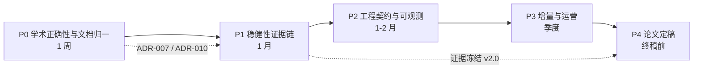

# 开发路线图与里程碑

> | 元信息 | 值 |
> |---|---|
> | 状态 | ✅ 生效 |
> | 版本 | v1.0 |
> | 日期 | 2026-11-19 |
> | 取代关系 | 承接《深度实施方案》的 14 周计划、《中期可行性分析与建议方案设计》§0.4 的中期交付清单、《平台优化设计方案》的 4 期路线；三者收敛为本文件 |
> | 关联 | 《项目诊断与开发建议书》《证据冻结清单》`adr/` |

---

## 0. 路线图总览

| 阶段 | 周期 | 主题 | 出口标准 |
|---|:---:|---|---|
| **P0** | 1 周 | 学术正确性与文档归一 | 论文每句方法学表述都能在代码中找到对应实现；全仓 md 链接 0 失效 |
| **P1** | 1 月 | 稳健性证据链 | 论文第 4 章具备「消融 + 敏感性 + 稳定性 + 锁箱声明」完整四件套 |
| **P2** | 1–2 月 | 工程契约与可观测 | 契约变更可被 CI 捕获；新增模块有测试 |
| **P3** | 季度 | 增量与运营 | 新数据接入后可自动重打分并触发预警闭环 |
| **P4** | 定稿前 | 论文定稿 | 所有数字可回溯到 run_id + 数据 SHA256 |

---

## P0 · 学术正确性与文档归一（1 周）

**目标**：消除「论文表述 ↔ 代码实现」冲突，并让文档体系恢复可信。

| # | 任务 | 交付物 | 状态 |
|---|---|---|:---:|
| P0-1 | 预处理无泄漏化方案定稿 | ADR-007 决策结论（方案 A） | ✅ |
| P0-2 | 论文表述口径统一方案 | ADR-010 决策结论 | ✅ |
| P0-3 | 文档目录改名 | `docs/desgin/` → `docs/design/`、`docs/附件/` → `docs/Attachment/` | ✅ |
| P0-4 | 全仓链接修复 | 失效链接归零 | ✅ |
| P0-5 | 文档状态治理 | 四分区索引 + 状态标记 + 维护约定 | ✅ |
| P0-6 | README 修订 | 项目树补齐 `api/` 全部子包；功能表补 9 项；12 视图校正；标注 `/predict/frame` 501 | ✅ |
| P0-7 | 工程契约文档 | API 契约 / 模型卡片 / 测试矩阵 / Agent 设计四份 | ✅ |
| P0-8 | 证据冻结清单 v1.0 | 《证据冻结清单》 | ✅ |

**验收标准**

- [x] `docs/` 下所有 Markdown 相对链接可达
- [x] `docs/README.md` 条目与实际文件一一对应，无遗漏、无幽灵条目
- [x] 同名 md 仅保留 1 份（99KB 综述底稿去重）
- [x] README / 论文 / 证据冻结清单三处指标逐项一致，**只增来源说明、不改数值**
- [x] `python scripts/build_homepage.py --check` 通过
- [x] ADR-001~010 全部成文，ADR-007/010 标为待决并给出方案

**风险预案**

| 风险 | 预案 |
|---|---|
| 目录改名破坏答辩材料内的链接 | `docs/Attachment/论文_全文.docx` 由 md 重新生成（见 P4-3），链接随之刷新 |
| `.gitignore` 规则失效导致大文件入库 | 已改为按文件粒度排除学校模板与个人材料，论文正文与 Word 版保留入库 |

---

## P1 · 稳健性证据链（1 月）

**目标**：把《中期可行性分析与建议方案设计》§0.4 要求的交付补齐，让论文 Level 3 稳健性层闭合。

| # | 任务 | 交付物 | 依赖 |
|---|---|---|---|
| P1-1 | 实施 ADR-007 方案 A | `etl/clean_financial.py` 去泄漏改造 + `tests/test_no_leakage.py` | P0-1 |
| P1-2 | 重跑全链路 | 新 `run_id`、新指标、新 SHAP 缓存 | P1-1 |
| P1-3 | 证据冻结清单 v2.0 | 《证据冻结清单》刷新 | P1-2 |
| P1-4 | 同步全部载体 | 论文第 3–4 章、README、`index.html`、报告 | P1-3 |
| P1-5 | 稳健性四件套 | ①消融表 ②标签敏感性（代理 vs 官方）③样本敏感性（全样本 vs 制造业）④SHAP 加和一致性与排名稳定性 | 复用 `scripts/ablation_study.py` |
| P1-6 | Top-K 复核容量分析 | 复核名单、精确率、lift 与成本阈值的完整呈现 | P1-2 |
| P1-7 | 2024 锁箱声明 | 独立小节，明确「不评估、不调参、不报告」 | — |
| P1-8 | 参考文献扩表 | 论文参考文献 14 → 覆盖 23 篇 + P 编号映射表 | — |
| P1-9 | 行业分组一致性 | `metrics_by_industry.csv` 进论文 | P1-2 |
| P1-10 | `config/settings.py` 修复 | `DESIGN_DIR = DOCS_DIR / "design"` | — |

**验收标准**

- [ ] ADR-007 实施后重跑，指标变化有前后对照记录
- [ ] 论文第 4 章包含消融、敏感性、稳定性、锁箱声明四类小节
- [ ] 论文参考文献覆盖综述底稿 23 篇，P 编号映射表可双向检索
- [ ] 《证据冻结清单》v2.0 与产物完全一致
- [ ] 论文、README、首页、报告四处数字一致

**风险预案**

| 风险 | 预案 |
|---|---|
| 去泄漏后指标下降超出预期 | 回到 ADR-007 §2 重评；若仍不可接受，走 X-2（改论文表述并加局限性说明），并**如实披露** |
| 验证集仅 75 正样本导致敏感性分析不稳定 | 报告置信区间而非单点值；明确说明样本量限制 |
| 2024 标签未到位 | 锁箱声明照常出具，不做任何替代性估计 |

---

## P2 · 工程契约与可观测（1–2 月）

| # | 任务 | 交付物 |
|---|---|---|
| P2-1 | OpenAPI 静态快照 | `docs/design/api/openapi.json`（导出后归档），并纳入契约 diff 检查 |
| P2-2 | 模型卡片落地 | 按《模型卡片与模型注册表规范》为当前 run_id 出卡 |
| P2-3 | 轻量模型注册表 | `candidate → shadow → champion → archived` 四态目录与元数据约定（替代 README 待办中的 MLflow） |
| P2-4 | CI 闸门增强 | ruff lint、前端 `npm run build`、`scripts/check_doc_links.py`、契约快照 diff |
| P2-5 | 测试面补齐 | 覆盖 `api/agent/`、`api/mcp/`、`api/routers/{plugins,skills,tables,attachments}.py`、`api/services/reading.py`、SSE、scheduler |
| P2-6 | 证据冻结自动校验 | `scripts/check_evidence_freeze.py` |

---

## P3 · 增量与运营（季度）

| # | 任务 | 说明 |
|---|---|---|
| P3-1 | 在线增量更新 | 复用 `/ingest/v1` X-API-Key 通道与 `api/worker/scheduler.py`，打通「接入 → 重打分 → 预警」自动闭环 |
| P3-2 | PSI 告警接入 | `models/monitor.py` 的 PSI 与性能衰减结果接入告警通道 |
| P3-3 | 服务端形态 | PostgreSQL 底座 + nginx 反代 + 独立 worker 进程（ADR-009） |
| P3-4 | 大屏深化 | 12 视图之上的大屏联动、多屏适配 |
| P3-5 | 数据补齐 | `FI_Indicators` 扣非净利润官方口径、2025 年 MD&A 文本 |

---

## P4 · 论文定稿

| # | 任务 | 说明 |
|---|---|---|
| P4-1 | 证据冻结终版 | 冻结 v3.0，锁定全部数字 |
| P4-2 | 参考文献终版 | 与综述底稿逐条对齐 |
| P4-3 | 论文终稿与 Word 版 | `pandoc` + `scripts/postprocess_docx.py` + `scripts/add_front_matter.py` |
| P4-4 | 答辩包 | 演示脚本（见《平台使用与运维手册》）、预判问题（见《开题报告_文献综述章节写作蓝图》） |

---

## 承接的四项历史待办

| 待办 | 来源 | 归属阶段 | 说明 |
|---|:---:|:---:|---|
| 2024 锁箱（等 2026 官方标签） | README 开发计划 | P1 | 外部依赖；期间严禁报告任何 2024 指标 |
| 扣非净利润官方口径核验（FI_Indicators） | README 开发计划 | P3 | 影响盈利类特征口径 |
| 2025 年 MD&A 文本 | README 开发计划 | P3 | 影响文本类特征与数字化转型维度 |
| 模型注册表（MLflow） | README 开发计划 | P2 | 由 `models/run_manifest.py` 的既有留痕能力 + 轻量四态目录替代，见《模型卡片与模型注册表规范》 |

---

## 复现清单（文档口径）

| 步骤 | 命令 | 产物 |
|---|---|---|
| 1 | `python -m scripts.sync_raw_download --write` | `data/incoming/csmar/raw/*` + manifest |
| 2 | `python -m etl.csmar_import --step all --write` | `data/raw/*.csv` |
| 3 | `python -m scripts.import_comscfi_official --write` | 官方折旧口径补丁 |
| 4 | `python -m scripts.fix_interest_debt --write` | 带息负债口径补丁 |
| 5 | `python -m scripts.validate_raw_data` + `python -m scripts.check_data_readiness` | 质量报告；BLOCK 时退出码 1 |
| 6 | `python -m etl.run_pipeline` | 面板 + 筛选证据链 |
| 7 | `python -m models.train --trials 30` | 模型产物 + `run_manifest.json` |
| 8 | `python -m models.evaluate` | `evaluation_report.md` + 校准/分群 CSV |
| 9 | `python -m models.shap_analysis` | SHAP 缓存（`--check` 校验版本） |
| 10 | `python -m models.monitor` | `monitor_report.json` + PSI 明细 |
| 11 | `python scripts/build_homepage.py` | 首页数据块注入 |
| 12 | `python -m pytest -q` | 单元测试 |
| 13 | `python scripts/generate_thesis_docx`（三段 pandoc 流水线） | `docs/Attachment/论文_全文.docx` |

---

## 相关

- 《项目诊断与开发建议书》——问题清单 P-01~P-11 与路线图总览
- 《证据冻结清单》——各阶段的数字真源
- `adr/`——架构决策记录
- 《API 契约与接口参考》《模型卡片与模型注册表规范》《测试策略与覆盖矩阵》《LLM-Agent 与 MCP 设计说明》
