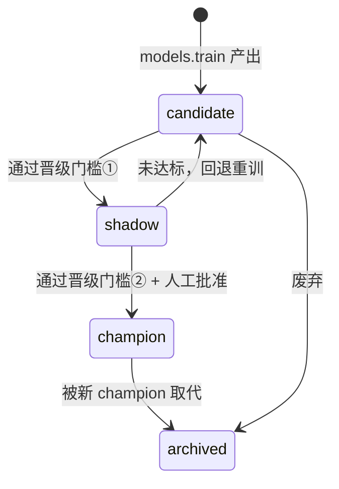

# 模型卡片与模型注册表规范

> | 元信息 | 值 |
> |---|---|
> | 状态 | ✅ 规范生效（当前模型卡片已按本模板出卡） |
> | 版本 | v1.0 |
> | 日期 | 2026-11-19 |
> | 取代关系 | 首次建立。承接 README 开发计划中的「模型注册表（MLflow）」待办，给出**轻量替代路径** |
> | 关联 | 《证据冻结清单》《训练评估口径与模型选择》《ADR-010》 |

---

## 1. 背景与目标

README 开发计划把「模型注册表（MLflow）」列为待办。但引入 MLflow 意味着新增一套服务、依赖与运维负担，与本项目「单机可交付、离线可运行」的定位不符。

实际上，**注册表所需的关键能力已经存在**：`models/run_manifest.py` 每次训练都会产出

```json
{
  "run_id": "...", "run_type": "train", "created_at": "...",
  "git": {...}, "dataset": {...}, "features": {...}, "params": {...},
  "threshold": {...}, "metrics": {...}, "environment": {...},
  "model_path": "...", "calibrator_path": "...", "lockbox_year": 2024,
  "selection": {...}, "comparison_file": "..."
}
```

配合 `models/artifacts/runs/<run_id>/` 快照目录与 `run_history.jsonl`，已具备「模型版本 + 血缘 + 指标」的完整留痕能力。**缺的只是编排层**：晋级状态、卡片、晋级门槛。

本规范因此定义三件事：**模型卡片模板**、**注册表目录与四态流转**、**晋级门槛**。

---

## 2. 模型卡片模板

> 每张卡片对应一个 `run_id`，存放在 `models/artifacts/runs/<run_id>/model_card.md`。

### 2.1 字段清单

| 字段 | 必填 | 说明 | 取值来源 |
|---|:---:|---|---|
| 模型标识 | ✅ | `run_id`、模型类型、算法、版本 | `run_manifest.json` |
| 用途 | ✅ | 一句话说明模型解决什么问题 | 人工 |
| 适用域 | ✅ | 行业、年份区间、样本规模、标签口径 | `run_manifest.json` → `dataset` |
| 训练数据 | ✅ | 数据 SHA256、面板来源、清洗与筛选口径 | `dataset` |
| 切分与验证 | ✅ | 训练/验证/测试年份与规模、CV 协议 | `models/data.py` |
| 特征 | ✅ | 入模特征数、来源注册表、筛选证据链路径 | `features` |
| 性能指标 | ✅ | 验证集与测试集全指标 + 主指标标注 | `metrics` |
| 校准与阈值 | ✅ | 校准方法、拟合范围、阈值策略与取值 | `calibration` / `threshold` |
| 已知限制 | ✅ | 必须显式列出（含未决事项） | 人工 + ADR |
| 禁用场景 | ✅ | 明确不可用于何处 | 人工 |
| 伦理与合规 | ✅ | 用途声明、不构成投资建议、数据合规 | 人工 |
| 失效条件 | ✅ | 漂移阈值、年度重训触发条件 | `models/monitor.py` |
| 血缘 | ✅ | Git 提交、数据指纹、依赖产物路径 | `git` / `dataset` |

### 2.2 当前模型卡片（`run_id=20261114-213525-da08d92c`）

| 字段 | 值 |
|---|---|
| 模型标识 | `20261114-213525-da08d92c` / XGBoost（Optuna 调优）/ `xgboost_final.json` |
| 用途 | 对沪深 A 股制造业上市公司给出未来 1 年的 ST 风险评分、归因与预警名单 |
| 适用域 | 证监会 C 类制造业；2015–2023；面板 22,814 行 / 3,629 家；标签为官方 ST（CSMAR `SPT_Trdchg`） |
| 训练数据 | `data_sha256=da08d92c…bfb55a`；`git_commit=b153213` |
| 切分与验证 | 训练 2015–2021（16,233/712）→ 验证 2022（3,209/75）→ 测试 2023（3,372/127）→ 2024 锁箱；CV = `year_grouped_expanding`（5 折） |
| 特征 | 36 维（由 80 维候选经 IV → 相关性/VIF → PSI → RF 重要性四步筛选）；证据链 `data/feature_store/feature_selection_report.csv` |
| 性能指标 | **测试 2023**：AUC 0.8962 / PR-AUC 0.3986 / KS 0.6609 / Recall@Top10% 0.6693 / ECE 0.0126<br>**验证 2022**：AUC 0.9196 / PR-AUC 0.4116 / KS 0.7004 / ECE 0.0032 |
| 校准与阈值 | 等渗回归（验证集全量拟合，`n_fit=3209`，`positive_fit=75`）；阈值 0.0525（成本法，`cost_fn=10`、`cost_fp=1`） |
| 已知限制 | ① 正样本率仅 3.93%，验证集 75 个正样本，指标方差大；② **预处理三处统计量在全样本上估计，与论文「按训练窗口估计」的表述冲突（ADR-007 未决）**；③ 样本为证监会 C 类制造业，非制造业结论不可外推；④ 2024 锁箱未解锁，模型真实外推能力未经验证；⑤ 消融表使用校准前原始输出，与本卡片指标口径不同 |
| 禁用场景 | ① 不可用于非制造业或含金融/地产/综合行业的样本；② 不可用于 2015 年前或 2023 年后年份而未经重新校验；③ 不可作为投资建议、信用评级或处置的唯一依据；④ 不可将 SHAP 归因解读为因果关系 |
| 伦理与合规 | 输出为风险提示与线索排序，**不构成投资建议或信用评级意见**；财务数据来自 CSMAR，文本来自巨潮资讯网公开披露；模型仅使用公开可得信息，不含个人数据 |
| 失效条件 | PSI > 0.25 触发重训评估；AUC 相对基线下降 > 10% 触发重训；每新增一个完整年度必须重跑并重新出具卡片；数据源口径变更（如折旧、带息负债）后必须重训 |
| 血缘 | Git `b153213`；模型 `models/artifacts/xgboost_final.json`；校准器 `models/artifacts/calibrator.pkl`；指标 `models/artifacts/evaluation_metrics.json`；快照 `models/artifacts/runs/20261114-213525-da08d92c/` |

---

## 3. 注册表规范

### 3.1 目录结构

```
models/artifacts/
├── registry/
│   ├── index.json              # 注册表总索引（所有 run 的元信息摘要）
│   ├── champion/               # 当前线上生效的模型（软链或副本）
│   │   ├── model_card.md
│   │   └── manifest_ref.json
│   ├── shadow/                 # 已通过回测、待观察的候选
│   ├── candidate/              # 新训练产出、尚未评估
│   └── archived/               # 历史归档（保留快照，不删）
├── runs/<run_id>/              # 每次运行的完整快照（已存在）
└── run_history.jsonl           # 追加式运行流水（已存在）
```

### 3.2 四态流转



| 状态 | 含义 | 进入条件 | 可否被平台加载 |
|---|---|---|:---:|
| `candidate` | 新训练产出，未评估 | `models.train` 成功后自动归档 | ❌ |
| `shadow` | 已通过离线评估，进入观察期 | 门槛① | ❌（仅旁路计算） |
| `champion` | 线上生效 | 门槛② + 人工批准 | ✅ |
| `archived` | 历史留存 | 被取代或废弃 | ❌ |

### 3.3 晋级门槛

**门槛①（自动，`candidate → shadow`）**

| 检查项 | 判据 |
|---|---|
| 产物完整 | `xgboost_final.json`、`calibrator.pkl`、`metrics.json`、`run_manifest.json` 均存在且可解析 |
| 数据指纹一致 | `run_manifest.dataset` 的 SHA256 与当前面板一致 |
| 切分正确 | 训练/验证/测试年份严格递增且无重叠；测试集样本数 > 0 |
| 主指标达标 | 测试集 PR-AUC ≥ 0.20（合格线）、Recall@Top10% ≥ 0.50、ECE ≤ 0.05 |
| 校准有效 | `calibration.fallback_reason` 为空 |
| 稳定性 | `python -m models.shap_analysis --check` 通过（解释与模型同版本） |

**门槛②（人工，`shadow → champion`）**

1. 观察期内无 PSI 告警；
2. 与当前 champion 的五模型对比表已复核；
3. 《证据冻结清单》已更新；
4. 变更理由与影响面已记录（ADR 或变更说明）。

### 3.4 `index.json` 结构

```json
{
  "updated_at": "2026-11-19T00:00:00",
  "champion": {
    "run_id": "20261114-213525-da08d92c",
    "model": "xgboost_final.json",
    "data_sha256": "da08d92c...",
    "git_commit": "b153213",
    "metrics": {"auc": 0.8962, "pr_auc": 0.3986, "ks": 0.6609, "recall_top10": 0.6693, "ece": 0.0126},
    "promoted_at": "2026-11-14",
    "model_card": "models/artifacts/runs/20261114-213525-da08d92c/model_card.md"
  },
  "candidates": [],
  "shadow": [],
  "archived": []
}
```

---

## 4. 与 MLflow 的关系

| 维度 | 本规范（轻量注册表） | MLflow |
|---|---|---|
| 部署成本 | 零（纯文件系统） | 需 Tracking Server + DB |
| 离线交付 | ✅ 完全支持 | ❌ 需服务 |
| 模型版本与血缘 | ✅ `run_manifest.json` + 快照目录 | ✅ 更完善 |
| 参数/指标对比 UI | ⚠️ 依赖 `model_comparison.csv` | ✅ 内置 |
| 晋级流程 | ✅ 四态 + 门槛（本规范定义） | ⚠️ 需自行实现 |
| 适用本项目 | ✅ **推荐** | 过度设计 |

**结论**：以本规范替代 README 待办中的 MLflow。若未来需要多人协作与 UI 对比，再评估迁移。

---

## 5. 相关

- 《证据冻结清单》——卡片中所有数字的出处
- 《训练评估口径与模型选择》——选型规则与指标口径
- 《ADR-006 主模型设定优先》——`selection.rule` 的语义
- 《ADR-010 论文表述与代码实现的口径统一》——`scripts/check_evidence_freeze.py` 的依据
- `models/run_manifest.py`——注册表的底层留痕实现